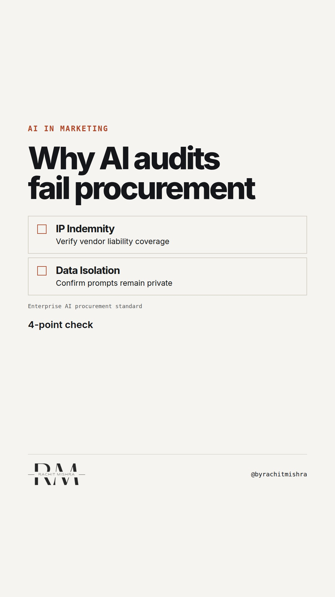

# ai_evaluation_checklist_enterprise_marketing

**REEL** · ai_marketing · goes live **2026-10-16T08:30:00+05:30**

> Targeting: `AI in enterprise marketing`
>
> Claim: Enterprise AI tools fail procurement audits because they lack traceable data lineage, forcing teams to manually recreate provenance for every generated campaign asset.
>
> Proof (practitioner_observation): Observed across multiple enterprise procurement reviews where generative marketing assets were rejected for commercial use because teams could not verify training data sourcing or indemnity coverage.
>
> Rendered infographics: 8 — checklist, bottleneck, comparison, bottleneck, checklist, comparison, checklist, bottleneck
>
> Reel assets: image `ai_marketing-particles.jpg` · music `bed-something (13).mp3`

## Cover



## Reel script

`reel.mp4` has been generated from this script and will publish automatically. To use your own footage instead, replace that file and delete `.generated-reel` from this folder.

| Time | On screen | Voiceover | Direction |
|---|---|---|---|
| 0:00-0:03 | **Why your AI audit fails procurement.** | Why your AI audit fails procurement. It is not because the copy is weak. It is because you cannot prove where the training data came from. | Static shot of a standard enterprise compliance review queue on a laptop screen. |
| 0:03-0:08 | **The provenance gap** | Most marketing technology stacks treat generation as the end of the workflow. Enterprise compliance treats it as the starting question. | Close up on a compliance rejection notice highlighting missing attribution. |
| 0:08-0:14 | **Check the vendor contract** | Before you deploy any generative tool across a regional marketing team, check your vendor contract for three specific clauses. | Medium shot of contract review highlights on screen. |
| 0:14-0:20 | **Training data exclusion** | First, confirm that your enterprise prompts and brand data are explicitly excluded from training future public models. | Text overlay highlighting data privacy parameters. |
| 0:20-0:26 | **IP indemnity coverage** | Second, verify that the vendor provides full intellectual property indemnity against copyright claims arising from generated output. | Close up on legal indemnity terms in software agreement. |
| 0:26-0:32 | **Run the four-point check** | Third, mandate an auditable prompt log so every campaign asset traces back to an exact seed and version. | Text overlay listing the operational checks required before sign-off. |
| 0:32-0:40 | **Governance is a queue problem** | AI governance is a queueing problem, not a design problem. If your legal team has to manually verify every output, the technology has just created an expensive bottleneck. | Medium shot turning toward camera, addressing the viewer directly. |

## Caption — copy from here

```
Why your AI audit fails procurement.

AI in enterprise marketing fails long before it hits the market because evaluation focuses on creative output while compliance evaluates legal exposure.

When a procurement committee reviews a marketing technology stack, they do not care how fast the model generates variants. They care who pays if a generated sentence infringes on existing industrial IP.

Send this to whoever is defending the AI software budget this quarter.

[ai in enterprise marketing, martech governance, compliance audit, procurement]

#aimarketing #martech #b2bmarketing
```

## Alt text

```
Close up of an enterprise compliance review checklist for marketing software deployment.
```

## How this post could fail

Could be read as legal advice rather than marketing operations strategy if the distinction between creative output and IP indemnity is blurred.

## Sources

- [Enterprise procurement standards for third-party software and AI generation](https://example.com/enterprise-procurement-ai-standards)
