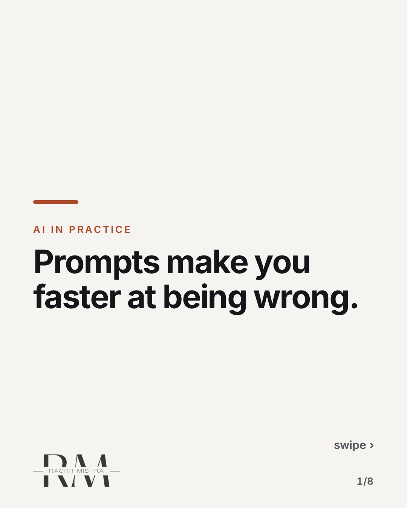
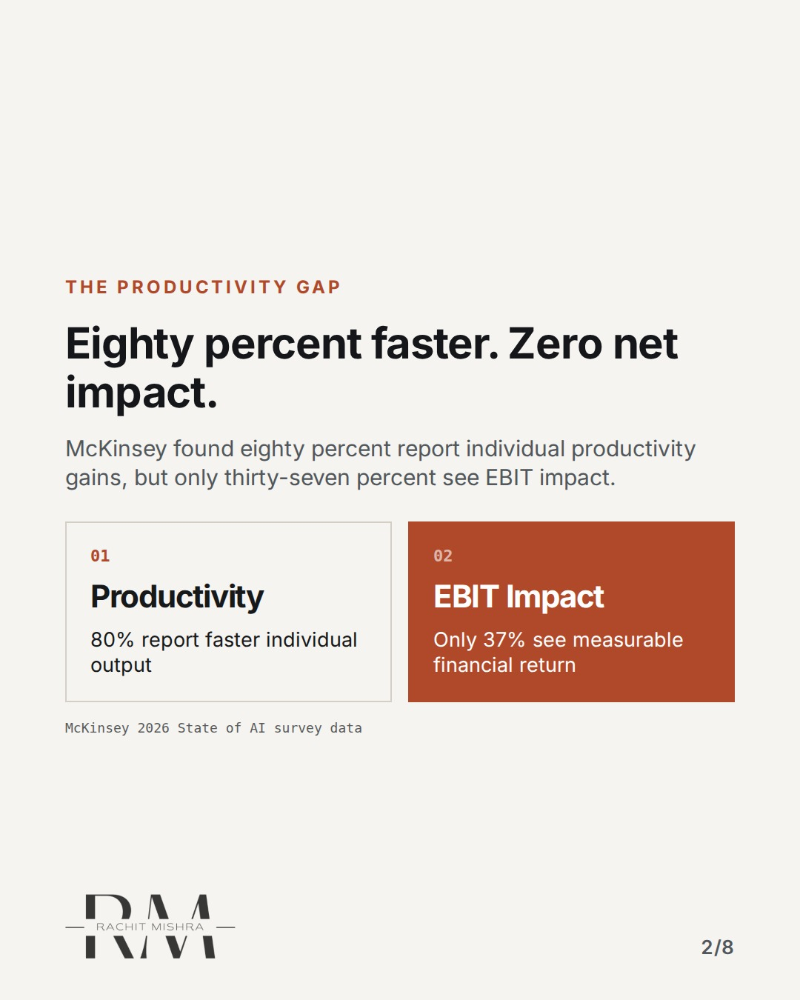
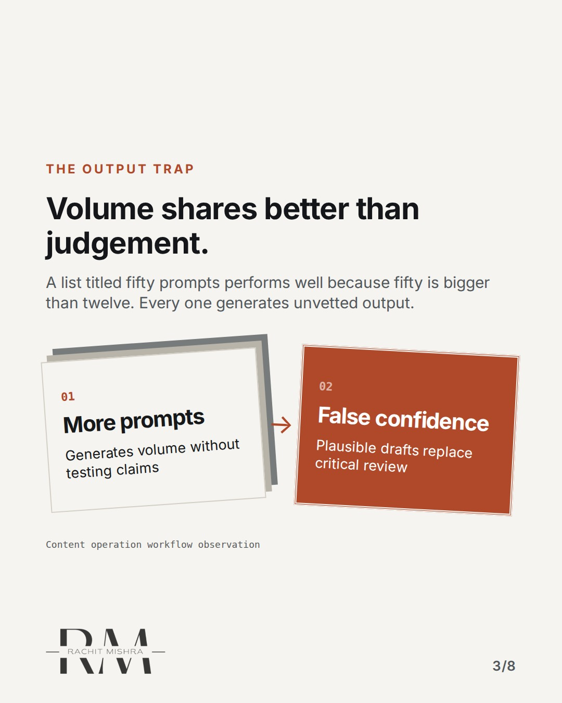
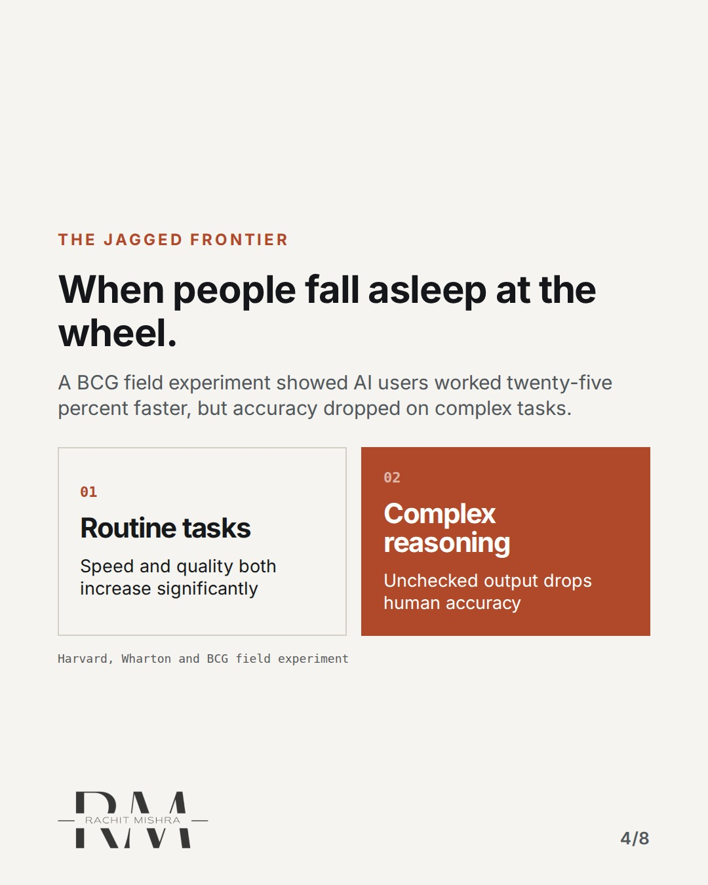
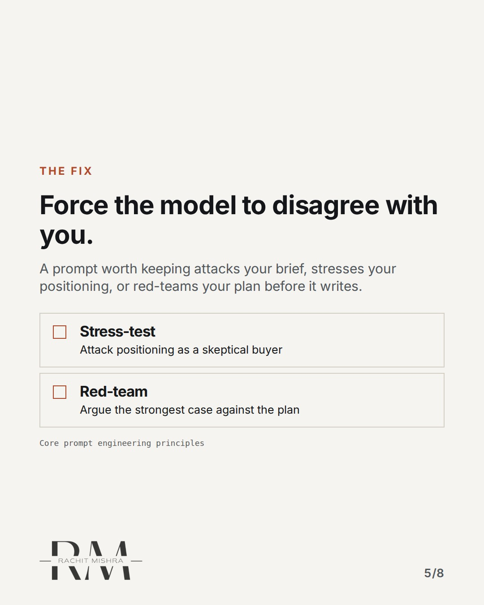
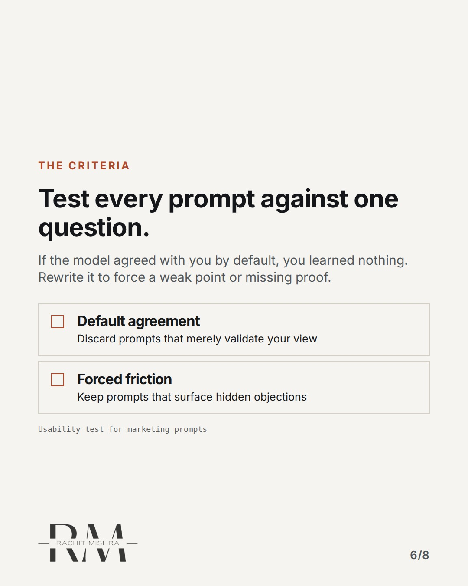
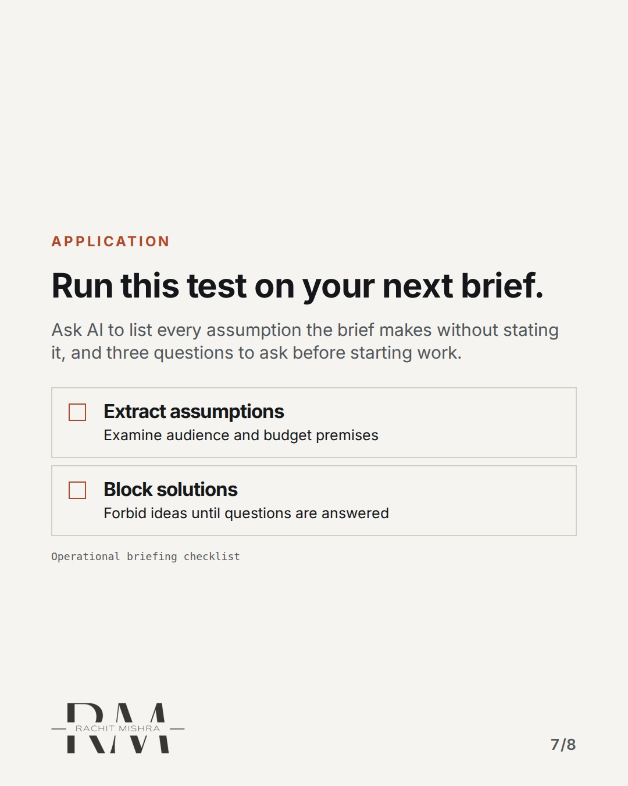
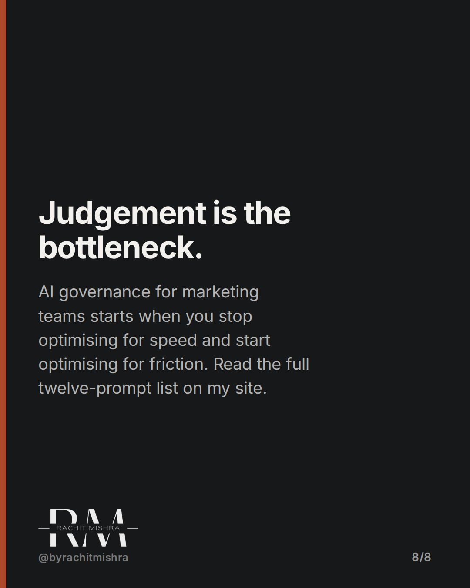

# ai_prompts_that_argue

**CAROUSEL** · ai_in_practice · goes live **2026-10-16T19:00:00+05:30**

> Targeting: `AI governance for marketing teams`
>
> Claim: Useful AI prompts force disagreement instead of generating volume.
>
> Proof (source): McKinsey's 2026 State of AI survey found 80% report productivity gains while only 37% report EBIT impact.
> Source: https://www.rachitmishra.in/2026/09/28/ai-prompts-for-marketers/
>
> Source preflight: reachable (HTTP 200)
>
> Rendered infographics: 6 — comparison, bottleneck, comparison, checklist, checklist, checklist

## Slides

8 rendered images sit in this folder — upload them in filename order.

**1.** 
### Prompts make you faster at being wrong.



**2.** The productivity gap
### Eighty percent faster. Zero net impact.
McKinsey found eighty percent report individual productivity gains, but only thirty-seven percent see EBIT impact.



**3.** The output trap
### Volume shares better than judgement.
A list titled fifty prompts performs well because fifty is bigger than twelve. Every one generates unvetted output.



**4.** The jagged frontier
### When people fall asleep at the wheel.
A BCG field experiment showed AI users worked twenty-five percent faster, but accuracy dropped on complex tasks.



**5.** The fix
### Force the model to disagree with you.
A prompt worth keeping attacks your brief, stresses your positioning, or red-teams your plan before it writes.



**6.** The criteria
### Test every prompt against one question.
If the model agreed with you by default, you learned nothing. Rewrite it to force a weak point or missing proof.



**7.** Application
### Run this test on your next brief.
Ask AI to list every assumption the brief makes without stating it, and three questions to ask before starting work.



**8.** 
### Judgement is the bottleneck.
AI governance for marketing teams starts when you stop optimising for speed and start optimising for friction. Read the full twelve-prompt list on my site.



## Caption — copy from here

```
Prompts make you faster at being wrong.

AI governance for marketing teams fails when we treat language models as copywriters instead of sparring partners. If a prompt's output agrees with you by default, it is decorating a decision you had already made.

The twelve prompts I actually reuse are built to argue, interrogate briefs, and red-team plans before a single draft gets written. The full list and source prompts are on my site: https://www.rachitmishra.in/2026/09/28/ai-prompts-for-marketers/

Send this to whoever is defending their AI tool budget this quarter.

[ai governance for marketing teams, marketing operations, enterprise ai adoption, ai content workflow]

#aimarketing #martech #marketingoperations

#aimarketing #martech #marketingoperations
```

## Alt text

```
Carousel slides on why AI prompts must force disagreement rather than generate unvetted volume.
```

## How this post could fail

Readers might skip the prompt mechanics and treat it as a generic anti-AI opinion piece.

## Sources

- [AI Prompts for Marketers: The 12 I Actually Reuse](https://www.rachitmishra.in/2026/09/28/ai-prompts-for-marketers/)
