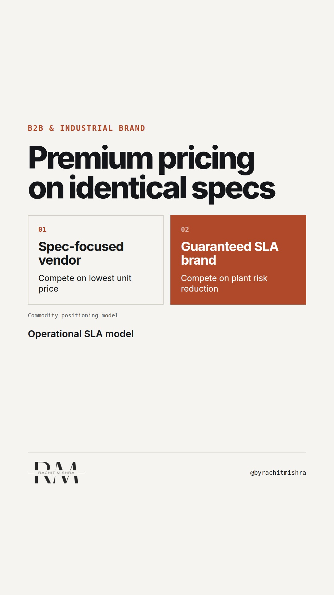

# brandingcommodityproducts

**REEL** · b2b_brand · goes live **2026-10-12T08:30:00+05:30**

> Targeting: `how to brand a commodity product`
>
> Claim: Commodity products secure premium pricing by branding operational SLA guarantees rather than product specifications.
>
> Proof (framework): A commercial positioning framework replacing standard specification claims with operational guarantees (vendor-managed inventory, automated delay penalties, and batch traceability) to shift procurement focus from unit price to plant outage risk.
>
> Rendered infographics: 4 — comparison, comparison, checklist, checklist
>
> Reel assets: image `b2b_brand-steel-grid.png` · music `bed-something (1).mp3`

## Cover



## Reel script

`reel.mp4` has been generated from this script and will publish automatically. To use your own footage instead, replace that file and delete `.generated-reel` from this folder.

| Time | On screen | Voiceover | Direction |
|---|---|---|---|
| 0:00-0:04 | **Spec sheets do not command a premium.** | Spec sheets do not command a premium. When two chemical or raw material suppliers offer identical purity, procurement buys on price unless you brand the delivery contract. | Clean dark background with split graphical contrast between spec matrix and commercial agreement. |
| 0:04-0:12 | **Procurement prices risk, not product.** | Procurement committees do not buy product features. They buy risk mitigation for plant operations. | Visual comparison graphic showing spec parity versus SLA contrast. |
| 0:12-0:20 | **Brand the terms, not the molecule.** | If you want to understand how to brand a commodity product, stop trying to make steel, resin, or freight sound emotional. Brand the service level agreement. | Text overlay with supply chain delivery workflow. |
| 0:20-0:32 | **Three commercial terms that build margin.** | There are three specific terms that turn an interchangeable supplier into an essential operational partner. | Onscreen checklist graphic highlighting three operational guarantees. |
| 0:32-0:42 | **Quantify plant downtime cost.** | When your brand promises zero unbudgeted downtime, a procurement buyer can defend paying twelve percent more to their committee. | Visual showing line downtime costs vs unit price delta. |
| 0:42-0:52 | **Audit your sales presentations.** | Check your commercial deck. If slide three is still listing product parameters instead of operational guarantees, you are positioning as an interchangeable vendor. | Interactive slide checklist visual. |
| 0:52-0:58 | **Brand is an operational guarantee.** | Brand is an operational guarantee. When the product is standard, the commercial contract is your brand. | Closing screen with bold principal summary. |

## Caption — copy from here

```
Spec sheets do not command a premium.

Learning how to brand a commodity product requires shifting from product specifications to operational guarantees.

In industrial markets, every technical specification eventually converges. When your chemical, steel, or logistics offering meets standard engineering benchmarks, procurement treats you as interchangeable.

The mistake marketing teams make is trying to build an emotional narrative around a standard specification. A plant manager does not care about brand fluff during a supply disruption. They care about line downtime.

The real margin sits in commercial architecture. When you guarantee vendor-managed inventory, automatic delay rebates, and sub-hour batch certification, you convert unit price discussions into plant risk calculations.

Commodity branding is contract design.

Send this to a commercial leader preparing for next quarter's contract renewals.

[b2b branding, how to brand a commodity product, industrial marketing, brand architecture, manufacturing marketing]

#b2bbranding #industrialmarketing #b2bmarketing
```

## Alt text

```
Visual framework showing how to brand a commodity product using operational guarantees and SLAs.
```

## How this post could fail

The audience might assume this advice only applies to heavily standardized bulk raw materials, missing its direct application to enterprise software SLAs and contract logistics.
