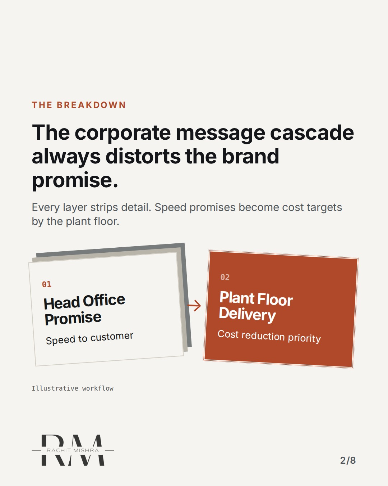
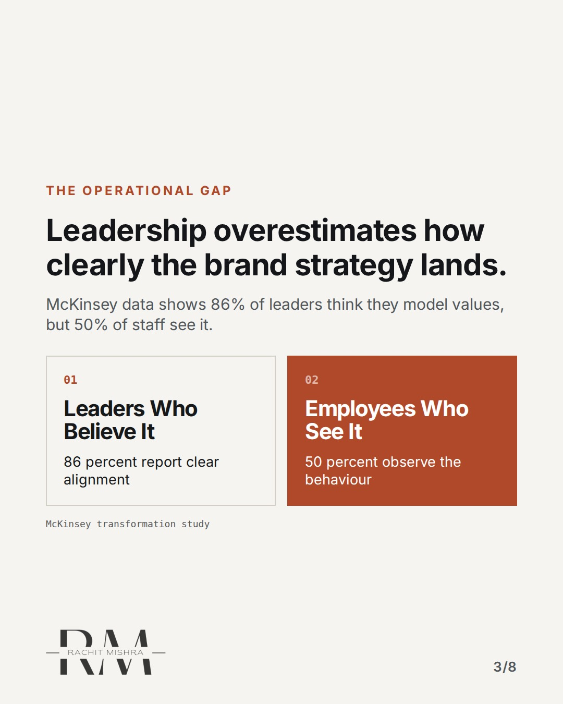
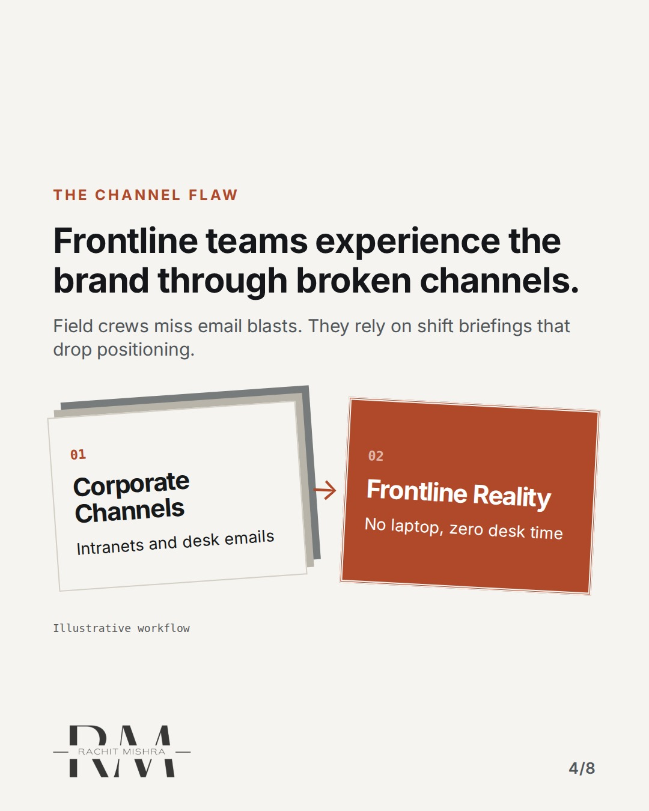
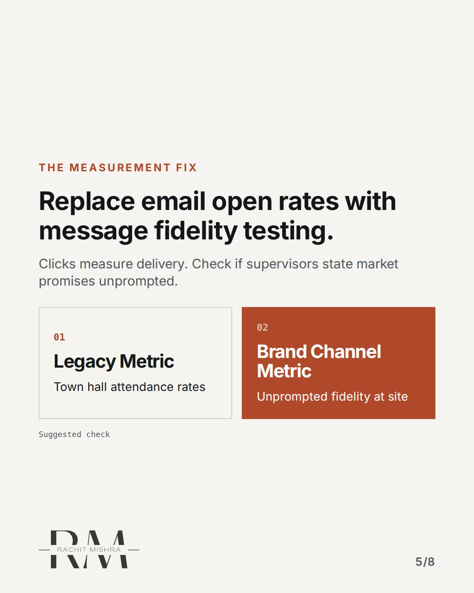
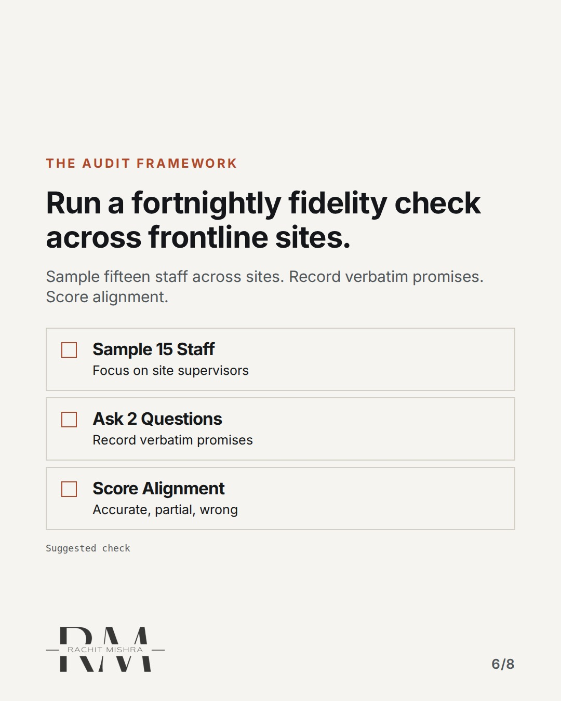
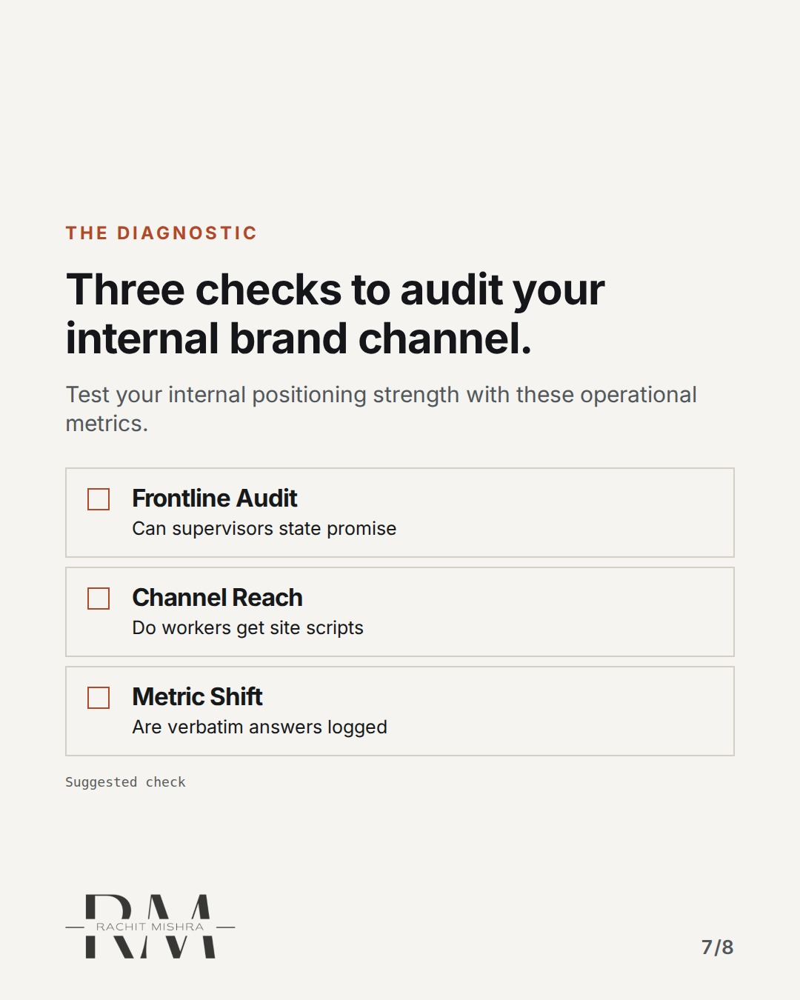
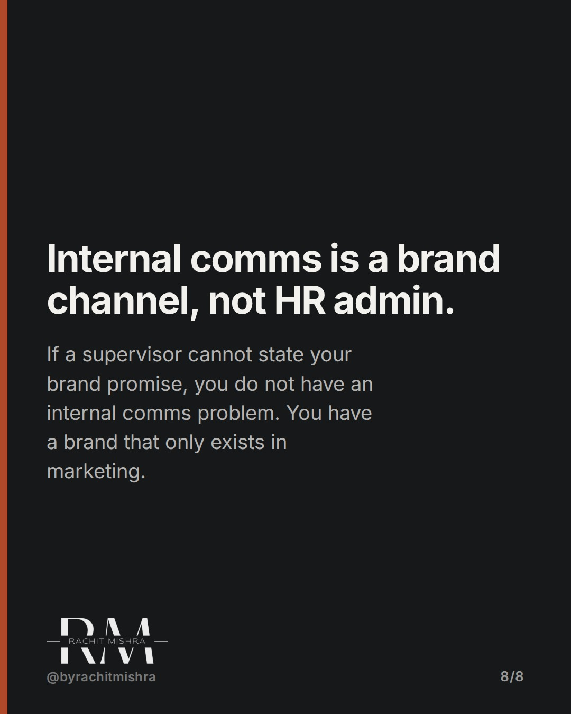

# internalcommbrandchannel

**CAROUSEL** · b2b_brand · goes live **2026-10-12T19:00:00+05:30**

> Targeting: `B2B brand positioning`
>
> Claim: Internal communication failure degrades B2B brand positioning because managers translate brand promises into internal cost targets.
>
> Proof (source): McKinsey research on organizational transformations found senior leaders were 86% likely to say they role model desired behaviours while only 50% of employees agreed.
> Source: https://www.rachitmishra.in/2026/09/30/internal-communication-strategy/
>
> Source preflight: reachable (HTTP 200)
>
> Rendered infographics: 6 — bottleneck, comparison, bottleneck, comparison, checklist, checklist

## Slides

8 rendered images sit in this folder — upload them in filename order.

**1.** 
### Your brand is changing at every manager's desk.


**2.** The breakdown
### The corporate message cascade always distorts the brand promise.
Every layer strips detail. Speed promises become cost targets by the plant floor.



**3.** The operational gap
### Leadership overestimates how clearly the brand strategy lands.
McKinsey data shows 86% of leaders think they model values, but 50% of staff see it.



**4.** The channel flaw
### Frontline teams experience the brand through broken channels.
Field crews miss email blasts. They rely on shift briefings that drop positioning.



**5.** The measurement fix
### Replace email open rates with message fidelity testing.
Clicks measure delivery. Check if supervisors state market promises unprompted.



**6.** The audit framework
### Run a fortnightly fidelity check across frontline sites.
Sample fifteen staff across sites. Record verbatim promises. Score alignment.



**7.** The diagnostic
### Three checks to audit your internal brand channel.
Test your internal positioning strength with these operational metrics.



**8.** 
### Internal comms is a brand channel, not HR admin.
If a supervisor cannot state your brand promise, you do not have an internal comms problem. You have a brand that only exists in marketing.



## Caption — copy from here

```
Your brand is changing at every manager's desk.

Maintaining B2B brand positioning is fundamentally an operational alignment challenge. When head office launches a new brand strategy, every management layer translates that promise through their own operational targets.

By the time a positioning promise about delivery speed reaches a plant shift briefing, it frequently becomes an instruction about cost reduction. Nobody lied. Each manager simply translated the corporate message into local incentives.

Tracking open rates on executive newsletters tells you nothing about brand consistency. The real test is message fidelity: whether a frontline site supervisor can state your customer promise in their own words without prompting.

Internal communication belongs with whoever owns the brand promise.

The full analysis is on my site: https://www.rachitmishra.in/2026/09/30/internal-communication-strategy/

Send this to whoever is responsible for brand governance across multi-site operations.

[b2b brand positioning, b2b branding, industrial marketing, brand architecture, manufacturing marketing]

#b2bbranding #industrialmarketing #brandstrategy

#b2bbranding #industrialmarketing #brandstrategy
```

## Alt text

```
Carousel slides on internal communications and B2B brand positioning.
```

## How this post could fail

It could be misread as general HR advice if the distinction between brand message fidelity and internal employee engagement is not kept explicit.

## Sources

- [Internal Communication Strategy Is a Brand Channel](https://www.rachitmishra.in/2026/09/30/internal-communication-strategy/)
