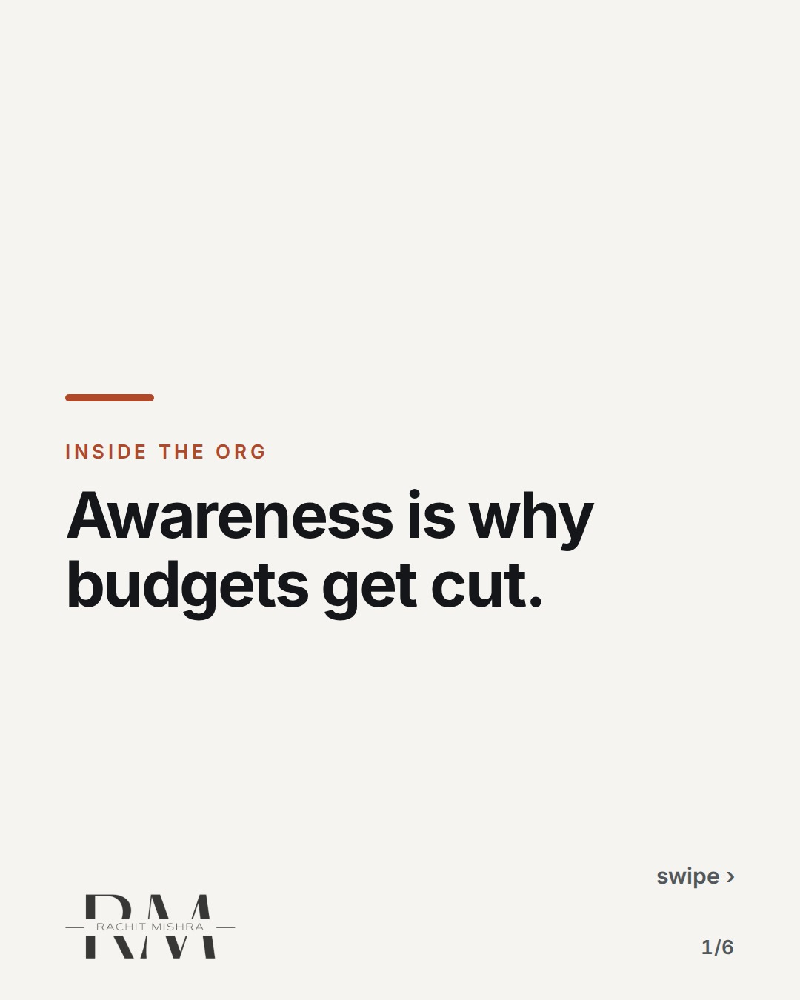
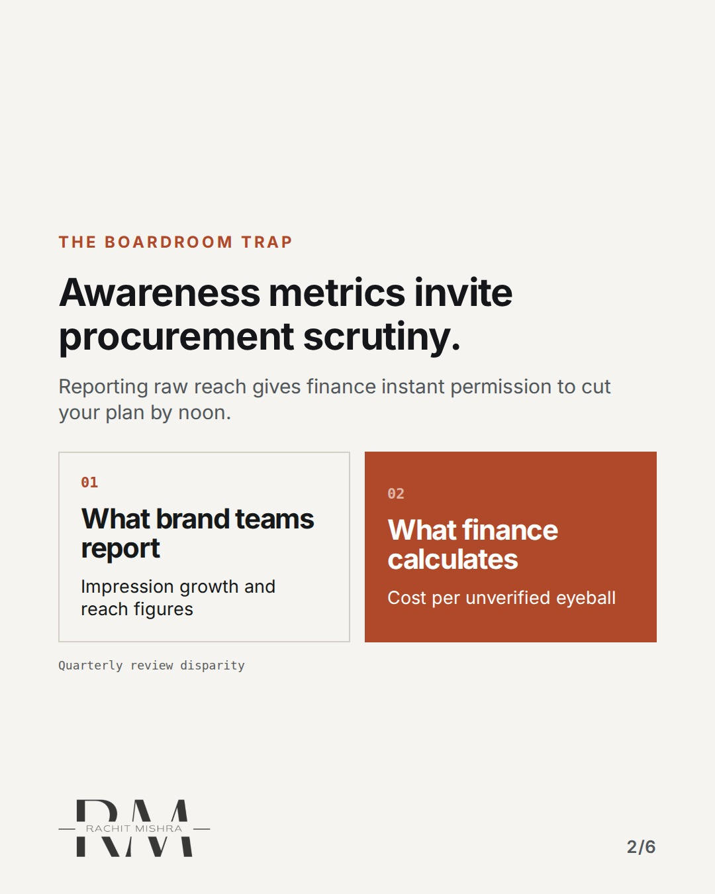
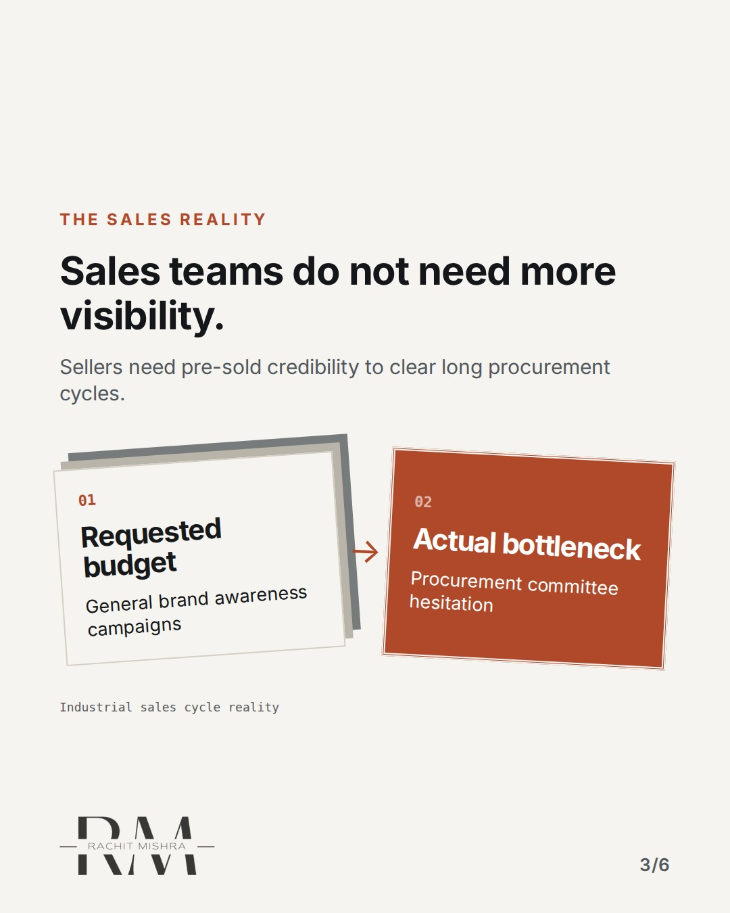
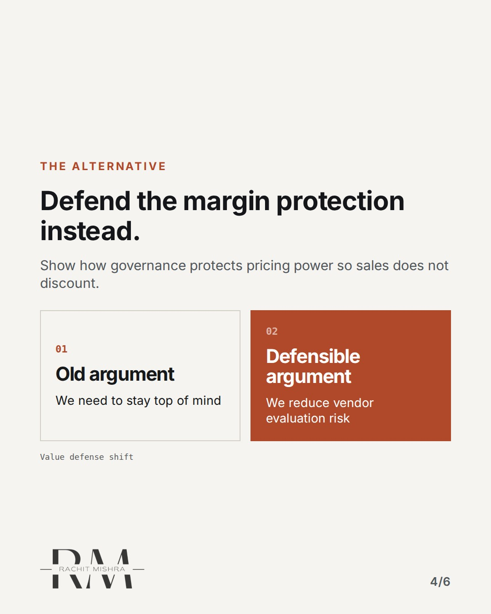
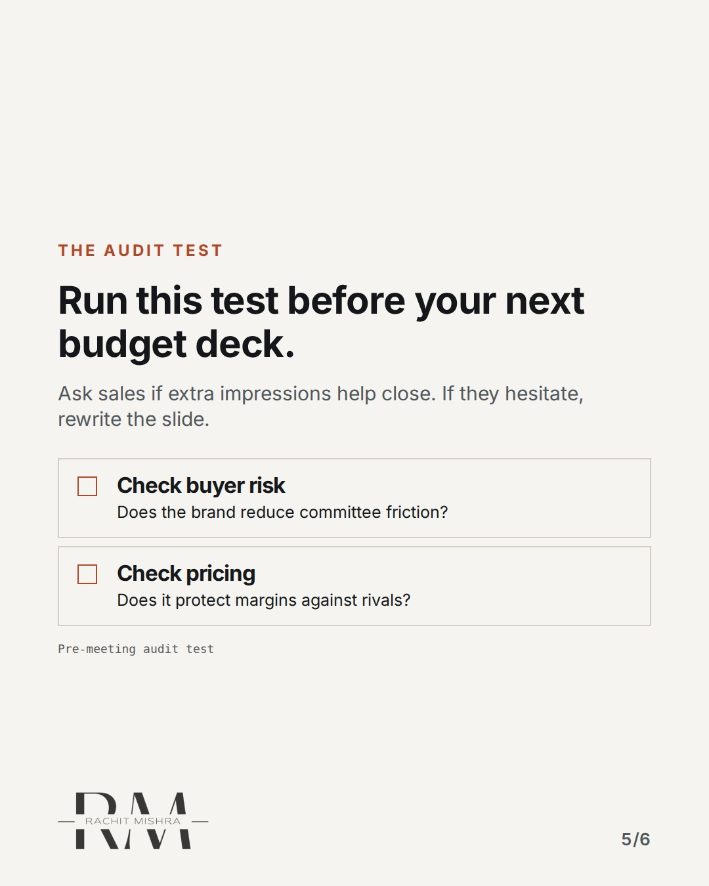
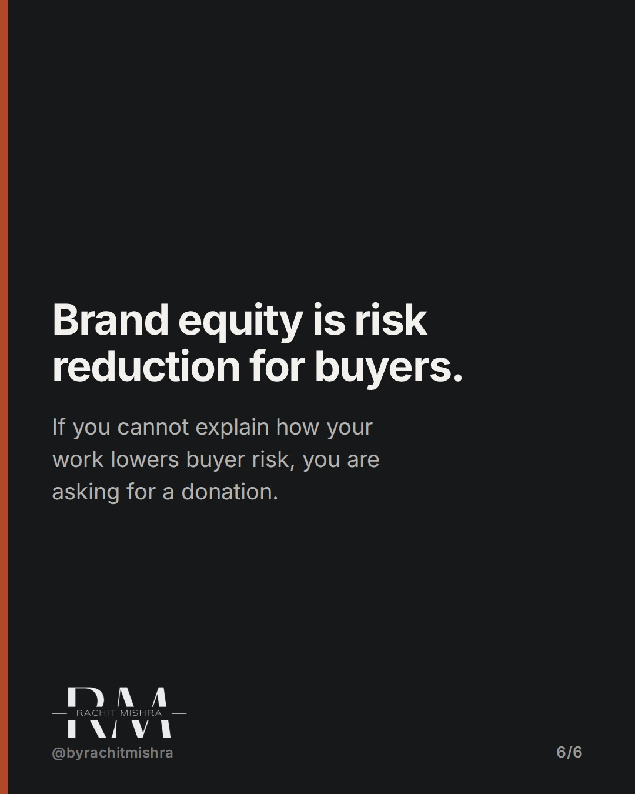

# defendingmarketingbudget

**CAROUSEL** · inside_the_org · goes live **2026-10-17T10:30:00+05:30**

> Targeting: `defending a marketing budget`
>
> Claim: When commercial leadership asks why brand budget exists while sales targets are missed, quoting awareness metrics guarantees a budget cut.
>
> Proof (practitioner_observation): Observed quarterly review cycles across industrial equipment and logistics firms where abstract brand metrics failed to survive commercial scrutiny.
>
> Rendered infographics: 5 — comparison, bottleneck, comparison, checklist, comparison

## Slides

6 rendered images sit in this folder — upload them in filename order.

**1.** 
### Awareness is why budgets get cut.



**2.** The Boardroom Trap
### Awareness metrics invite procurement scrutiny.
Reporting raw reach gives finance instant permission to cut your plan by noon.



**3.** The Sales Reality
### Sales teams do not need more visibility.
Sellers need pre-sold credibility to clear long procurement cycles.



**4.** The Alternative
### Defend the margin protection instead.
Show how governance protects pricing power so sales does not discount.



**5.** The Audit Test
### Run this test before your next budget deck.
Ask sales if extra impressions help close. If they hesitate, rewrite the slide.



**6.** The Core Rule
### Brand equity is risk reduction for buyers.
If you cannot explain how your work lowers buyer risk, you are asking for a donation.



## Caption — copy from here

```
Awareness is why budgets get cut.

Defending a marketing budget in an industrial organisation requires abandoning consumer metrics entirely. When you report impressions to a commercial committee looking at missed tonnage targets, you are handing them the knife.

Finance understands risk reduction. They do not understand share of voice.

Send this to whoever is defending the brand budget this quarter.

[defending a marketing budget, in-house marketing, stakeholder management, brand governance]

#marketingleadership #inhousemarketing #brandgovernance #cmo #b2bmarketing

#marketingleadership #inhousemarketing #brandgovernance #cmo #b2bmarketing
```

## Alt text

```
Carousel slides outlining why awareness metrics fail when defending industrial marketing budgets.
```

## How this post could fail

Readers might confuse this with general finance advice rather than specific industrial marketing positioning.
