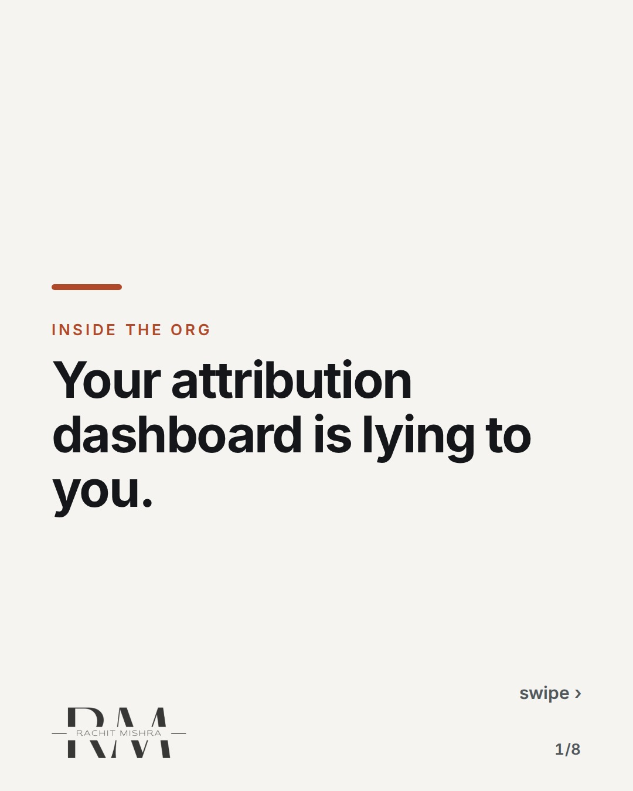
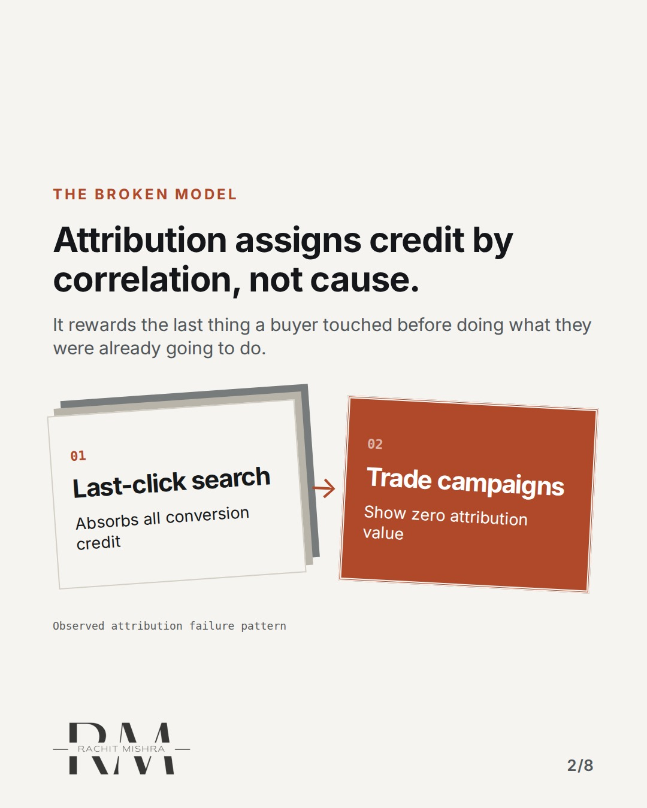
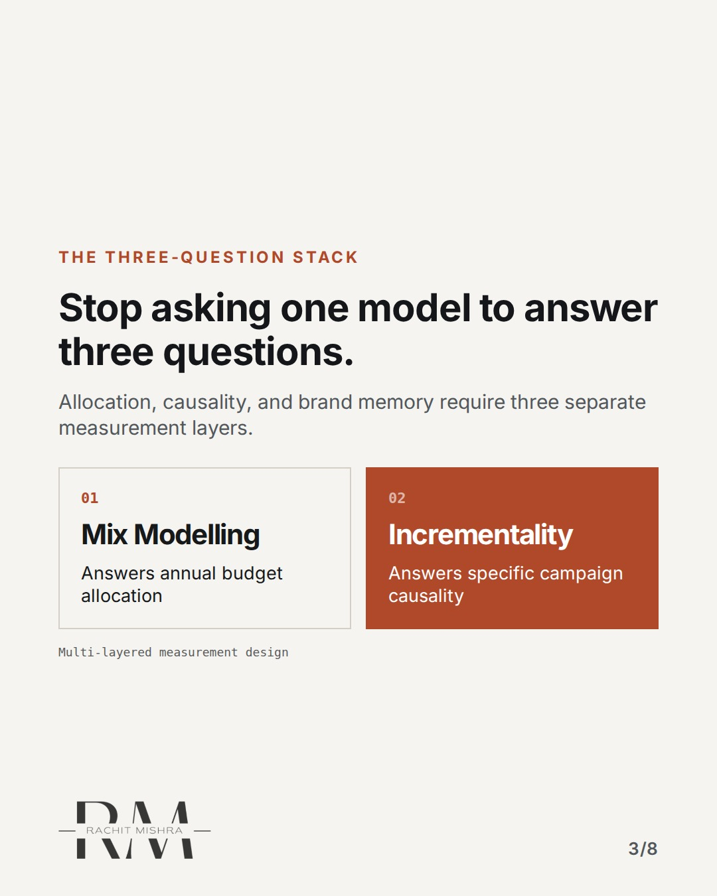
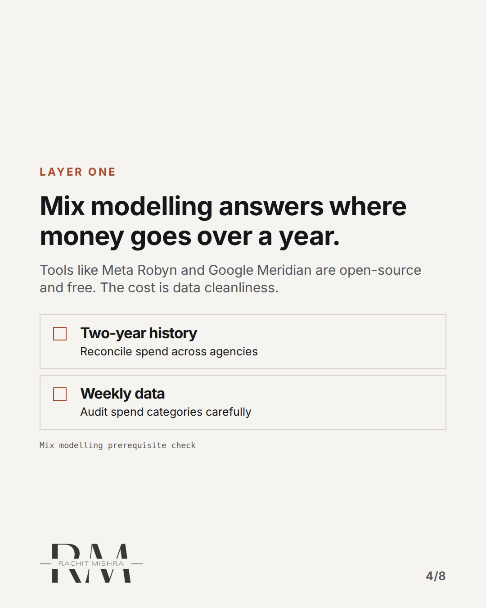
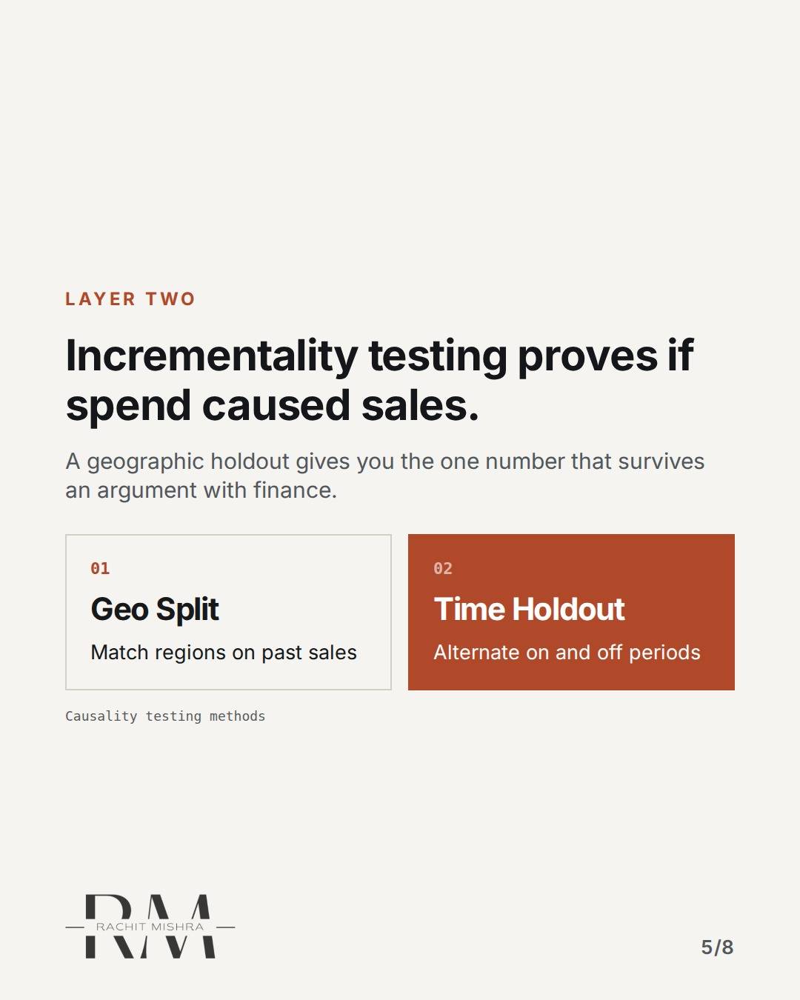
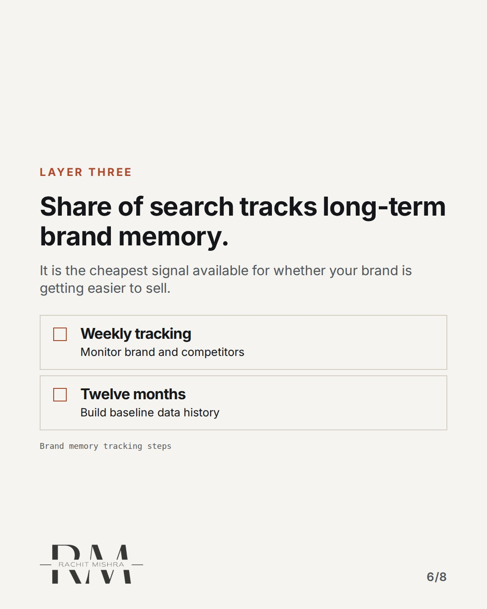
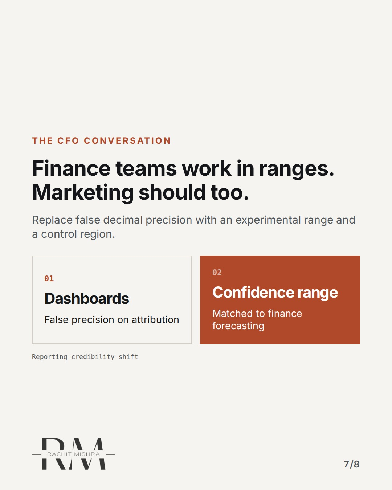
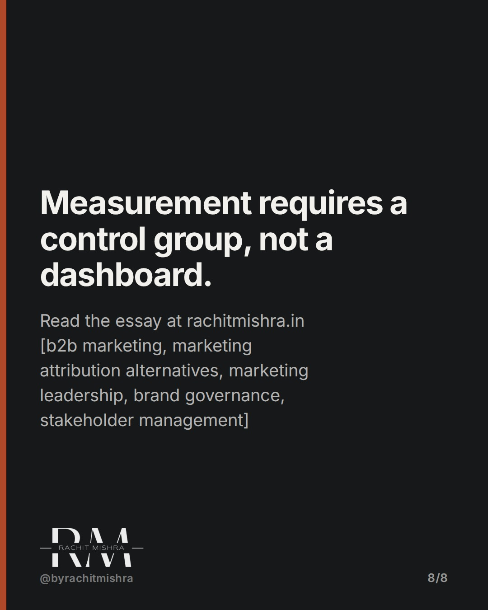

# attribution alternatives that actually work

**CAROUSEL** · inside_the_org · goes live **2026-10-18T10:30:00+05:30**

> Targeting: `marketing attribution alternatives`
>
> Claim: Multi-touch attribution is a bookkeeping convention with no control group; the three-question stack replaces it.
>
> Proof (source): Forrester found that 64% of B2B marketing leaders do not trust their measurement, and only 6% are advanced insight-driven businesses.
> Source: https://www.rachitmishra.in/2026/09/26/marketing-attribution-alternatives/
>
> Source preflight: reachable (HTTP 200)
>
> Rendered infographics: 6 — bottleneck, comparison, checklist, comparison, checklist, comparison

## Slides

8 rendered images sit in this folder — upload them in filename order.

**1.** 
### Your attribution dashboard is lying to you.



**2.** The Broken Model
### Attribution assigns credit by correlation, not cause.
It rewards the last thing a buyer touched before doing what they were already going to do.



**3.** The Three-Question Stack
### Stop asking one model to answer three questions.
Allocation, causality, and brand memory require three separate measurement layers.



**4.** Layer One
### Mix modelling answers where money goes over a year.
Tools like Meta Robyn and Google Meridian are open-source and free. The cost is data cleanliness.



**5.** Layer Two
### Incrementality testing proves if spend caused sales.
A geographic holdout gives you the one number that survives an argument with finance.



**6.** Layer Three
### Share of search tracks long-term brand memory.
It is the cheapest signal available for whether your brand is getting easier to sell.



**7.** The CFO Conversation
### Finance teams work in ranges. Marketing should too.
Replace false decimal precision with an experimental range and a control region.



**8.** 
### Measurement requires a control group, not a dashboard.
Read the essay at rachitmishra.in [b2b marketing, marketing attribution alternatives, marketing leadership, brand governance, stakeholder management]



## Caption — copy from here

```
Your attribution dashboard is lying to you.

Evaluating marketing attribution alternatives proves why.

Most teams run dashboards they privately do not believe. Forrester found that 64% of B2B marketing leaders distrust their own measurement.

The fix is separating allocation, causality, and memory into distinct layers.

Send this to whoever is defending the quarterly marketing report to the board this week.

[b2b marketing, marketing attribution alternatives, marketing leadership, brand governance, stakeholder management]

#b2bmarketing #marketingleadership #brandgovernance
```

## Alt text

```
Carousel on why multi-touch attribution fails and how the three-question stack replaces it.
```

## How this post could fail

The technical shift from attribution to mix modelling and incrementality can feel abstract if readers do not connect it to their own agency spend audits.

## Sources

- [Marketing Attribution Alternatives That Actually Work](https://www.rachitmishra.in/2026/09/26/marketing-attribution-alternatives/)
