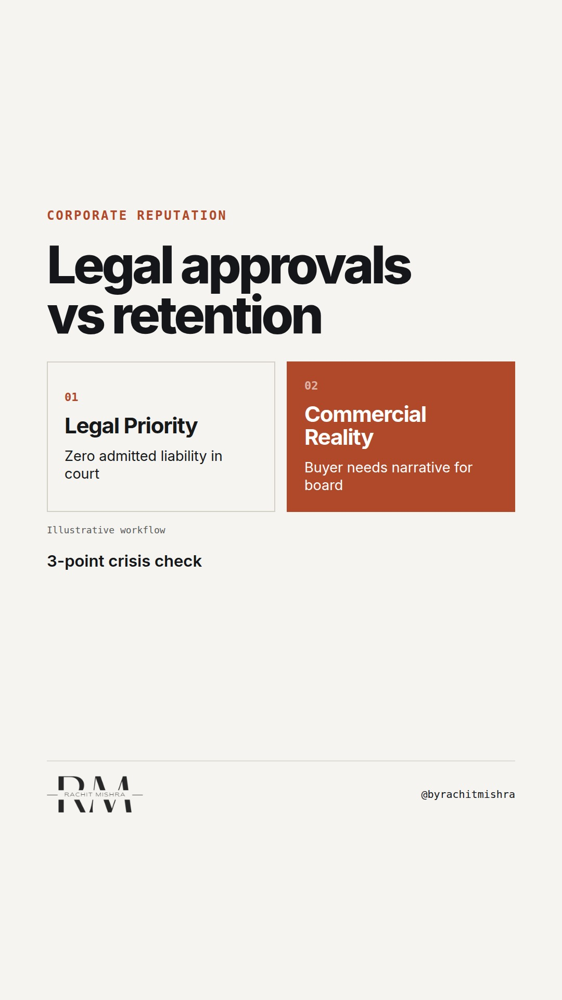

# crisis_communication_mistakes

**REEL** · reputation · goes live **2026-10-15T13:00:00+05:30**

> Targeting: `crisis communication mistakes`
>
> Claim: In B2B industrial crises, legal reviews prioritize immediate liability containment over commercial relationship retention, costing millions in canceled vendor contracts.
>
> Proof (framework): A 3-part legal vs commercial crisis review checklist balancing liability containment against long-tail contract retention.
>
> Rendered infographics: 3 — comparison, comparison, checklist
>
> Reel assets: image `reputation-reflection.png` · music `bed-something (11).mp3`

## Cover



## Reel script

`reel.mp4` has been generated from this script and will publish automatically. To use your own footage instead, replace that file and delete `.generated-reel` from this folder.

| Time | On screen | Voiceover | Direction |
|---|---|---|---|
| 0:00-0:03 | **Your legal team is ruining your crisis response.** | Your legal team is ruining your crisis response. When an operational breakdown hits, legal drafts a response designed to do exactly one thing: eliminate court liability. | Text on dark slate background with a stark red review stamp visual. |
| 0:03-0:08 | **Zero legal exposure can mean zero customer trust** | Zero legal exposure can mean zero customer trust. The legal response removes empathy, delays statements by 48 hours, and refuses to explain the failure. | Split screen contrasting legal defense priorities versus commercial contract risks. |
| 0:08-0:14 | **Legal guards courtrooms. Brand guards contracts.** | Legal guards courtrooms. Brand guards contracts. A liability-free statement often forces your commercial buyers to invoke default clauses because you gave them no narrative to defend you to their board. | Text over workflow showing approval bottleneck. |
| 0:14-0:20 | **Run this audit before signing off statements.** | Run this 3-point audit before signing off on any holding statement. | Transition frame introducing the governance framework. |
| 0:20-0:28 | **3-point holding statement audit** | First, state what failed without conceding fault. Second, give buyers a narrative for their board. Third, commit to a clear update time. | Checklist graphic appears on screen. |
| 0:28-0:34 | **Reputation is contract retention.** | Reputation is contract retention. If your statement survives legal review but causes your top three clients to open an audit, the response failed. | Text statement on dark industrial background. |

## Caption — copy from here

```
Your legal team is ruining your crisis response.

Avoiding common crisis communication mistakes requires managing the gap between legal safety and buyer retention.

In B2B heavy industry, an operational issue rarely ends in a lawsuit. It ends in a procurement audit.

When a plant trips or a shipment delays, legal counsel wants no admission, zero commitments, and maximum ambiguity. That strategy avoids courtroom liability while quietly destroying your commercial contracts.

Your buyers have to explain your failure to their own internal risk committees. If your holding statement gives them zero operational context, they cannot defend you. Their safest option is to trigger default clauses or diversify suppliers.

Legal counsel optimizes for zero legal exposure. Corporate communications must optimize for contract retention. If your crisis response survives legal sign-off but forces a strategic account to issue a tender, you lost the real risk battle.

Send this to whoever is redlining your crisis comms protocol this week.

[crisis communication mistakes, corporate reputation, crisis management, b2b comms, corporate communications]

#corporatecommunications #crisiscommunication #reputation
```

## Alt text

```
Comparison chart showing legal priority of zero liability versus commercial need for client trust.
```

## How this post could fail

If the post sounds like an attack on corporate lawyers rather than a governance framework, it loses credibility with senior communicators who must work alongside legal.
