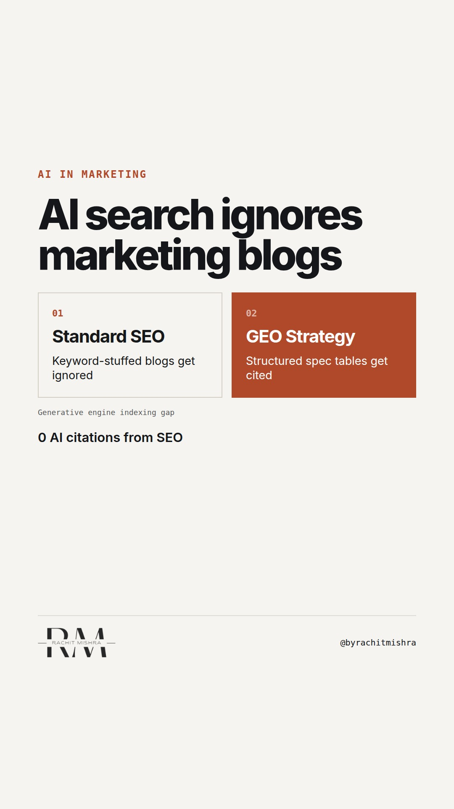

# generativeengineoptimisationb2b

**REEL** · ai_marketing · goes live **2026-10-13T19:00:00+05:30**

> Targeting: `generative engine optimisation for B2B`
>
> Claim: AI search engines filter out standard B2B marketing blogs and prioritize un-gated spec sheets, structured tabular data, and trade citations.
>
> Proof (framework): A three-part Generative Engine Optimisation (GEO) audit checking technical data accessibility, structured table formatting, and third-party consensus.
>
> Rendered infographics: 3 — comparison, checklist, checklist
>
> Reel assets: image `ai_marketing-particles.jpg` · music `bed-something (10).mp3`

## Cover



## Reel script

`reel.mp4` has been generated from this script and will publish automatically. To use your own footage instead, replace that file and delete `.generated-reel` from this folder.

| Time | On screen | Voiceover | Direction |
|---|---|---|---|
| 0:00-0:03 | **AI search ignores your marketing blog.** | AI search ignores your marketing blog. When buyers ask ChatGPT or Perplexity for vendor recommendations, generic articles get filtered out immediately. | Rachit seated at desk reviewing an AI prompt search result. |
| 0:03-0:07 | **AI engines index facts, not filler.** | Generative engines do not read broad thought leadership. They parse structured tables, un-gated technical specs, and verified trade data. | Graphic highlighting how LLMs extract factual entities from technical documentation. |
| 0:07-0:12 | **3 rules for B2B AI visibility** | If you want your industrial or enterprise product cited in AI answer engines, you need a Generative Engine Optimisation audit. | On-screen framework graphic showing three criteria. |
| 0:12-0:16 | **Un-gate your spec sheets.** | First, un-gate your technical spec sheets. If a crawler hits a lead form wall, the AI assumes that information does not exist. | Split screen comparing gated lead form vs un-gated indexed spec table. |
| 0:16-0:20 | **Format product data in tables.** | Second, format product comparisons and technical parameters into markdown tables. LLMs extract tabular data far more reliably than prose. | Demonstrating clean data tables being parsed by code. |
| 0:20-0:24 | **Build clear trade citations.** | Third, ensure your brand entity is explicitly linked to your category on independent industry registers and trade publications. | Diagram showing entity relationship mapping across industry sources. |
| 0:24-0:28 | **The B2B GEO readiness checklist** | Run this check on your technical content before planning your next search budget. | Checklist visual displayed full screen. |
| 0:28-0:32 | **SEO builds traffic. GEO builds shortlists.** | SEO builds traffic. GEO builds shortlists. | Rachit delivering final statement directly to camera. |

## Caption — copy from here

```
AI search ignores your marketing blog.

Generative engine optimisation for B2B works differently than traditional SEO. When a procurement team asks an AI assistant to compare industrial vendors, the model does not crawl 1,200-word opinion posts.

It extracts structured parameters, un-gated specification tables, and verified category consensus across independent trade databases.

If your product specs live behind a PDF lead form, you are invisible to the synthetic search layer.

B2B search strategy is moving from ranking for keywords to being parsed as ground truth.

Send this to whoever is managing your search budget this quarter.

[generative engine optimisation for b2b, b2b marketing, martech, ai search, enterprise marketing]

#aimarketing #martech #geo #b2bmarketing
```

## Alt text

```
Diagram showing B2B SEO blogs versus structured data tables in AI search engines.
```

## How this post could fail

If B2B marketers mistake GEO for simple keyword optimization rather than structural content re-architecture, the tactical advice might feel like a minor website update instead of a fundamental publishing pivot.
