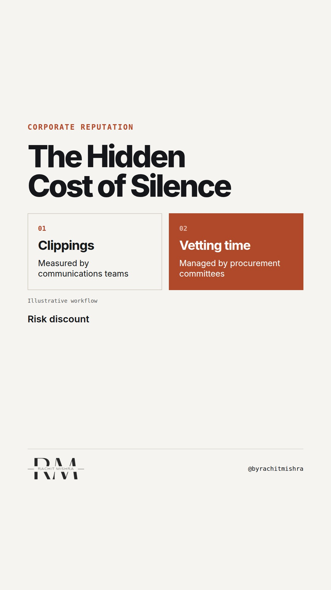

# reputation_ledger_cost

**REEL** · reputation · goes live **2026-10-14T08:30:00+05:30**

> Targeting: `what reputation actually costs`
>
> Claim: Corporate reputation is a balance sheet asset that depreciates when communications teams measure coverage instead of procurement friction.
>
> Proof (practitioner_observation): Observed across multiple industrial enterprise transitions where communications audits measured volume of media mentions while procurement committees quietly extended supplier vetting cycles by six months.
>
> Rendered infographics: 8 — comparison, bottleneck, comparison, checklist, checklist, checklist, checklist, bottleneck
>
> Reel assets: image `reputation-reflection.png` · music `bed-something (12).mp3`

## Cover



## Reel script

`reel.mp4` has been generated from this script and will publish automatically. To use your own footage instead, replace that file and delete `.generated-reel` from this folder.

| Time | On screen | Voiceover | Direction |
|---|---|---|---|
| 0:00-0:03 | **Your reputation ledger has no line item.** | Your reputation ledger has no line item. Yet every time a procurement committee takes six months to clear your vendor code, you are paying for it. | Static shot of a blank general ledger page with a pen resting beside it. |
| 0:03-0:07 | **Media volume is not enterprise trust.** | Most corporate communications teams measure success by press clippings and share of voice. None of those metrics appear in a risk committee review. | Close-up of a communications dashboard showing rising mention volume alongside flat enterprise sales. |
| 0:07-0:12 | **Run this three-part trust audit.** | If you want to know what your reputation actually costs, run this three-part audit before your next board deck goes live. | Cut to a clean checklist graphic appearing on screen. |
| 0:12-0:16 | **Track vendor onboarding time.** | First, track your vendor onboarding time across eight quarters to see where institutional friction actually lives. | Zoom in on the tender cycle line of the checklist graphic. |
| 0:16-0:21 | **Measure price concessions.** | Second, measure the price concessions demanded by buyers who perceive higher regulatory risk in your supply chain. | Zoom in on the discount cost line of the checklist graphic. |
| 0:21-0:26 | **Count permit approval lags.** | Third, count permit approval delays against your regional competitors to isolate external friction from internal execution. | Zoom in on the regulatory lag line of the checklist graphic. |
| 0:26-0:30 | **Reputation is a risk discount.** | Reputation is not how well you are liked. It is the risk discount buyers apply before they trust you with an eighteen-month contract. | Return to camera. Direct delivery. |

## Caption — copy from here

```
Your reputation ledger has no line item.

Understanding what reputation actually costs requires looking where communications audits never go. When procurement committees add six months to your vendor vetting cycle, that delay is the invoice for an unmanaged brand.

Most teams treat corporate reputation as a PR exercise. In heavy industry, it is a risk mitigation mechanism that directly influences your cost of capital and tender conversion rates.

Send this to whoever is defending the communications budget against a sales team asking for immediate leads.

[corporate reputation, stakeholder trust, b2b communications, corporate communications]

#corporatecommunications #reputation #publicrelations
```

## Alt text

```
A blank ledger page illustrating how corporate reputation affects procurement cycles.
```

## How this post could fail

Readers might mistake this for generic advice about PR measurement unless they have sat through a procurement committee review where brand safety dictated the vendor selection.
