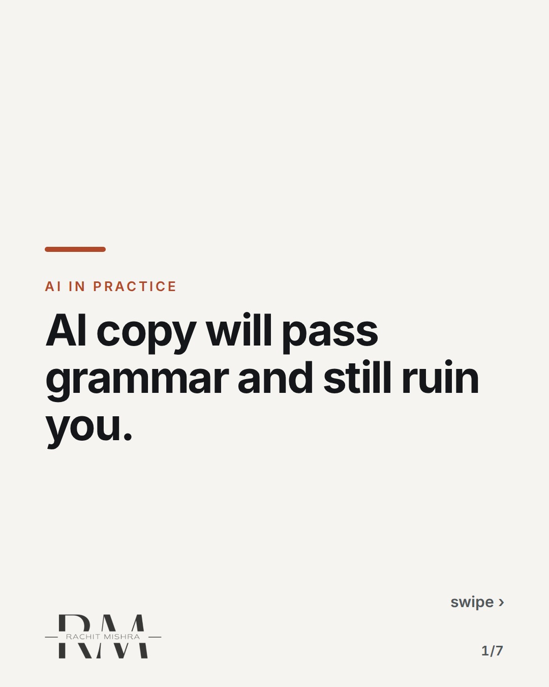
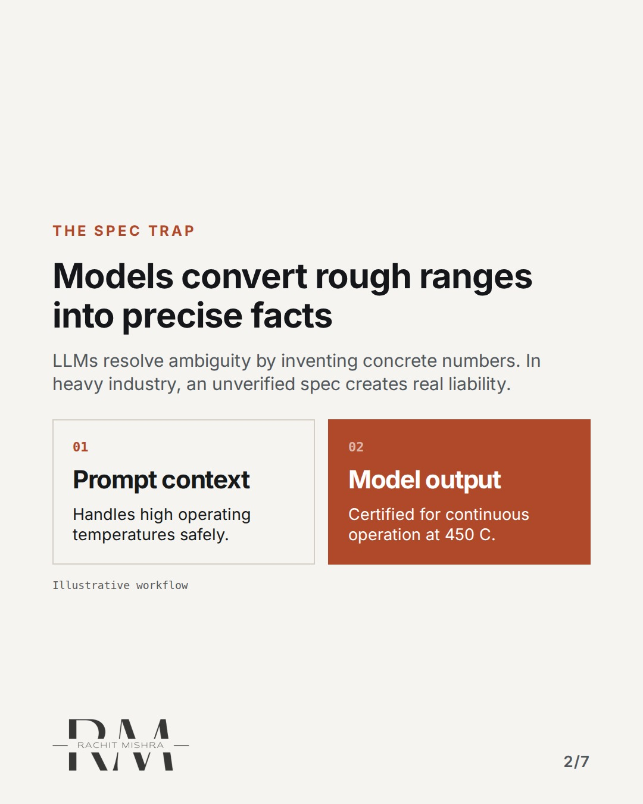
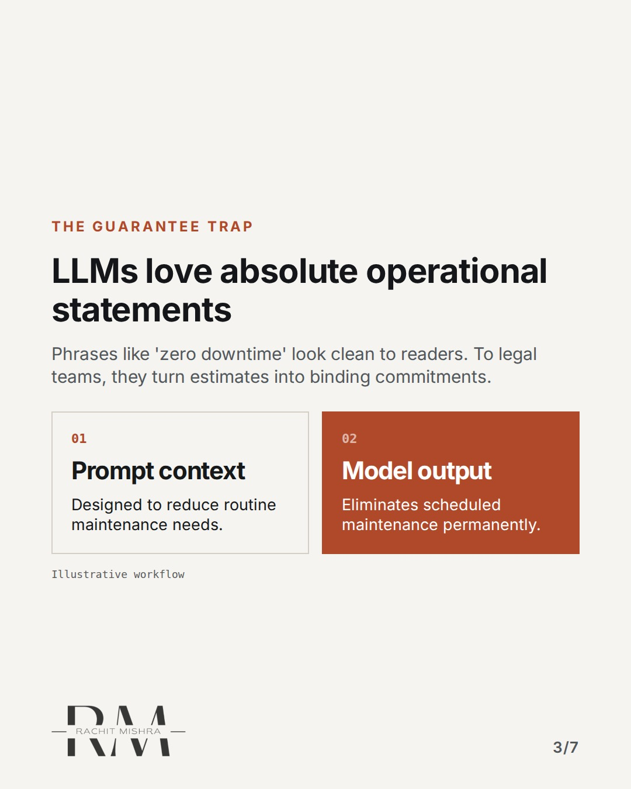
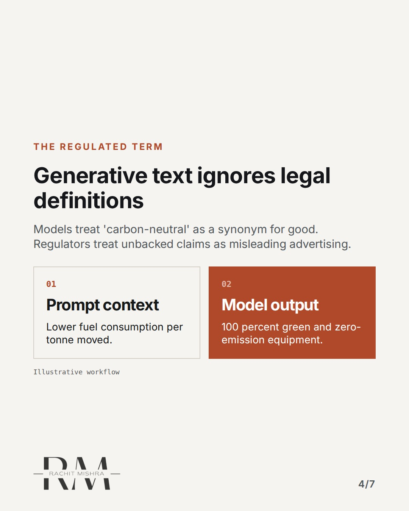
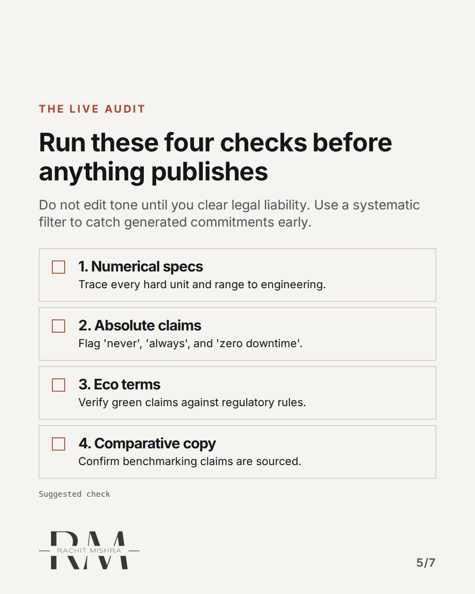
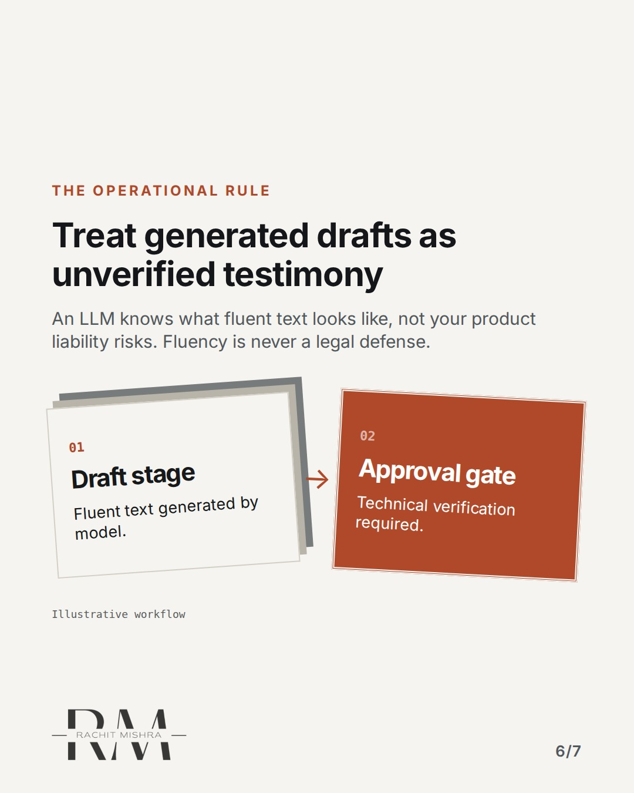
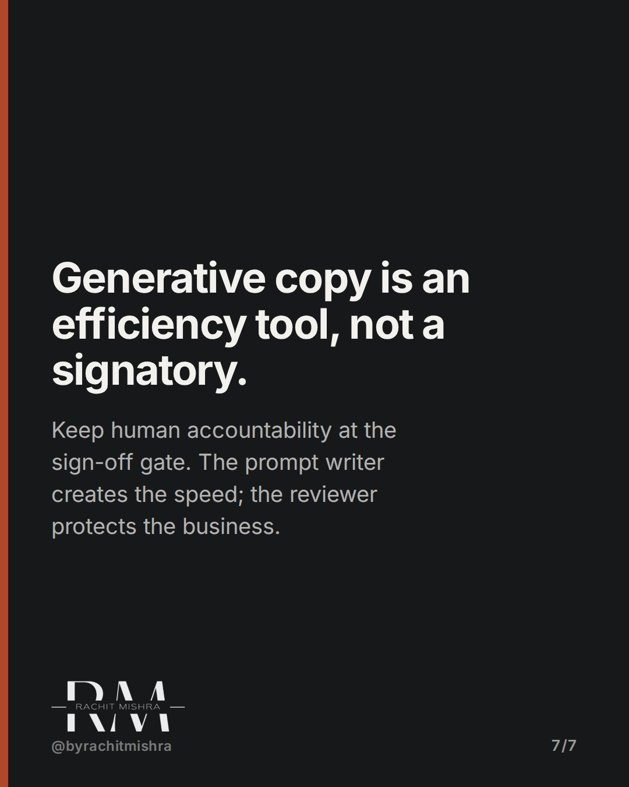

# checks_before_ai_copy_goes_live

**CAROUSEL** · ai_in_practice · goes live **2026-10-14T20:00:00+05:30**

> Targeting: `checks before AI copy goes live`
>
> Claim: AI copy risks enterprise liability not through grammatical error, but when it generates unverified performance specs, absolute liability claims, or non-compliant environmental descriptors.
>
> Proof (framework): A 4-point compliance screening protocol designed for industrial B2B communication teams reviewing model-generated collateral before release.
>
> Rendered infographics: 5 — comparison, comparison, comparison, checklist, bottleneck

## Slides

7 rendered images sit in this folder — upload them in filename order.

**1.** 
### AI copy will pass grammar and still ruin you.



**2.** The Spec Trap
### Models convert rough ranges into precise facts
LLMs resolve ambiguity by inventing concrete numbers. In heavy industry, an unverified spec creates real liability.



**3.** The Guarantee Trap
### LLMs love absolute operational statements
Phrases like 'zero downtime' look clean to readers. To legal teams, they turn estimates into binding commitments.



**4.** The Regulated Term
### Generative text ignores legal definitions
Models treat 'carbon-neutral' as a synonym for good. Regulators treat unbacked claims as misleading advertising.



**5.** The Live Audit
### Run these four checks before anything publishes
Do not edit tone until you clear legal liability. Use a systematic filter to catch generated commitments early.



**6.** The Operational Rule
### Treat generated drafts as unverified testimony
An LLM knows what fluent text looks like, not your product liability risks. Fluency is never a legal defense.



**7.** 
### Generative copy is an efficiency tool, not a signatory.
Keep human accountability at the sign-off gate. The prompt writer creates the speed; the reviewer protects the business.



## Caption — copy from here

```
AI copy will pass grammar and still ruin you.

Establishing mandatory checks before AI copy goes live is not about fixing style or tone. It is about catching liability before legal sees the final collateral.

Generative language models write with total confidence. When prompted about product performance, they turn qualified engineering estimates into precise facts, and reasonable trade-offs into absolute guarantees.

In consumer marketing, a hyperbolic adjective costs very little. In industrial equipment, enterprise software, or heavy manufacturing, an unverified temperature tolerance or absolute uptime claim becomes a contractual commitment.

Your reviewers should not spend time checking if the text reads smoothly. The model already made it smooth. The reviewer's job is to strip out the unearned commitments the model added to make it sound persuasive.

Speed means nothing if the output exposes the business to regulatory fines or contract disputes.

Send this to whoever oversees brand governance or marketing workflows on your team.

[checks before AI copy goes live, AI governance, marketing operations, b2b copy risk, enterprise AI adoption]

#aigovernance #marketingoperations #b2bmarketing
```

## Alt text

```
Text-based carousel outlining four essential compliance checks before publishing AI copy.
```

## How this post could fail

If the reader works in small consumer brands with low legal risk, these compliance checks might seem excessively rigid.
