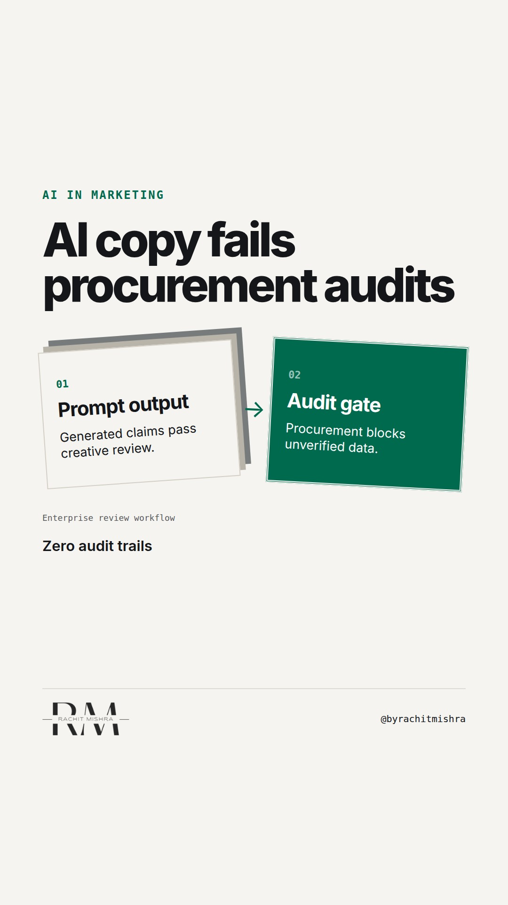

# ai_governance_procurement_gate

**REEL** · ai_marketing · goes live **2026-10-23T08:30:00+05:30**

> Targeting: `AI governance`
>
> Claim: Autonomous AI marketing systems fail in heavy industry because procurement teams audit compliance before they ever read creative copy.
>
> Proof (practitioner_observation): Observed enterprise procurement reviews for industrial engineering suppliers where generative copy without traceable sourcing was rejected for non-compliance with ISO standards.
>
> Rendered infographics: 3 — bottleneck, comparison, checklist
>
> Reel assets: image `designed_gradient` · music `bed-something (13).mp3`

## Cover



## Reel script

`reel.mp4` has been generated from this script and will publish automatically. To use your own footage instead, replace that file and delete `.generated-reel` from this folder.

| Time | On screen | Voiceover | Direction |
|---|---|---|---|
| 0:00-0:03 | **AI generated copy fails every procurement audit.** | AI generated copy fails every procurement audit. Not because it sounds robotic, but because enterprise buyers require verifiable proof. | Close up on a printed procurement specification sheet marked with red review stamps. |
| 0:03-0:09 | **Speed creates liability.** | Speed is what generative tools sell. Liability is what large industrial buyers actually buy against. | Pan across a stack of heavy industrial equipment compliance manuals. |
| 0:09-0:16 | **The enterprise gap** | When your marketing team uses AI to write product capability claims, you introduce unmonitored risk into an eighteen-month sales cycle. | Medium shot of an office workspace with enterprise software dashboards visible. |
| 0:16-0:24 | **Run this compliance test** | Before you let algorithms write another product spec, run this three-point governance check across your output. | Cut to a clean checklist graphic against a neutral industrial background. |
| 0:24-0:35 | **Governance checklist** | First, can you trace every claim to a regulated standard? Second, is the data source publicly verifiable? Third, will legal indemnify the prompt output? | Detailed checklist view highlighting the verification steps one by one. |
| 0:35-0:42 | **AI governance is risk control** | Effective AI governance in marketing is not about creative output quality. It is about whether your buyers can defend your claims to their board. | Return to presenter looking directly at the camera. |

## Caption — copy from here

```
AI generated copy fails every procurement audit.

Effective AI governance matters most when selling industrial commodities where every technical assertion must survive a legal review board before an invoice gets signed.

Consumer marketing rewards speed and volume. Enterprise procurement rewards verifiable consistency.

Send this to whoever is defending your marketing technology stack against compliance reviews this quarter.

[AI governance, enterprise marketing, marketing technology, procurement compliance]

#aimarketing #martech #b2bmarketing
```

## Alt text

```
Audit documents with compliance stamps and a checklist graphic for marketing systems
```

## How this post could fail

Readers might mistake this for generic anti-AI sentiment rather than a specific operational warning about enterprise procurement rules.
