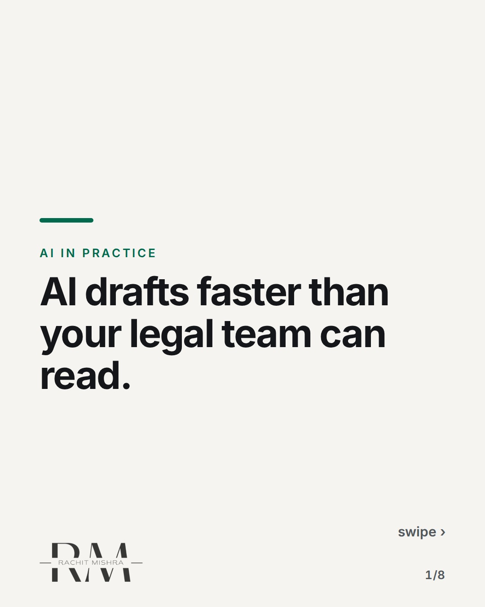
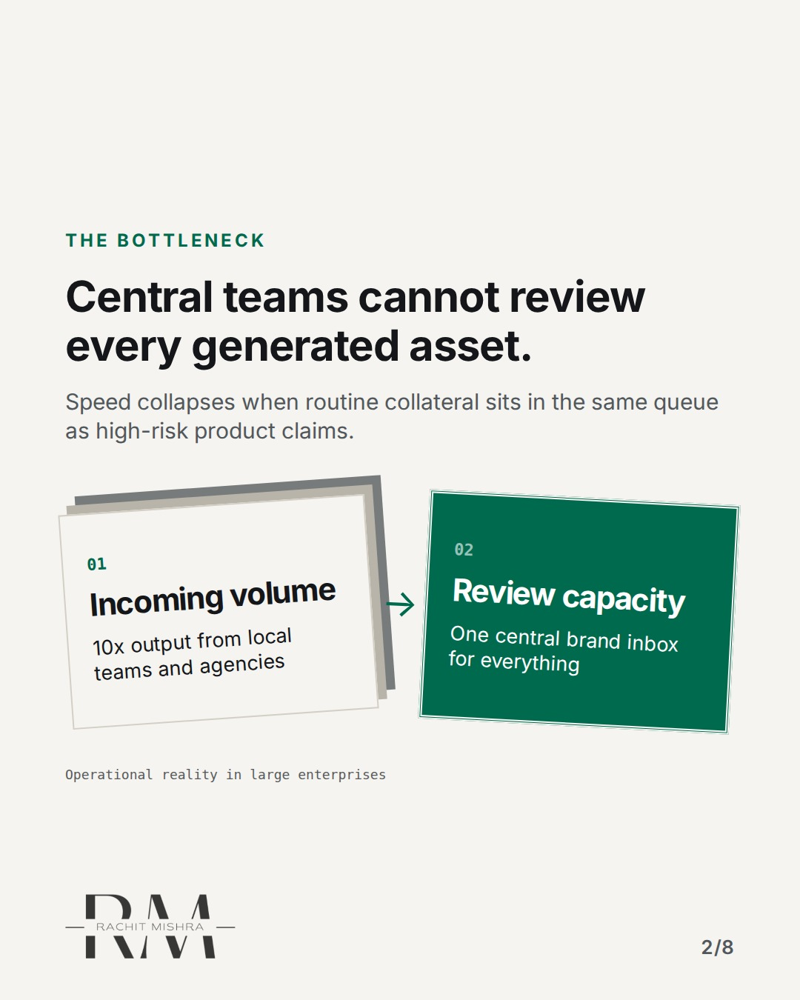
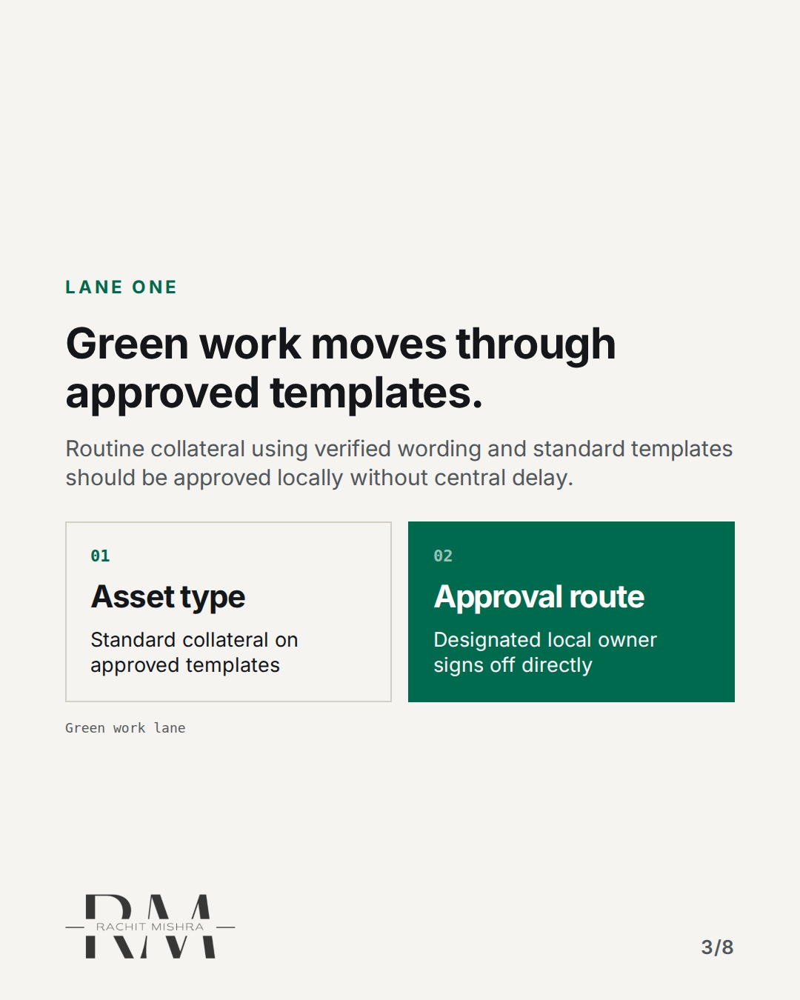
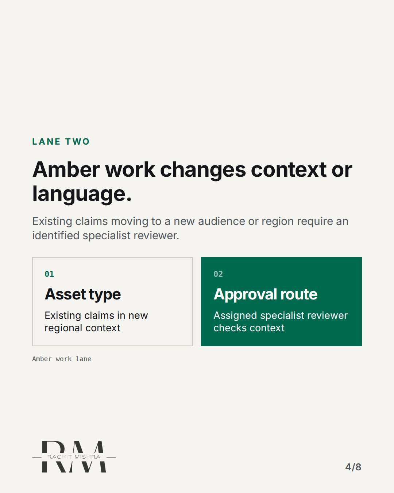
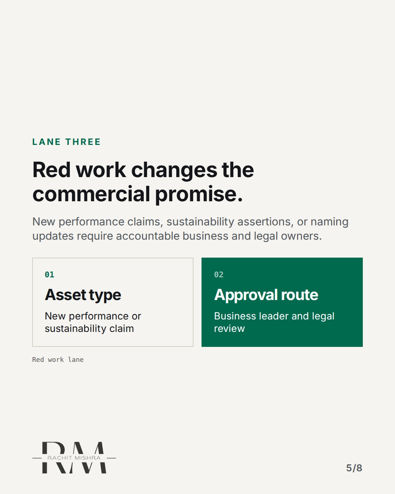
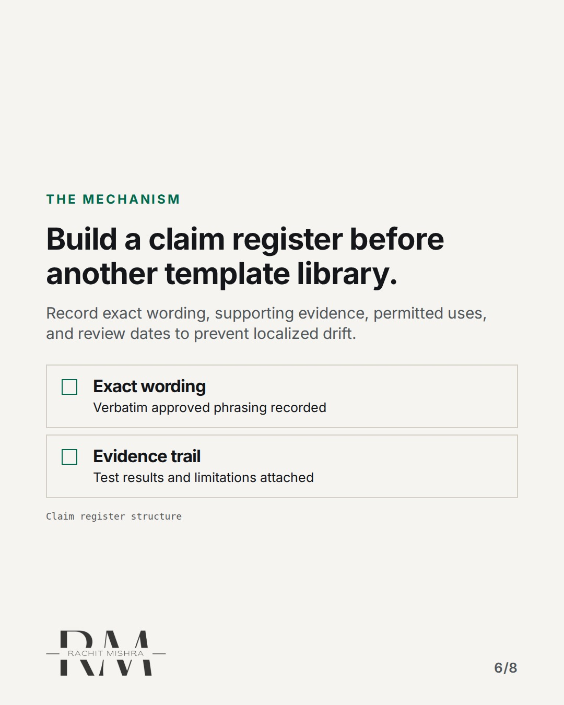
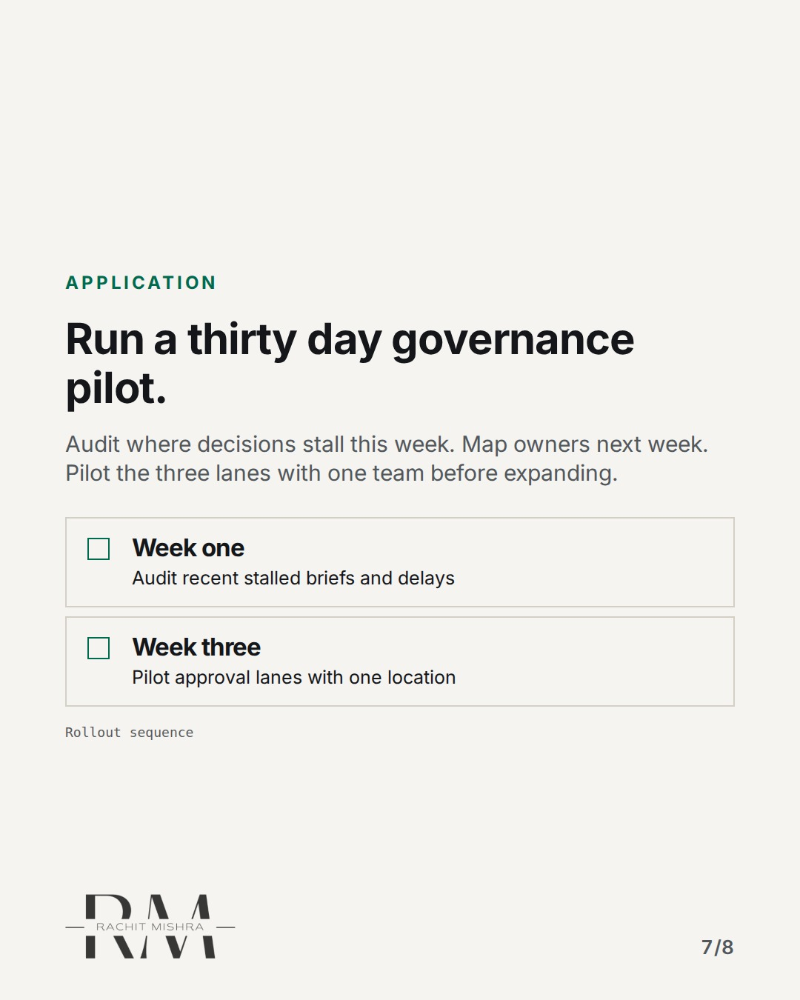
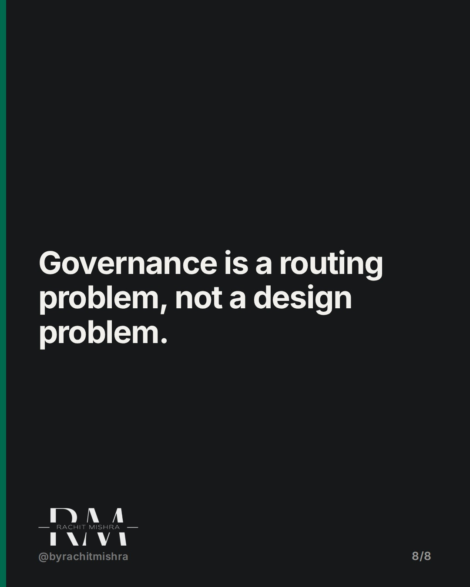

# ai_content_approval_workflow

**CAROUSEL** · ai_in_practice · goes live **2026-10-23T19:00:00+05:30**

> Targeting: `AI content approval workflow`
>
> Claim: AI content approval requires structural decision lanes rather than one central inbox.
>
> Proof (source): Brand governance framework operating model for separating routine collateral from red-risk claims.
> Source: https://www.rachitmishra.in/2026/10/13/brand-governance-framework/
>
> Source preflight: reachable (HTTP 200)
>
> Rendered infographics: 6 — bottleneck, comparison, comparison, comparison, checklist, checklist

## Slides

8 rendered images sit in this folder — upload them in filename order.

**1.** 
### AI drafts faster than your legal team can read.



**2.** The Bottleneck
### Central teams cannot review every generated asset.
Speed collapses when routine collateral sits in the same queue as high-risk product claims.



**3.** Lane One
### Green work moves through approved templates.
Routine collateral using verified wording and standard templates should be approved locally without central delay.



**4.** Lane Two
### Amber work changes context or language.
Existing claims moving to a new audience or region require an identified specialist reviewer.



**5.** Lane Three
### Red work changes the commercial promise.
New performance claims, sustainability assertions, or naming updates require accountable business and legal owners.



**6.** The Mechanism
### Build a claim register before another template library.
Record exact wording, supporting evidence, permitted uses, and review dates to prevent localized drift.



**7.** Application
### Run a thirty day governance pilot.
Audit where decisions stall this week. Map owners next week. Pilot the three lanes with one team before expanding.



**8.** 
### Governance is a routing problem, not a design problem.



## Caption — copy from here

```
AI drafts faster than your legal team can read.

Setting up an effective AI content approval workflow means separating routine collateral from claims that alter the commercial promise.

Most teams make the mistake of routing everything through a central inbox. That creates bottlenecks where regional managers wait weeks for sign-off on minor local collateral.

Instead, separate decisions into green, amber, and red lanes based on risk and context. If the template is approved and the claim is unchanged, let the local owner sign off.

Save this checklist before your team scales up generative copy output this quarter.

[aimarketing, enterprise ai adoption, brand governance, marketing operations]

#aimarketing #martech #b2bmarketing

#aimarketing #martech #b2bmarketing
```

## Alt text

```
Carousel slides detailing an enterprise AI content approval workflow with three decision lanes.
```

## How this post could fail

Readers might assume this applies only to generative text when it applies equally to technical spec sheets and regional collateral.

## Sources

- [Brand Governance Framework: Who Decides What?](https://www.rachitmishra.in/2026/10/13/brand-governance-framework/)
