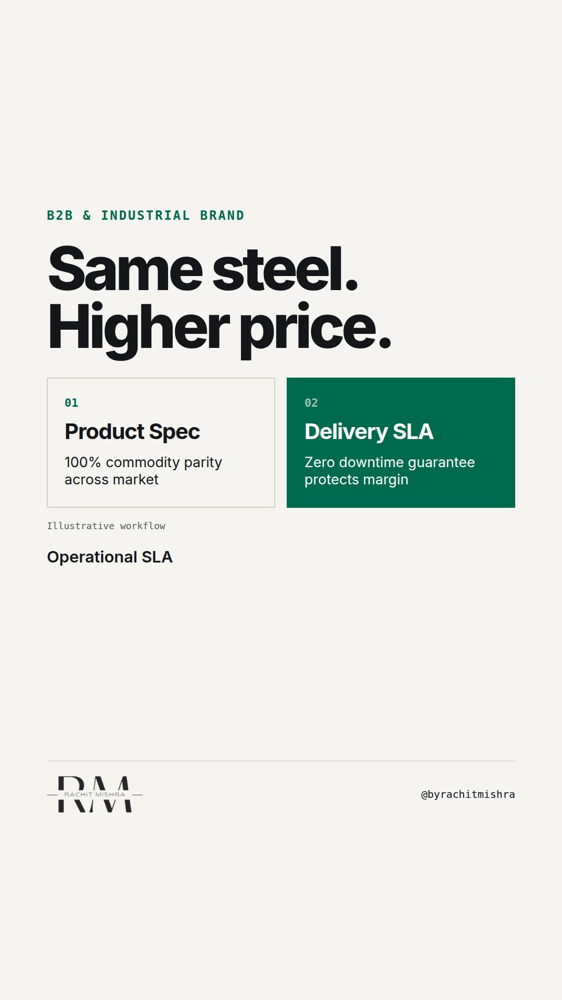

# commoditypricingdifferentiation

**REEL** · b2b_brand · goes live **2026-10-19T08:30:00+05:30**

> Targeting: `how to brand a commodity product`
>
> Claim: In B2B commodities, brand value is built on delivery and terms governance, not product specifications.
>
> Proof (framework): A procurement evaluation matrix showing that specification parity shifts 80% of supplier margin control to supply chain reliability and commercial terms.
>
> Rendered infographics: 3 — comparison, comparison, checklist
>
> Reel assets: image `designed_gradient` · music `bed-something (1).mp3`

## Cover



## Reel script

`reel.mp4` has been generated from this script and will publish automatically. To use your own footage instead, replace that file and delete `.generated-reel` from this folder.

| Time | On screen | Voiceover | Direction |
|---|---|---|---|
| 0:00-0:04 | **Why pay more for identical steel?** | Why pay more for identical steel? When two industrial suppliers meet identical grade specifications, marketing the product itself is a waste of budget. |  |
| 0:04-0:09 | **Spec parity kills product claims** | Understanding how to brand a commodity product starts with accepting that technical parity kills product-led messaging. | Clean typography over abstract industrial machinery background. |
| 0:09-0:15 | **The margin is in the delivery** | Your buyer is an evaluation committee. They do not care about your brand story. They care about downtime risk. |  |
| 0:15-0:21 | **Commodity Branding Matrix** | Run this three-part check on your B2B offer before writing your next campaign. |  |
| 0:21-0:27 | **Brand the delivery workflow** | If you cannot change the metallurgy, brand the delivery workflow. Guaranteeing arrival windows protects margins better than ad creative. |  |
| 0:27-0:32 | **Positioning lives in the contract** | Commodity positioning is not about product claims. It lives entirely inside the operational SLA. |  |

## Caption — copy from here

```
Why pay more for identical steel?

If you want to know how to brand a commodity product, stop looking at the product.

When a procurement committee evaluates two suppliers with identical technical standards, product marketing loses all leverage. The margin premium does not come from clever positioning copy or a new logo.

It comes from taking risk off the buyer's balance sheet.

Guaranteed delivery windows, credit flexibility, and rapid batch replacement are what allow an industrial supplier to charge above spot price.

In heavy industry, operational reliability is the brand.

Send this to whoever is defending your pricing strategy in procurement meetings this quarter.

[how to brand a commodity product, b2b branding, industrial marketing, manufacturing marketing, b2b brand strategy]

#b2bmarketing #industrialmarketing #brandstrategy
```

## Alt text

```
Text graphic comparing commodity specs against delivery guarantees for B2B industrial marketing.
```

## How this post could fail

If the viewer works in custom engineering rather than true commodities, the emphasis on delivery SLAs over technical features may feel overstated.
