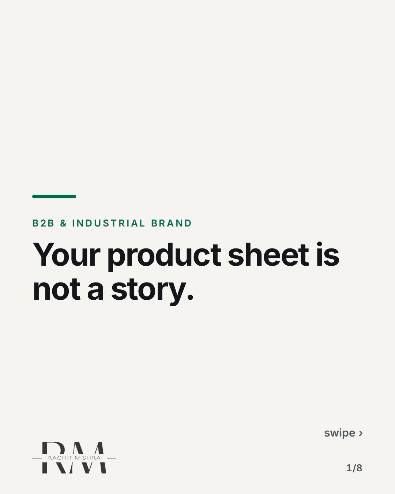
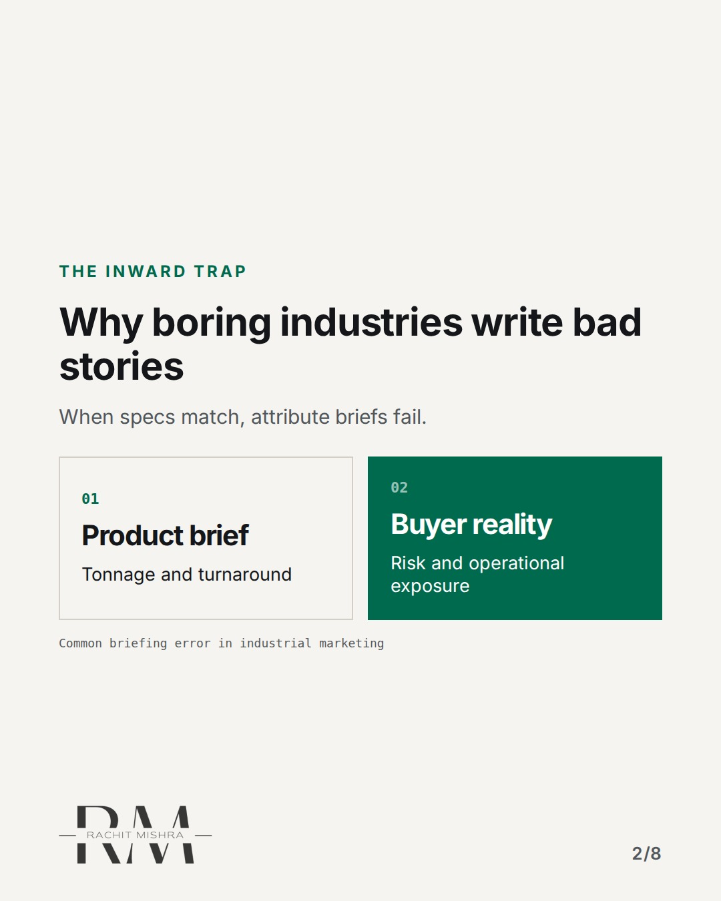
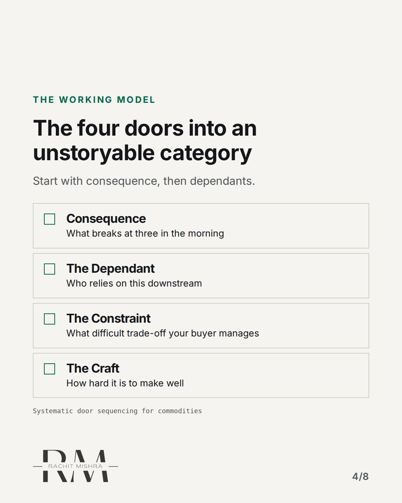
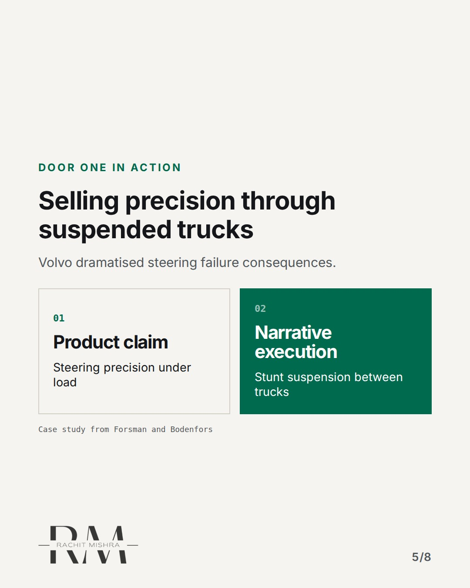
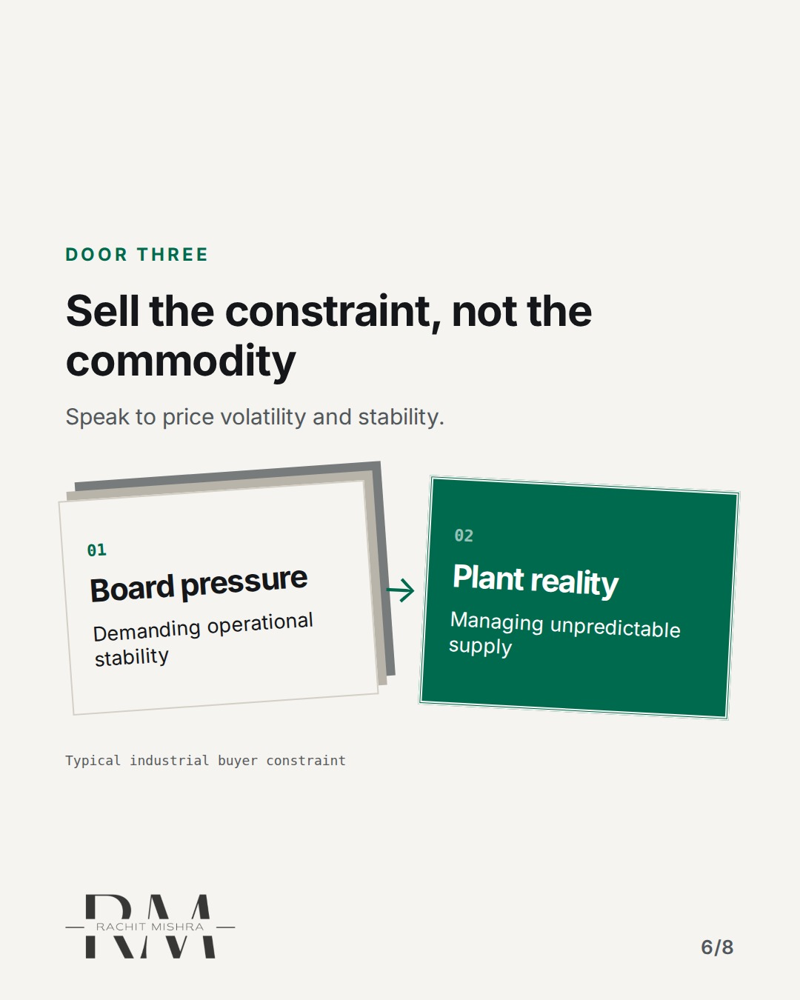
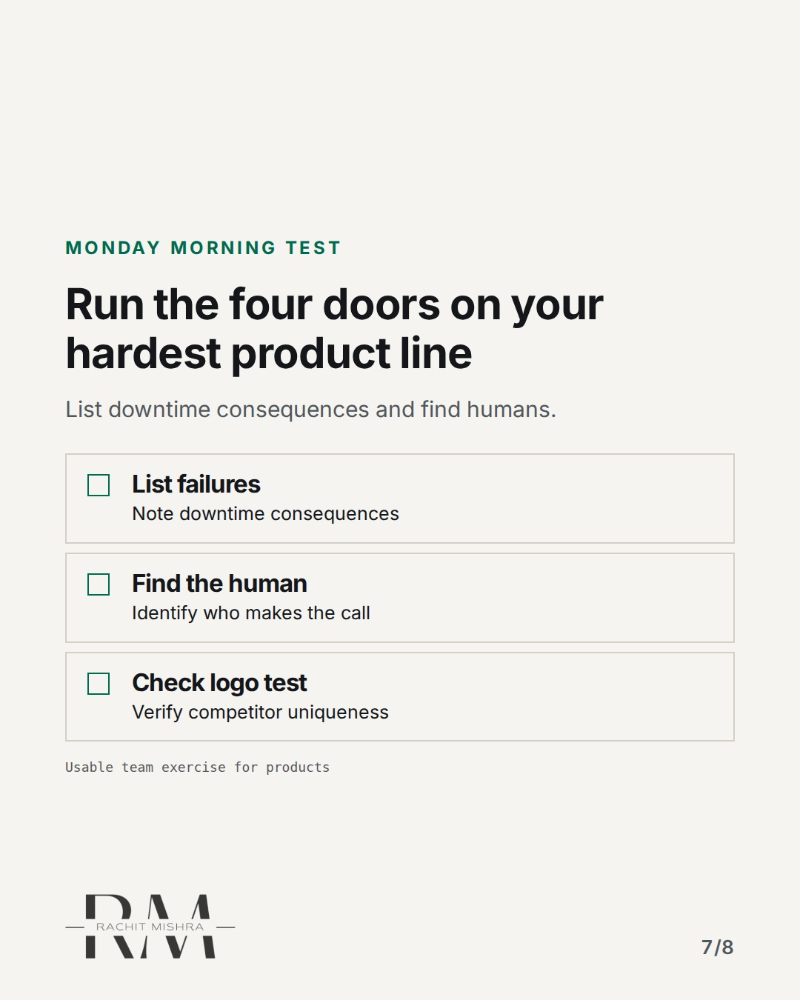
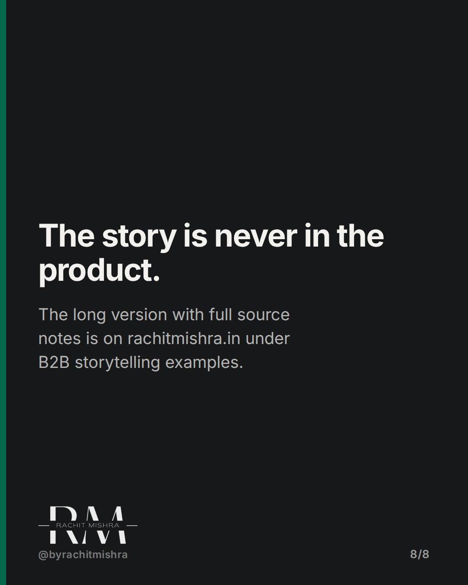

# b2b_storytelling_four_doors

**CAROUSEL** · b2b_brand · goes live **2026-10-19T19:00:00+05:30**

> Targeting: `B2B brand positioning`
>
> Claim: Commoditised B2B categories fail at storytelling because they search inside the product instead of the consequence of failure.
>
> Proof (source): Research by Ehrenberg-Bass Institute and LinkedIn B2B Institute indicates 95% of buyers are out of market, requiring memory structures built through narrative rather than immediate product specifications.
> Source: https://www.rachitmishra.in/2026/09/22/b2b-storytelling-examples/
>
> Source preflight: reachable (HTTP 200)
>
> Rendered infographics: 7 — comparison, comparison, checklist, comparison, bottleneck, checklist, comparison

## Slides

8 rendered images sit in this folder — upload them in filename order.

**1.** 
### Your product sheet is not a story.



**2.** The Inward Trap
### Why boring industries write bad stories
When specs match, attribute briefs fail.



**3.** The Evidence
### Buyers are asking for creative work
60% cite lack of emotion in industrial ads.


**4.** The Working Model
### The four doors into an unstoryable category
Start with consequence, then dependants.



**5.** Door One in Action
### Selling precision through suspended trucks
Volvo dramatised steering failure consequences.



**6.** Door Three
### Sell the constraint, not the commodity
Speak to price volatility and stability.



**7.** Monday Morning Test
### Run the four doors on your hardest product line
List downtime consequences and find humans.



**8.** 
### The story is never in the product.
The long version with full source notes is on rachitmishra.in under B2B storytelling examples.



## Caption — copy from here

```
Your product sheet is not a story.

Good B2B brand positioning starts by looking outside the factory gate. When your category is built on tonnage and delivery windows, marketing teams default to listing attributes that every competitor matches within a percentage point.

That approach fails because buyers are out of market ninety-five percent of the time. Specifications get evaluated when a deal is active, but memory structures are built long before procurement makes the call.

When the product yields no narrative tension, examine what happens when it fails, who depends on it downstream, or what constraints your buyer manages under pressure. The full breakdown of how to run this exercise is on my site: https://www.rachitmishra.in/2026/09/22/b2b-storytelling-examples/

If a competitor can put their logo on your campaign unchanged, it is not a story. It is a category description.

Send this to whoever is still trying to turn an engineering specification into an ad.

[b2b brand positioning, industrial marketing, brand strategy, manufacturing marketing, b2b storytelling]

#industrialmarketing #brandstrategy #b2bbranding
```

## Alt text

```
Carousel slides detailing B2B storytelling examples across industrial and boring categories.
```

## How this post could fail

Industrial marketers might dismiss storytelling as irrelevant to heavy procurement committees without reading the Ehrenberg-Bass timing argument.

## Sources

- [Research by Ehrenberg-Bass Institute and LinkedIn B2B Institute indicates 95% of buyers are out of market, requiring memory structures built through narrative rather than immediate product specifications.](https://www.rachitmishra.in/2026/09/22/b2b-storytelling-examples/)
