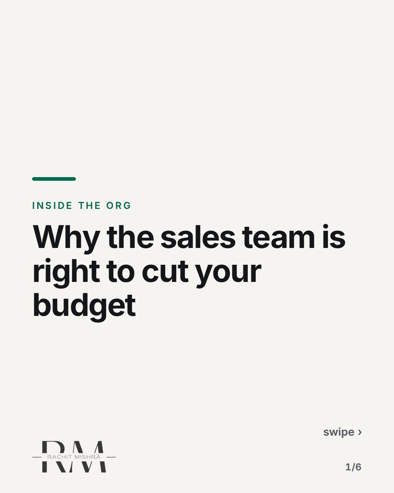
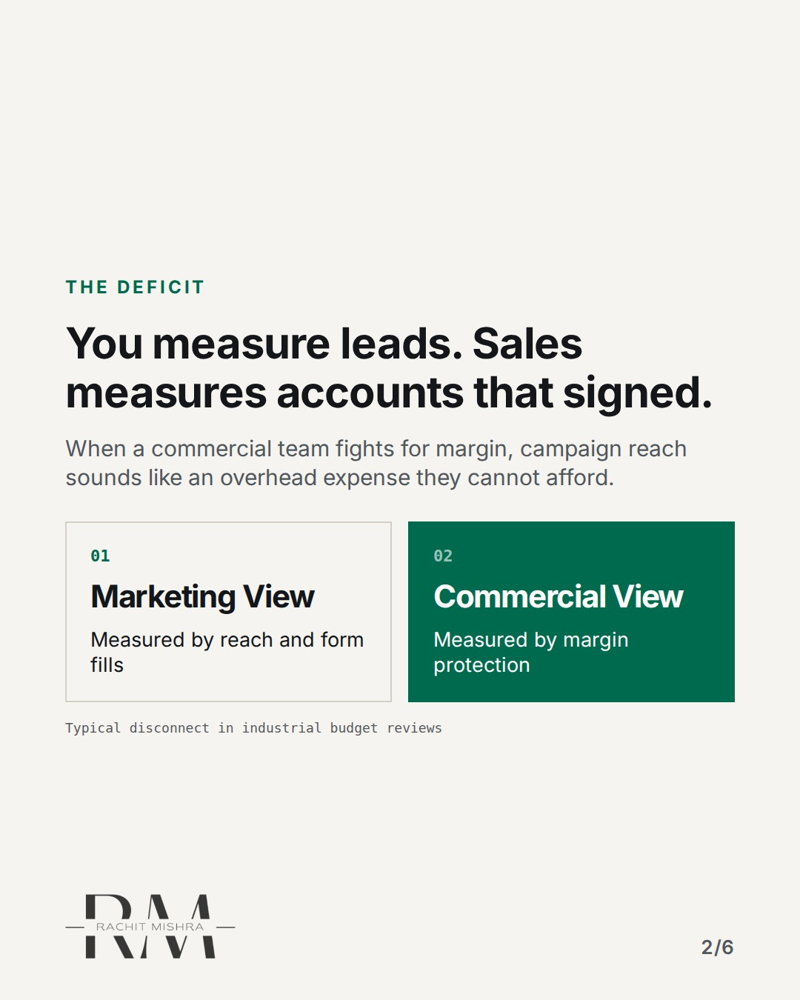
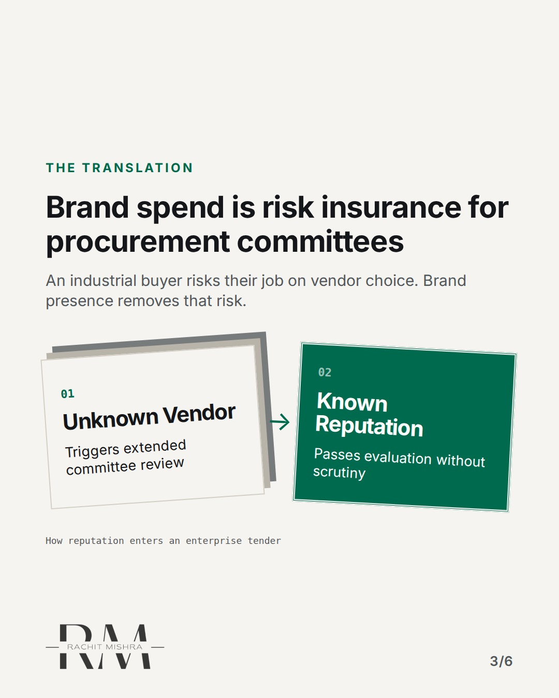
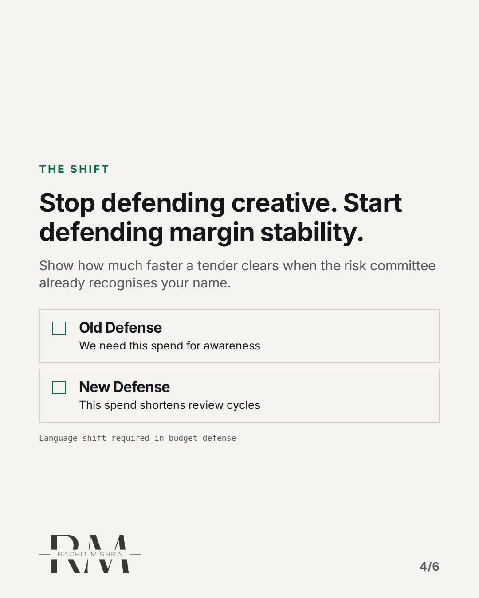
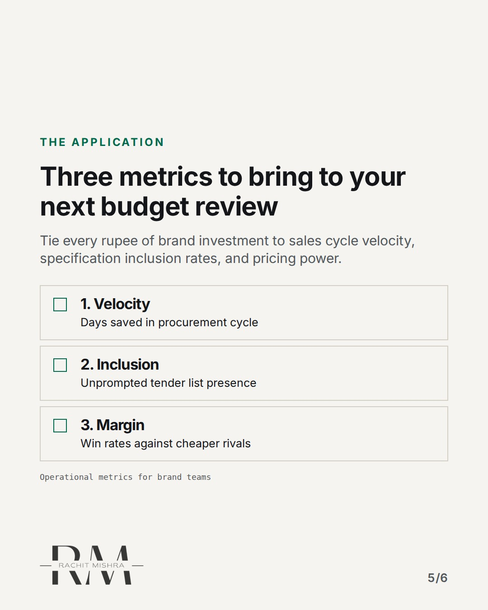
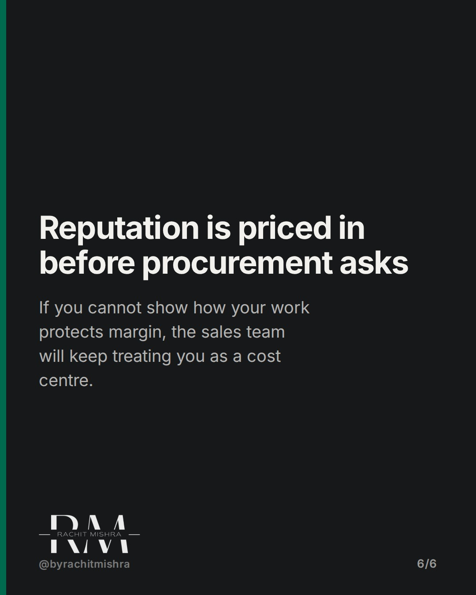

# defendingmarketingbudgetb2b

**CAROUSEL** · inside_the_org · goes live **2026-10-24T10:30:00+05:30**

> Targeting: `defending a marketing budget`
>
> Claim: Budget defense fails when marketing brings opinion instead of operational risk metrics to the commercial review.
>
> Proof (practitioner_observation): Observed commercial reviews across industrial sales cycles where brand expenditure was routinely reduced until mapped directly to procurement committee risk reduction rather than lead volume.
>
> Rendered infographics: 5 — comparison, bottleneck, checklist, checklist, comparison

## Slides

6 rendered images sit in this folder — upload them in filename order.

**1.** 
### Why the sales team is right to cut your budget



**2.** The Deficit
### You measure leads. Sales measures accounts that signed.
When a commercial team fights for margin, campaign reach sounds like an overhead expense they cannot afford.



**3.** The Translation
### Brand spend is risk insurance for procurement committees
An industrial buyer risks their job on vendor choice. Brand presence removes that risk.



**4.** The Shift
### Stop defending creative. Start defending margin stability.
Show how much faster a tender clears when the risk committee already recognises your name.



**5.** The Application
### Three metrics to bring to your next budget review
Tie every rupee of brand investment to sales cycle velocity, specification inclusion rates, and pricing power.



**6.** The Principle
### Reputation is priced in before procurement asks
If you cannot show how your work protects margin, the sales team will keep treating you as a cost centre.



## Caption — copy from here

```
Why the sales team is right to cut your budget

Defending a marketing budget fails when you argue about impressions in a room where everyone else is worried about margin.

Industrial buyers do not buy from ads. They buy to eliminate risk. If your brand work cannot show how it shortens tender cycles or protects pricing power against commoditisation, the commercial team is right to treat it as overhead.

Stop talking about reach. Start talking about risk reduction.

Send this to whoever is defending the brand budget this quarter.

[defending a marketing budget, b2b marketing, industrial marketing, marketing leadership, in-house marketing]

#marketingleadership #inhousemarketing #b2bmarketing
```

## Alt text

```
Carousel slide about defending a marketing budget in industrial b2b companies.
```

## How this post could fail

Readers might assume this applies only to ad spend rather than the wider operational definition of brand reputation in industrial sales.
