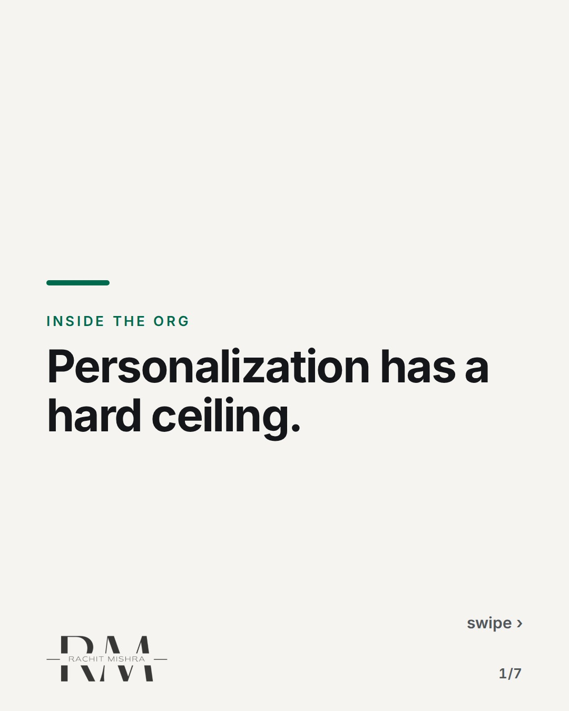
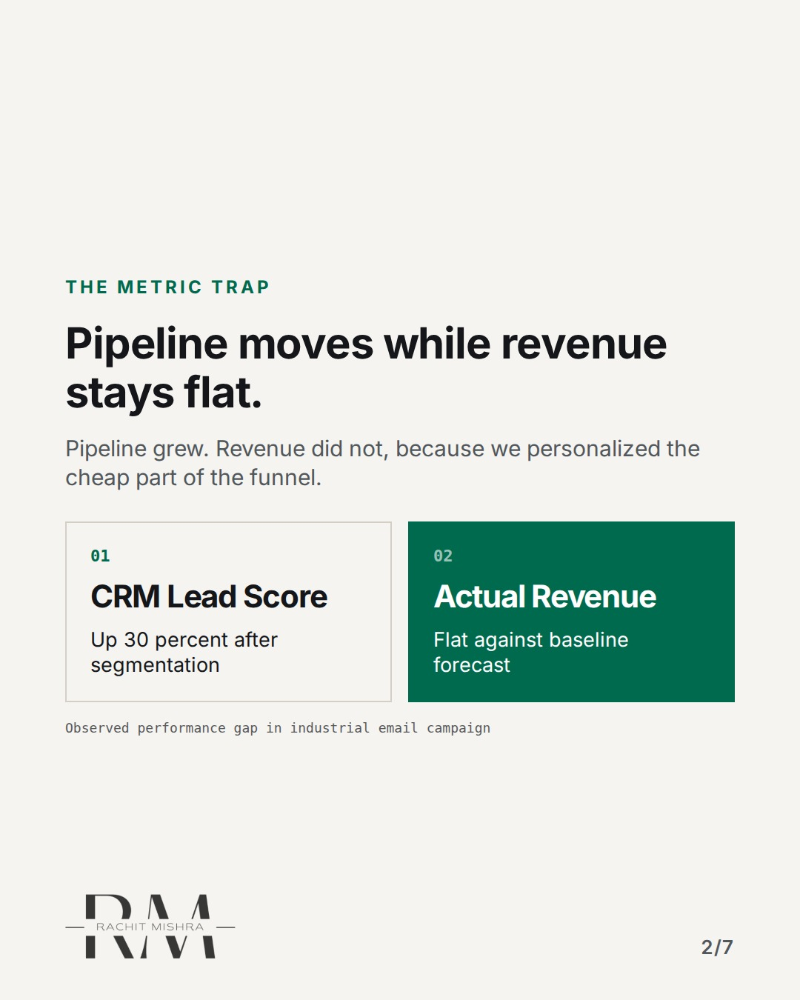
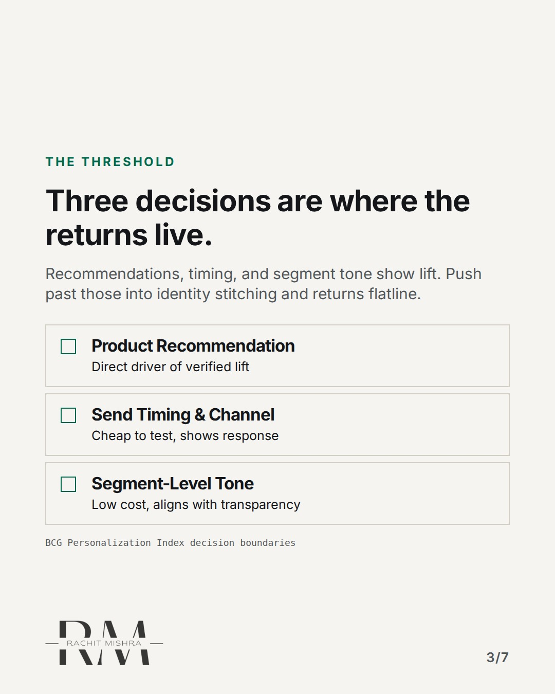
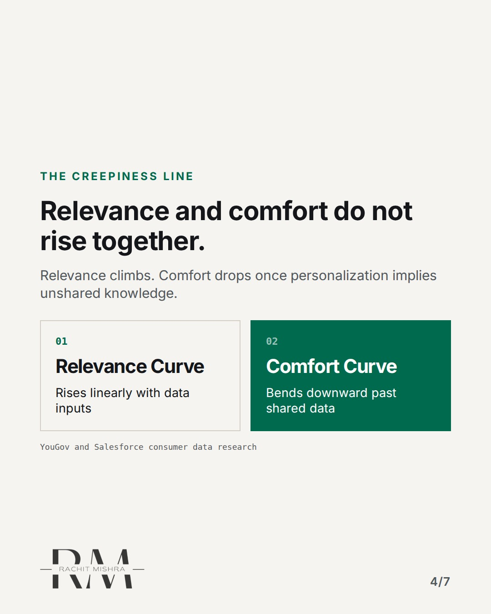
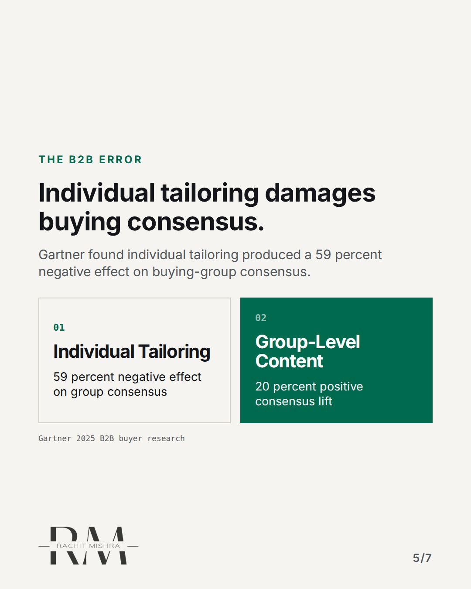
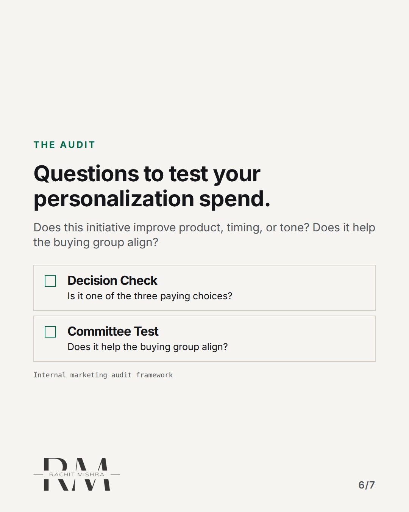
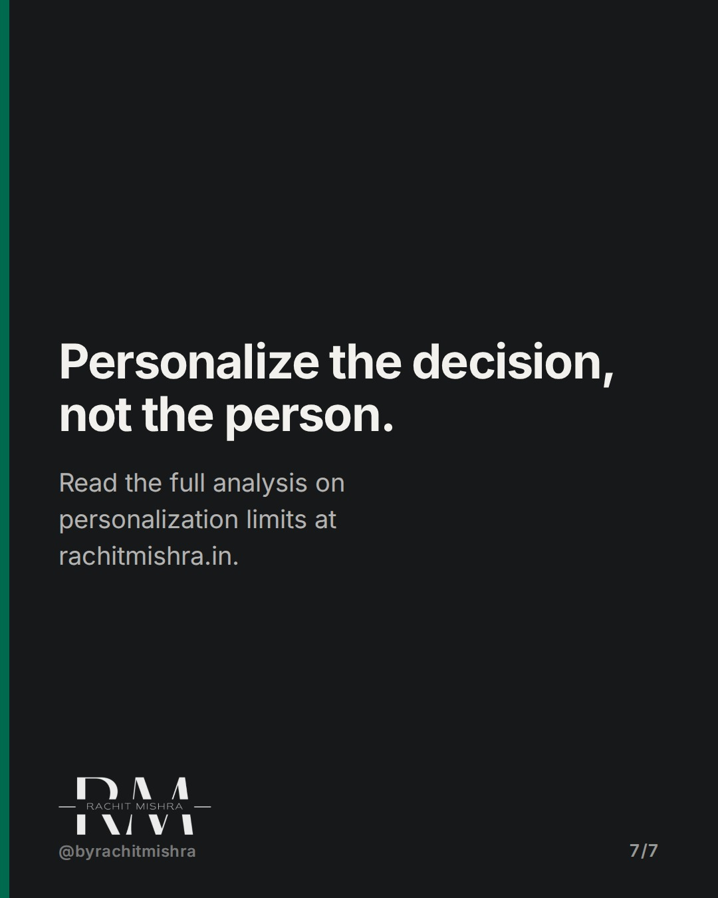

# personalization_ceiling_b2b

**CAROUSEL** · inside_the_org · goes live **2026-10-25T10:30:00+05:30**

> Targeting: `in-house marketing`
>
> Claim: Personalization programs fail when they optimize for individual CRM records instead of the committee that actually buys.
>
> Proof (source): Gartner's 2025 research found individual-level content tailoring produced a 59% negative effect on buying-group consensus.
> Source: https://www.rachitmishra.in/2026/09/24/personalization-limits-marketing/
>
> Source preflight: reachable (HTTP 200)
>
> Rendered infographics: 6 — comparison, checklist, comparison, comparison, checklist, checklist

## Slides

7 rendered images sit in this folder — upload them in filename order.

**1.** 
### Personalization has a hard ceiling.



**2.** The Metric Trap
### Pipeline moves while revenue stays flat.
Pipeline grew. Revenue did not, because we personalized the cheap part of the funnel.



**3.** The Threshold
### Three decisions are where the returns live.
Recommendations, timing, and segment tone show lift. Push past those into identity stitching and returns flatline.



**4.** The Creepiness Line
### Relevance and comfort do not rise together.
Relevance climbs. Comfort drops once personalization implies unshared knowledge.



**5.** The B2B Error
### Individual tailoring damages buying consensus.
Gartner found individual tailoring produced a 59 percent negative effect on buying-group consensus.



**6.** The Audit
### Questions to test your personalization spend.
Does this initiative improve product, timing, or tone? Does it help the buying group align?



**7.** 
### Personalize the decision, not the person.
Read the full analysis on personalization limits at rachitmishra.in.



## Caption — copy from here

```
Personalization has a hard ceiling.

Most in-house marketing teams keep pushing for individual specificity long after the returns have flattened and the legal risk has climbed.

In B2B, individual-level tailoring doesn't just fail to help. It actively damages committee consensus because it treats a multi-person buying group as a single contact record.

The long version of this analysis is up on my site at https://www.rachitmishra.in/2026/09/24/personalization-limits-marketing/

Reputation is priced in long before procurement calls you.

Send this to whoever is defending their personalization budget in the Q4 planning meeting.

[b2b marketing, personalization limits, in-house marketing, b2b buying committee, marketing ROI]

#marketingleadership #inhousemarketing #b2bmarketing
```

## Alt text

```
Carousel slides on B2B personalization limits and buying committee consensus.
```

## How this post could fail

Readers might dismiss it if they rely entirely on consumer e-commerce playbooks that don't apply to enterprise sales cycles.

## Sources

- [Personalization Limits: Where Marketing’s Ceiling Is](https://www.rachitmishra.in/2026/09/24/personalization-limits-marketing/)
