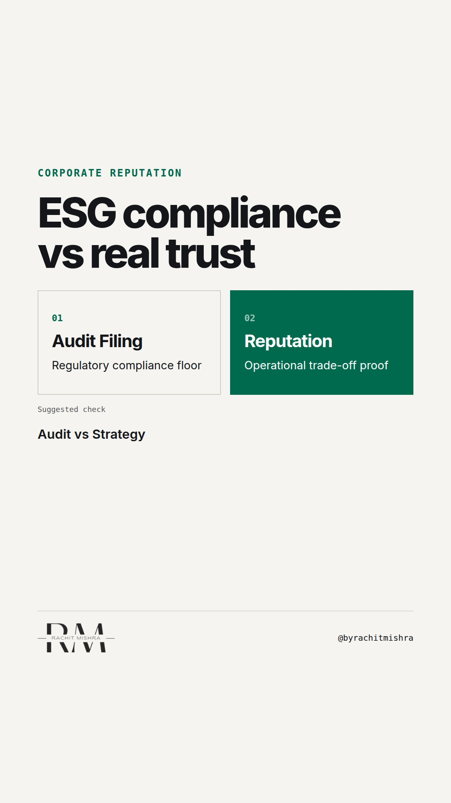

# esg_compliance_versus_reputation

**REEL** · reputation · goes live **2026-10-22T17:00:00+05:30**

> Targeting: `ESG communication that is not greenwashing`
>
> Claim: Audit compliance does not build stakeholder trust because buyers treat regulatory disclosures as a legal minimum rather than a commercial differentiator.
>
> Proof (framework): The ESG Disclosure Gap: Audited compliance metrics satisfy legal obligations but fail to build buyer trust unless paired with operational trade-off data.
>
> Rendered infographics: 3 — comparison, bottleneck, checklist
>
> Reel assets: image `designed_gradient` · music `bed-something (11).mp3`

## Cover



## Reel script

`reel.mp4` has been generated from this script and will publish automatically. To use your own footage instead, replace that file and delete `.generated-reel` from this folder.

| Time | On screen | Voiceover | Direction |
|---|---|---|---|
| 0:00-0:03 | **ESG reporting will not protect your reputation.** | ESG reporting will not protect your reputation. Passing an audit just means you are legally allowed to operate. | Text appears over clean minimalist background with a document approval stamp animation. |
| 0:03-0:07 | **Compliance is a legal floor, not proof.** | Most corporate communications teams treat the annual ESG filing like a reputation strategy. | Text overlay switches to industrial background graphic. |
| 0:07-0:12 | **Procurement committee review** | It isn't. When a procurement committee reviews your bid, audit compliance is just the entry ticket. | Visual slide shows bottleneck graphic of procurement checklist. |
| 0:12-0:17 | **Buyers look for operational trade-offs.** | Trust is built on how you handle trade-offs when input costs surge or supply chains break. | Clean typography transition. |
| 0:17-0:22 | **The 3-point ESG credibility test** | Run this three-point test on your ESG communication before publishing. | Checklist animation overlay. |
| 0:22-0:28 | **Reputation lives in operational decisions.** | If your report only lists metrics and hides the costs, it reads as PR. Stakeholder trust is built in the trade-offs. | Final text frame with clear emphasis. |

## Caption — copy from here

```
ESG reporting will not protect your reputation.

Executing ESG communication that is not greenwashing requires showing the decisions that actually cost money.

Audited filings satisfy regulators. They do not convince a procurement committee or a community group that you will do the right thing when margins tighten.

When a company publishes target metrics without disclosing the operational trade-offs required to reach them, readers assume the report was written by legal and polished by PR.

If your sustainability disclosures list achievements without naming what they cost or where the scope stops, you are publishing marketing copy, not building credibility.

Real reputation is built on how transparently you handle business constraints, not how neatly you design a compliance PDF.

Send this to whoever is preparing your corporate sustainability disclosures this quarter.

[corporate reputation, esg communication that is not greenwashing, corporate communications, stakeholder trust, b2b reputation]

#corporatecommunications #reputation #esg
```

## Alt text

```
Text graphic listing three ESG communication checks on a dark gray background.
```

## How this post could fail

It risks reading like generic ESG critique if the operational trade-off framework in beat 5 is skimmed over.
