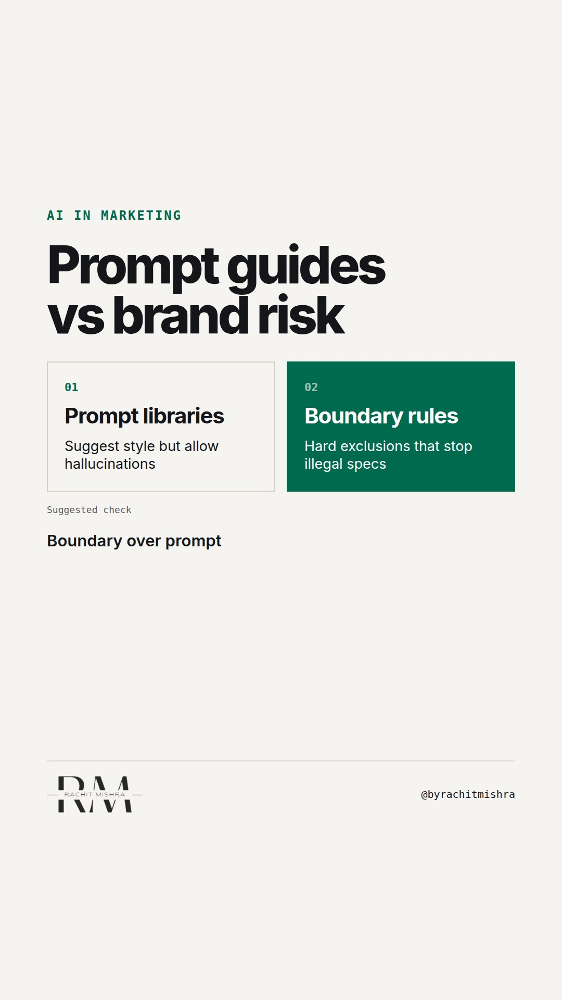

# promptlibrariesvsrisk

**REEL** · ai_marketing · goes live **2026-10-20T19:00:00+05:30**

> Targeting: `AI adoption in a large company`
>
> Claim: Enterprise AI adoption fails in B2B marketing when teams rely on prompt guides instead of defining non-negotiable operational boundaries.
>
> Proof (practitioner_observation): Observed enterprise AI rollouts where prompt templates increased draft velocity while increasing legal rework due to unchecked technical spec hallucinations in commercial collateral.
>
> Rendered infographics: 3 — comparison, comparison, checklist
>
> Reel assets: image `designed_gradient` · music `bed-something (10).mp3`

## Cover



## Reel script

`reel.mp4` has been generated from this script and will publish automatically. To use your own footage instead, replace that file and delete `.generated-reel` from this folder.

| Time | On screen | Voiceover | Direction |
|---|---|---|---|
| 0:00-0:03 | **Prompt libraries will not protect your brand.** | Prompt libraries will not protect your brand. In a B2B enterprise, standard prompt templates give teams permission to output fluent draft text, but zero guardrails against liability. | Text headline over dark graphic background. |
| 0:03-0:07 | **Style rules fail when specs matter** | When a customer buys heavy machinery, freight contracts, or chemicals, an AI hallucination in a technical spec sheet is a legal liability. | Pacing shot over technical specification document. |
| 0:07-0:12 | **The prompt trap vs boundary rules** | Most marketing tech stacks focus on how to prompt. B2B brand governance requires hard negative constraints. |  |
| 0:12-0:17 | **Rule 1: Anchor on verified data** | First, the Fact-Anchor Rule. AI must pull technical numbers and tolerances from an audited database, never generate them from memory. | Graphic showing verified database query. |
| 0:17-0:22 | **Rule 2: Exclude unapproved terms** | Second, Programmatic Exclusion. Define compliance terms AI is legally prohibited from using without explicit sign-off. | Highlighting prohibited terms on screen. |
| 0:22-0:27 | **The 3-point B2B AI boundary checklist** | Third, Source Auditability. Every published paragraph must map back to a human-approved technical document. |  |
| 0:27-0:32 | **Speed without boundaries creates debt** | Accelerating draft speed without strict boundaries does not build scale. It just compounds enterprise risk. | Chart comparing draft velocity against audit debt. |
| 0:32-0:36 | **Governance is an operational boundary** | Governance is not prompt engineering. It is an operational boundary. | Closing title slide with summary line. |

## Caption — copy from here

```
Prompt libraries will not protect your brand.

When scaling AI adoption in a large company, marketing teams usually distribute prompt guides. They focus on tone, length, and style.

In B2B industrial marketing, tone rarely breaks you. Technical specifications, warranty terms, and regulatory claims do.

If an AI tool generates a technical specification for heavy machinery or freight contracts, a hallucinated tolerance figure creates legal risk. Better prompts cannot fix probabilistic model outputs.

Prompting accelerates draft speed. Hard boundaries protect liability.

Send this to whoever is building your team's martech guidelines this quarter.

[ai adoption in a large company, ai governance, martech, b2b marketing, industrial marketing]

#aimarketing #martech #marketingtechnology #aigovernance #b2bmarketing
```

## Alt text

```
Graphic showing a contrast between prompt libraries and operational AI boundary rules for B2B teams.
```

## How this post could fail

Could be misinterpreted as an anti-AI stance rather than an operational governance framework for enterprise accuracy.
