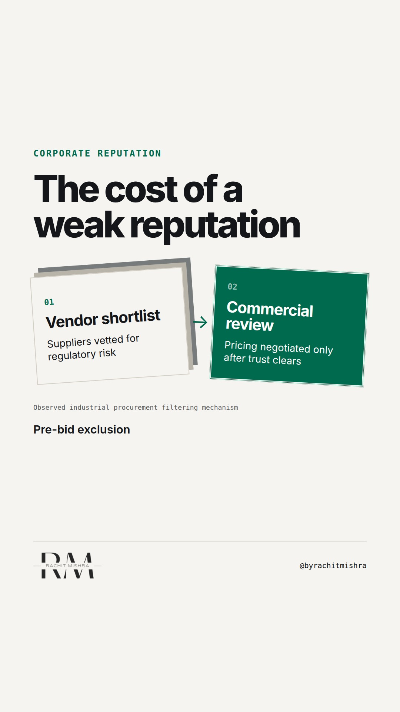

# corporate reputation procurement cost

**REEL** · reputation · goes live **2026-10-21T08:30:00+05:30**

> Targeting: `corporate reputation management`
>
> Claim: Corporate reputation is priced into procurement long before commercial terms are discussed, functioning as an invisible risk discount.
>
> Proof (practitioner_observation): Observed review cycles across heavy equipment and industrial logistics where procurement committees filter out vendors with regulatory exposure before reviewing pricing sheets.
>
> Rendered infographics: 7 — bottleneck, bottleneck, comparison, checklist, bottleneck, comparison, checklist
>
> Reel assets: image `designed_gradient` · music `bed-something (12).mp3`

## Cover



## Reel script

`reel.mp4` has been generated from this script and will publish automatically. To use your own footage instead, replace that file and delete `.generated-reel` from this folder.

| Time | On screen | Voiceover | Direction |
|---|---|---|---|
| 0:00-0:03 | **Reputation is priced in before they call you.** | Reputation is priced in before they call you. In industrial procurement, trust is evaluated before anyone looks at a single line of your proposal. | Static shot looking across an industrial desk with procurement files. |
| 0:03-0:08 | **Risk discounts apply before negotiation.** | Buyers do not wait for a crisis to factor in risk. If your plant emissions or community disputes make local news, procurement adds a hidden safety buffer. | Cut to close-up of a risk assessment matrix. |
| 0:08-0:14 | **Run this procurement trust check today.** | Here is a simple check to run on your pipeline this week. Ask your sales lead which accounts stalled during compliance review, not during pricing talks. | Direct cut to camera, measured cadence. |
| 0:14-0:20 | **Sales teams feel the invisible penalty.** | Your sales team then spends months discounting prices to make up for a corporate reputation issue they did not create and cannot fix alone. | Pan across a manufacturing floor showing assembly lines. |
| 0:20-0:26 | **Corporate reputation is a balance sheet asset.** | Corporate reputation management is not about public relations campaigns. It is risk reduction that protects your margin when sales teams are not in the room. | Hold steady on a clean industrial backdrop. |
| 0:26-0:32 | **Protect trust before bidding begins.** | Fix the regulatory record before you send the bid. That is where commercial margins are actually defended. | Fade to final title card with clean typography. |

## Caption — copy from here

```
Reputation is priced in before they call you.

Effective corporate reputation management starts long before a sales team picks up the phone. When you sell steel, logistics, or industrial equipment, procurement committees are not grading your brand ads. They are evaluating your regulatory exposure, your community record, and your plant stability.

If those signals carry friction, your commercial team spends months arguing against a risk discount they did not create.

Send this to whoever is defending the brand budget against the sales team this quarter.

[corporate reputation management, B2B trust, industrial procurement, stakeholder trust]

#corporatecommunications #reputation #publicrelations
```

## Alt text

```
An industrial desk with procurement documents and a risk matrix.
```

## How this post could fail

Could be misread as a general PR homily if the industrial procurement angle is not emphasized.
