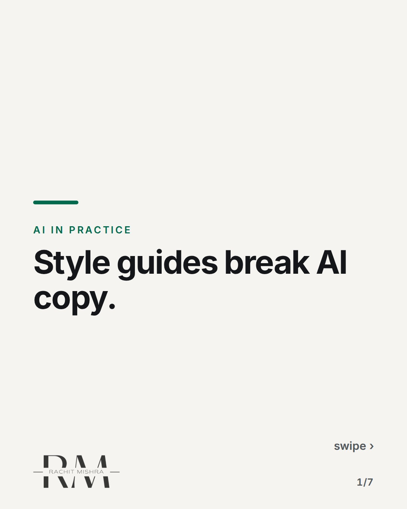
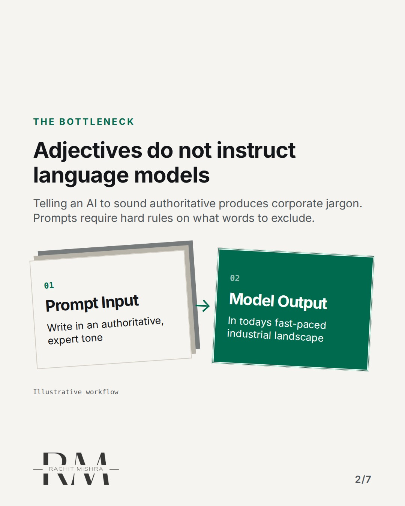
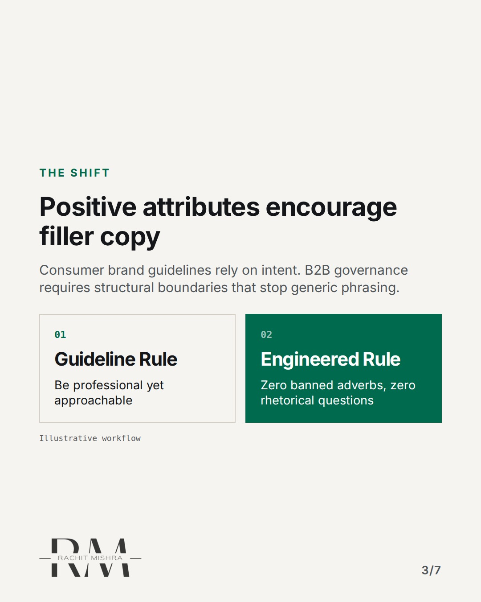
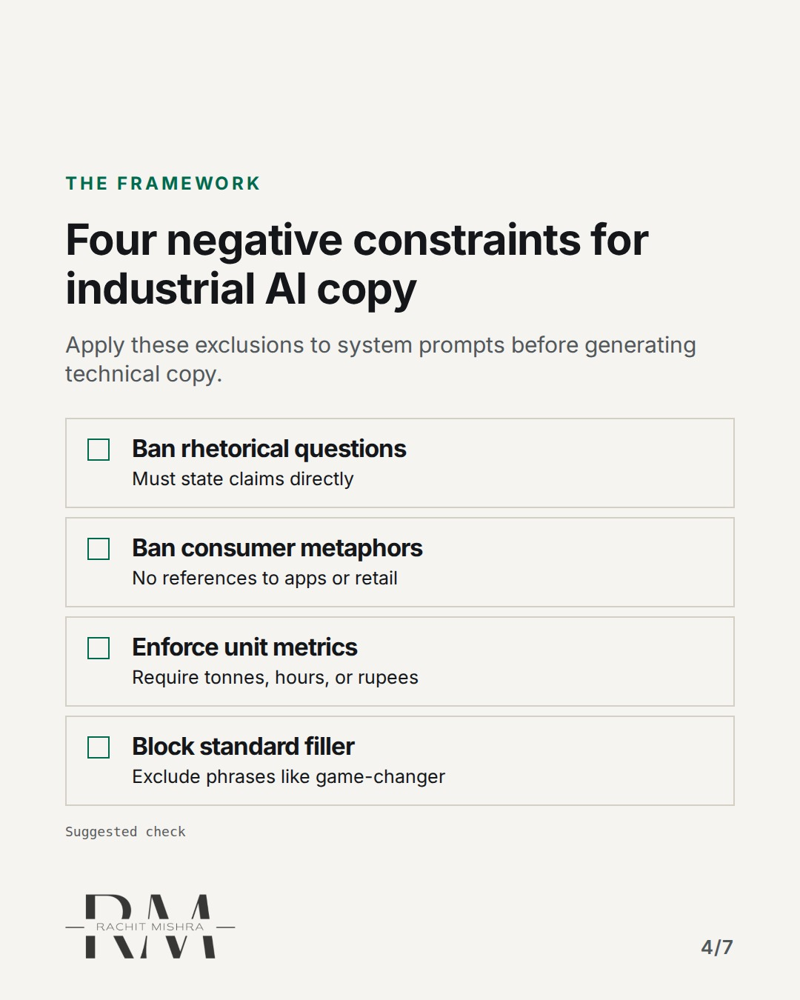
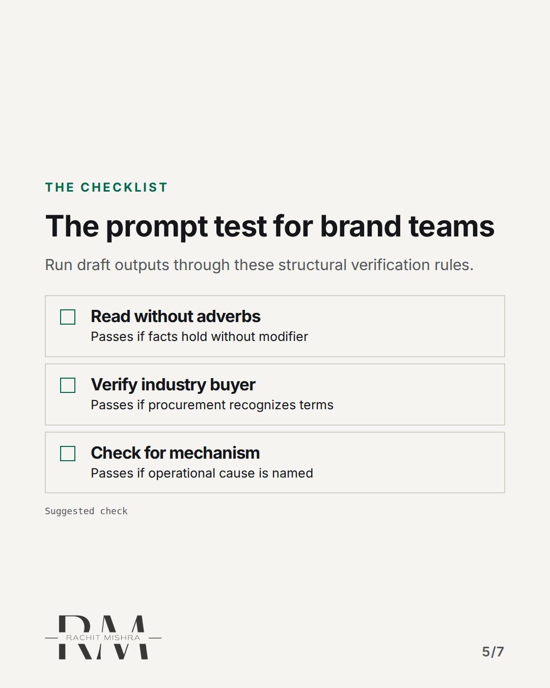
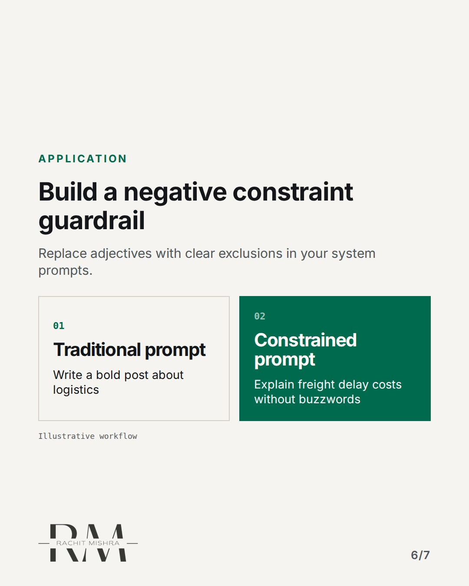
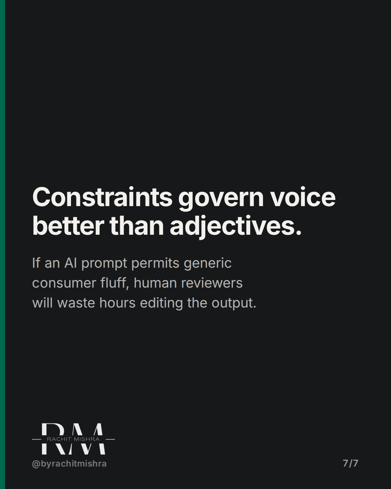

# briefing_ai_on_brand_voice

**CAROUSEL** · ai_in_practice · goes live **2026-10-21T20:00:00+05:30**

> Targeting: `briefing AI on brand voice`
>
> Claim: AI models drift into generic consumer marketing voice because teams feed them style guidelines instead of explicit negative constraints.
>
> Proof (framework): A negative constraint framework that filters language generated by large language models before human review.
>
> Rendered infographics: 5 — bottleneck, comparison, checklist, checklist, comparison

## Slides

7 rendered images sit in this folder — upload them in filename order.

**1.** 
### Style guides break AI copy.



**2.** THE BOTTLENECK
### Adjectives do not instruct language models
Telling an AI to sound authoritative produces corporate jargon. Prompts require hard rules on what words to exclude.



**3.** THE SHIFT
### Positive attributes encourage filler copy
Consumer brand guidelines rely on intent. B2B governance requires structural boundaries that stop generic phrasing.



**4.** THE FRAMEWORK
### Four negative constraints for industrial AI copy
Apply these exclusions to system prompts before generating technical copy.



**5.** THE CHECKLIST
### The prompt test for brand teams
Run draft outputs through these structural verification rules.



**6.** APPLICATION
### Build a negative constraint guardrail
Replace adjectives with clear exclusions in your system prompts.



**7.** 
### Constraints govern voice better than adjectives.
If an AI prompt permits generic consumer fluff, human reviewers will waste hours editing the output.



## Caption — copy from here

```
Style guides break AI copy.

When briefing AI on brand voice, most teams copy their existing guidelines into a system prompt. They paste adjectives like visionary, trusted, and human, then wonder why the output sounds like a D2C ad campaign.

Large language models do not interpret adjectives the way a human writer does. To a model, visionary means reaching for high-frequency marketing fluff. Trusted means adding passive, safe assertions.

In B2B and heavy industry, voice is defined by what you refuse to say. You protect technical credibility by setting explicit negative constraints.

If you want clean output, stop telling the tool how to feel. Tell it what syntax, phrases, and structures are strictly forbidden.

Send this to the person managing your brand system prompts this week.

[briefing ai on brand voice, ai content workflow, b2b branding, marketing automation]

#aimarketing #aigovernance #b2bmarketing

#aimarketing #aigovernance #b2bmarketing
```

## Alt text

```
Comparison showing traditional brand guidelines versus negative prompt rules for briefing AI.
```

## How this post could fail

If the negative constraint concept reads as basic prompt engineering advice rather than brand governance, it loses its enterprise focus.
