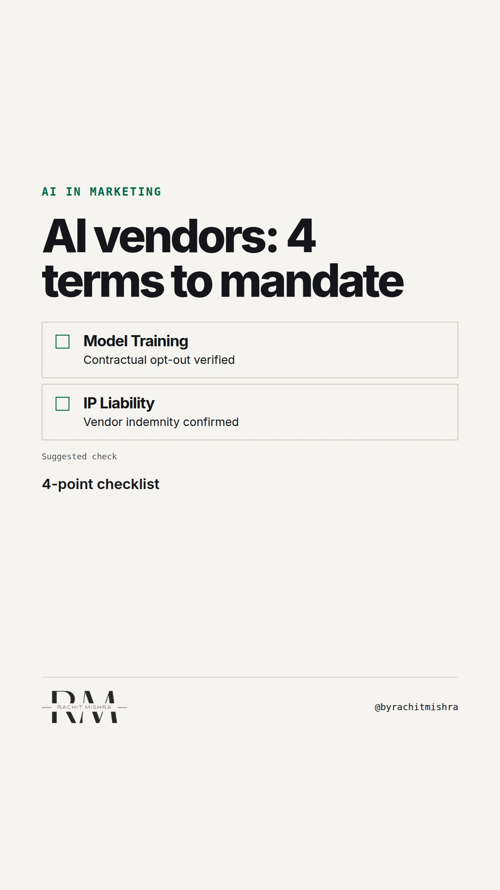

# ai_vendor_vetting_criteria

**REEL** · ai_marketing · goes live **2026-10-30T08:30:00+05:30**

> Targeting: `AI adoption in a large company`
>
> Claim: Enterprise AI tools fail in marketing not from bad outputs, but from unmanaged legal liability and data privacy exposure in the supply chain.
>
> Proof (framework): A 4-point procurement sanity check for enterprise marketing technology evaluation: training data indemnity, data retention window, downstream model ownership, and liability cap alignment.
>
> Rendered infographics: 3 — checklist, bottleneck, checklist
>
> Reel assets: image `designed_gradient` · music `bed-something (13).mp3`

## Cover



## Reel script

`reel.mp4` has been generated from this script and will publish automatically. To use your own footage instead, replace that file and delete `.generated-reel` from this folder.

| Time | On screen | Voiceover | Direction |
|---|---|---|---|
| 0:00-0:03 | **90% of AI risk sits in your vendor contract.** | 90% of AI risk sits in your vendor contract, not in the prompt window. | Text overlays dark background with industrial corporate grid pattern. |
| 0:03-0:07 | **Copy paste is easy. Legal sign-off is not.** | Generative tools look simple at the desk. But scaling AI adoption in a large company breaks at legal sign-off. | Text overlay with clean typography. |
| 0:07-0:12 | **Where is your brand data retained?** | Most enterprise teams check output quality. Almost none check if input prompts train public base models by default. |  |
| 0:12-0:18 | **The 4-point AI procurement checklist** | Before signing any enterprise marketing technology vendor, run this four-step legal audit. |  |
| 0:18-0:23 | **If they fail one point, block the license.** | If an AI software vendor cannot sign all four conditions in writing, do not deploy them across your communications team. | Clear bold text on screen. |
| 0:23-0:28 | **Governance protects speed.** | AI governance is not a brake on marketing execution. It is the boundary that allows enterprise scale without legal rollback. | Final summary card. |

## Caption — copy from here

```
90% of AI risk sits in your vendor contract.

Successful AI adoption in a large company is rarely stopped by prompt quality. It gets killed six months later when legal reviews the enterprise software agreement.

Most B2B communications leads test tools for speed and output style. Meanwhile, the software vendor retains prompt inputs to train public base models, exposing confidential product specifications to public indexing.

If your martech vendor cannot grant full copyright indemnity and guarantee zero data retention for training, you are taking on unmanaged corporate risk.

Governance is not the enemy of speed. Clear boundaries are what allow large organizations to deploy tools safely.

Send this to whoever is evaluating AI software vendors for your team this quarter.

[ai adoption in a large company, marketing technology, enterprise marketing, AI governance, martech procurement]

#aimarketing #martech #marketingtechnology
```

## Alt text

```
Text graphic showing a 4-point contract checklist for evaluating enterprise marketing AI software.
```

## How this post could fail

If the checklist feels too oriented toward legal procurement, pure creative leads might skim past, but for B2B brand leaders in enterprise environments, this trade-off is the exact point of failure.
