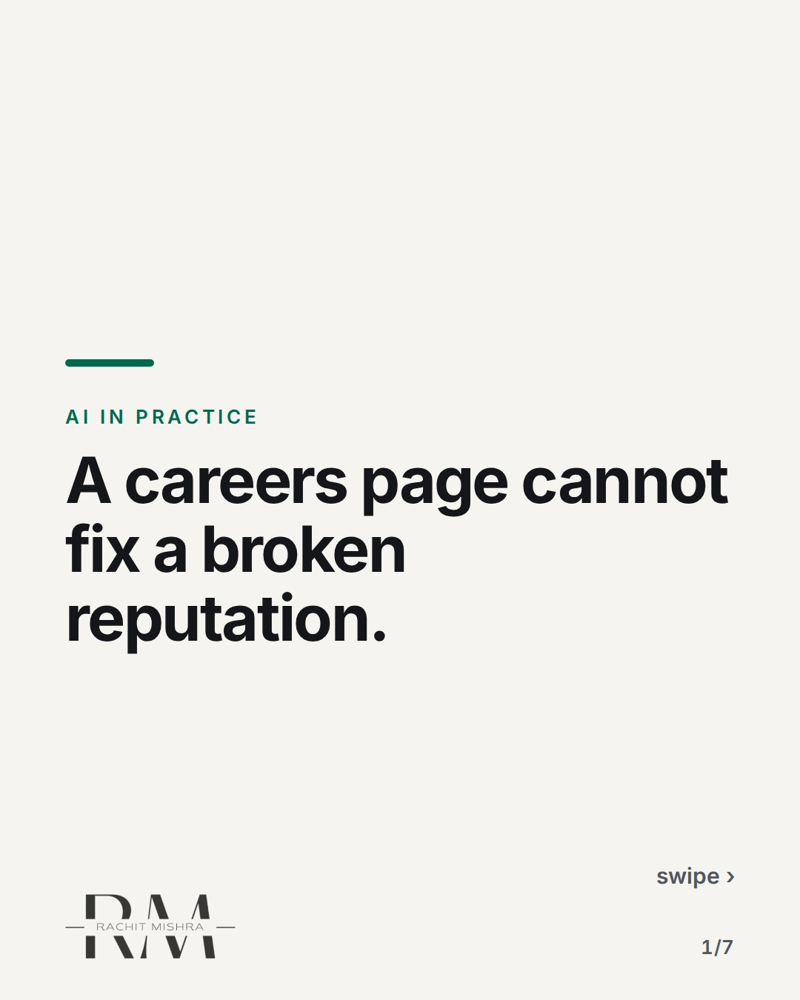
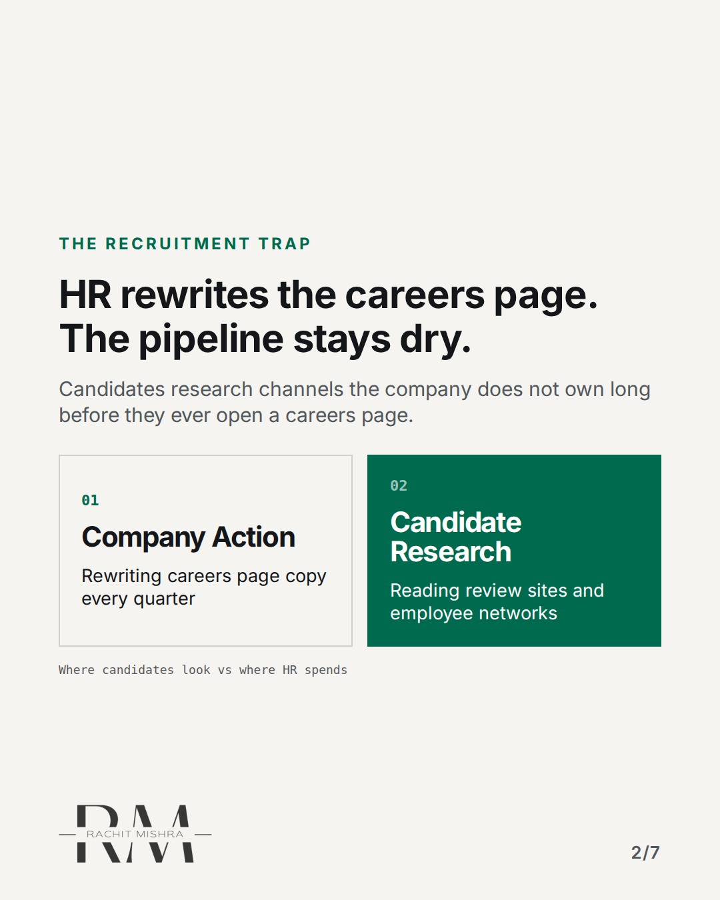
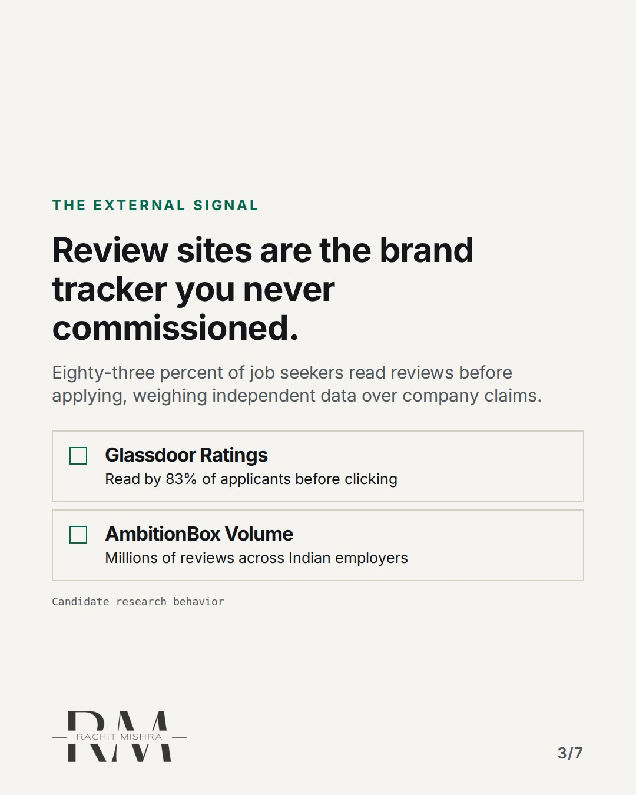
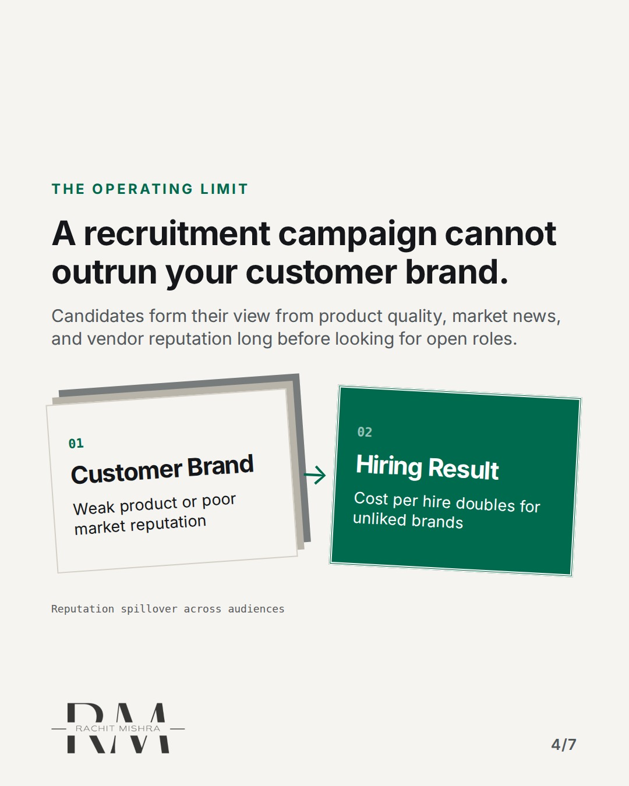
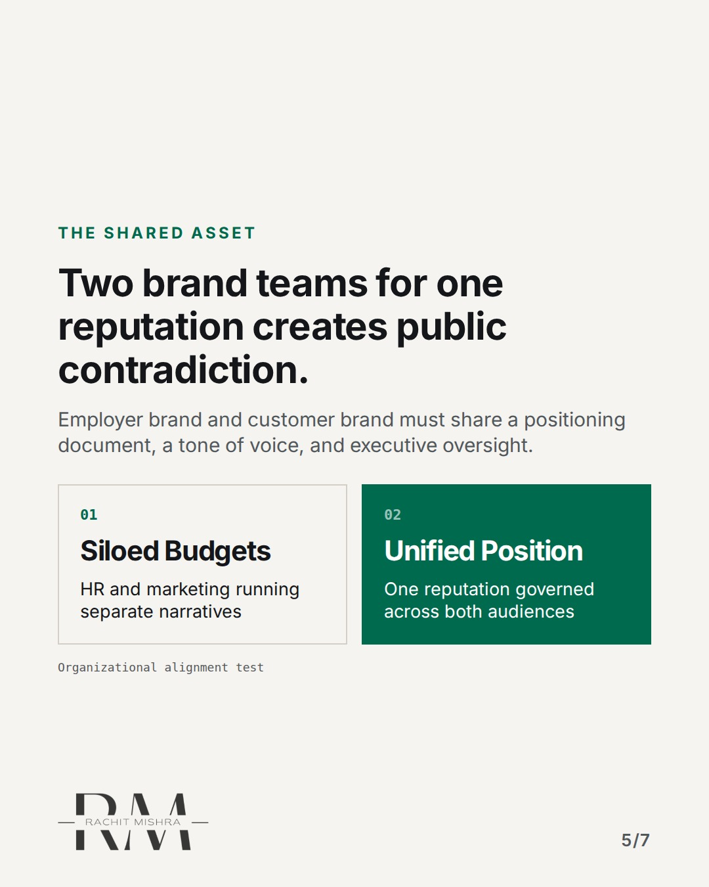
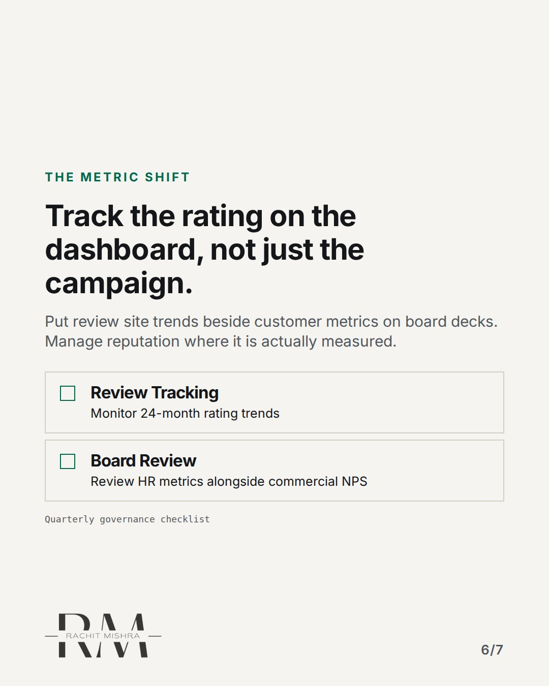
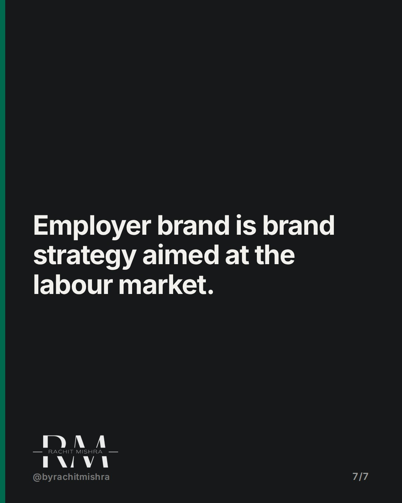

# employer_brand_strategy_is_brand_strategy

**CAROUSEL** · ai_in_practice · goes live **2026-10-30T19:00:00+05:30**

> Targeting: `employer branding strategy`
>
> Claim: Employer brand is downstream of corporate reputation, not a standalone HR project.
>
> Proof (source): Randstad Employer Brand Research 2025 and Glassdoor candidate research data on review volume and conversion impact.
> Source: https://www.rachitmishra.in/2026/09/12/employer-branding-strategy/
>
> Source preflight: reachable (HTTP 200)
>
> Rendered infographics: 5 — comparison, checklist, bottleneck, comparison, checklist

## Slides

7 rendered images sit in this folder — upload them in filename order.

**1.** 
### A careers page cannot fix a broken reputation.



**2.** The Recruitment Trap
### HR rewrites the careers page. The pipeline stays dry.
Candidates research channels the company does not own long before they ever open a careers page.



**3.** The External Signal
### Review sites are the brand tracker you never commissioned.
Eighty-three percent of job seekers read reviews before applying, weighing independent data over company claims.



**4.** The Operating Limit
### A recruitment campaign cannot outrun your customer brand.
Candidates form their view from product quality, market news, and vendor reputation long before looking for open roles.



**5.** The Shared Asset
### Two brand teams for one reputation creates public contradiction.
Employer brand and customer brand must share a positioning document, a tone of voice, and executive oversight.



**6.** The Metric Shift
### Track the rating on the dashboard, not just the campaign.
Put review site trends beside customer metrics on board decks. Manage reputation where it is actually measured.



**7.** 
### Employer brand is brand strategy aimed at the labour market.



## Caption — copy from here

```
A careers page cannot fix a broken reputation.

Treating employer branding strategy as a separate recruitment marketing project is an expensive mistake. Candidates research your company on independent channels long before they apply.

The long version of this analysis on employer brand strategy is available on my site: https://www.rachitmishra.in/2026/09/12/employer-branding-strategy/

If your ratings have not moved in two years, a new banner will not change the outcome.

Send this to whoever is defending the recruitment marketing budget this quarter.

[employer branding strategy, b2b branding, corporate reputation, marketing operations]

#b2bmarketing #marketingoperations #aigovernance
```

## Alt text

```
Carousel slides showing why employer brand strategy depends on customer reputation and review sites.
```

## How this post could fail

Readers might assume this is generic HR advice rather than a structural critique of how industrial companies waste brand budget on recruitment.

## Sources

- [Randstad Employer Brand Research 2025 and Glassdoor candidate research data on review volume and conversion impact.](https://www.rachitmishra.in/2026/09/12/employer-branding-strategy/)
