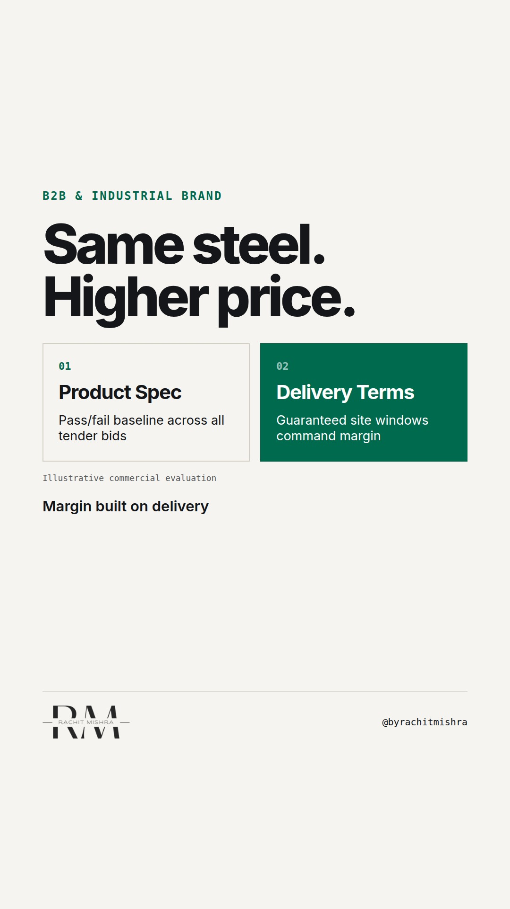

# how_to_brand_a_commodity_product_spec

**REEL** · b2b_brand · goes live **2026-10-26T08:30:00+05:30**

> Targeting: `how to brand a commodity product`
>
> Claim: In industrial markets, commodity branding succeeds by reducing the buyer's risk of project delay rather than proving technical product superiority.
>
> Proof (practitioner_observation): In industrial procurement tenders, technical specs are binary pass/fail filters; margin premiums are captured entirely on commercial terms like guaranteed site delivery windows and liability caps.
>
> Rendered infographics: 3 — comparison, comparison, checklist
>
> Reel assets: image `designed_gradient` · music `bed-something (1).mp3`

## Cover



## Reel script

`reel.mp4` has been generated from this script and will publish automatically. To use your own footage instead, replace that file and delete `.generated-reel` from this folder.

| Time | On screen | Voiceover | Direction |
|---|---|---|---|
| 0:00-0:03 | **Why pay more for identical steel?** | Why pay more for identical steel? Because procurement committees do not buy metal. | Text overlays a dark industrial floor with heavy steel coils stored in rows. |
| 0:03-0:08 | **Tech specs are pass/fail filters.** | They buy schedule certainty. Technical specifications are just binary pass or fail filters in a tender. | Animated comparison layout showing spec evaluation versus operational delivery risk. |
| 0:08-0:14 | **Risk lives on the timeline.** | Once three suppliers pass the lab test, product differentiation drops to zero. The risk moves entirely to site delivery. | Diagram of supply chain delay cascading into liquidated damages fees. |
| 0:14-0:21 | **Brand is risk reduction.** | If your late delivery stops a construction site, the contractor loses fifty thousand dollars a day in liquidated damages. | Graphic highlighting site delay penalty clause in procurement contract. |
| 0:21-0:29 | **Commodity Brand Audit** | To understand how to brand a commodity product, run this quick audit on your commercial messaging. | Checklist layout overlaying structural steel installation. |
| 0:29-0:36 | **Guarantees command margins.** | The vendor who guarantees staged delivery slots earns a five percent premium on identical grade material. | Close up of logistics dispatch screen showing real-time delivery tracking. |
| 0:36-0:42 | **Position on execution.** | Stop trying to prove your commodity is special. Position your organisation around execution risk. | Text graphic showing transition from product features to operational guarantees. |
| 0:42-0:48 | **Margin is the price of certainty.** | Margin is not the price of your product. Margin is the price of buyer certainty. | Final clean text screen displaying the core principle. |

## Caption — copy from here

```
Why pay more for identical steel?

If you want to know how to brand a commodity product, look at the penalty clause in your buyer's contract.

Most industrial marketing teams spend millions trying to prove their grade, chemical purity, or tensile strength is superior. In reality, procurement evaluates technical specifications as a pass/fail line. Once you meet the standard, technical superiority stops driving margin.

The real risk in heavy industry is operational downtime. A delayed shipment of structural rebar halts an entire project site, incurring thousands of dollars per day in liquidated damages. The procurement manager who buys from you is not looking for a story about craft; they are looking for a defense when their board asks why they did not pick the lowest bidder.

When your product is physically identical to your competitor's, your brand lives in your delivery SLAs, inventory buffer transparency, and penalty guarantees. You earn a premium by taking execution risk off the buyer's plate.

Branding a commodity is about operational certainty, not product stories.

Send this to whoever is setting your commercial positioning for next quarter's tender.

[how to brand a commodity product, b2b branding, industrial marketing, manufacturing marketing, b2b brand strategy]

#b2bmarketing #industrialmarketing #b2bbranding
```

## Alt text

```
Text graphic explaining industrial commodity pricing alongside steel manufacturing imagery.
```

## How this post could fail

If the viewer works in custom engineering rather than high-volume commodities, they might view delivery guarantees as pure operations rather than a positioning choice.
