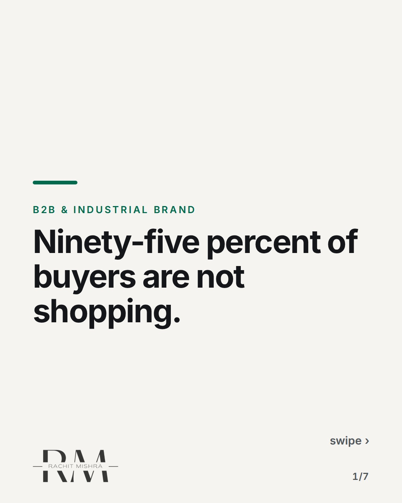
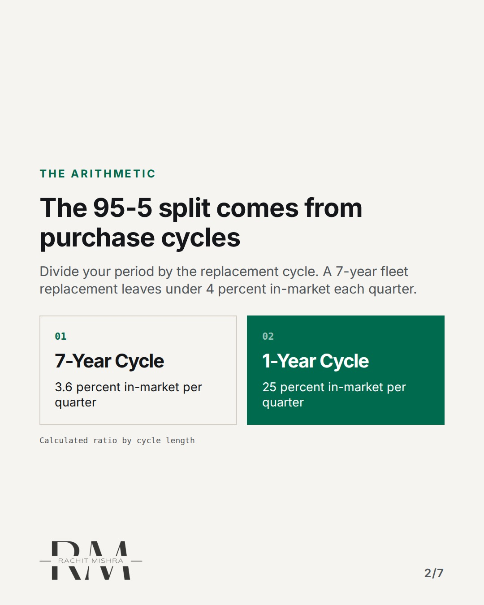
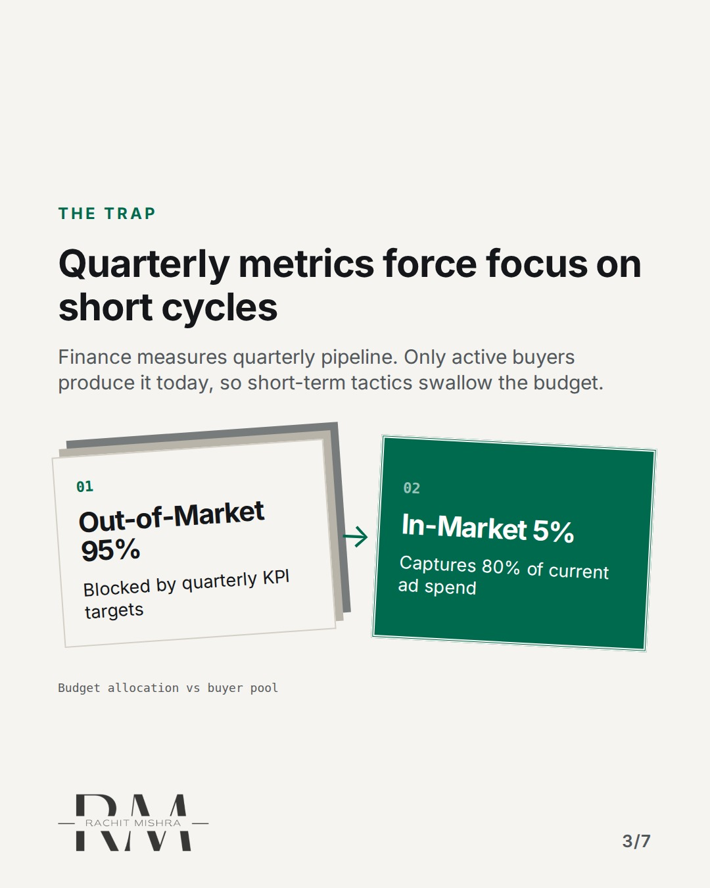
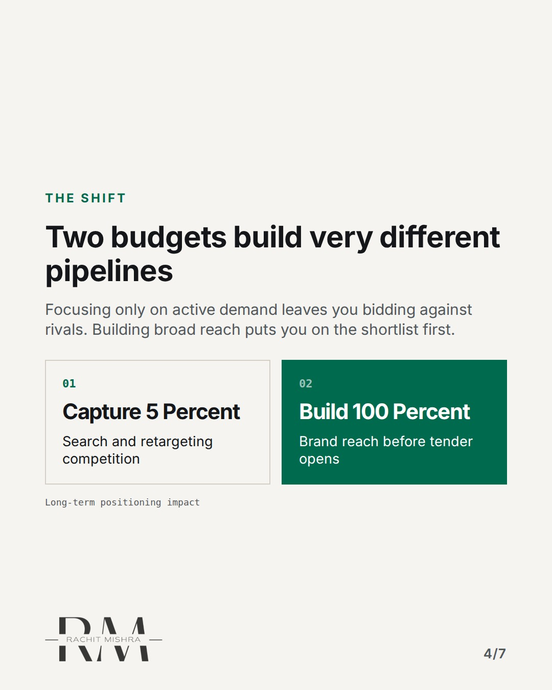
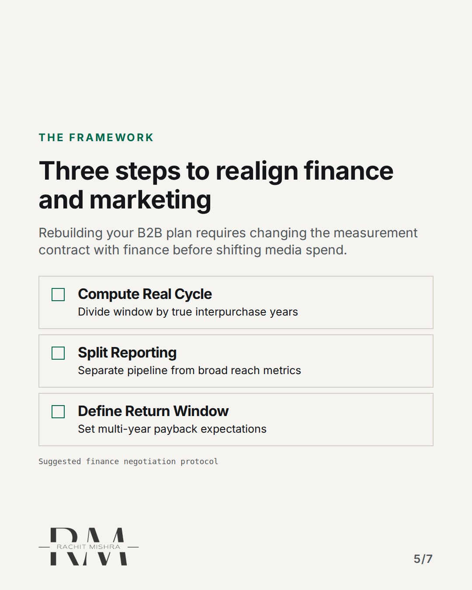
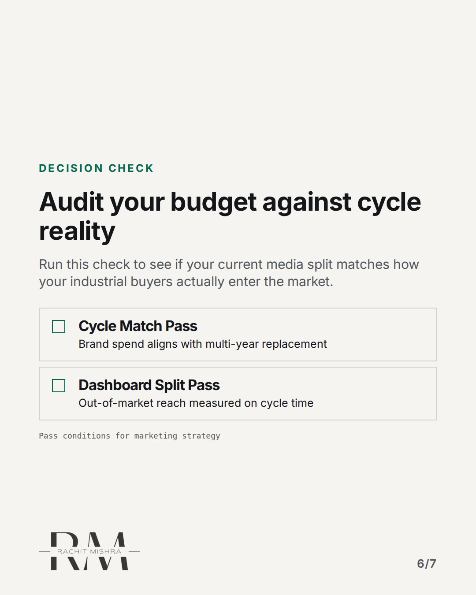

# ninetyfivepercentbuyers

**CAROUSEL** · b2b_brand · goes live **2026-10-26T19:00:00+05:30**

> Targeting: `b2b brand strategy`
>
> Claim: B2B marketers over-invest in active demand capture because finance measures quarterly pipeline rather than multi-year replacement cycles.
>
> Proof (source): In long purchase-cycle categories, roughly 95 percent of buyers are out-of-market at any moment, derived from purchase cycle length rather than survey intent.
> Source: https://www.rachitmishra.in/2026/09/14/95-5-rule-b2b-marketing/
>
> Source preflight: reachable (HTTP 200)
>
> Rendered infographics: 5 — comparison, bottleneck, comparison, checklist, checklist

## Slides

7 rendered images sit in this folder — upload them in filename order.

**1.** 
### Ninety-five percent of buyers are not shopping.



**2.** THE ARITHMETIC
### The 95-5 split comes from purchase cycles
Divide your period by the replacement cycle. A 7-year fleet replacement leaves under 4 percent in-market each quarter.



**3.** THE TRAP
### Quarterly metrics force focus on short cycles
Finance measures quarterly pipeline. Only active buyers produce it today, so short-term tactics swallow the budget.



**4.** THE SHIFT
### Two budgets build very different pipelines
Focusing only on active demand leaves you bidding against rivals. Building broad reach puts you on the shortlist first.



**5.** THE FRAMEWORK
### Three steps to realign finance and marketing
Rebuilding your B2B plan requires changing the measurement contract with finance before shifting media spend.



**6.** DECISION CHECK
### Audit your budget against cycle reality
Run this check to see if your current media split matches how your industrial buyers actually enter the market.



**7.** 
### Build for the hundred percent before they shop.
Re-negotiate your marketing contract with finance based on actual purchase cycles. Read the full analysis at rachitmishra.in


## Caption — copy from here

```
Ninety-five percent of buyers are not shopping.

Most B2B brand strategy focuses on active demand. The hardest meeting in B2B marketing isn't with your agency. It's with the CFO when you ask for budget that won't show up in quarterly pipeline.

When we shifted media weight toward out-of-market buyers, leads didn't spike in week two. They couldn't—those accounts were years away from replacing equipment.

What changed was tender participation later. When their window opened, we were already on the shortlist.

If finance measures you on quarterly pipeline alone, you will always over-invest in search ads and under-invest in category presence.

Send this to whoever is defending the brand budget in your next review meeting.

[b2b brand strategy, b2b branding, industrial marketing, manufacturing marketing, brand architecture]

#b2bmarketing #industrialmarketing #brandstrategy
```

## Alt text

```
Diagram showing purchase cycle math and how B2B brand budget splits across buyers.
```

## How this post could fail

If the reader operates in a short-cycle SaaS category where buyers renew annually, the 95-5 math weakens and the post may read as irrelevant.

## Sources

- [The 95-5 Rule: Marketing to Buyers Who Aren’t Buying](https://www.rachitmishra.in/2026/09/14/95-5-rule-b2b-marketing/)
