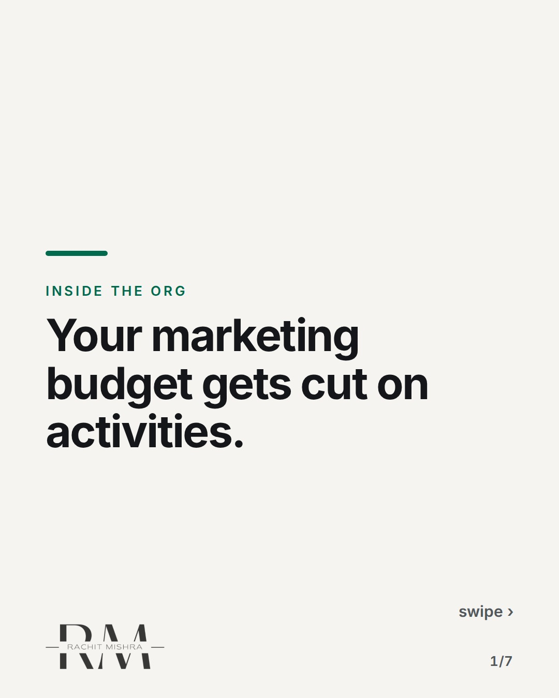
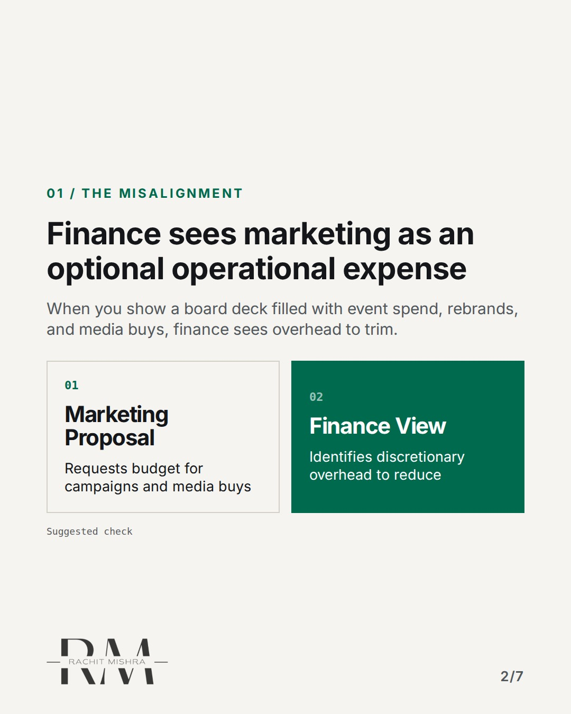
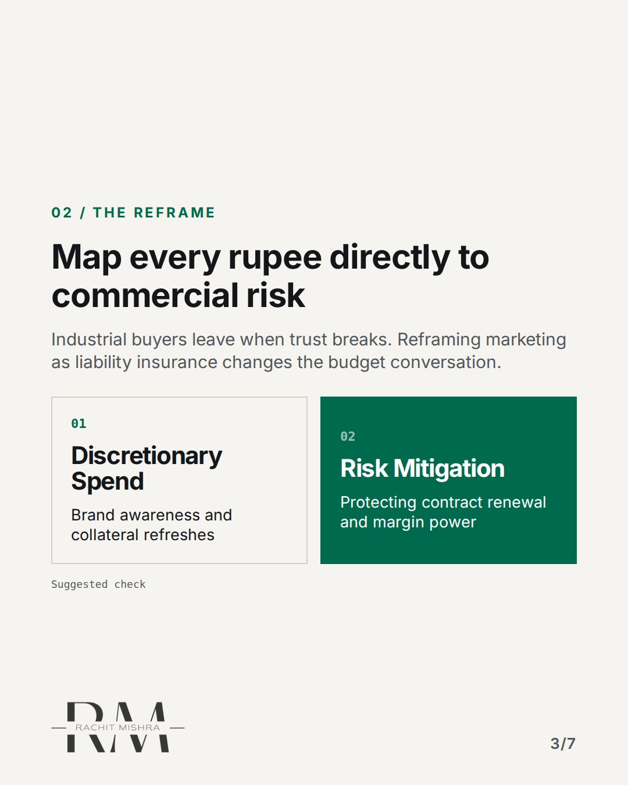
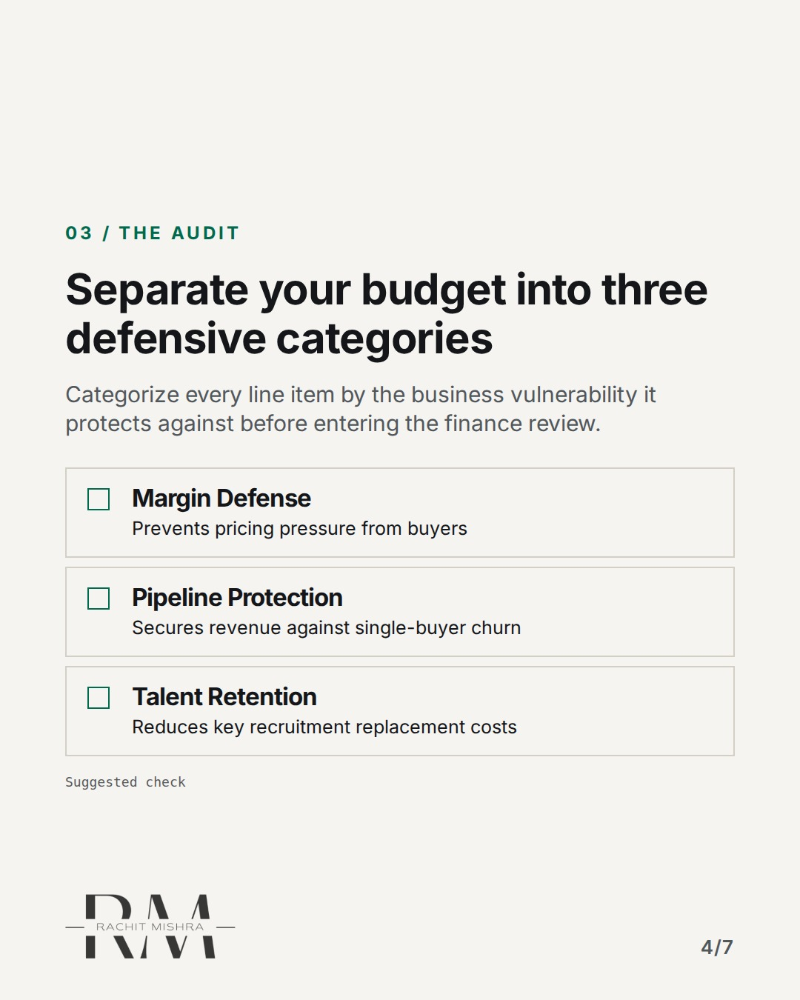
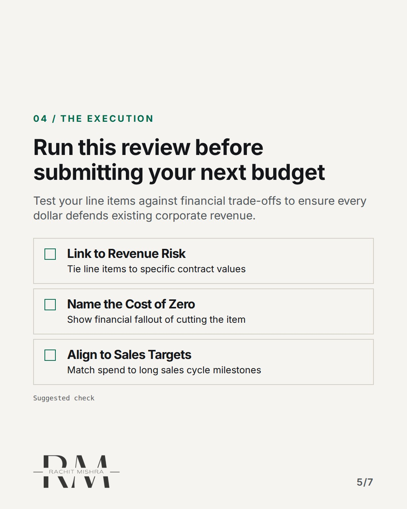
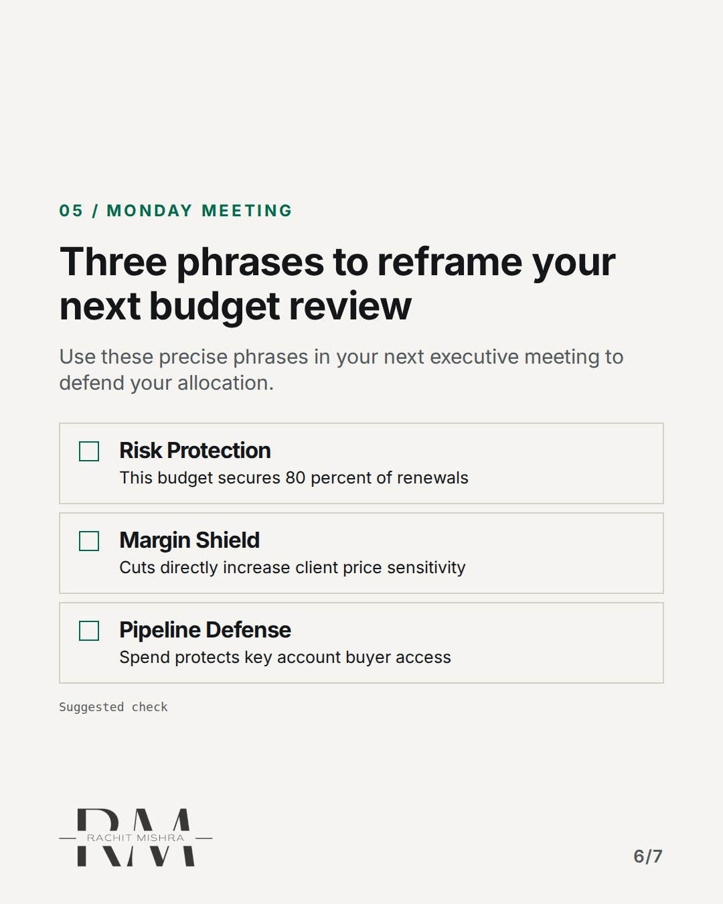
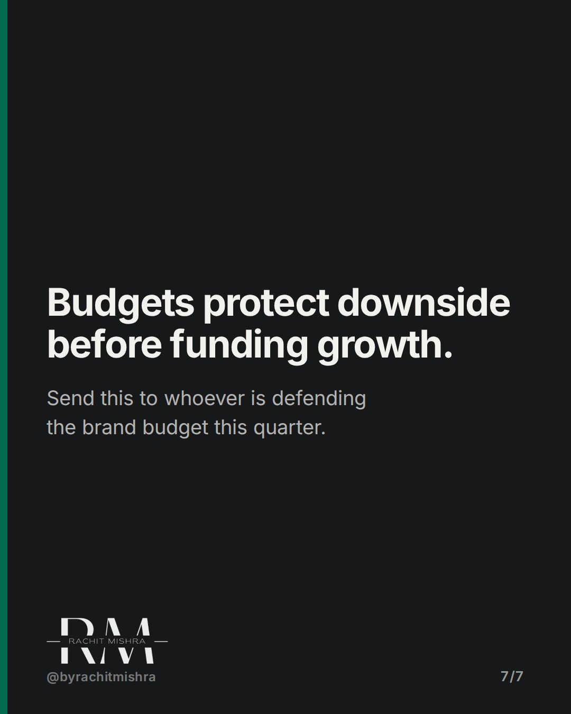

# defendingamarketingbudget

**CAROUSEL** · inside_the_org · goes live **2026-10-31T10:30:00+05:30**

> Targeting: `defending a marketing budget`
>
> Claim: Marketing budgets get cut in industrial firms because teams present spending by activity instead of business liability coverage.
>
> Proof (framework): A decision framework framing marketing line items as risk mitigation costs rather than campaign expenses during executive budget defense.
>
> Rendered infographics: 5 — comparison, comparison, checklist, checklist, checklist

## Slides

7 rendered images sit in this folder — upload them in filename order.

**1.** 
### Your marketing budget gets cut on activities.



**2.** 01 / THE MISALIGNMENT
### Finance sees marketing as an optional operational expense
When you show a board deck filled with event spend, rebrands, and media buys, finance sees overhead to trim.



**3.** 02 / THE REFRAME
### Map every rupee directly to commercial risk
Industrial buyers leave when trust breaks. Reframing marketing as liability insurance changes the budget conversation.



**4.** 03 / THE AUDIT
### Separate your budget into three defensive categories
Categorize every line item by the business vulnerability it protects against before entering the finance review.



**5.** 04 / THE EXECUTION
### Run this review before submitting your next budget
Test your line items against financial trade-offs to ensure every dollar defends existing corporate revenue.



**6.** 05 / MONDAY MEETING
### Three phrases to reframe your next budget review
Use these precise phrases in your next executive meeting to defend your allocation.



**7.** 
### Budgets protect downside before funding growth.
Send this to whoever is defending the brand budget this quarter.



## Caption — copy from here

```
Your marketing budget gets cut on activities.

When defending a marketing budget to a CFO in heavy industry, presenting a list of campaigns and collateral updates invites immediate cuts.

Finance leaders evaluate discretionary spend by its impact on cash preservation. If your line items read as activities rather than risk controls, they look like optional overhead.

The fix is to translate every line item into revenue protection. You are not buying a trade show booth; you are securing access to procurement decision-makers for five key enterprise accounts.

Marketing in enterprise B2B is operational insurance against margin erosion.

Send this to whoever is defending the brand budget this quarter.

[defending a marketing budget, in-house marketing, brand governance, b2b marketing]

#marketingleadership #inhousemarketing #brandgovernance
```

## Alt text

```
A framework graphic contrasting activity-based marketing budgets with risk mitigation budgets.
```

## How this post could fail

If the post reads like generic corporate budget advice rather than addressing the specific tension between industrial marketing leaders and CFOs, it fails.
