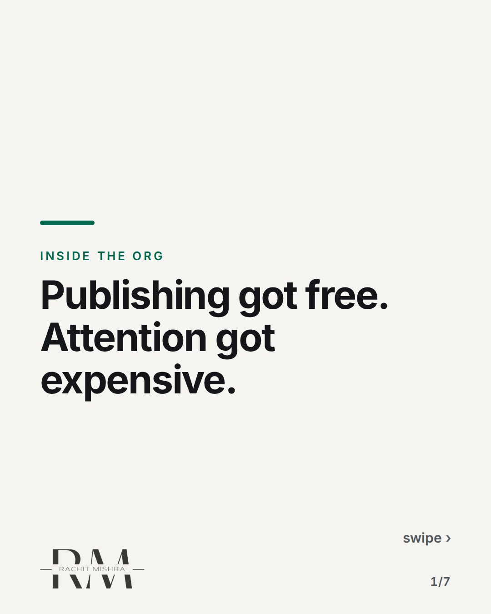
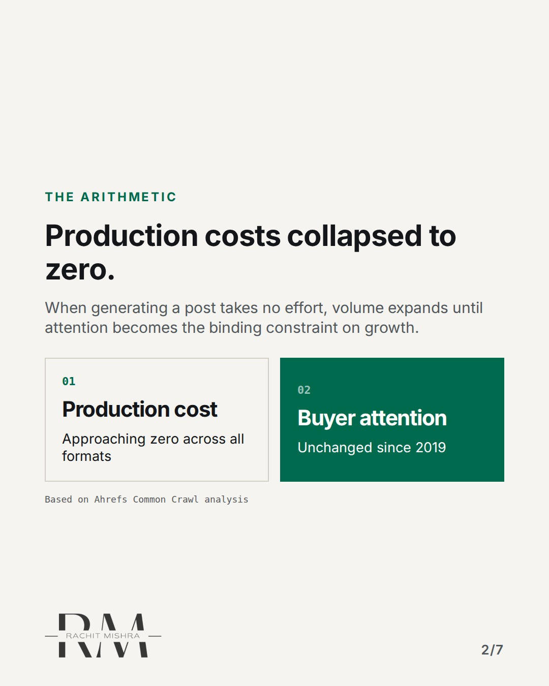
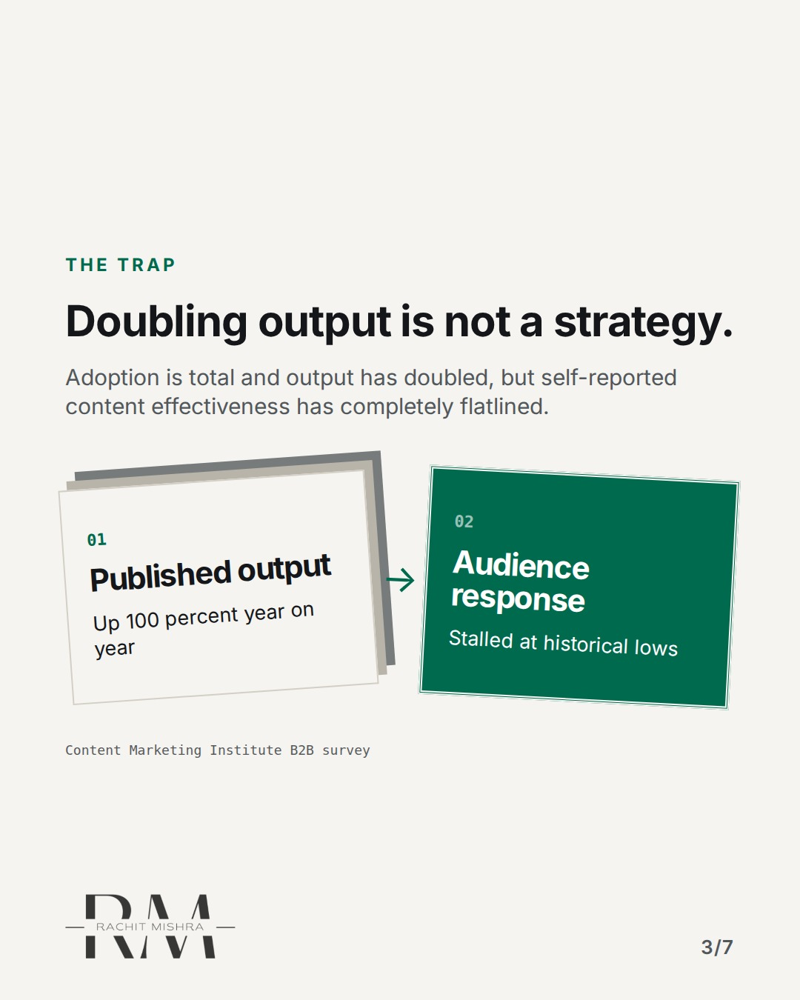
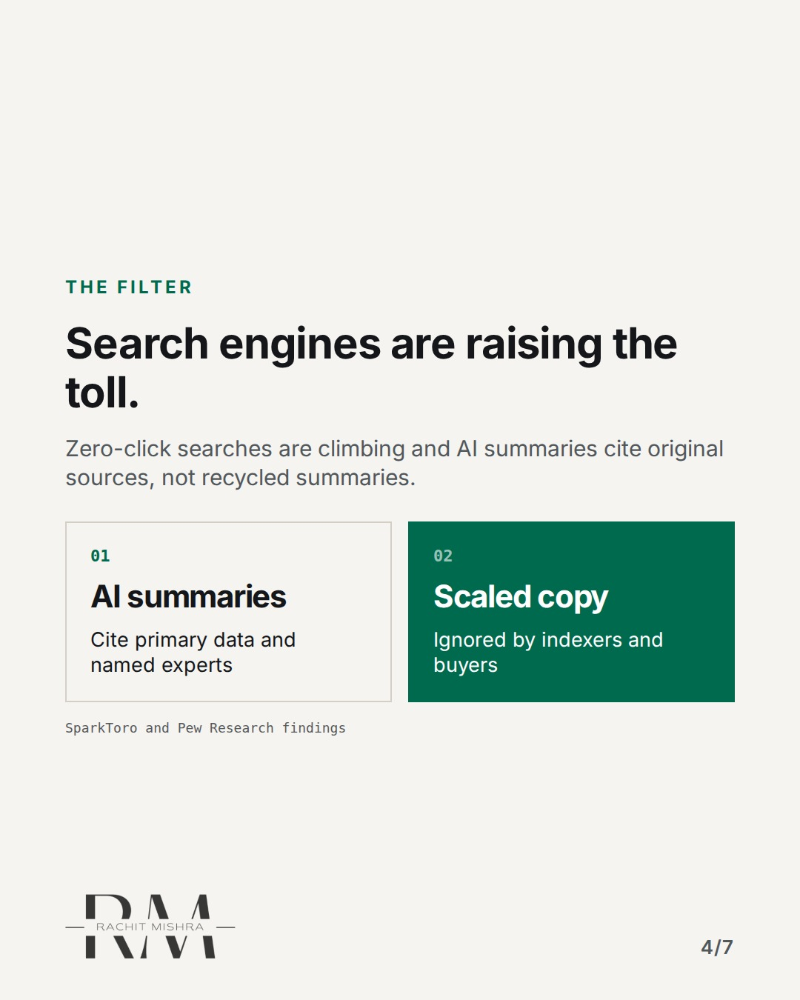
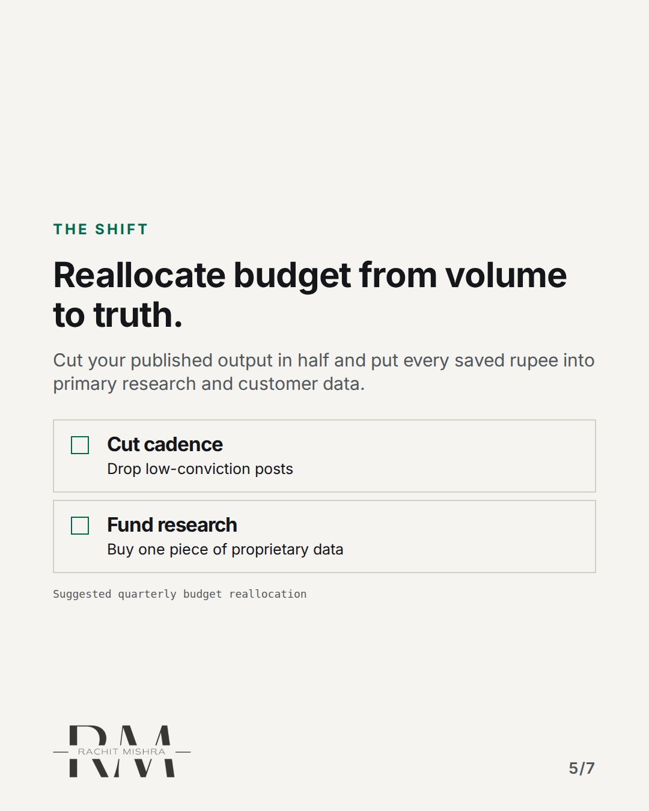
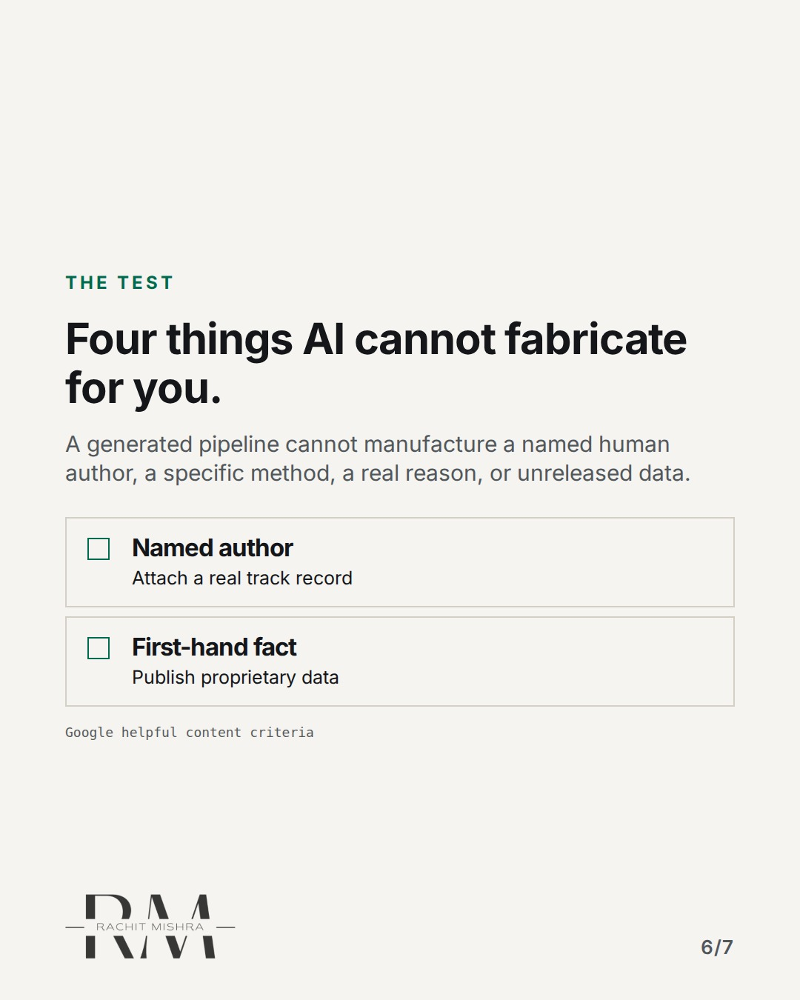
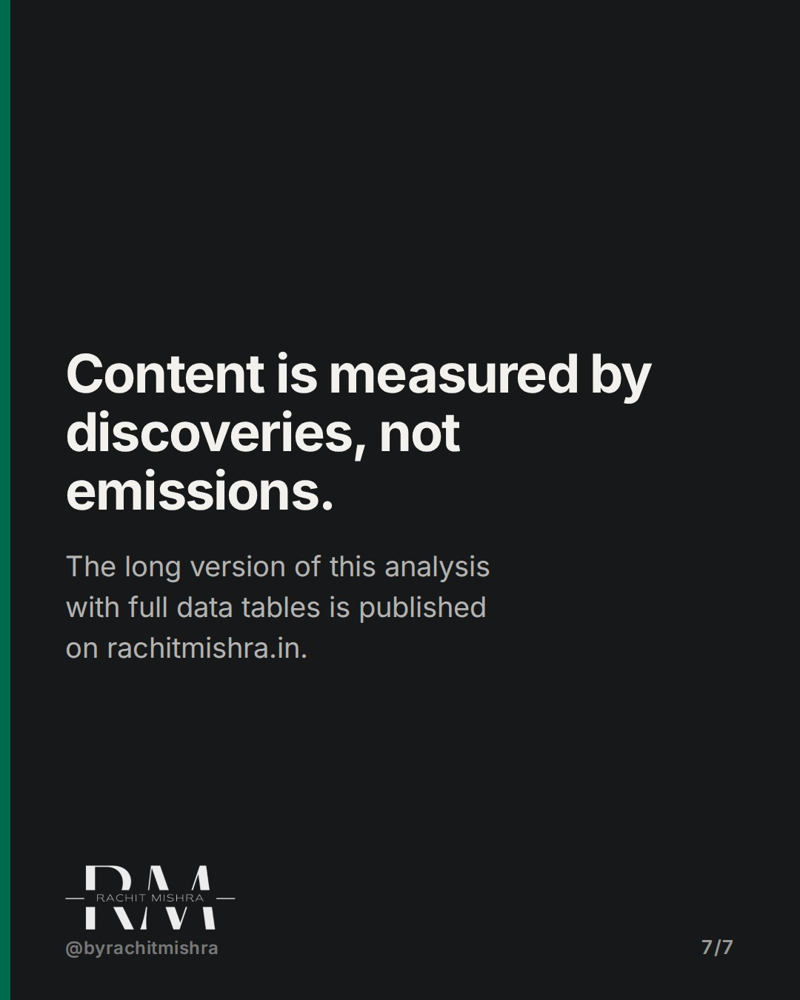

# ai_content_economics_quality

**CAROUSEL** · inside_the_org · goes live **2026-11-01T10:30:00+05:30**

> Targeting: `content marketing budget`
>
> Claim: AI made publishing free, which means volume is no longer a constraint and attention is the only thing left worth buying.
>
> Proof (source): Ahrefs scanned 900,000 newly created pages in April 2025 and found 74.2% carried machine-written text while CMI data shows B2B content effectiveness stalled at 59% despite total adoption.
> Source: https://www.rachitmishra.in/2026/09/10/ai-generated-content-marketing-quality/
>
> Source preflight: reachable (HTTP 200)
>
> Rendered infographics: 6 — comparison, bottleneck, comparison, checklist, checklist, comparison

## Slides

7 rendered images sit in this folder — upload them in filename order.

**1.** 
### Publishing got free. Attention got expensive.



**2.** The Arithmetic
### Production costs collapsed to zero.
When generating a post takes no effort, volume expands until attention becomes the binding constraint on growth.



**3.** The Trap
### Doubling output is not a strategy.
Adoption is total and output has doubled, but self-reported content effectiveness has completely flatlined.



**4.** The Filter
### Search engines are raising the toll.
Zero-click searches are climbing and AI summaries cite original sources, not recycled summaries.



**5.** The Shift
### Reallocate budget from volume to truth.
Cut your published output in half and put every saved rupee into primary research and customer data.



**6.** The Test
### Four things AI cannot fabricate for you.
A generated pipeline cannot manufacture a named human author, a specific method, a real reason, or unreleased data.



**7.** The Principle
### Content is measured by discoveries, not emissions.
The long version of this analysis with full data tables is published on rachitmishra.in.



## Caption — copy from here

```
Publishing got free. Attention got expensive.

Most teams treat the shift in content marketing budget as a prompt engineering challenge when it is actually an economics problem. When writing costs nothing, volume expands until the buyer's attention stops you.

The long version of this analysis is on my site: https://www.rachitmishra.in/2026/09/10/ai-generated-content-marketing-quality/

If you cut your publishing schedule in half tomorrow and spent the difference on finding out something true about your market, would anyone notice the drop?

Send this to whoever is defending the content budget in your planning meeting this quarter.

[ai content quality, content marketing budget, b2b marketing, content strategy]

#inhousemarketing #b2bmarketing #marketingleadership
```

## Alt text

```
Carousel slides detailing how AI content economics change content marketing budgets and strategy.
```

## How this post could fail

Readers might mistake this for an anti-AI manifesto rather than an economic argument about resource allocation.

## Sources

- [AI-Generated Content and the Quality Collapse Ahead](https://www.rachitmishra.in/2026/09/10/ai-generated-content-marketing-quality/)
