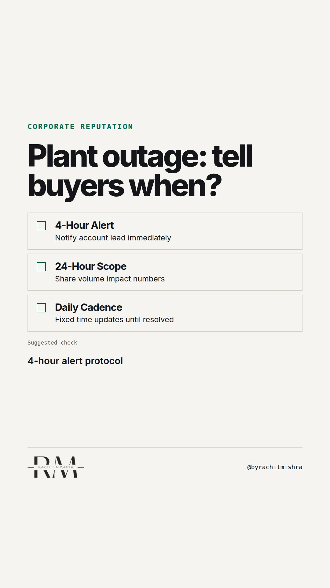

# b2b_crisis_communication_protocol

**REEL** · reputation · goes live **2026-10-29T13:00:00+05:30**

> Targeting: `crisis communication mistakes`
>
> Claim: In enterprise B2B disruptions, withholding operational bad news until a complete solution exists destroys client trust far faster than the outage itself.
>
> Proof (framework): The 4-hour disclosure framework for B2B supply disruptions: immediate disruption alert at hour 4, scope and schedule impact at hour 24, fixed daily updates until resolution.
>
> Rendered infographics: 3 — checklist, bottleneck, checklist
>
> Reel assets: image `designed_gradient` · music `bed-something (11).mp3`

## Cover



## Reel script

`reel.mp4` has been generated from this script and will publish automatically. To use your own footage instead, replace that file and delete `.generated-reel` from this folder.

| Time | On screen | Voiceover | Direction |
|---|---|---|---|
| 0:00-0:03 | **Holding back bad news costs B2B trust.** | Holding back bad news costs B2B trust. When an industrial supplier faces a plant outage, leadership often waits to inform buyers. | Dark textured background with high-contrast text overlay. |
| 0:03-0:07 | **Buyers hate surprise shutdowns.** | They wait until they have a complete recovery plan. But enterprise buyers do not need a perfect answer on day one; they need lead time. | Graphic overlay illustrating operational delay approval process. |
| 0:07-0:11 | **Silence forces buyers to guess.** | When you stay silent, procurement assumes the worst, alerts their leadership, and starts qualifying alternate suppliers. | Clean typography shift to emphasize client risk assessment. |
| 0:11-0:15 | **Early bad news protects contracts.** | Admitting a delay within four hours with partial data builds far more trust than a polished explanation delivered three days late. | Split view contrasting early raw updates against delayed polished comms. |
| 0:15-0:21 | **Run the B2B Crisis Protocol.** | Here is the 3-step notification protocol for enterprise account management. | Checklist sequence detailing step-by-step incident notification. |
| 0:21-0:26 | **Transparency retains enterprise accounts.** | B2B buyers forgive equipment failures and logistics delays. They do not forgive being caught off guard in front of their own customers. | Text focus emphasizing client relationship retention. |
| 0:26-0:29 | **Predictability is brand protection.** | Predictability in a crisis is brand protection. | Final summary card displaying named principle. |

## Caption — copy from here

```
Holding back bad news costs B2B trust.

Most crisis communication mistakes in enterprise accounts come from waiting for board approval on a solution before telling buyers about an outage.

Your client knows heavy industry has downtime. They are calculating whether you will make them look incompetent to their own customers.

An imperfect alert at hour four lets them adjust schedules. A polished apology at hour seventy-two forces them to halt production.

Corporate reputation is not built on flawless uptime. It is built on zero surprises.

Send this to whoever leads key account communications or operational risk.

[crisis communication mistakes, corporate reputation management, corporate communications, b2b trust, stakeholder trust]

#corporatecommunications #reputation #crisiscommunication
```

## Alt text

```
Text graphic displaying a 3-step crisis communication checklist for B2B industrial plant outages.
```

## How this post could fail

Internal operations leaders may argue that announcing an outage before fixing it risks causing unnecessary client panic.
