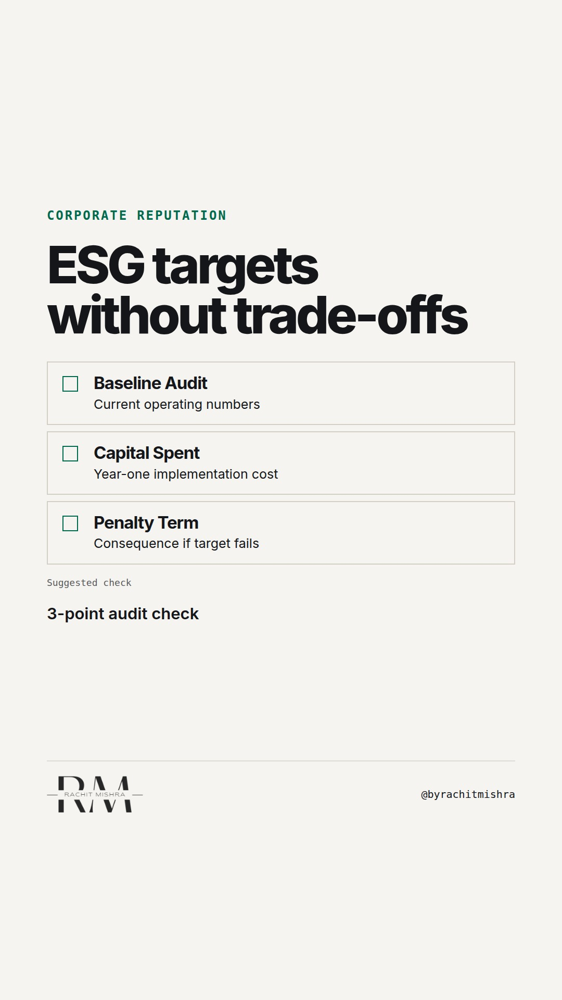

# esg_compliance_versus_reputation

**REEL** · reputation · goes live **2026-10-28T08:30:00+05:30**

> Targeting: `ESG communication that is not greenwashing`
>
> Claim: Corporate reputation in B2B is damaged when ESG communications focus on target years rather than operational trade-offs.
>
> Proof (framework): A 3-part operational audit for enterprise ESG communications: verifying current operational baselines, naming the cost trade-off, and defining explicit failure conditions.
>
> Rendered infographics: 3 — checklist, comparison, checklist
>
> Reel assets: image `designed_gradient` · music `bed-something (12).mp3`

## Cover



## Reel script

`reel.mp4` has been generated from this script and will publish automatically. To use your own footage instead, replace that file and delete `.generated-reel` from this folder.

| Time | On screen | Voiceover | Direction |
|---|---|---|---|
| 0:00-0:03 | **ESG claims fail without trade-offs.** | ESG claims fail without trade-offs. Most corporate comms teams publish twenty-year climate goals that no current board member will be alive to enforce. | Clean, minimal text display on dark metallic background. |
| 0:03-0:08 | **Procurement audits operations, not vision.** | Procurement committees do not award heavy industrial contracts based on a vision statement for 2045. They look at your current operating audit. | Text transition emphasizing procurement reality. |
| 0:08-0:14 | **Vague targets look like unpriced risk.** | When your ESG comms leads with distant targets without naming the capital cost to get there, enterprise buyers do not read ambition. They read unpriced financial risk. | Text highlighting the buyer perspective. |
| 0:14-0:20 | **The 3-point ESG audit for B2B comms.** | If you want ESG communication that is not greenwashing, run every draft through three tests before publishing. | Text introduction to the actionable framework. |
| 0:20-0:26 | **1. State the baseline numbers today.** | First: State where the plant operates today. Absolute numbers, verified by third-party audit, not percentage reductions against a convenient historical benchmark. | Text displaying rule one. |
| 0:26-0:32 | **2. Name the financial trade-off.** | Second: Name the cost. If your lower-carbon steel costs twelve percent more to produce, state it. Procurement respects margin reality far more than frictionless claims. | Text displaying rule two. |
| 0:32-0:38 | **3. Publish the condition for failure.** | Third: Name the failure condition. Credibility comes from telling stakeholders what happens if a capital project misses its deadline. | Text displaying rule three. |
| 0:38-0:44 | **Trust relies on real constraints.** | Corporate reputation is built on operational constraints. If your ESG statement sounds like it was written by a marketing agency, keep it out of the annual report. | Final summary line on screen. |

## Caption — copy from here

```
ESG claims fail without trade-offs.

Executing ESG communication that is not greenwashing requires treating disclosures like financial filings rather than brand campaigns.

Industrial buyers and regulators know that decarbonisation costs money, alters supply chains, and creates operational bottlenecks. When corporate communications removes those friction points to tell a clean story, it creates immediate scepticism inside procurement committees.

Credibility comes from friction. Publishing the trade-off—the extra cost per ton, the capital commitment required, or the operational limit—signals that the company understands its own business model.

If your ESG disclosures read like consumer advertising, they belong nowhere near an enterprise customer or a regulatory filing.

Send this to whoever is writing your corporate sustainability report this quarter.

[esg communication that is not greenwashing, corporate reputation management, esg communications, b2b reputation, corporate communications]

#corporatecommunications #reputation #esg
```

## Alt text

```
Text graphic detailing a three-step corporate reputation audit for enterprise ESG comms.
```

## How this post could fail

The post could read as anti-sustainability if the distinction between vague PR targets and audited operational trade-offs is not sharply maintained.
