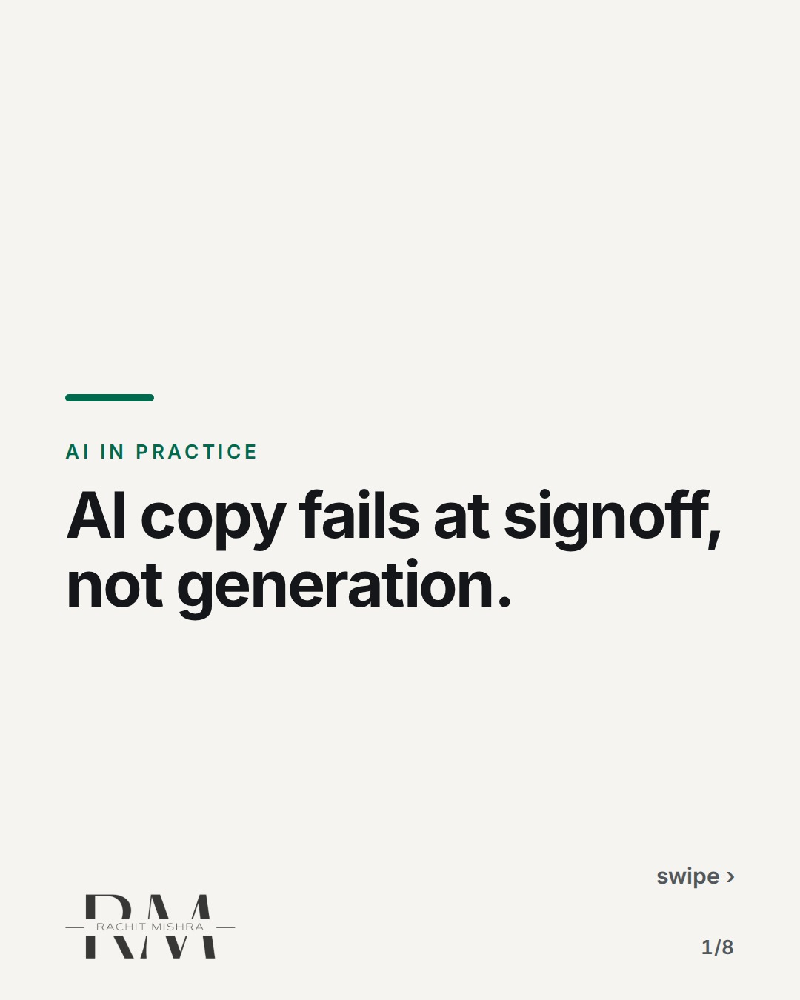
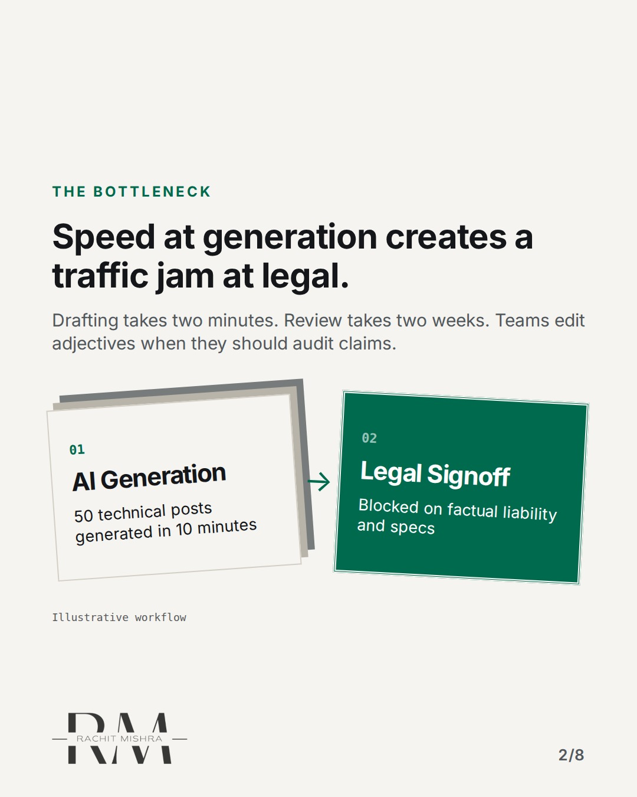
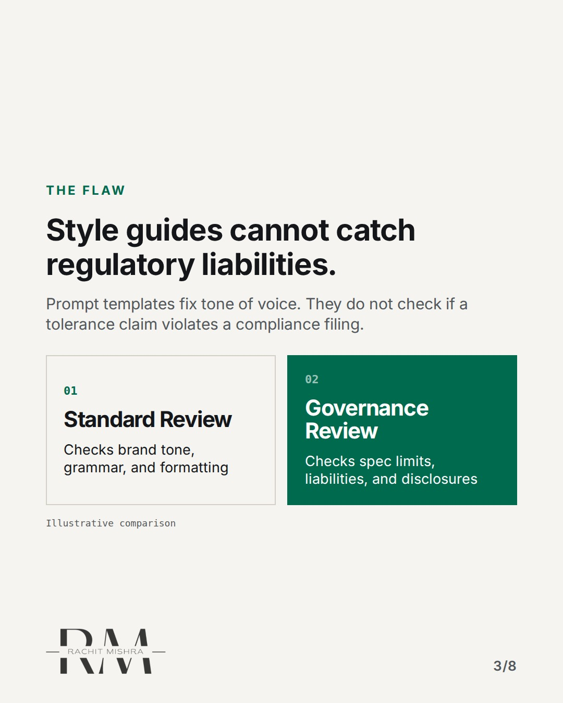
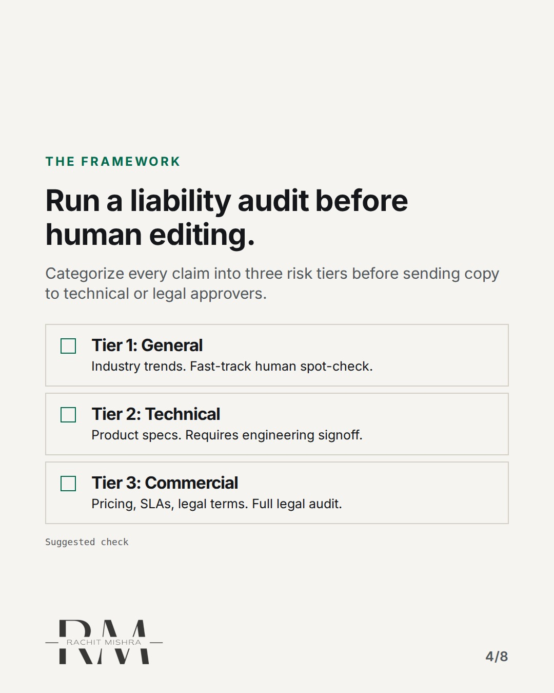
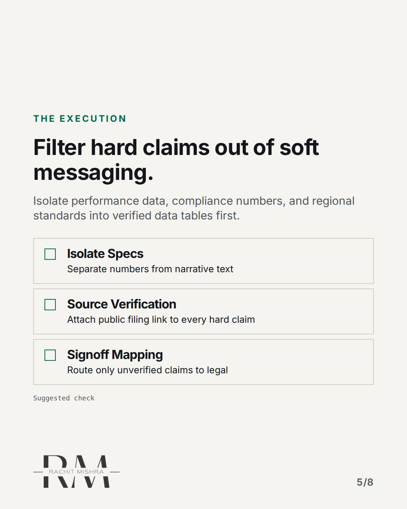
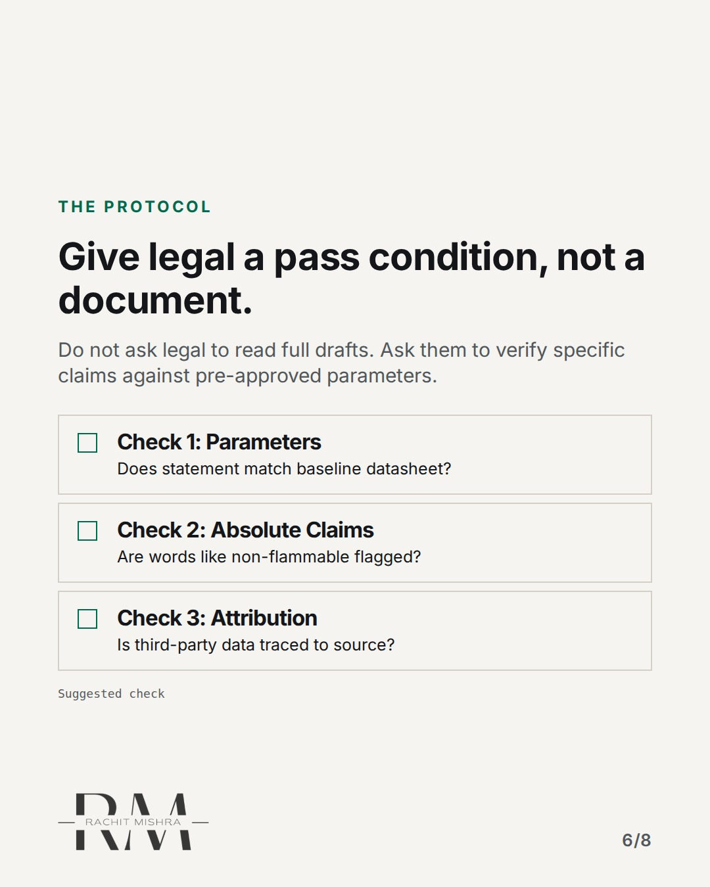
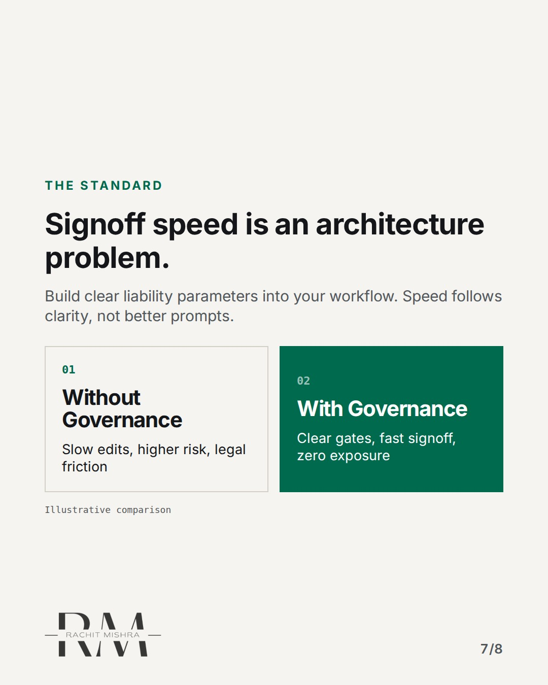
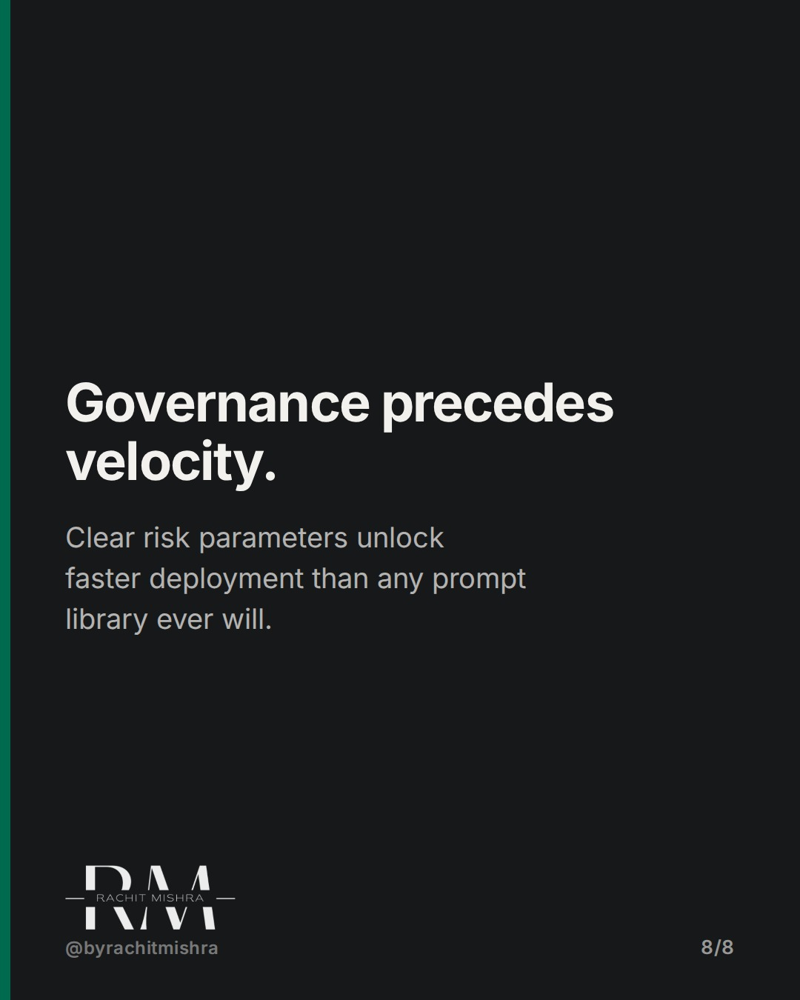

# ai_governance_signoff_gate

**CAROUSEL** · ai_in_practice · goes live **2026-10-28T20:00:00+05:30**

> Targeting: `AI governance for marketing teams`
>
> Claim: AI copy bottlenecks in B2B because teams check word quality instead of regulatory liability.
>
> Proof (framework): A three-tier liability audit model that replaces generic copy-editing with regulatory, technical, and commercial risk checks for industrial marketing teams.
>
> Rendered infographics: 6 — bottleneck, comparison, checklist, checklist, checklist, comparison

## Slides

8 rendered images sit in this folder — upload them in filename order.

**1.** 
### AI copy fails at signoff, not generation.



**2.** The Bottleneck
### Speed at generation creates a traffic jam at legal.
Drafting takes two minutes. Review takes two weeks. Teams edit adjectives when they should audit claims.



**3.** The Flaw
### Style guides cannot catch regulatory liabilities.
Prompt templates fix tone of voice. They do not check if a tolerance claim violates a compliance filing.



**4.** The Framework
### Run a liability audit before human editing.
Categorize every claim into three risk tiers before sending copy to technical or legal approvers.



**5.** The Execution
### Filter hard claims out of soft messaging.
Isolate performance data, compliance numbers, and regional standards into verified data tables first.



**6.** The Protocol
### Give legal a pass condition, not a document.
Do not ask legal to read full drafts. Ask them to verify specific claims against pre-approved parameters.



**7.** The Standard
### Signoff speed is an architecture problem.
Build clear liability parameters into your workflow. Speed follows clarity, not better prompts.



**8.** 
### Governance precedes velocity.
Clear risk parameters unlock faster deployment than any prompt library ever will.



## Caption — copy from here

```
AI copy fails at signoff, not generation.

Establishing clear AI governance for marketing teams requires moving past style guides and tackling regulatory exposure directly.

In enterprise industrial marketing, generation is easy. Approval is where campaigns die. The team generates twenty technical posts in minutes, then spends three weeks arguing with compliance over adjectives.

The fix is not training legal to read faster. The fix is changing what you ask them to do. Legal should never review tone; they should verify claim boundaries.

When you separate narrative copy from verifiable technical data, signoff times drop from weeks to hours.

Speed is a workflow structure, not a prompt skill.

Send this to whoever is responsible for managing brand risk and content approvals this quarter.

[ai governance for marketing teams, enterprise ai adoption, marketing automation, b2b marketing, brand governance]

#aigovernance #b2bmarketing #marketingoperations
```

## Alt text

```
Diagram showing an AI content signoff gate and liability audit workflow for marketing teams.
```

## How this post could fail

If the risk categories feel too generic, the reader might view this as standard content strategy rather than a governance framework for regulated industries.
