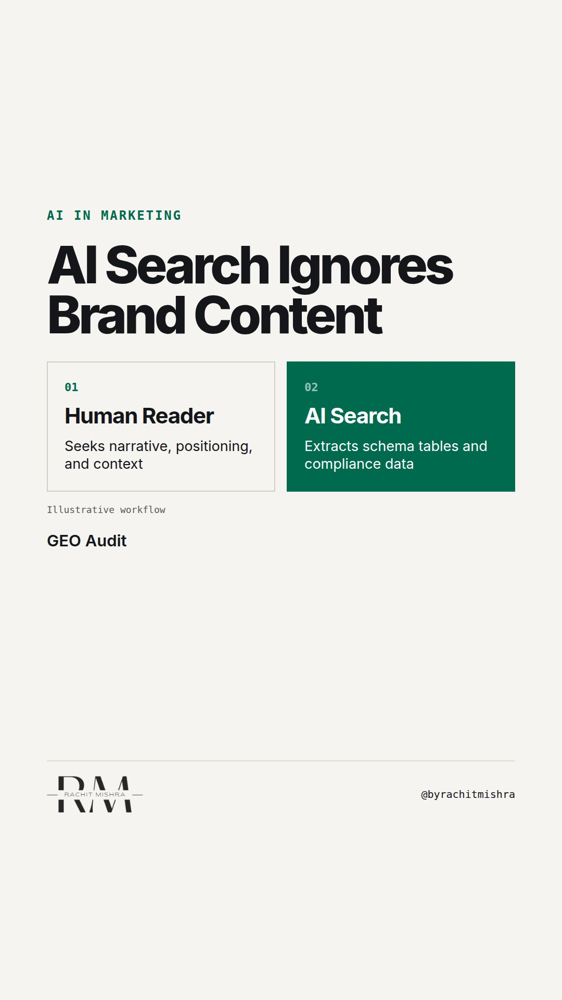

# generative_engine_optimisation_b2b

**REEL** · ai_marketing · goes live **2026-11-06T08:30:00+05:30**

> Targeting: `generative engine optimisation for B2B`
>
> Claim: AI search engines prioritize structured technical specifications and compliance data over traditional SEO content when answering enterprise procurement queries.
>
> Proof (framework): A three-part content structure test (structured spec sheets, regulatory tables, machine-readable pricing tiers) that ensures enterprise technical data is surfaced by generative answer engines.
>
> Rendered infographics: 3 — comparison, comparison, checklist
>
> Reel assets: image `designed_gradient` · music `bed-something (13).mp3`

## Cover



## Reel script

`reel.mp4` has been generated from this script and will publish automatically. To use your own footage instead, replace that file and delete `.generated-reel` from this folder.

| Time | On screen | Voiceover | Direction |
|---|---|---|---|
| 0:00-0:04 | **AI search ignores your polished blog posts.** | AI search ignores your polished blog posts. When a procurement team asks Perplexity or ChatGPT for vendor options, the model bypasses thought leadership. |  |
| 0:04-0:09 | **Generative engines look for hard data.** | Generative engine optimisation for B2B requires a complete shift in format. AI engines extract facts, not narrative. |  |
| 0:09-0:15 | **Traditional SEO vs GEO inputs** | Traditional search rewarded long-form articles. Generative engines look for structured specs, regulatory compliance codes, and exact operational thresholds. |  |
| 0:15-0:22 | **Run this 3-point GEO readiness audit** | Here is a three-part audit to check if your technical product data is readable by generative search systems. |  |
| 0:22-0:28 | **Raw technical specs beat brand stories.** | If your technical parameters sit inside locked PDFs or fuzzy brand copy, AI search tools simply skip your catalog. |  |
| 0:28-0:34 | **Optimize for extraction, not attention.** | Optimize for machine extraction, not human skimming. That is how your product enters the short-list. |  |

## Caption — copy from here

```
AI search ignores your polished blog posts.

Mastering generative engine optimisation for B2B means accepting that large language models do not read content the way humans do. When an enterprise buyer uses AI to screen vendors, the model looks for extractable facts, not brand storytelling.

If your product specs, ISO certifications, and operating limits are buried inside marketing prose or locked PDFs, the crawler skips them completely.

The fix is architectural. You need structured schema, machine-readable tables, and explicit compliance references published on open web pages.

In B2B industrial sales, machine readability is becoming the new baseline for top-of-funnel discovery.

Send this to whoever is responsible for your website strategy and technical SEO.

[generative engine optimisation for b2b, b2b marketing, search engine optimization, martech]

#aimarketing #martech #b2bmarketing
```

## Alt text

```
Text graphic showing a comparison between traditional SEO blogs and machine-readable data tables.
```

## How this post could fail

Could be dismissed as standard SEO advice if the emphasis on industrial product specs and compliance data isn't clear.
