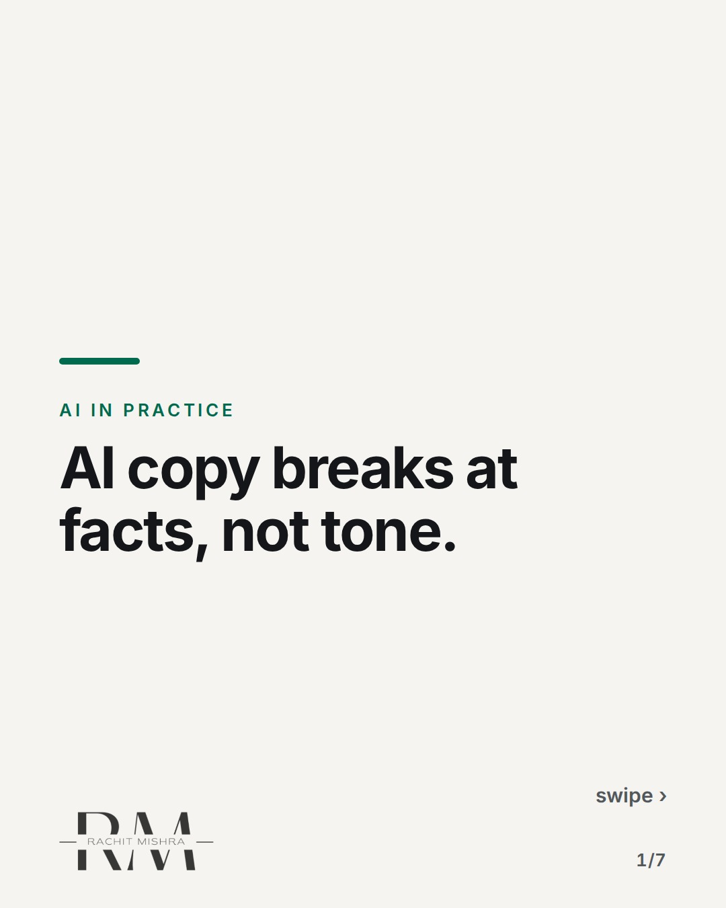
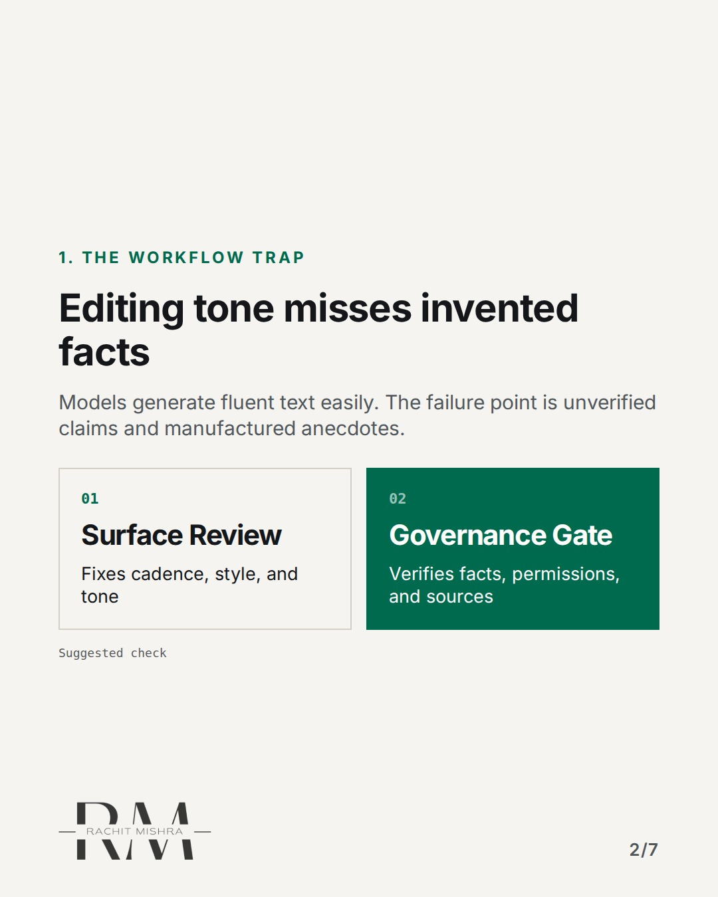
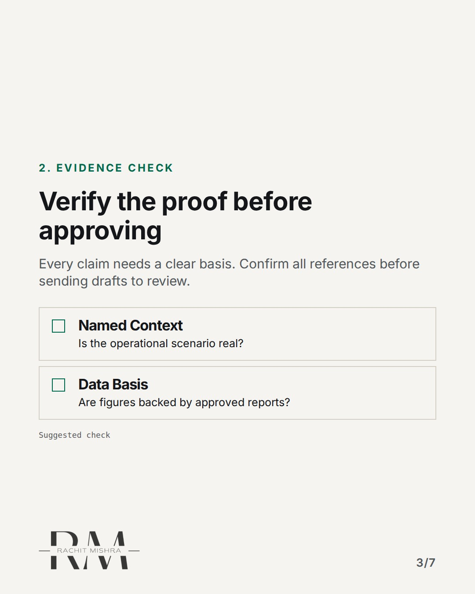
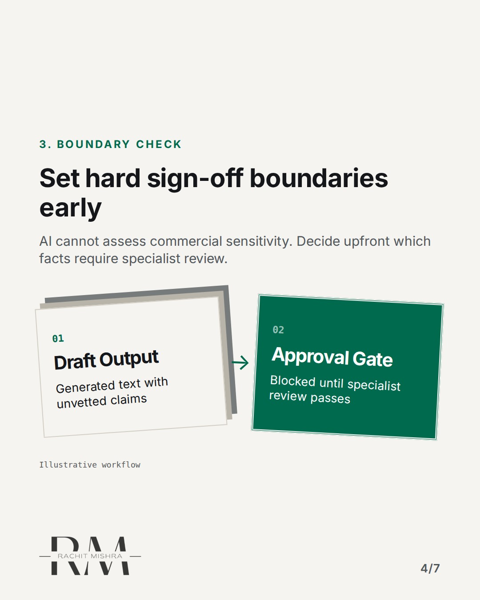
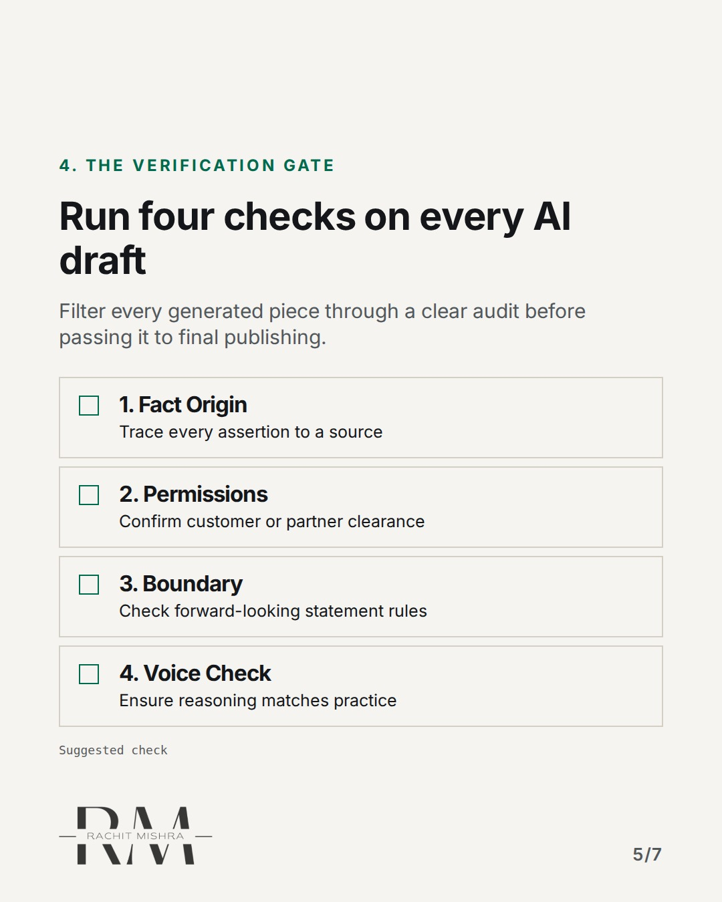
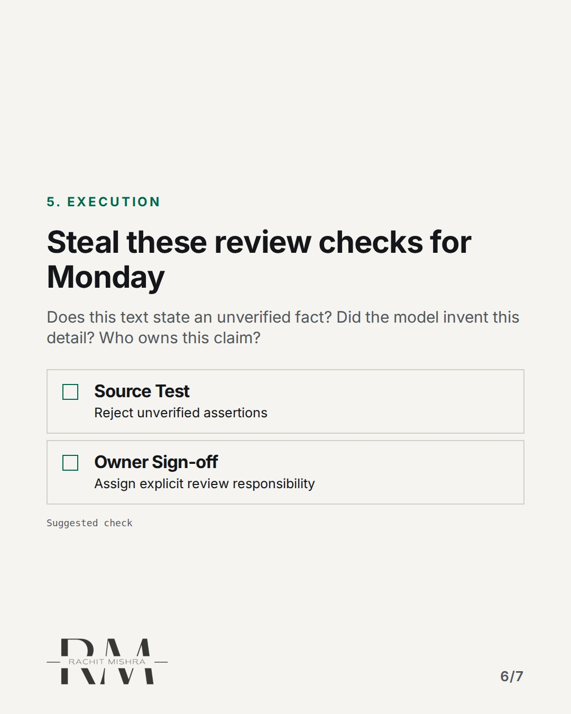
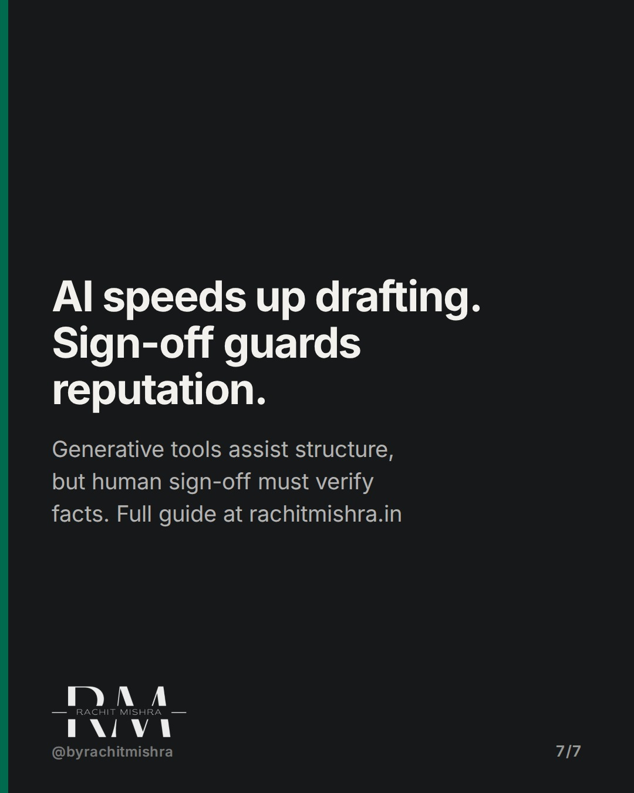

# ai_content_approval_workflow

**CAROUSEL** · ai_in_practice · goes live **2026-11-06T19:00:00+05:30**

> Targeting: `AI content approval workflow`
>
> Claim: AI draft verification requires checking evidence and boundaries, not just fixing tone.
>
> Proof (source): Executive LinkedIn Strategy framework establishing that AI-assisted drafting requires verifying facts, explicit permissions, and business boundaries rather than relying on automated generation alone.
> Source: https://www.rachitmishra.in/2026/10/23/executive-linkedin-strategy/
>
> Source preflight: reachable (HTTP 200)
>
> Rendered infographics: 5 — comparison, checklist, bottleneck, checklist, checklist

## Slides

7 rendered images sit in this folder — upload them in filename order.

**1.** 
### AI copy breaks at facts, not tone.



**2.** 1. THE WORKFLOW TRAP
### Editing tone misses invented facts
Models generate fluent text easily. The failure point is unverified claims and manufactured anecdotes.



**3.** 2. EVIDENCE CHECK
### Verify the proof before approving
Every claim needs a clear basis. Confirm all references before sending drafts to review.



**4.** 3. BOUNDARY CHECK
### Set hard sign-off boundaries early
AI cannot assess commercial sensitivity. Decide upfront which facts require specialist review.



**5.** 4. THE VERIFICATION GATE
### Run four checks on every AI draft
Filter every generated piece through a clear audit before passing it to final publishing.



**6.** 5. EXECUTION
### Steal these review checks for Monday
Does this text state an unverified fact? Did the model invent this detail? Who owns this claim?



**7.** 
### AI speeds up drafting. Sign-off guards reputation.
Generative tools assist structure, but human sign-off must verify facts. Full guide at rachitmishra.in



## Caption — copy from here

```
AI copy breaks at facts, not tone.

Building an enterprise AI content approval workflow usually starts with tone guidelines. That is the wrong place to focus.

Language models generate convincing text easily. The risk in industrial and enterprise communication is never a weak transition sentence; it is a hallucinated metric, an invented customer anecdote, or an unapproved forward-looking statement.

When teams use AI tools for drafting, the approval process must shift from copyediting to verification. That means checking whether every claim has an underlying source, whether customer context requires explicit sign-off, and whether sensitive operational facts belong in public.

Speed in drafting is useless if it creates a bottleneck at legal review.

Send this to whoever is setting up your team's AI approval workflow this quarter.

[ai content approval workflow, ai governance, b2b marketing, enterprise ai adoption]

#aigovernance #martech #marketingoperations

#aigovernance #martech #marketingoperations
```

## Alt text

```
Carousel slides outlining an AI content verification workflow for B2B marketing teams.
```

## How this post could fail

It could be mistaken for generic AI advice if the distinction between tone editing and factual verification is not stated sharply on slides 2 and 3.

## Sources

- [Executive LinkedIn Strategy: Build Trust Without Becoming a Content Machine](https://www.rachitmishra.in/2026/10/23/executive-linkedin-strategy/)
