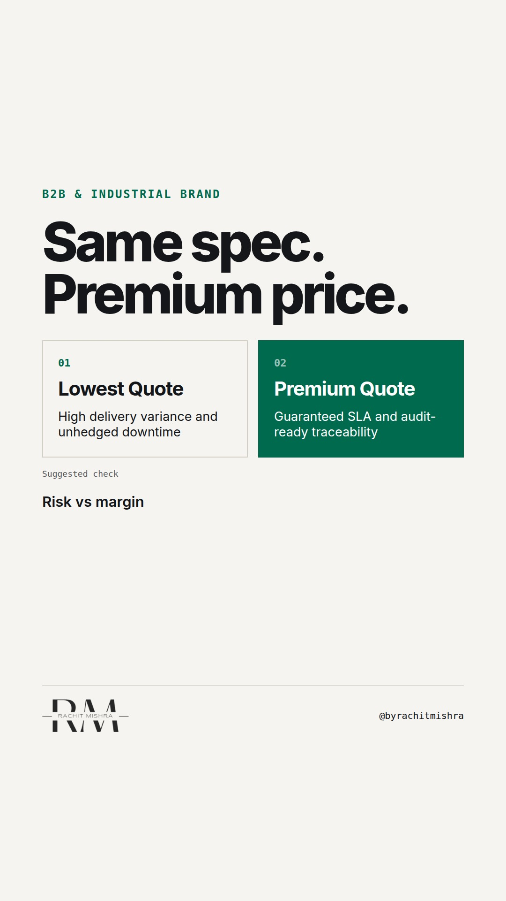

# how_to_brand_a_commodity_product_buyer_risk

**REEL** · b2b_brand · goes live **2026-11-02T08:30:00+05:30**

> Targeting: `how to brand a commodity product`
>
> Claim: Commodity products command premium margins by eliminating buyer risk at the procurement evaluation stage, not by inventing product differentiation.
>
> Proof (framework): A procurement evaluation framework assessing commodity margins against four operational risk vectors: delivery variance, specs compliance, response latency, and liability coverage.
>
> Rendered infographics: 3 — comparison, comparison, checklist
>
> Reel assets: image `designed_gradient` · music `bed-something (1).mp3`

## Cover



## Reel script

`reel.mp4` has been generated from this script and will publish automatically. To use your own footage instead, replace that file and delete `.generated-reel` from this folder.

| Time | On screen | Voiceover | Direction |
|---|---|---|---|
| 0:00-0:03 | **Why pay more for identical steel?** | Why pay more for identical steel? In industrial markets, specs are standardized. | Clean typography over neutral slate background. |
| 0:03-0:08 | **Procurement does not buy story.** | Procurement does not buy storytelling when ordering raw materials or heavy components. | Text transition emphasizing procurement reality. |
| 0:08-0:14 | **Buyers pay to eliminate risk.** | They pay extra to make sure their plant line does not stop because of late delivery or failed compliance. | Comparison chart showing risk exposure vs margin capture. |
| 0:14-0:21 | **Commodity Brand Checklist** | If you are figuring out how to brand a commodity product, stop looking for emotional angles. Audit these four operational assurances instead. | Diagram displaying four operational metrics. |
| 0:21-0:28 | **Margin lives in operational certainty.** | When your product is identical to your competitor's, your brand is the certainty that the buyer will not get blamed for choosing you. | Text slide showing margin origin. |
| 0:28-0:34 | **Brand is a risk discount.** | B2B brand premium is simply the price a buyer pays to eliminate career risk. | Final summary card. |

## Caption — copy from here

```
Why pay more for identical steel?

If you want to know how to brand a commodity product, look at the procurement committee instead of the spec sheet. When physical specifications are benchmarked by industry standards, marketing teams often panic and try consumer positioning tactics.

That fails because industrial buyers do not care about your brand story. They care about supply chain continuity.

A procurement manager rarely gets promoted for saving five percent on a commodity input, but they can easily get fired if a late delivery halts production.

The margin premium does not come from claiming superior quality when the lab reports say you are identical. It comes from embedding operational certainty into the transaction.

Brand premium in B2B is the price of eliminated operational risk.

Send this to whoever is defending industrial pricing strategy against discount demands this quarter.

[how to brand a commodity product, b2b branding, industrial marketing, manufacturing marketing, b2b brand strategy]

#b2bmarketing #industrialmarketing #b2bbranding
```

## Alt text

```
Text graphic showing a commodity brand checklist evaluating delivery SLA and risk elimination.
```

## How this post could fail

Could be misconstrued as saying product quality does not matter, whereas the point is that baseline parity forces differentiation onto operational reliability.
