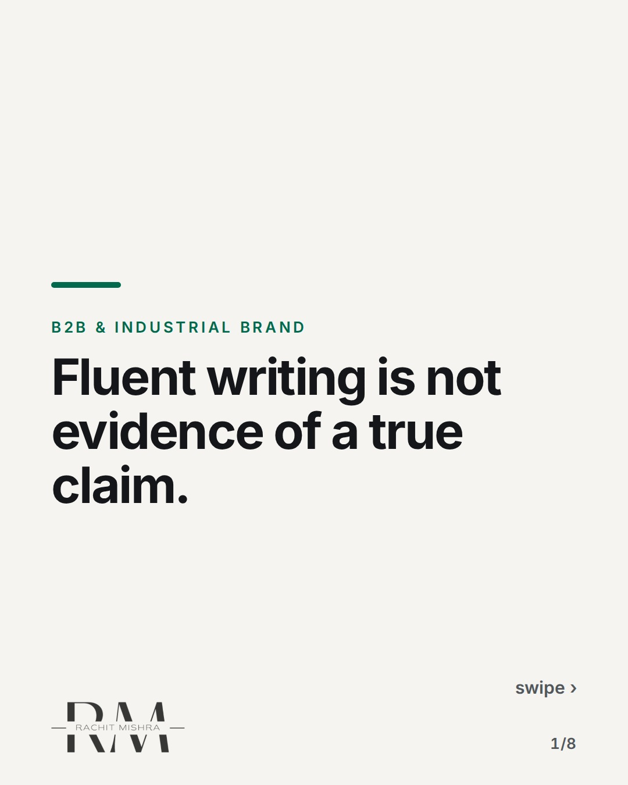
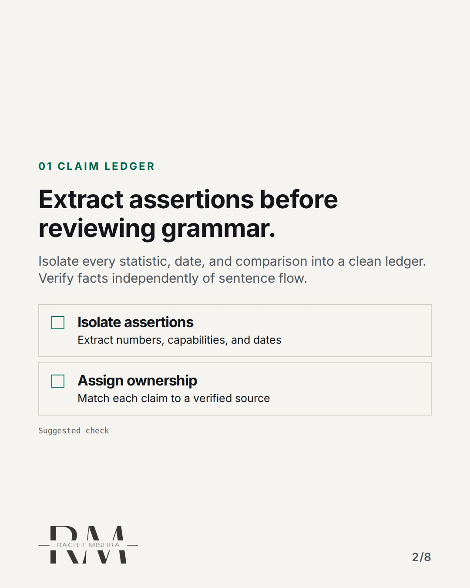
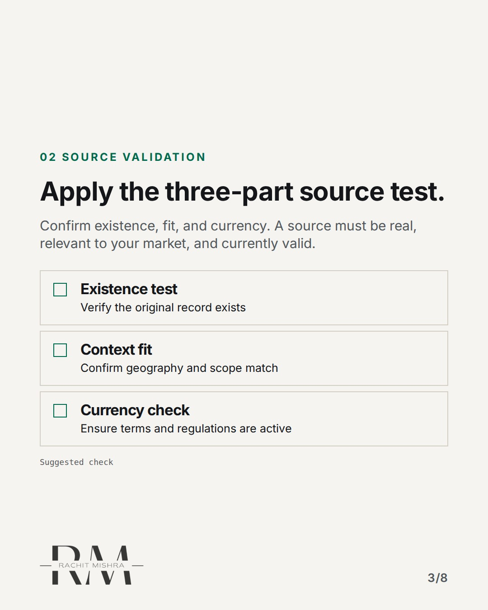
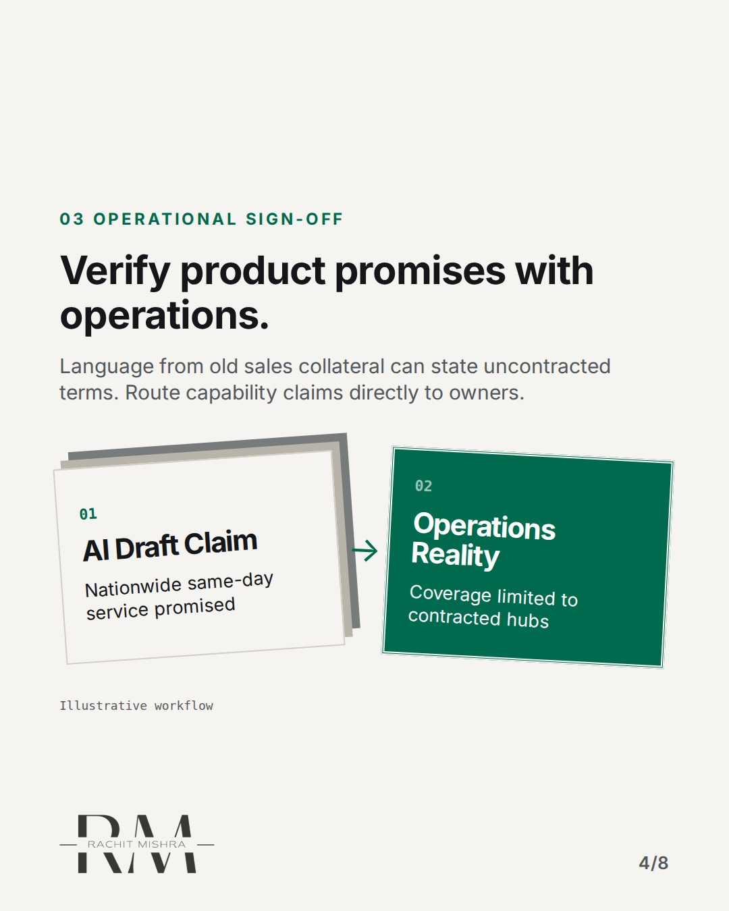
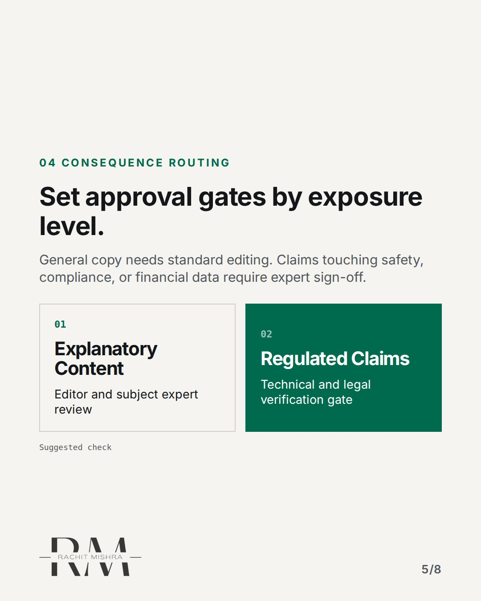
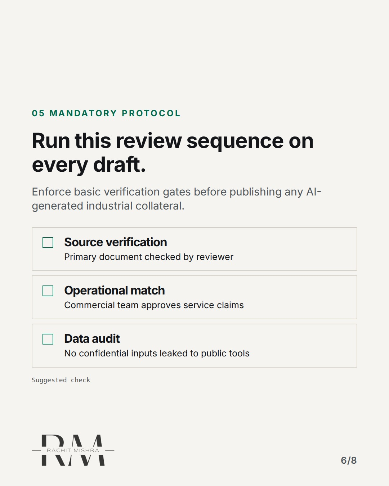
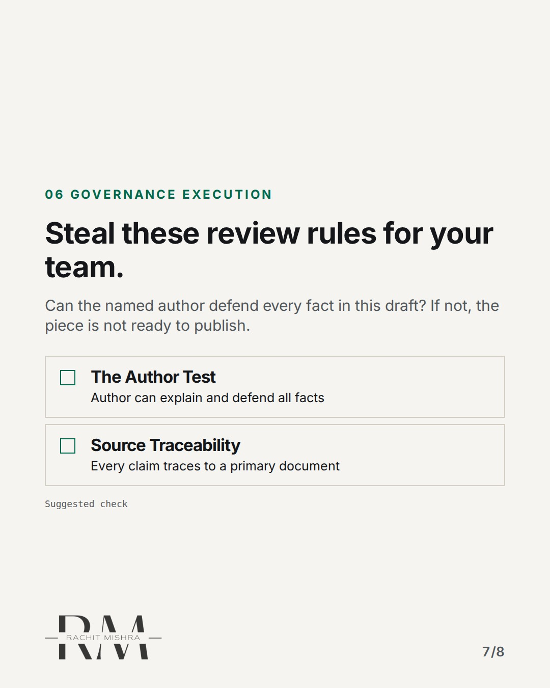
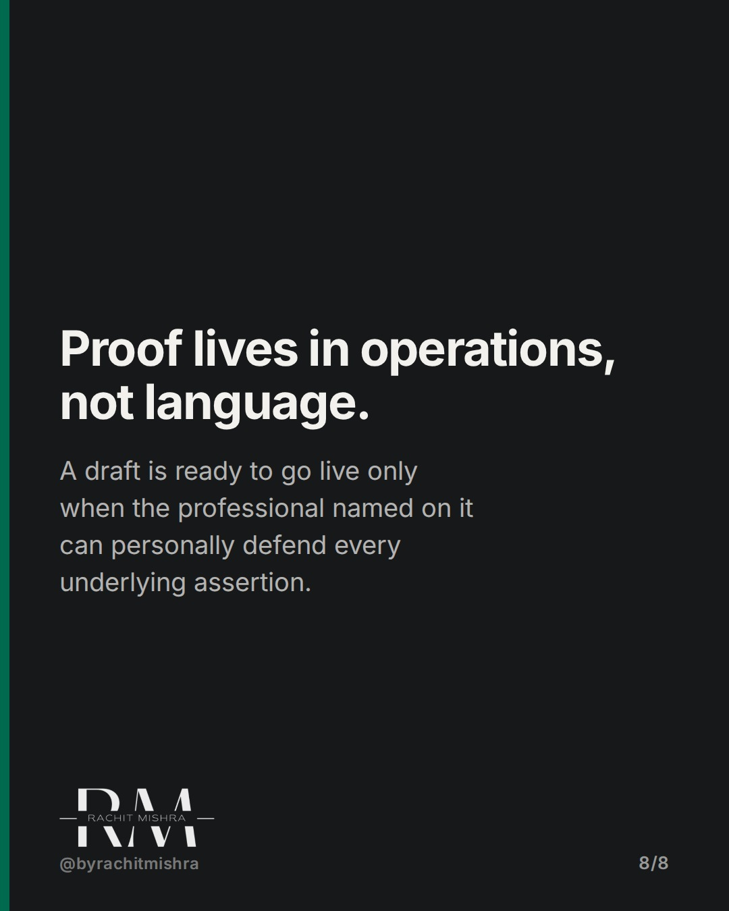

# ai_content_review_checklist

**CAROUSEL** · b2b_brand · goes live **2026-11-02T19:00:00+05:30**

> Targeting: `B2B brand strategy`
>
> Claim: AI content review requires testing specific factual claims against verified operational sources, not just editing prose.
>
> Proof (source): An editorial checklist protocol establishing a three-part source test (existence, fit, currency) and operational verification gates for AI-generated brand claims.
> Source: https://www.rachitmishra.in/2026/10/27/ai-content-review-checklist/
>
> Source preflight: reachable (HTTP 200)
>
> Rendered infographics: 6 — checklist, checklist, bottleneck, comparison, checklist, checklist

## Slides

8 rendered images sit in this folder — upload them in filename order.

**1.** 
### Fluent writing is not evidence of a true claim.



**2.** 01 CLAIM LEDGER
### Extract assertions before reviewing grammar.
Isolate every statistic, date, and comparison into a clean ledger. Verify facts independently of sentence flow.



**3.** 02 SOURCE VALIDATION
### Apply the three-part source test.
Confirm existence, fit, and currency. A source must be real, relevant to your market, and currently valid.



**4.** 03 OPERATIONAL SIGN-OFF
### Verify product promises with operations.
Language from old sales collateral can state uncontracted terms. Route capability claims directly to owners.



**5.** 04 CONSEQUENCE ROUTING
### Set approval gates by exposure level.
General copy needs standard editing. Claims touching safety, compliance, or financial data require expert sign-off.



**6.** 05 MANDATORY PROTOCOL
### Run this review sequence on every draft.
Enforce basic verification gates before publishing any AI-generated industrial collateral.



**7.** 06 GOVERNANCE EXECUTION
### Steal these review rules for your team.
Can the named author defend every fact in this draft? If not, the piece is not ready to publish.



**8.** 
### Proof lives in operations, not language.
A draft is ready to go live only when the professional named on it can personally defend every underlying assertion.



## Caption — copy from here

```
Fluent writing is not evidence of a true claim.

When evaluating AI content within a B2B brand strategy, polished prose often masks unsupported assumptions. Generative models produce authoritative language by default, regardless of whether the underlying facts match your operating reality.

Fixing style is easy; verifying accuracy is where reputational risk lives. If a draft claims a service capability or regulatory standard that operations cannot deliver, smooth sentence structure only accelerates commercial exposure.

Reviewing the claims ledger instead of paragraph syntax isolates the risk early. If the named author cannot defend the primary source behind a specific metric, the piece stays in draft.

The complete editorial framework is published on my site: https://www.rachitmishra.in/2026/10/27/ai-content-review-checklist/

Send this to the communications lead managing your editorial sign-off queue.

[b2b brand strategy, b2b branding, industrial marketing, brand governance, AI risk management]

#b2bmarketing #industrialmarketing #b2bbranding
```

## Alt text

```
Carousel slides detailing a human review checklist for verifying AI-generated brand claims.
```

## How this post could fail

The slides could be misread as basic proofreading advice if the audience misses the focus on operational source verification.

## Sources

- [AI Content Review Checklist: What a Human Must Verify Before Publishing](https://www.rachitmishra.in/2026/10/27/ai-content-review-checklist/)
