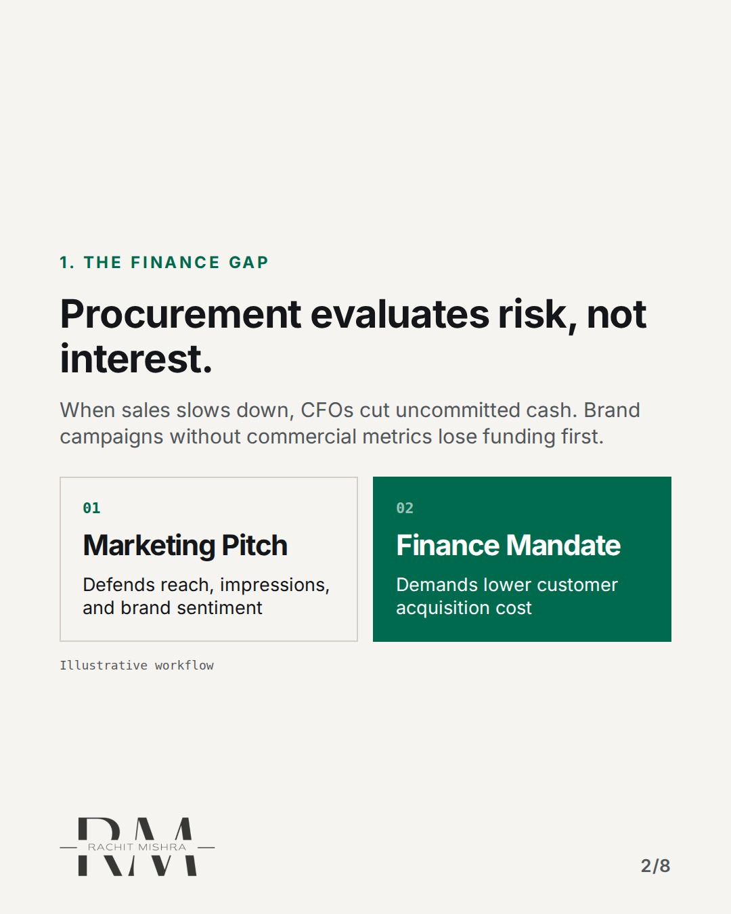
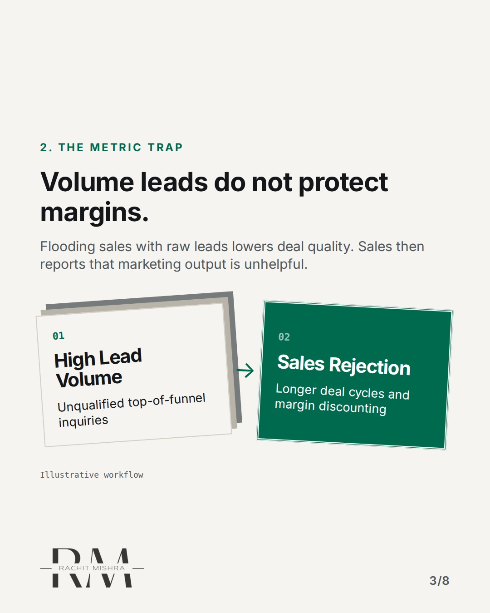
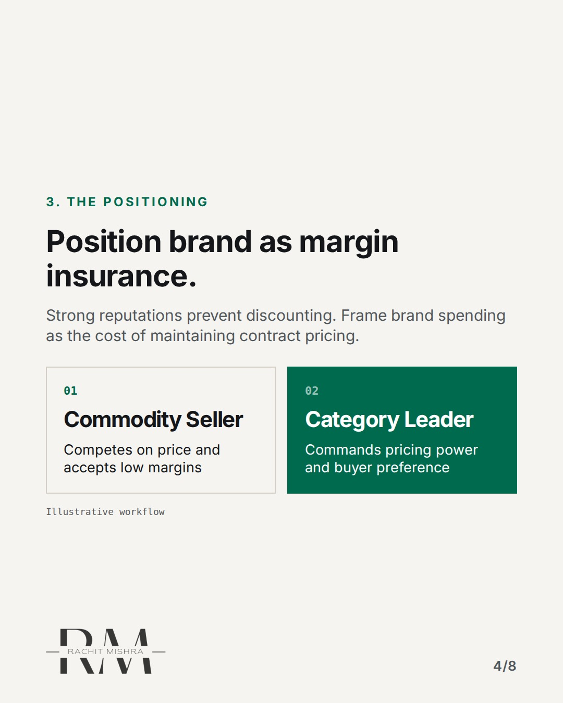
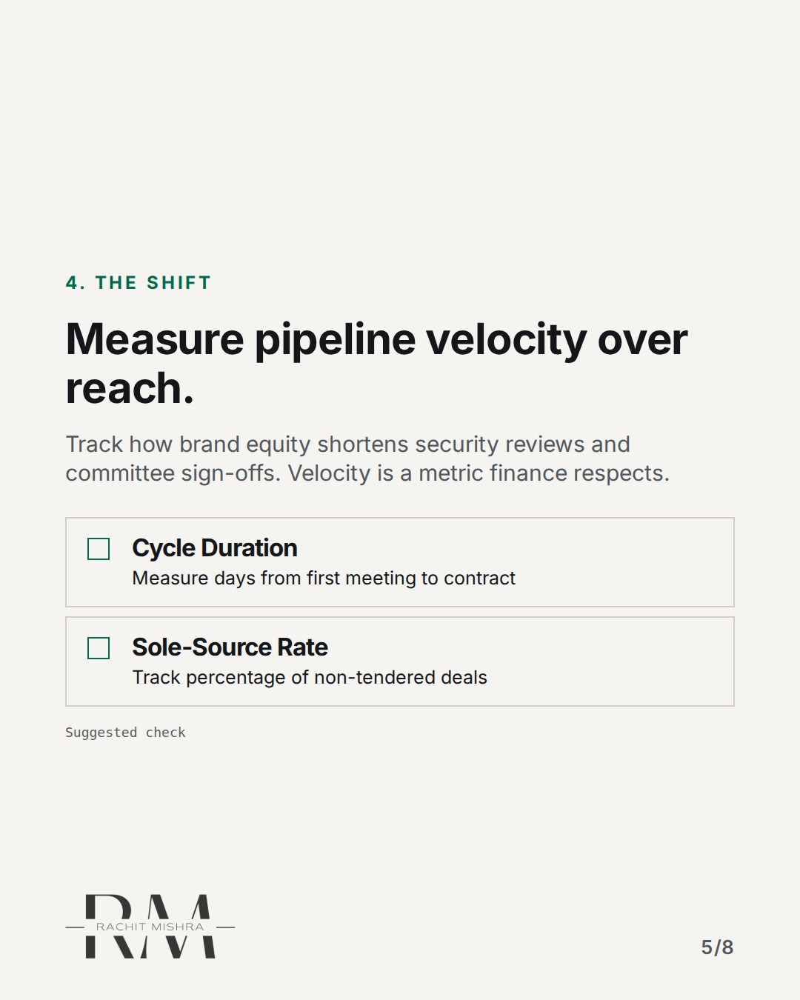
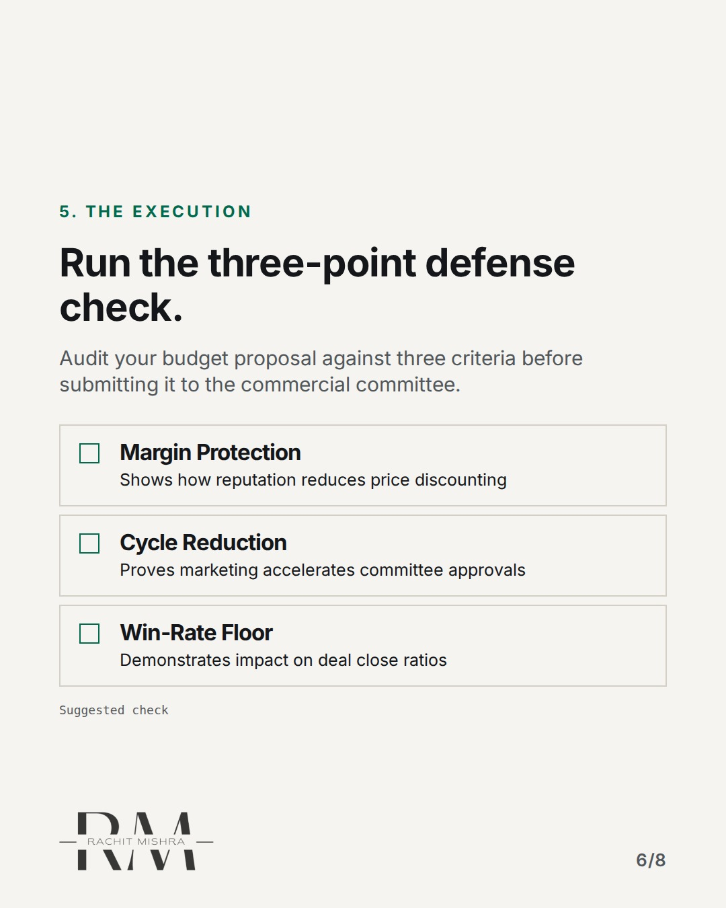
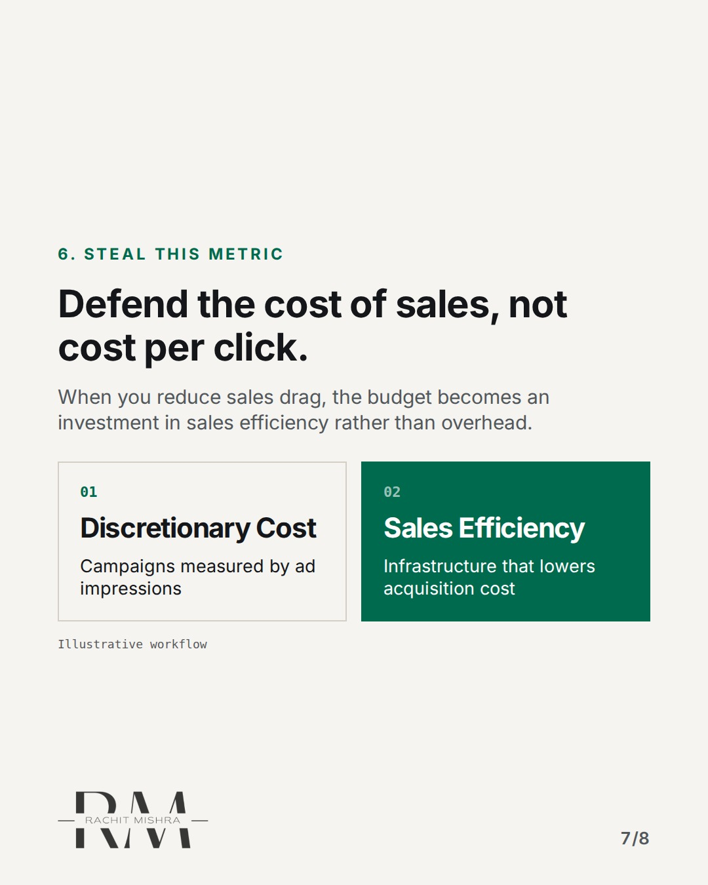
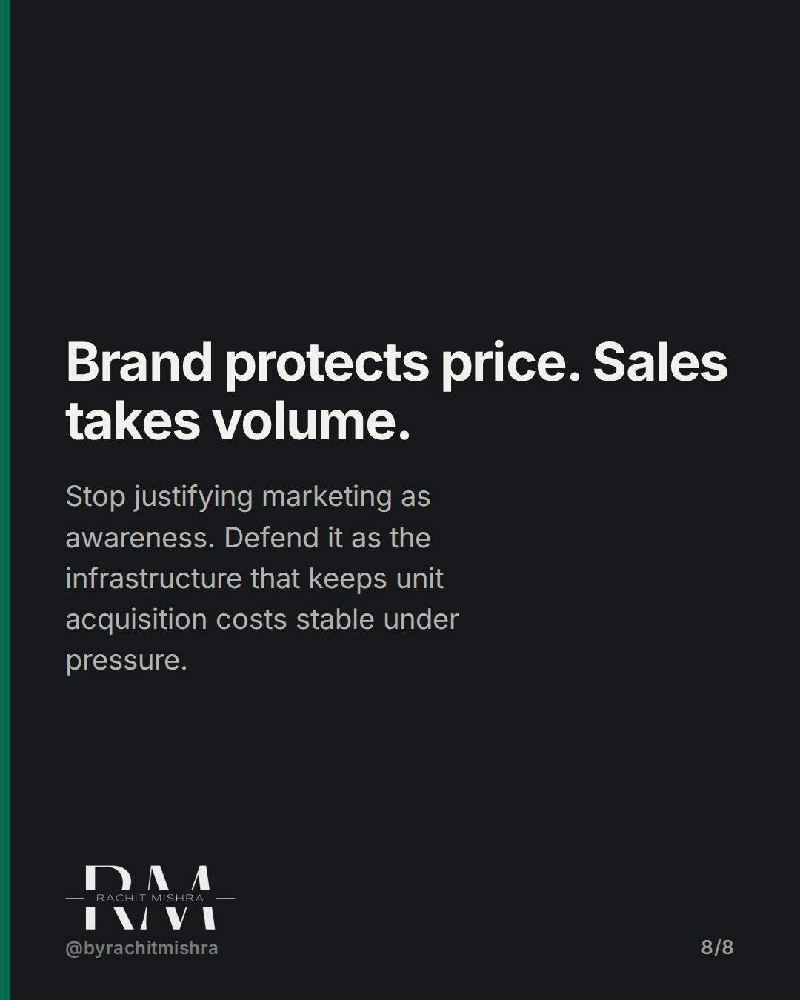

# defending_marketing_budget_procurement

**CAROUSEL** · inside_the_org · goes live **2026-11-07T10:30:00+05:30**

> Targeting: `defending a marketing budget`
>
> Claim: B2B marketing budgets get cut in committee because marketers defend pipeline volume instead of defending unit acquisition cost and sales cycle velocity.
>
> Proof (framework): A three-part defense test for commercial budget reviews: substituting top-of-funnel reach metrics with commercial velocity, margin protection, and sales access thresholds.
>
> Rendered infographics: 6 — comparison, bottleneck, comparison, checklist, checklist, comparison

## Slides

8 rendered images sit in this folder — upload them in filename order.

**1.** 
### You lose budget when you defend awareness.


**2.** 1. THE FINANCE GAP
### Procurement evaluates risk, not interest.
When sales slows down, CFOs cut uncommitted cash. Brand campaigns without commercial metrics lose funding first.



**3.** 2. THE METRIC TRAP
### Volume leads do not protect margins.
Flooding sales with raw leads lowers deal quality. Sales then reports that marketing output is unhelpful.



**4.** 3. THE POSITIONING
### Position brand as margin insurance.
Strong reputations prevent discounting. Frame brand spending as the cost of maintaining contract pricing.



**5.** 4. THE SHIFT
### Measure pipeline velocity over reach.
Track how brand equity shortens security reviews and committee sign-offs. Velocity is a metric finance respects.



**6.** 5. THE EXECUTION
### Run the three-point defense check.
Audit your budget proposal against three criteria before submitting it to the commercial committee.



**7.** 6. STEAL THIS METRIC
### Defend the cost of sales, not cost per click.
When you reduce sales drag, the budget becomes an investment in sales efficiency rather than overhead.



**8.** 
### Brand protects price. Sales takes volume.
Stop justifying marketing as awareness. Defend it as the infrastructure that keeps unit acquisition costs stable under pressure.



## Caption — copy from here

```
You lose budget when you defend awareness.

When defending a marketing budget in front of a commercial committee, talking about impression volume or brand equity scores usually fails.

Finance teams operate on risk reduction. Sales leaders operate on quarterly volume. If marketing presents top-of-funnel reach while sales is missing targets, the budget is seen as overhead.

The fix is to change what the budget defends. Do not defend market awareness. Defend sales velocity and margin stability.

Show how a strong reputation stops buyers from demanding price concessions during late-stage procurement. Show how it cuts weeks out of committee reviews because the buyer already knows your operating standard.

When brand investment is framed as sales efficiency, cutting it becomes a risk to net margins rather than a quick cost saving.

Point of view: If your marketing budget can be cut without sales raising an alarm, you built a campaign engine instead of commercial infrastructure.

Send this to whoever is defending the brand budget in the next planning cycle.

[defending a marketing budget, b2b marketing, brand governance, marketing leadership]

#marketingleadership #inhousemarketing #brandgovernance

#marketingleadership #inhousemarketing #brandgovernance
```

## Alt text

```
Slide deck explaining how to defend a B2B marketing budget using sales velocity and margins.
```

## How this post could fail

If the reader works in consumer D2C where top-of-funnel reach directly drives instant sales volume, framing awareness as a weak metric might read as counterintuitive unless they operate in B2B heavy industry.
