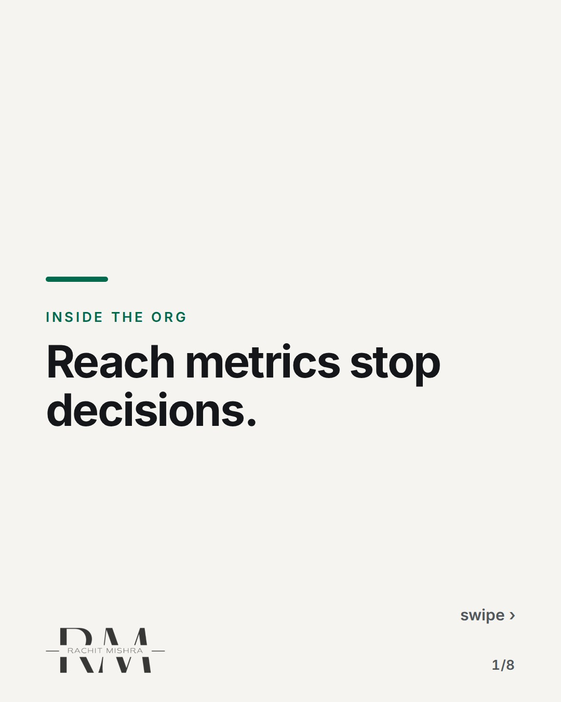
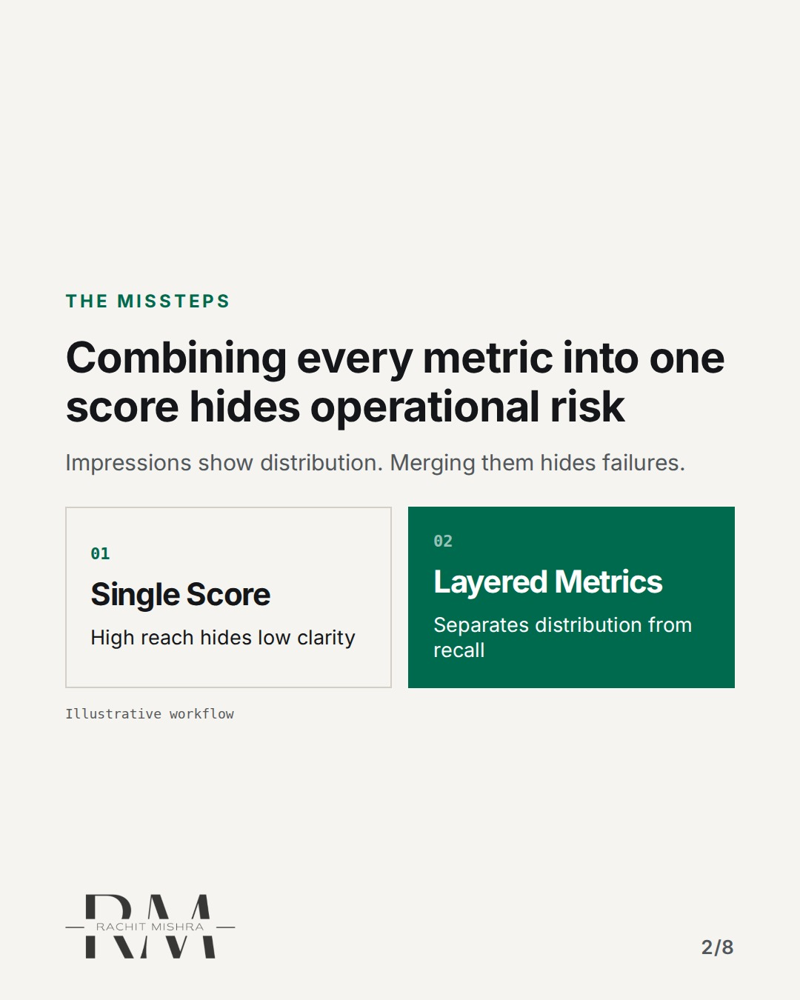
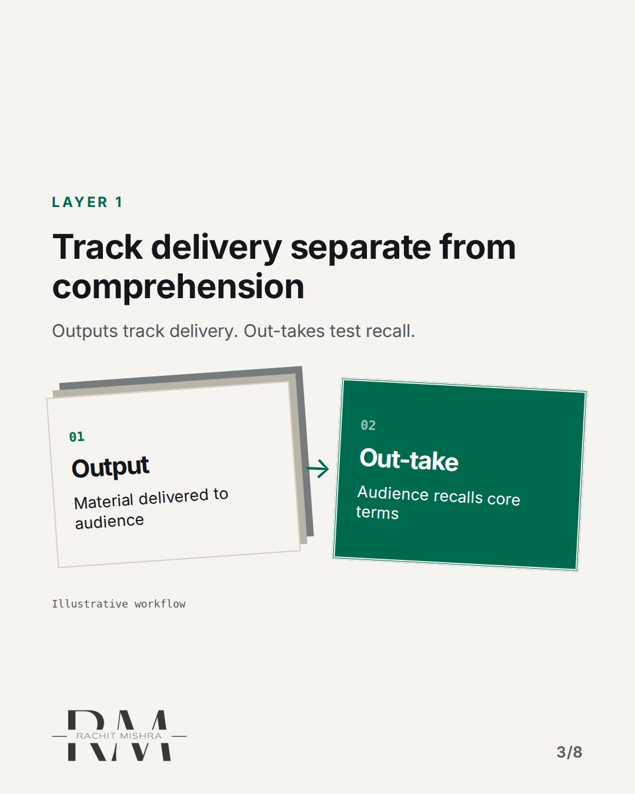
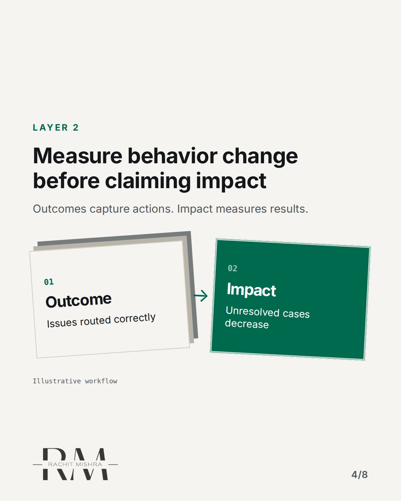
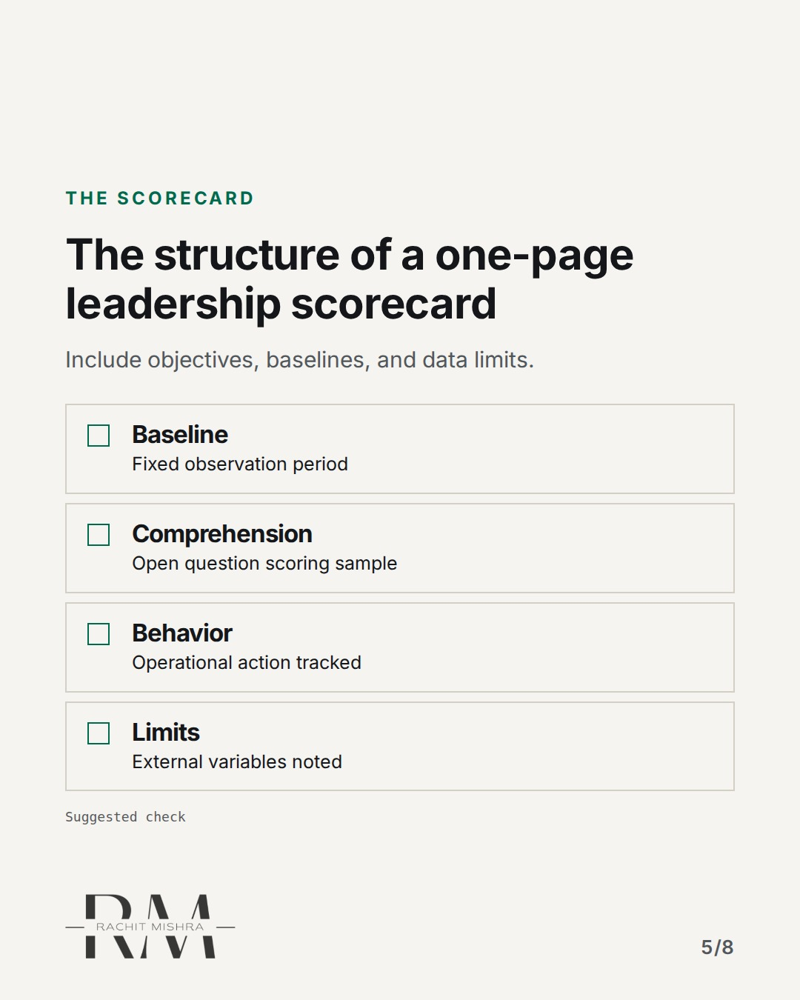
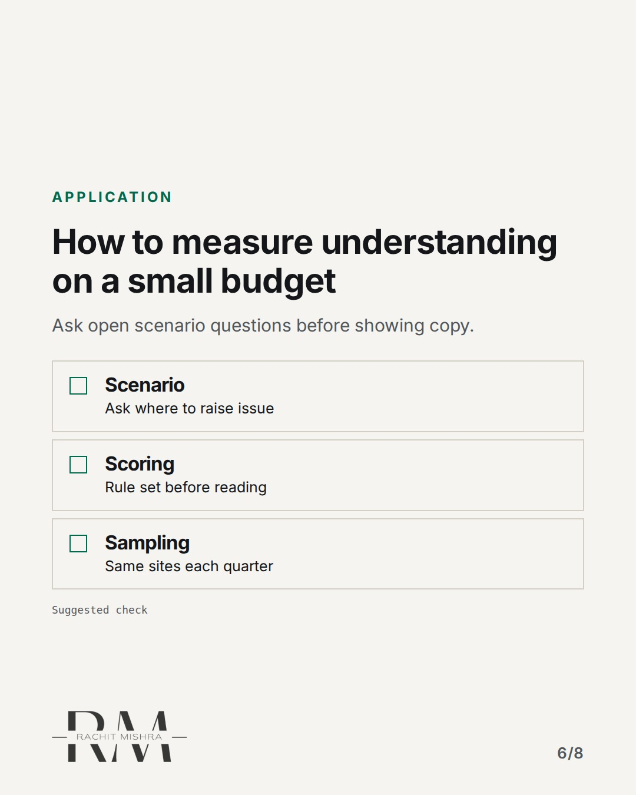
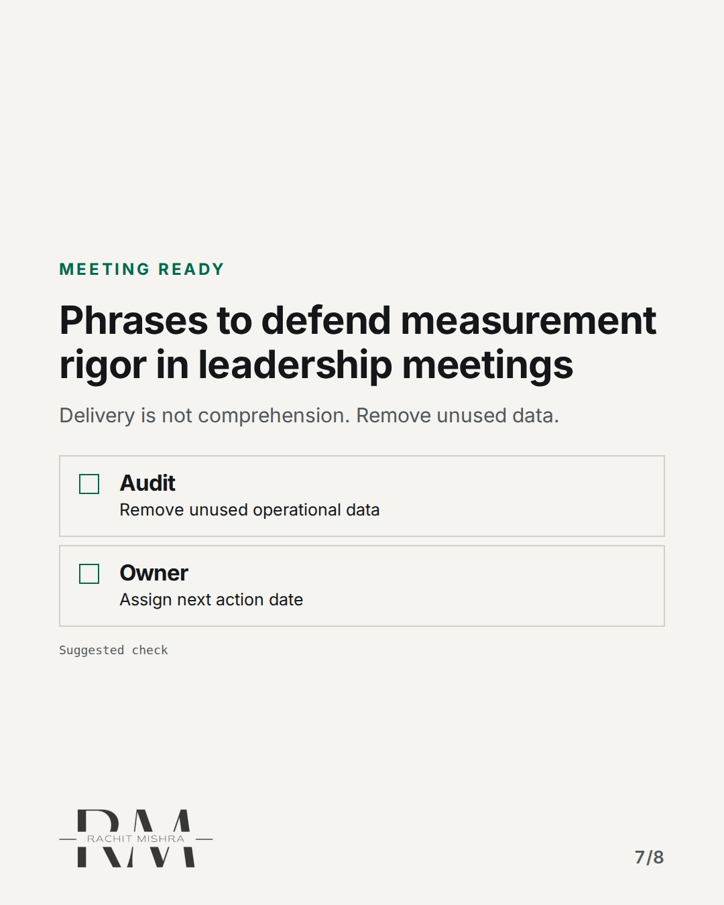
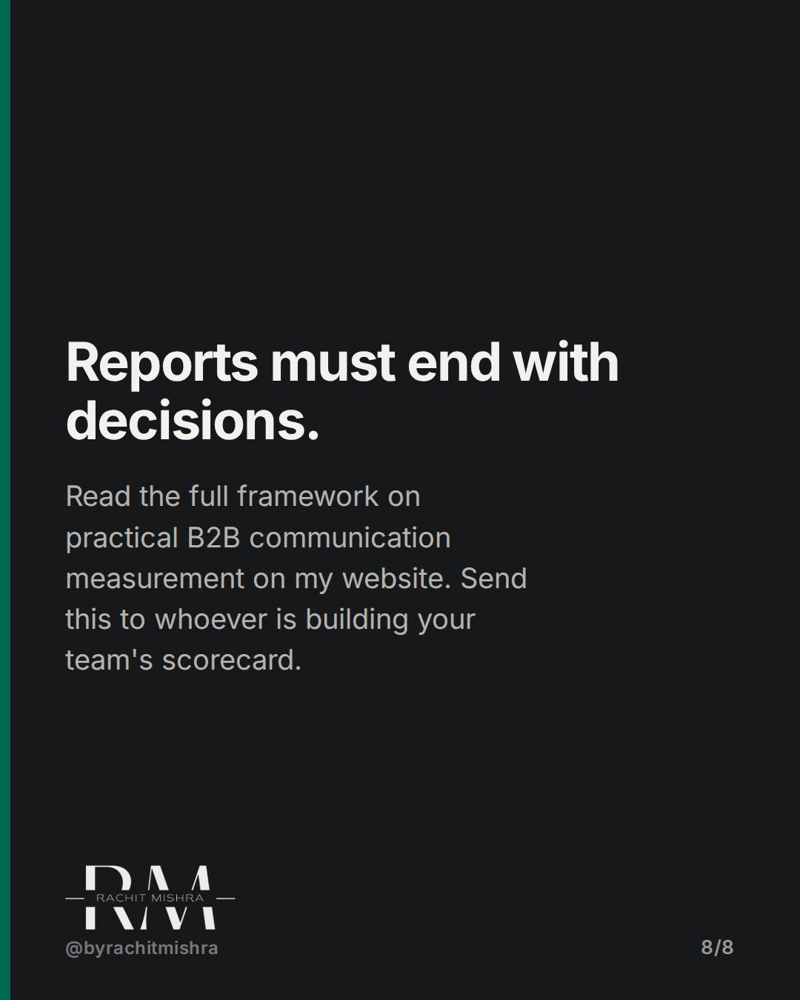

# communication_scorecard_framework

**CAROUSEL** · inside_the_org · goes live **2026-11-08T10:30:00+05:30**

> Targeting: `brand governance`
>
> Claim: Combining reach, understanding, and behavior into one single success metric prevents leadership from making strategic decisions.
>
> Proof (source): A structured communication measurement framework separates outputs, out-takes, outcomes, and business impact instead of combining them into a single score.
> Source: https://www.rachitmishra.in/2026/10/20/communication-measurement-framework/
>
> Source preflight: reachable (HTTP 200)
>
> Rendered infographics: 6 — comparison, bottleneck, bottleneck, checklist, checklist, checklist

## Slides

8 rendered images sit in this folder — upload them in filename order.

**1.** 
### Reach metrics stop decisions.



**2.** THE MISSTEPS
### Combining every metric into one score hides operational risk
Impressions show distribution. Merging them hides failures.



**3.** LAYER 1
### Track delivery separate from comprehension
Outputs track delivery. Out-takes test recall.



**4.** LAYER 2
### Measure behavior change before claiming impact
Outcomes capture actions. Impact measures results.



**5.** THE SCORECARD
### The structure of a one-page leadership scorecard
Include objectives, baselines, and data limits.



**6.** APPLICATION
### How to measure understanding on a small budget
Ask open scenario questions before showing copy.



**7.** MEETING READY
### Phrases to defend measurement rigor in leadership meetings
Delivery is not comprehension. Remove unused data.



**8.** 
### Reports must end with decisions.
Read the full framework on practical B2B communication measurement on my website. Send this to whoever is building your team's scorecard.



## Caption — copy from here

```
Reach metrics stop decisions.

Effective brand governance relies on reporting structures that force operational choices rather than aggregate vanity totals. Combining impressions, press mentions, and internal feedback into a single composite index hides local operational failures.

A board deck showing millions of potential impressions provides zero insight into whether key account managers understand a service change. Operational diagnostics belong in channel management files, not the executive summary.

When building a governance scorecard, isolate delivery metrics from recall tests and behavior tracking. Every line on the summary page must support a specific operational decision, complete with explicit limits and alternative explanations.

Measurement isn't about proving value through inflated totals; it is about providing clear inputs for resource allocation.

The detailed framework is available at rachitmishra.in

Send this to whoever is defending your team's measurement framework this quarter.

[brand governance, in-house marketing, marketing leadership, stakeholder management, b2b marketing]

#brandgovernance #inhousemarketing #marketingleadership

#brandgovernance #inhousemarketing #marketingleadership
```

## Alt text

```
Slide deck explaining how to structure a B2B communication measurement scorecard.
```

## How this post could fail

The post could be mistaken for generic advice if the distinction between outputs, out-takes, and outcomes is not clearly tied to executive decision-making.

## Sources

- [Communication Measurement Framework: From Reach to Decisions](https://www.rachitmishra.in/2026/10/20/communication-measurement-framework/)
