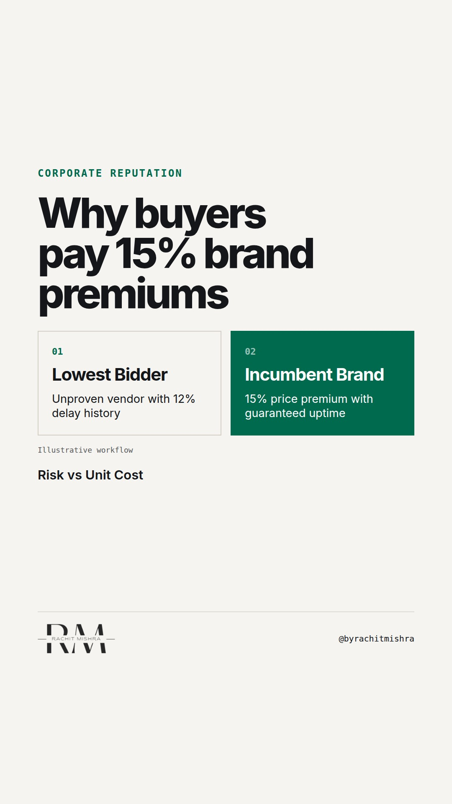

# what_reputation_actually_costs

**REEL** · reputation · goes live **2026-11-05T17:00:00+05:30**

> Targeting: `what reputation actually costs`
>
> Claim: Corporate reputation in industrial B2B is not measured by brand sentiment, but by the financial premium buyers pay to avoid operational risk.
>
> Proof (framework): A 3-part evaluation framework used by industrial procurement committees to price vendor risk versus raw unit cost.
>
> Rendered infographics: 3 — comparison, comparison, checklist
>
> Reel assets: image `designed_gradient` · music `bed-something (11).mp3`

## Cover



## Reel script

`reel.mp4` has been generated from this script and will publish automatically. To use your own footage instead, replace that file and delete `.generated-reel` from this folder.

| Time | On screen | Voiceover | Direction |
|---|---|---|---|
| 0:00-0:03 | **Reputation is insurance against vendor risk.** | Reputation is insurance against vendor risk. When a plant manager chooses a supplier, they are not buying a story. | Rachit looking directly at camera in a neutral office setting. |
| 0:03-0:08 | **Procurement pays extra to avoid failure.** | Procurement committees routinely pay a fifteen percent premium for the exact same physical spec. They pay to protect their operations. | Cut to split comparison graphic showing lowest bidder versus incumbent brand. |
| 0:08-0:14 | **3 tests buyers use to price vendor risk:** | Here are the three explicit tests industrial buyers use to calculate what reputation actually costs in a tender. | Text transition showing headline list with checklist visual overlay. |
| 0:14-0:20 | **1. Escalation path clarity** | First: escalation clarity. If a conveyor line stops at two in the morning, does senior leadership get involved immediately? | Rachit speaking to camera. |
| 0:20-0:26 | **2. Regulatory liability transfer** | Second: regulatory compliance. A strong brand absorbs audit risk so the buyer does not have to answer to regulators alone. | Rachit speaking to camera. |
| 0:26-0:32 | **3. Balance sheet resilience** | Third: balance sheet depth. The buyer needs to know you can survive a supply chain shock without defaulting on delivery. | Rachit speaking to camera. |
| 0:32-0:38 | **Brand reputation is risk governance.** | Corporate communications does not build reputation out of thin air. It makes operational risk management visible to the buyer. | Text overlay on clean background. |

## Caption — copy from here

```
Reputation is insurance against vendor risk.

Understanding what reputation actually costs changes how you talk to commercial teams. In heavy industry, nobody pays extra because they like your brand guidelines.

They pay extra because selecting an unknown vendor creates internal personal risk for the buyer. If a low-cost supplier delays a plant launch by three weeks, the procurement officer takes the blame. If an established market leader delays it, the delay is logged as an industry-wide supply disruption.

That asymmetric risk profile is where the margin lives.

Corporate communications is not an exercise in optimism. It is the practice of documenting and proving operational reliability before the tender is opened.

Send this to whoever is defending the brand budget to a CFO this quarter.

[corporate reputation, industrial b2b, procurement risk, b2b marketing, brand premium]

#corporatecommunications #reputation #publicrelations

#corporatecommunications #reputation #publicrelations
```

## Alt text

```
Text graphic listing three vendor risk tests: escalation path, regulatory margin, balance sheet.
```

## How this post could fail

If the risk premium mechanism is not clear, this could read like generic advice on why brand matters instead of a hard commercial trade-off.
