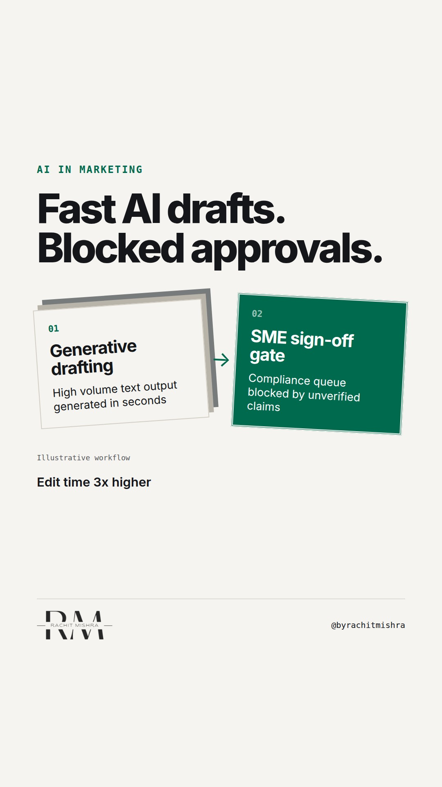

# ai_content_audit_threshold

**REEL** · ai_marketing · goes live **2026-11-03T19:00:00+05:30**

> Targeting: `AI adoption in a large company`
>
> Claim: Scaling AI content generation without an error-density threshold creates an expensive compliance and editing backlog in industrial enterprise marketing.
>
> Proof (framework): A three-point pre-review audit filter for enterprise marketing teams: verify technical specs against regulatory filings, check hallucinated operational claims, and enforce explicit negative constraints before human sign-off.
>
> Rendered infographics: 3 — bottleneck, comparison, checklist
>
> Reel assets: image `designed_gradient` · music `bed-something (10).mp3`

## Cover



## Reel script

`reel.mp4` has been generated from this script and will publish automatically. To use your own footage instead, replace that file and delete `.generated-reel` from this folder.

| Time | On screen | Voiceover | Direction |
|---|---|---|---|
| 0:00-0:04 | **Faster drafting creates a slower approval queue.** | Faster drafting creates a slower approval queue. When enterprise marketing teams scale output using generative tools, the bottleneck simply shifts down the line. | Text overlay on simple dark graphic showing draft output rising while approval velocity drops. |
| 0:04-0:09 | **Drafting time down 80%. Edit time up 3x.** | Drafting time drops by eighty percent, but review time triples because legal and technical SMEs are filtering low-density text. | Clean metric graphic comparing draft generation speed versus internal technical sign-off duration. |
| 0:09-0:16 | **The issue is unchecked AI adoption.** | AI adoption in a large company breaks down when speed is measured at generation rather than final sign-off. | Diagram showing the shift of team effort from initial copywriting to downstream technical correction. |
| 0:16-0:23 | **3-point pre-review audit filter** | To fix the review queue, deploy a three-point audit filter before any generated text reaches subject matter experts. | On-screen checklist graphic detailing the three governance filters. |
| 0:23-0:28 | **Reject drafts without source anchors.** | First, reject any generated copy that lacks explicit source anchors from audited internal documentation. | Focus on step one of the checklist graphic. |
| 0:28-0:33 | **Filter out generic category fluff.** | Second, purge generic adjective stackings that sound polished but say nothing about your specific product performance. | Focus on step two of the checklist graphic. |
| 0:33-0:38 | **Enforce strict negative constraints.** | Third, apply negative constraints to automatically strip out unapproved claims before compliance sees them. | Focus on step three of the checklist graphic. |
| 0:38-0:44 | **Approval speed is your real AI metric.** | Approval speed is your real AI metric. Measure time-to-publish, not time-to-first-draft. | Final summary frame displaying the core governing principle. |

## Caption — copy from here

```
Faster drafting creates a slower approval queue.

Accelerating draft production with AI adoption in a large company usually creates a hidden operational cost: a massive review backlog for technical leadership.

When a team goes from writing two technical whitepapers a month to drafting ten, legal, regulatory, and engineering leads become the bottleneck. They are forced to act as line editors for AI-generated text that sounds authoritative but lacks precision.

If a draft takes ten minutes to generate but three hours for a domain expert to verify and correct, your workflow is slower than it was before.

The fix is not asking experts to review faster. The fix is setting a strict pre-review audit filter. If a draft does not cite verified technical documentation or violates brand negative constraints, it never enters the approval queue.

Measure AI performance by time-to-publish, not time-to-draft.

Send this to whoever is setting content governance rules for your team this quarter.

[ai adoption in a large company, marketing technology stack, AI governance, enterprise marketing, martech]

#aimarketing #martech #b2bmarketing

#aimarketing #martech #b2bmarketing
```

## Alt text

```
Graphic detailing a three-step audit filter for AI content governance in B2B marketing.
```

## How this post could fail

If the audit checklist reads as basic editing advice rather than a structural governance gate for enterprise review queues, senior comms leaders will dismiss it.
