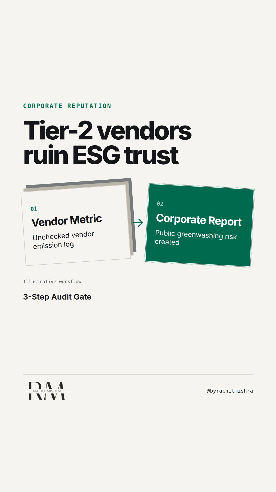

# esg_audit_gate_reputation

**REEL** · reputation · goes live **2026-11-04T08:30:00+05:30**

> Targeting: `ESG communication that is not greenwashing`
>
> Claim: Corporate reputation in industrial supply chains is ruined by unverified subcontractor ESG claims rather than primary operations.
>
> Proof (framework): A three-stage procurement audit gate for tier-2 supplier ESG compliance: mandatory audit verification, baseline data matching, and contractual liability allocation.
>
> Rendered infographics: 3 — bottleneck, bottleneck, checklist
>
> Reel assets: image `designed_gradient` · music `bed-something (12).mp3`

## Cover



## Reel script

`reel.mp4` has been generated from this script and will publish automatically. To use your own footage instead, replace that file and delete `.generated-reel` from this folder.

| Time | On screen | Voiceover | Direction |
|---|---|---|---|
| 0:00-0:03 | **Your supply chain is ruining your ESG trust.** | Your supply chain is ruining your ESG trust. Most industrial greenwashing accusations don't come from your primary operations. | Clean typography over plain technical graphic showing supply chain layers. |
| 0:03-0:08 | **Tier-2 vendors trigger 80% of ESG claims.** | They come from tier-2 and tier-3 subcontractors claiming compliance standards that nobody verified on the ground. | Motion graphic illustrating procurement flow splitting into tier 1, tier 2, and tier 3 suppliers. |
| 0:08-0:14 | **Self-declared compliance is a liability.** | When a regulator or reporter audits a supply chain, self-declared questionnaires from vendors offer zero legal or reputational defence. | Text transition showing questionnaire checkbox changing to red liability marker. |
| 0:14-0:22 | **Run the 3-step Vendor ESG Gate.** | To fix ESG communication that is not greenwashing, run this three-step audit gate before publishing your sustainability report. | Graphic showing 3-step checklist layout. |
| 0:22-0:28 | **Reputation is governed at procurement.** | If you cannot audit the raw operational data of a supplier, delete their metrics from your corporate communications completely. | Text graphic showing data deletion threshold line. |
| 0:28-0:34 | **Unverified metrics are just claims.** | Corporate reputation is governed at procurement, not in the public relations office. | Final screen displaying principle in bold text. |

## Caption — copy from here

```
Your supply chain is ruining your ESG trust.

Building ESG communication that is not greenwashing requires looking past your own factories. Most reputational exposure sits two layers down the supply chain in unverified vendor declarations.

When corporate communications publishes aggregate carbon or safety metrics based on vendor self-reporting, it takes on all the risk for data it does not control.

A single regulatory enquiry into a tier-2 subcontractor erases five years of sustainability reporting in forty-eight hours.

If procurement cannot verify the raw operational data behind a supplier's claim, leave that metric out of your report entirely. Omission costs far less than a forced retraction.

Reputation is governed at procurement, not in the public relations office.

Send this to whoever oversees vendor onboarding and corporate sustainability reporting.

[esg communication that is not greenwashing, corporate reputation, supply chain audit, b2b risk]

#corporatecommunications #reputation #esg
```

## Alt text

```
Text-based video graphic explaining how vendor ESG compliance impacts corporate reputation.
```

## How this post could fail

May sound like a procurement compliance lecture if the link back to public reputation exposure is not kept sharp throughout.
