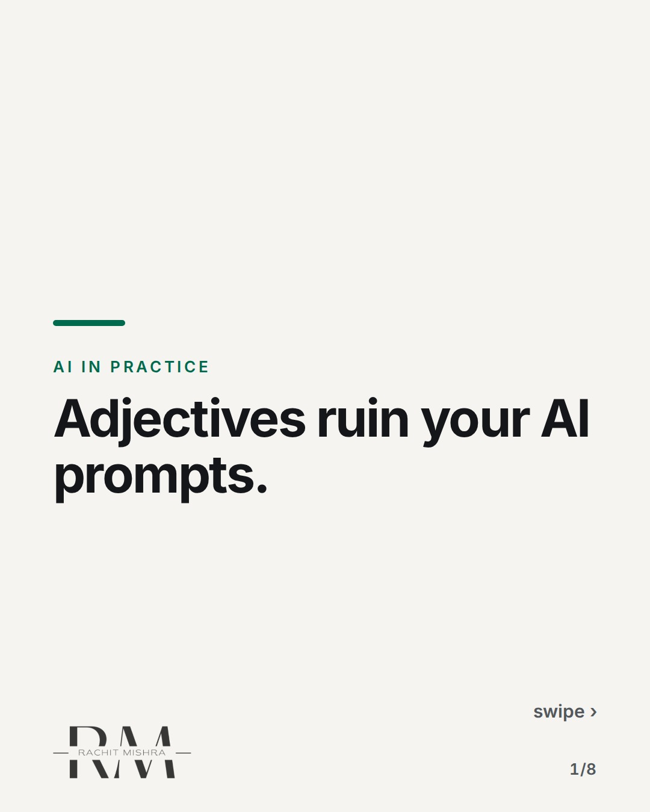
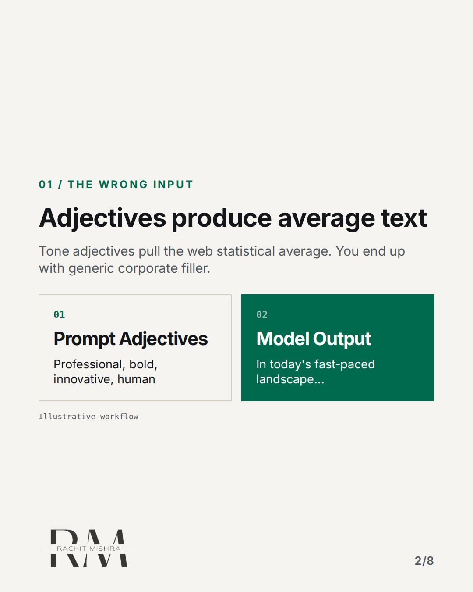
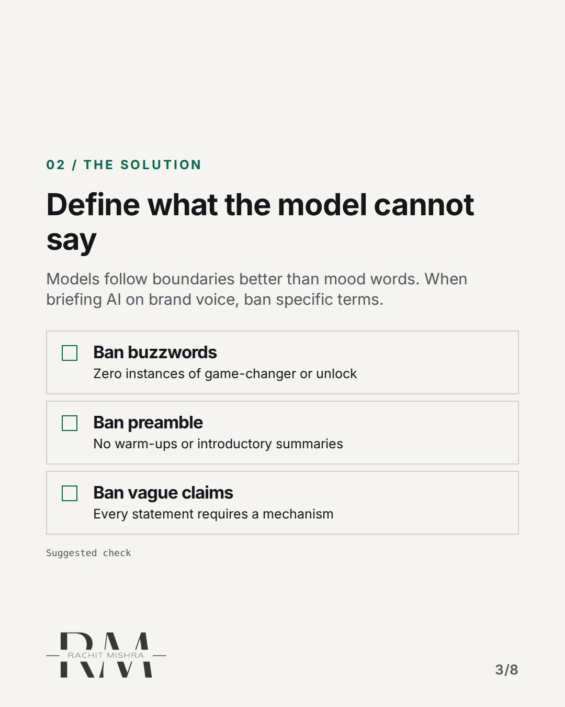
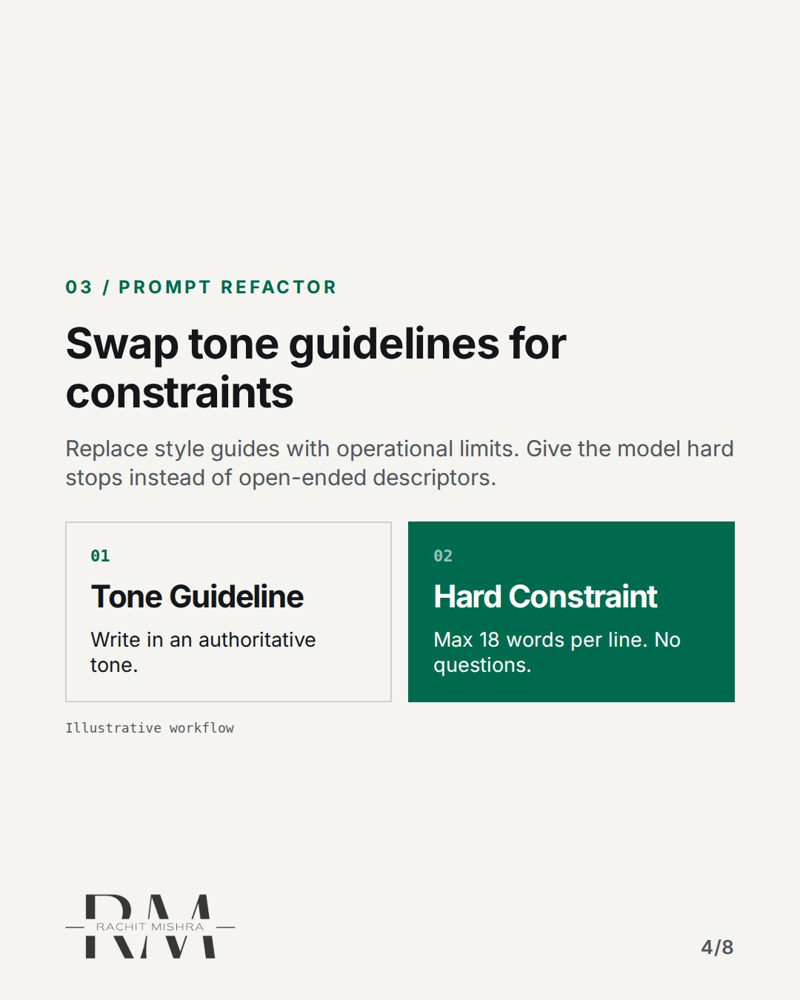
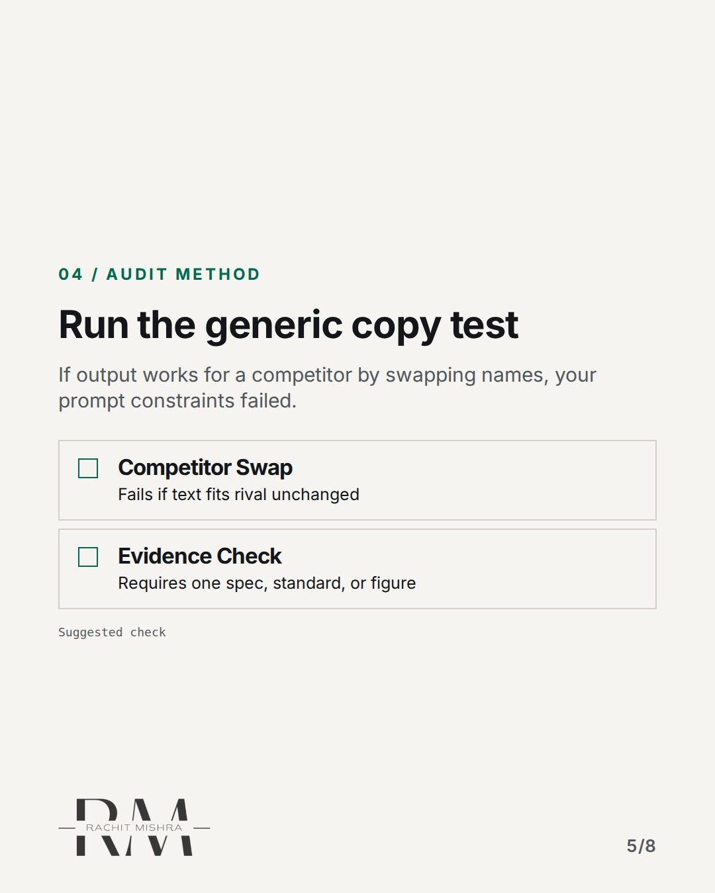
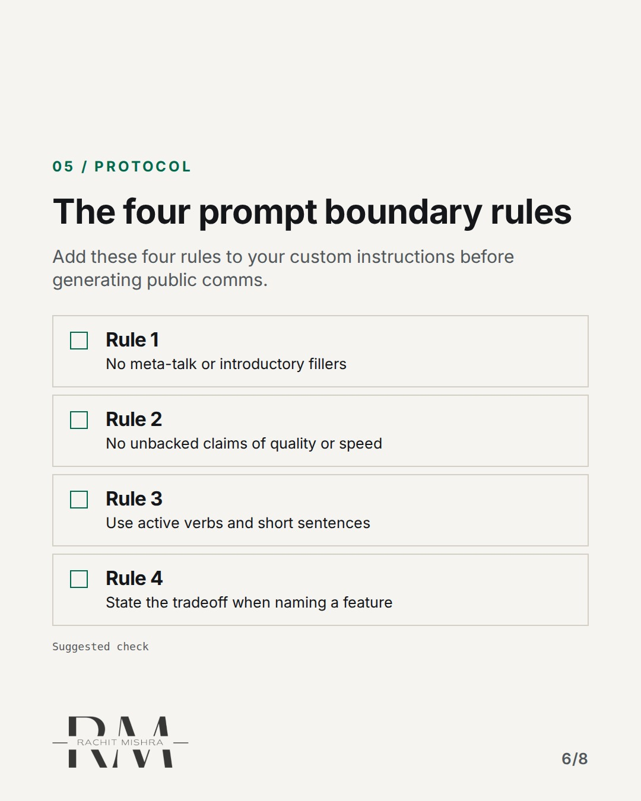
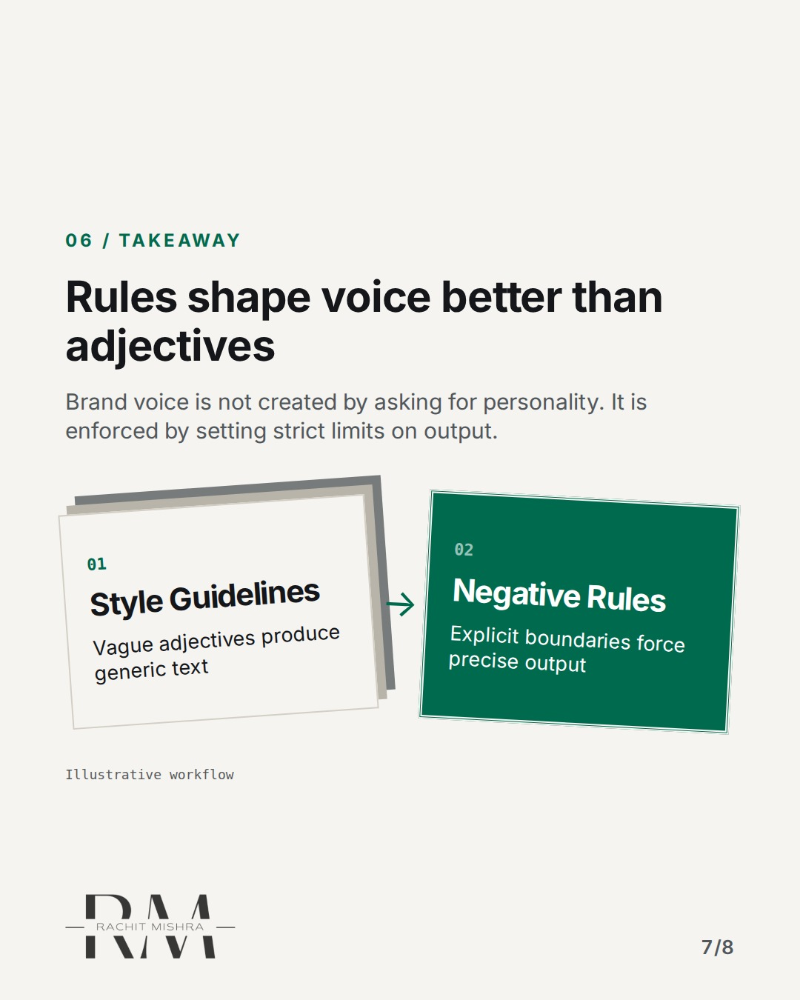
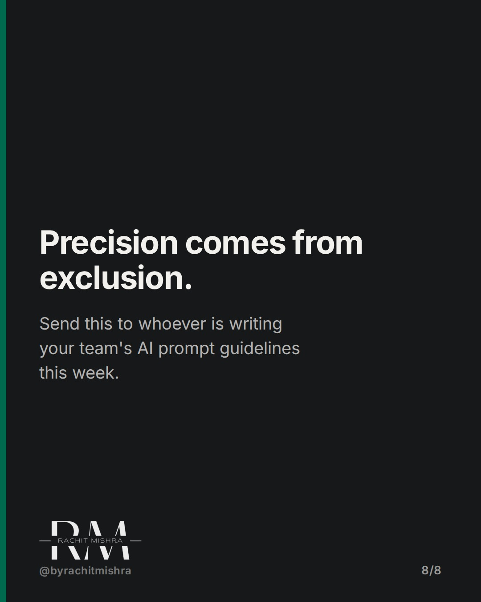

# briefing_ai_on_brand_voice

**CAROUSEL** · ai_in_practice · goes live **2026-11-04T20:00:00+05:30**

> Targeting: `briefing AI on brand voice`
>
> Claim: AI models generate generic copy because teams feed them style adjectives instead of negative operational rules.
>
> Proof (framework): A prompt engineering test for corporate comms: replace tone adjectives with explicit negative constraints and forbidden industry cliches.
>
> Rendered infographics: 6 — comparison, checklist, comparison, checklist, checklist, bottleneck

## Slides

8 rendered images sit in this folder — upload them in filename order.

**1.** 
### Adjectives ruin your AI prompts.



**2.** 01 / THE WRONG INPUT
### Adjectives produce average text
Tone adjectives pull the web statistical average. You end up with generic corporate filler.



**3.** 02 / THE SOLUTION
### Define what the model cannot say
Models follow boundaries better than mood words. When briefing AI on brand voice, ban specific terms.



**4.** 03 / PROMPT REFACTOR
### Swap tone guidelines for constraints
Replace style guides with operational limits. Give the model hard stops instead of open-ended descriptors.



**5.** 04 / AUDIT METHOD
### Run the generic copy test
If output works for a competitor by swapping names, your prompt constraints failed.



**6.** 05 / PROTOCOL
### The four prompt boundary rules
Add these four rules to your custom instructions before generating public comms.



**7.** 06 / TAKEAWAY
### Rules shape voice better than adjectives
Brand voice is not created by asking for personality. It is enforced by setting strict limits on output.



**8.** 
### Precision comes from exclusion.
Send this to whoever is writing your team's AI prompt guidelines this week.



## Caption — copy from here

```
Adjectives ruin your AI prompts.

When briefing AI on brand voice, most teams copy and paste their marketing style guide: "make it bold, authoritative, and human." Then they wonder why the output sounds like every other enterprise software brochure written in the last two years.

Language models treat tone adjectives as statistical weighted averages. Asking for "innovative" simply pulls the most common, generic phrases associated with innovation across the web.

If you want custom output, stop describing the vibe. Start writing negative constraints. Tell the model what it is explicitly forbidden to say, which words to ban, and what sentence structures to avoid.

Setting boundaries shapes writing faster than asking for personality.

Send this to whoever is building your team's custom prompts this quarter.

[briefing ai on brand voice, ai content workflow, ai governance, b2b marketing]

#aimarketing #martech #b2bmarketing

#aimarketing #martech #b2bmarketing
```

## Alt text

```
Carousel slides explaining how to brief AI on brand voice using negative prompt constraints.
```

## How this post could fail

It might read like generic prompt engineering advice if the B2B comms context is not heavily emphasized in the slide copy.
