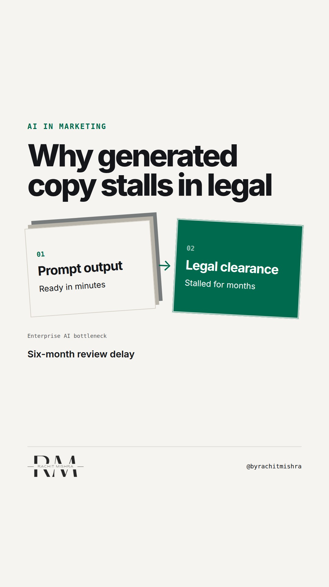

# ai_governance_in_enterprise_marketing

**REEL** · ai_marketing · goes live **2026-11-13T08:30:00+05:30**

> Targeting: `AI adoption in a large company`
>
> Claim: AI in enterprise marketing fails not because of model capability, but because legal and compliance gatekeepers treat generated copy as an unregulated risk.
>
> Proof (practitioner_observation): Observed review cycles in industrial manufacturing where generative text tools speed up creation by three weeks, only for legal teams to stall publication for six months due to lack of traceable provenance.
>
> Rendered infographics: 7 — bottleneck, bottleneck, comparison, comparison, checklist, comparison, comparison
>
> Reel assets: image `designed_gradient` · music `bed-something (13).mp3`

## Cover



## Reel script

`reel.mp4` has been generated from this script and will publish automatically. To use your own footage instead, replace that file and delete `.generated-reel` from this folder.

| Time | On screen | Voiceover | Direction |
|---|---|---|---|
| 0:00-0:03 | **Generated copy dies in legal compliance gates.** | Generated copy dies in legal compliance gates. | Static view of a document marked with red strikethrough at the signature line. |
| 0:03-0:08 | **Speed creates compliance debt.** | AI adoption in a large company usually stumbles here. Speed creates compliance debt that legal must clear before anything goes public. | Pan across a corporate compliance flowchart. |
| 0:08-0:14 | **Unverified claims block publication.** | A model can draft fifty data sheets in minutes. But without clear source attribution, every claim is a legal risk. | Cut to an unverified technical specification draft. |
| 0:14-0:20 | **The four verification checks.** | If your team cannot answer four questions about every generated asset, the workflow is broken. | Cut to clean typographic list on screen. |
| 0:20-0:26 | **Traceability beats raw speed.** | Traceability beats raw speed every time in regulated markets. Treat generative tools like junior writers who need audit trails. | Presenter holding a printed compliance sign-off log. |
| 0:26-0:30 | **Governance is the marketing strategy.** | Governance is the marketing strategy when your buyer is a procurement committee. | Close on final principle graphic. |

## Caption — copy from here

```
Generated copy dies in legal compliance gates.

AI adoption in a large company fails when marketing treats generative tools as writing aids rather than regulated assets. A model can draft fifty product descriptions in ten minutes, but if none of them carry verifiable provenance, they sit in legal review until the campaign window closes.

Governance is the marketing strategy when your buyer is a procurement committee that checks every assertion.

Send this to whoever is trying to scale content production without expanding the compliance team.

[ai adoption in a large company, marketing technology, enterprise marketing, brand governance]

#aimarketing #martech #b2bmarketing
```

## Alt text

```
Industrial compliance workflow chart showing marketing generation blocked by legal review gates.
```

## How this post could fail

Readers might assume this applies only to legal departments rather than the underlying workflow breakdown between marketing speed and risk management.
