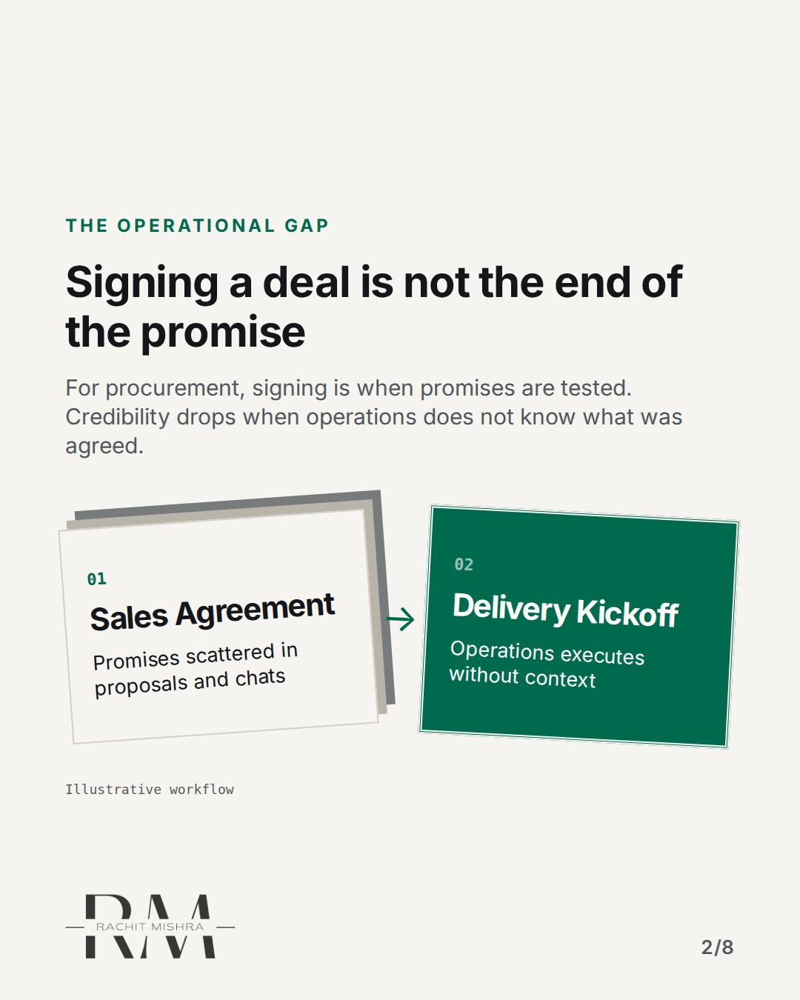
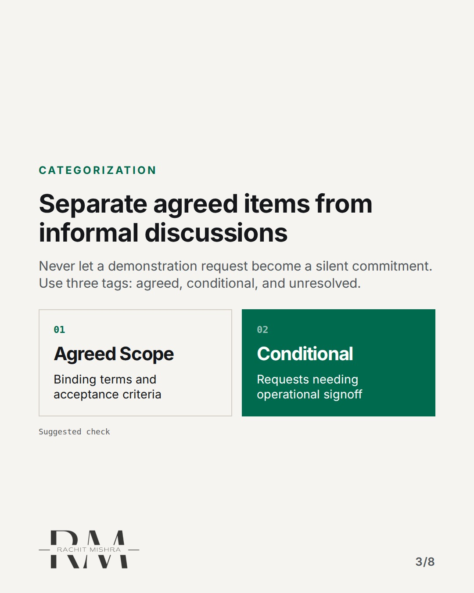
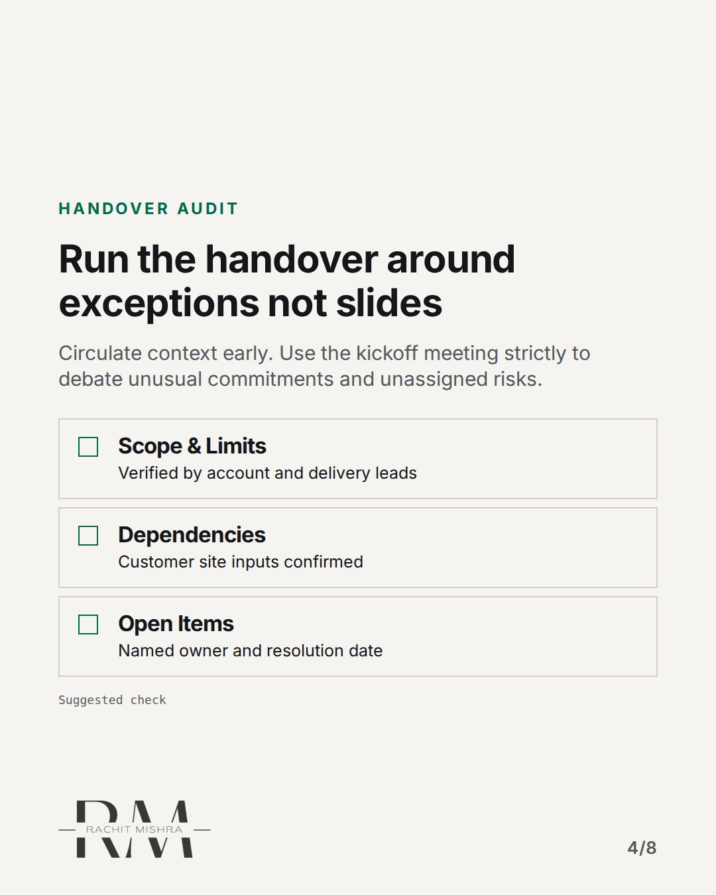
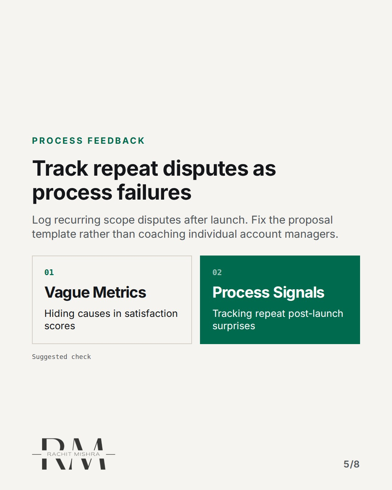
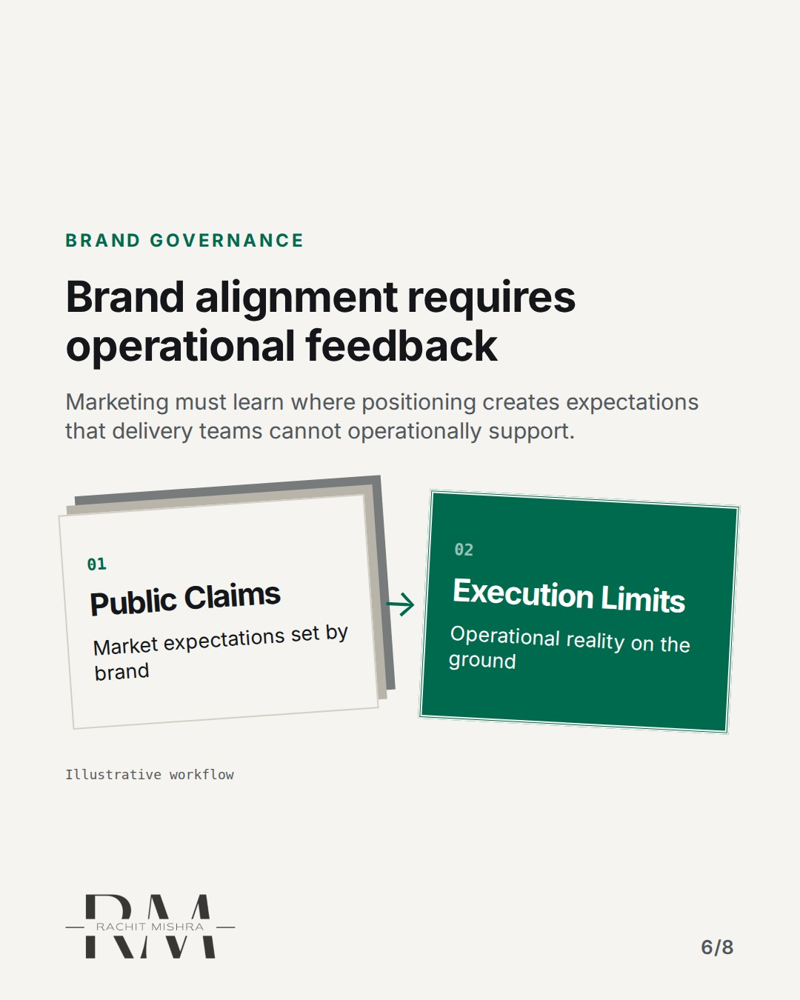
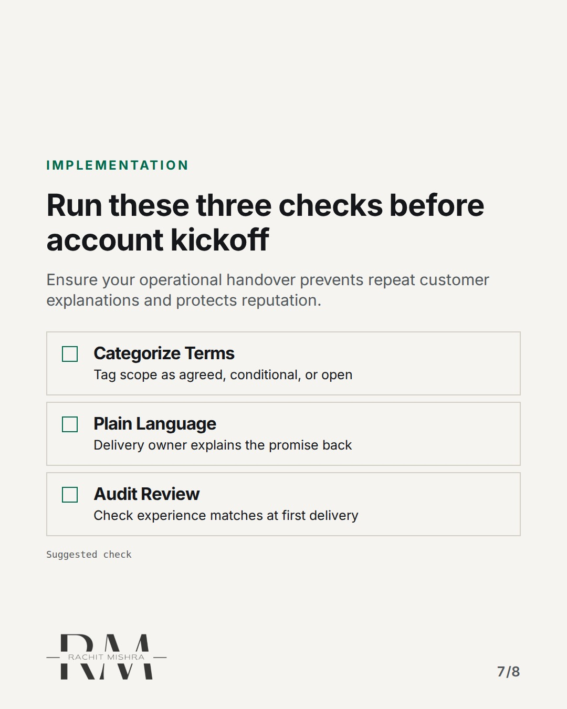
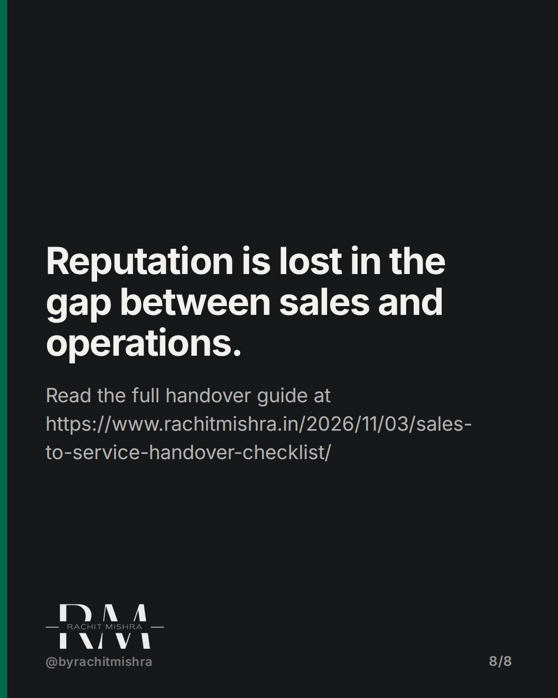

# salestoservicehandoverchecklist

**CAROUSEL** · ai_in_practice · goes live **2026-11-13T19:00:00+05:30**

> Targeting: `AI content workflow`
>
> Claim: A customer promise breaks when sales agreements are handed to operational delivery without an explicit validation checklist.
>
> Proof (source): Sales-to-service handovers require explicit categorization into agreed scope, conditional requests, and unresolved items to prevent customer experience failure.
> Source: https://www.rachitmishra.in/2026/11/03/sales-to-service-handover-checklist/
>
> Source preflight: reachable (HTTP 200)
>
> Rendered infographics: 6 — bottleneck, comparison, checklist, comparison, bottleneck, checklist

## Slides

8 rendered images sit in this folder — upload them in filename order.

**1.** 
### The deal is signed. Now real risk begins.


**2.** The Operational Gap
### Signing a deal is not the end of the promise
For procurement, signing is when promises are tested. Credibility drops when operations does not know what was agreed.



**3.** Categorization
### Separate agreed items from informal discussions
Never let a demonstration request become a silent commitment. Use three tags: agreed, conditional, and unresolved.



**4.** Handover Audit
### Run the handover around exceptions not slides
Circulate context early. Use the kickoff meeting strictly to debate unusual commitments and unassigned risks.



**5.** Process Feedback
### Track repeat disputes as process failures
Log recurring scope disputes after launch. Fix the proposal template rather than coaching individual account managers.



**6.** Brand Governance
### Brand alignment requires operational feedback
Marketing must learn where positioning creates expectations that delivery teams cannot operationally support.



**7.** Implementation
### Run these three checks before account kickoff
Ensure your operational handover prevents repeat customer explanations and protects reputation.



**8.** 
### Reputation is lost in the gap between sales and operations.
Read the full handover guide at https://www.rachitmishra.in/2026/11/03/sales-to-service-handover-checklist/



## Caption — copy from here

```
The deal is signed. Now real risk begins.

Designing a structured AI content workflow requires clean inputs, but human sales-to-service handovers fail on the exact same governance blindspot: unverified assumptions.

In B2B accounts, credibility is rarely lost during the sales pitch. It breaks during the first delivery cycle when operations discovers that informal demonstration chats were interpreted by the customer as binding commitments.

A CRM record is not proof of alignment. If delivery cannot state the customer's expected outcome in plain language without asking them to repeat their requirements, your internal handover failed.

Marketing sets the promise. Operations pays for it. When those two functions do not share an explicit exception framework, reputation erodes long before the contract comes up for renewal.

Send this to whoever is responsible for customer delivery and account handovers this quarter.

[b2b marketing, ai content workflow, brand governance, customer experience, marketing operations]

#b2bmarketing #marketingoperations #aigovernance
```

## Alt text

```
Carousel slides outlining a sales-to-service handover framework for industrial B2B companies.
```

## How this post could fail

The post risks reading like standard account management advice if the link back to brand promises and governance is overlooked.

## Sources

- [Sales-to-Service Handover Checklist: Keep the Promise After the Contract](https://www.rachitmishra.in/2026/11/03/sales-to-service-handover-checklist/)
