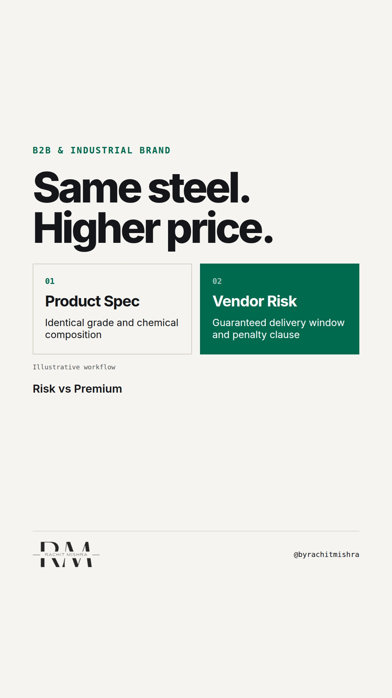

# commodity_price_premium_test

**REEL** · b2b_brand · goes live **2026-11-09T08:30:00+05:30**

> Targeting: `how to brand a commodity product`
>
> Claim: A commodity price premium is earned by reducing the buyer's internal risk, not by adding marketing adjectives.
>
> Proof (framework): A three-part procurement risk test that identifies operational guarantees capable of supporting a price premium on undifferentiated goods.
>
> Rendered infographics: 3 — comparison, comparison, checklist
>
> Reel assets: image `designed_gradient` · music `bed-something (1).mp3`

## Cover



## Reel script

`reel.mp4` has been generated from this script and will publish automatically. To use your own footage instead, replace that file and delete `.generated-reel` from this folder.

| Time | On screen | Voiceover | Direction |
|---|---|---|---|
| 0:00-0:03 | **Why pay more for identical steel?** | Why pay more for identical steel? Procurement committees do not pay extra for brand stories. | Text on dark slate background with a stark high-contrast layout. |
| 0:03-0:07 | **Commodities are priced on risk, not product.** | When two industrial products hit the exact same technical specification, the buyer is no longer evaluating the material. | Comparison visual contrasting identical material specs with supplier risk factors. |
| 0:07-0:12 | **The buyer defends the choice to a committee.** | They are evaluating what happens to their own job if your delivery is three days late. | Graphic showing buyer sitting between supplier and procurement board. |
| 0:12-0:18 | **Audit your margin against operational risk.** | If you want to understand how to brand a commodity product, run this risk audit before you change your messaging. | Interactive checklist visual animating three operational risk checks. |
| 0:18-0:24 | **Branding a commodity means underwriting delay.** | Every point of price premium on an undifferentiated commodity comes from underwriting operational friction for the buyer. | Text highlighting operational guarantees over traditional ad copy. |
| 0:24-0:28 | **B2B brand is an operational guarantee.** | In heavy industry, your brand is not your slogan. It is the cost you absorb so your customer does not have to. | Final clean text frame displaying the core principle. |

## Caption — copy from here

```
Why pay more for identical steel?

If you are working on how to brand a commodity product, the first mistake is treating it like a consumer exercise. Consumer brands add emotional value to create differentiation. Industrial buyers do not buy emotion; they manage downside.

When a procurement committee looks at two suppliers offering identical technical specifications, the purchase order goes to the vendor that removes personal risk for the buyer.

That buyer has to defend their decision to a plant manager, a finance director, and an auditor. If your shipment is late, their production line stops. If your paperwork is wrong, their compliance audit fails.

Your margin premium does not come from your ad copy. It comes from your willingness to guarantee delivery windows, streamline reject protocols, and absorb operational risk.

Industrial brand strength is measured by how much friction you remove from the purchasing committee's internal review.

Send this to the commercial head currently trying to rebrand a raw material.

[how to brand a commodity product, industrial marketing, b2b branding, commodity pricing]

#b2bmarketing #industrialmarketing #b2bbranding

#b2bmarketing #industrialmarketing #b2bbranding
```

## Alt text

```
Text graphic outlining operational risk factors in industrial commodity procurement.
```

## How this post could fail

It risks being dismissed as operational advice rather than marketing advice if the reader does not accept that risk reduction is the core function of B2B branding.
