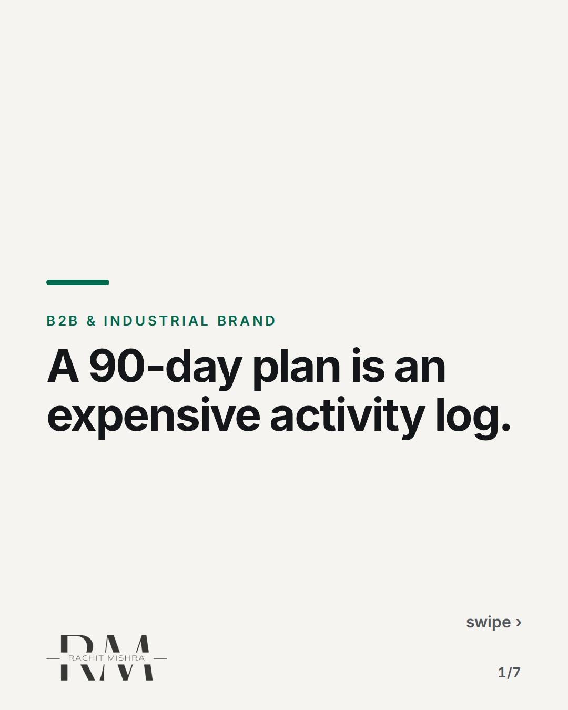
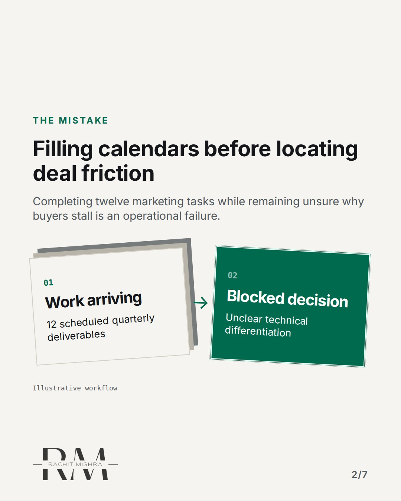
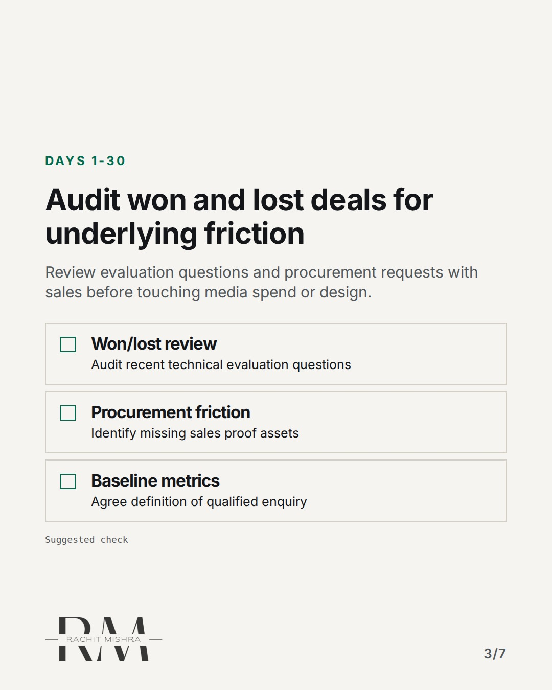
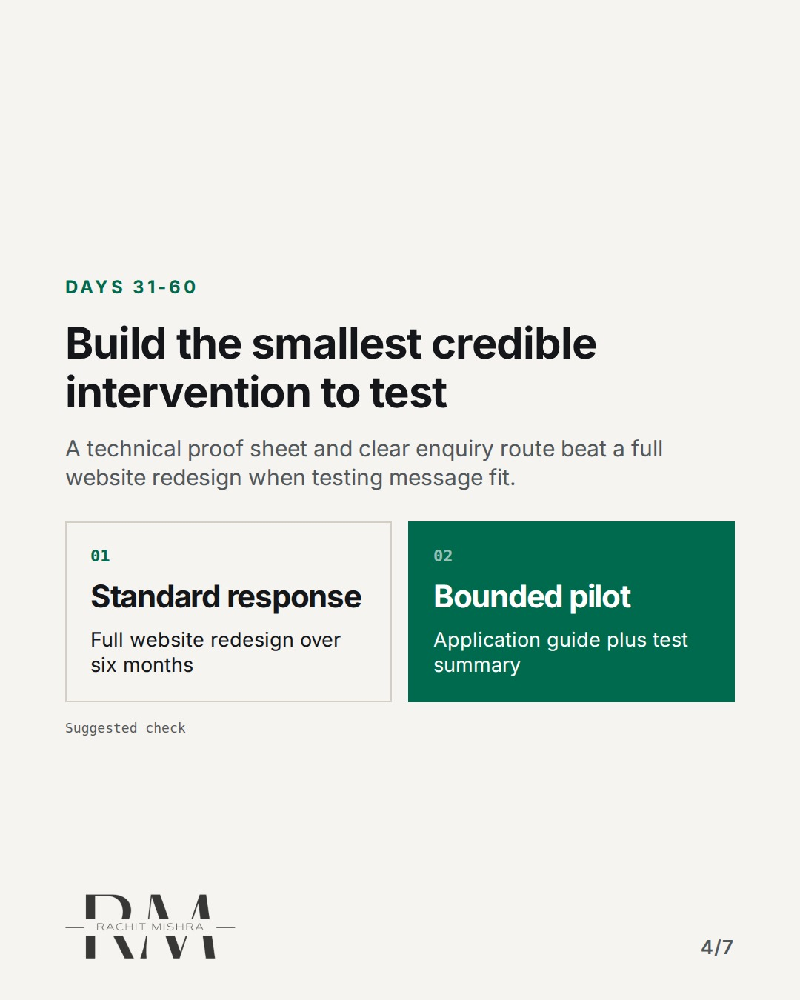
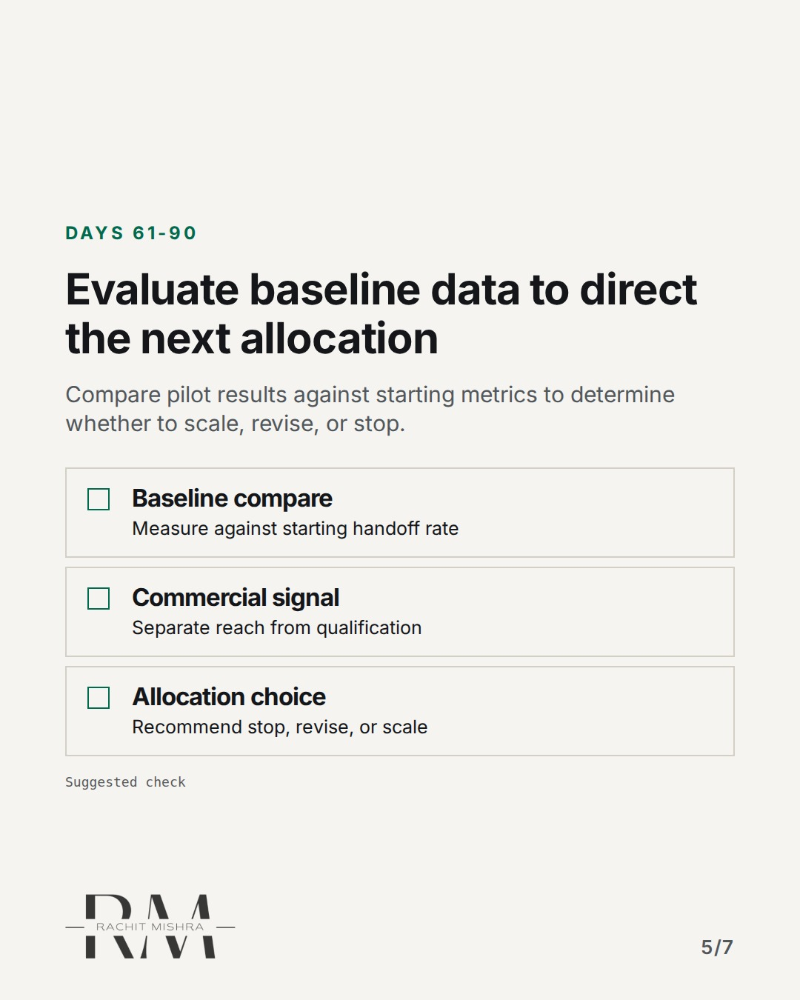
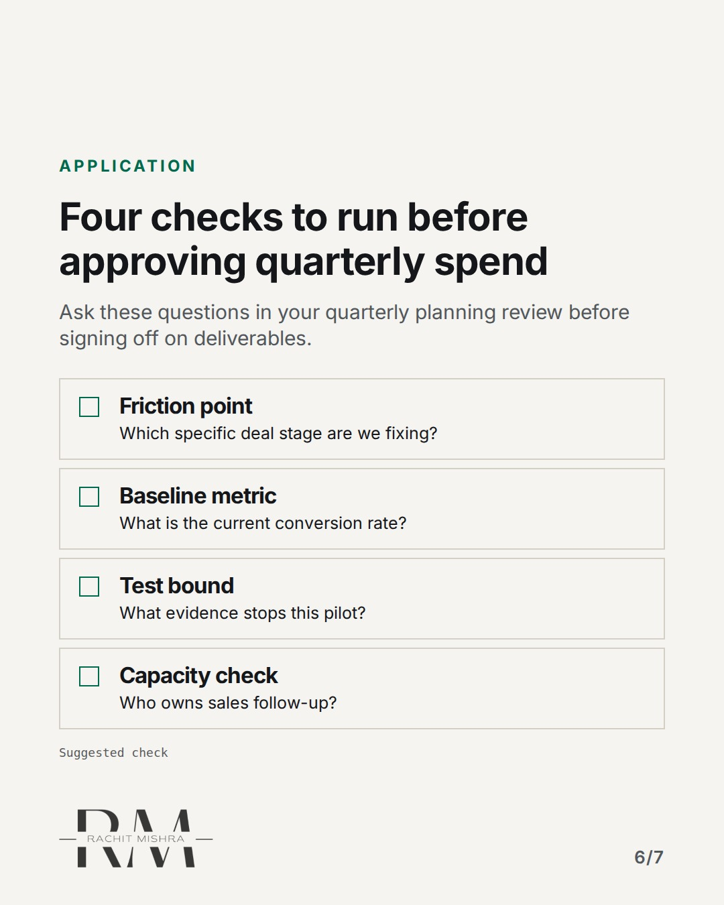
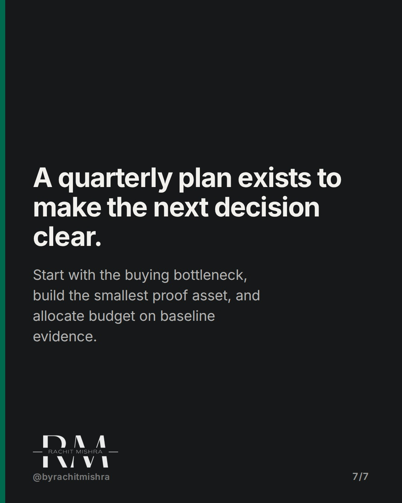

# b2b_90_day_marketing_plan

**CAROUSEL** · b2b_brand · goes live **2026-11-09T19:00:00+05:30**

> Targeting: `B2B brand strategy`
>
> Claim: A 90-day B2B marketing plan fails when structured as an activity calendar rather than a tool to resolve buyer decision friction.
>
> Proof (source): Framework for structuring quarterly B2B marketing plans around buyer decision gates and baseline metrics rather than campaign deliverables.
> Source: https://www.rachitmishra.in/2026/11/06/90-day-b2b-marketing-plan/
>
> Source preflight: reachable (HTTP 200)
>
> Rendered infographics: 5 — bottleneck, checklist, comparison, checklist, checklist

## Slides

7 rendered images sit in this folder — upload them in filename order.

**1.** 
### A 90-day plan is an expensive activity log.



**2.** THE MISTAKE
### Filling calendars before locating deal friction
Completing twelve marketing tasks while remaining unsure why buyers stall is an operational failure.



**3.** DAYS 1-30
### Audit won and lost deals for underlying friction
Review evaluation questions and procurement requests with sales before touching media spend or design.



**4.** DAYS 31-60
### Build the smallest credible intervention to test
A technical proof sheet and clear enquiry route beat a full website redesign when testing message fit.



**5.** DAYS 61-90
### Evaluate baseline data to direct the next allocation
Compare pilot results against starting metrics to determine whether to scale, revise, or stop.



**6.** APPLICATION
### Four checks to run before approving quarterly spend
Ask these questions in your quarterly planning review before signing off on deliverables.



**7.** 
### A quarterly plan exists to make the next decision clear.
Start with the buying bottleneck, build the smallest proof asset, and allocate budget on baseline evidence.



## Caption — copy from here

```
A 90-day plan is an expensive activity log.

Most B2B brand strategy reviews start with a calendar of activities instead of identifying the specific decision blocking sales.

When a team promises webinars, brochures, and trade show booths, every item can land on time while contract win rates remain untouched.

The cost of campaign-first planning is treating output as progress. Buyers rarely stall for lack of content. They stall on technical risk or procurement terms.

Full framework: https://www.rachitmishra.in/2026/11/06/90-day-b2b-marketing-plan/

Marketing calendars create busyness. Decision gates create accountability.

Send this to whoever is building your team's next quarterly plan.

[b2b brand strategy, industrial marketing, b2b branding, b2b marketing]

#b2bmarketing #industrialmarketing #brandstrategy
```

## Alt text

```
Diagram showing a 90-day B2B marketing planning process focused on buyer decision gates.
```

## How this post could fail

It could read as anti-execution advice if the distinction between goal-less activity and targeted testing is not clear.

## Sources

- [90-Day B2B Marketing Plan: Start With Decisions, Not a Campaign Calendar](https://www.rachitmishra.in/2026/11/06/90-day-b2b-marketing-plan/)
