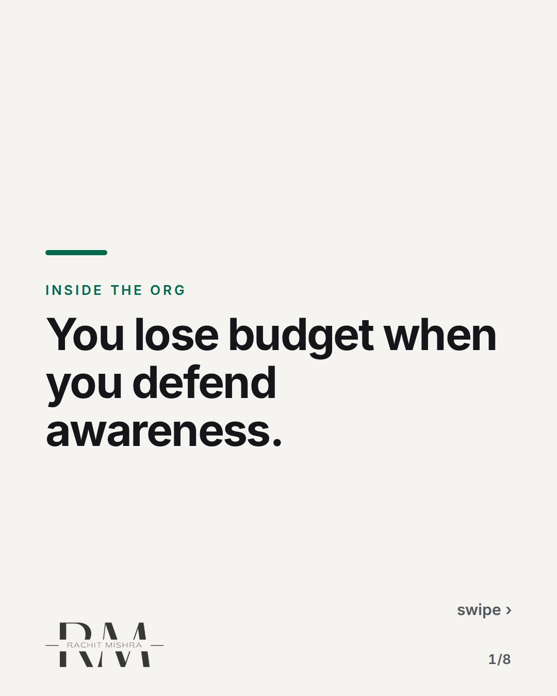
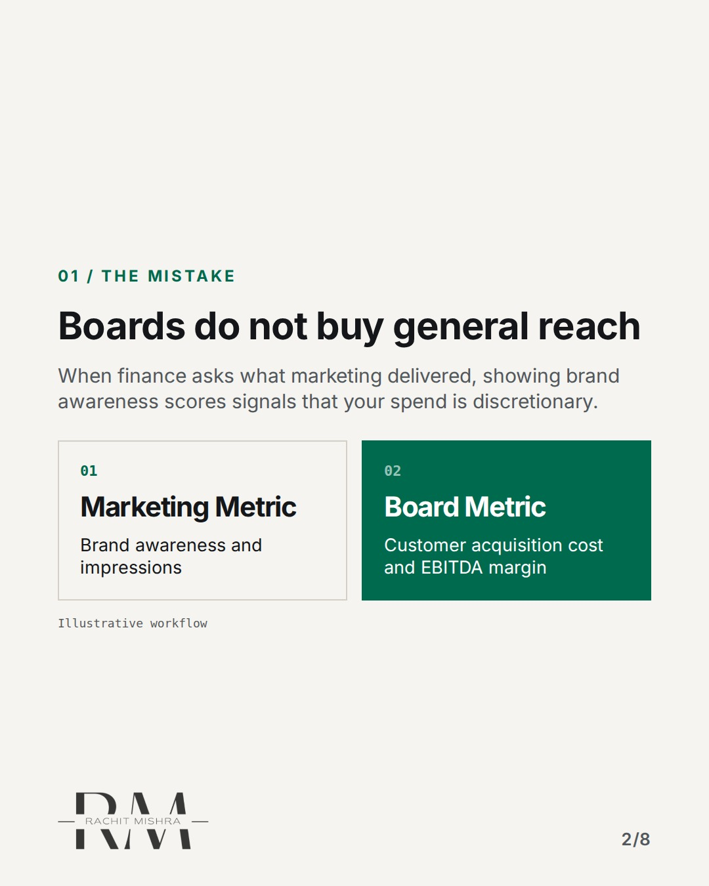
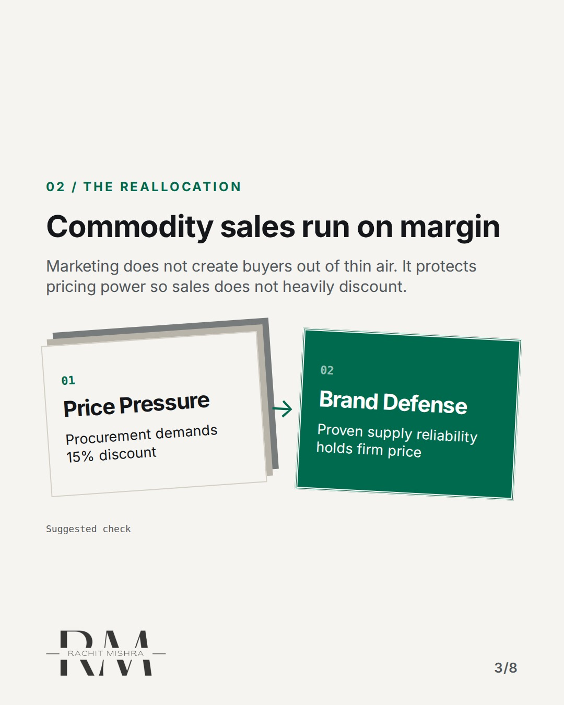
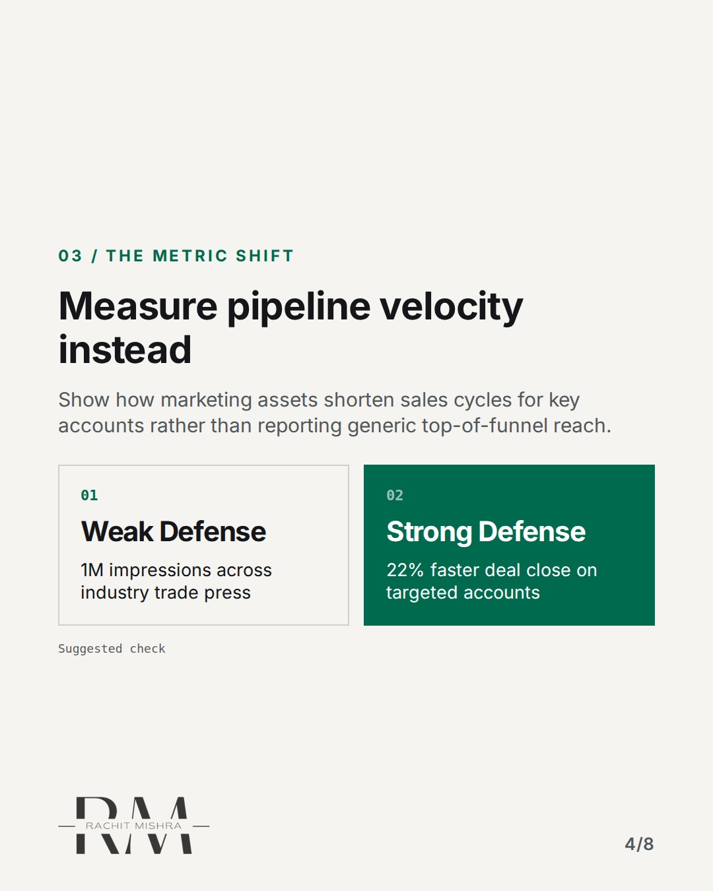
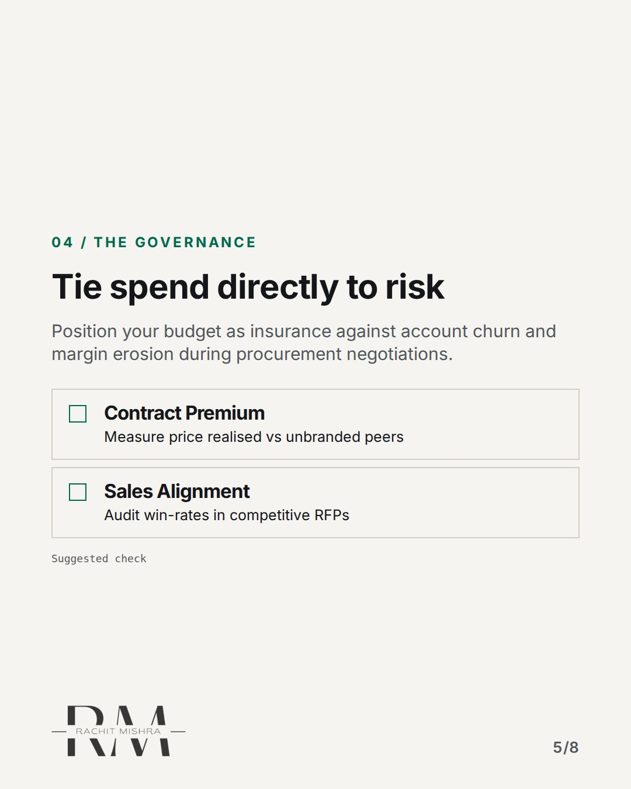
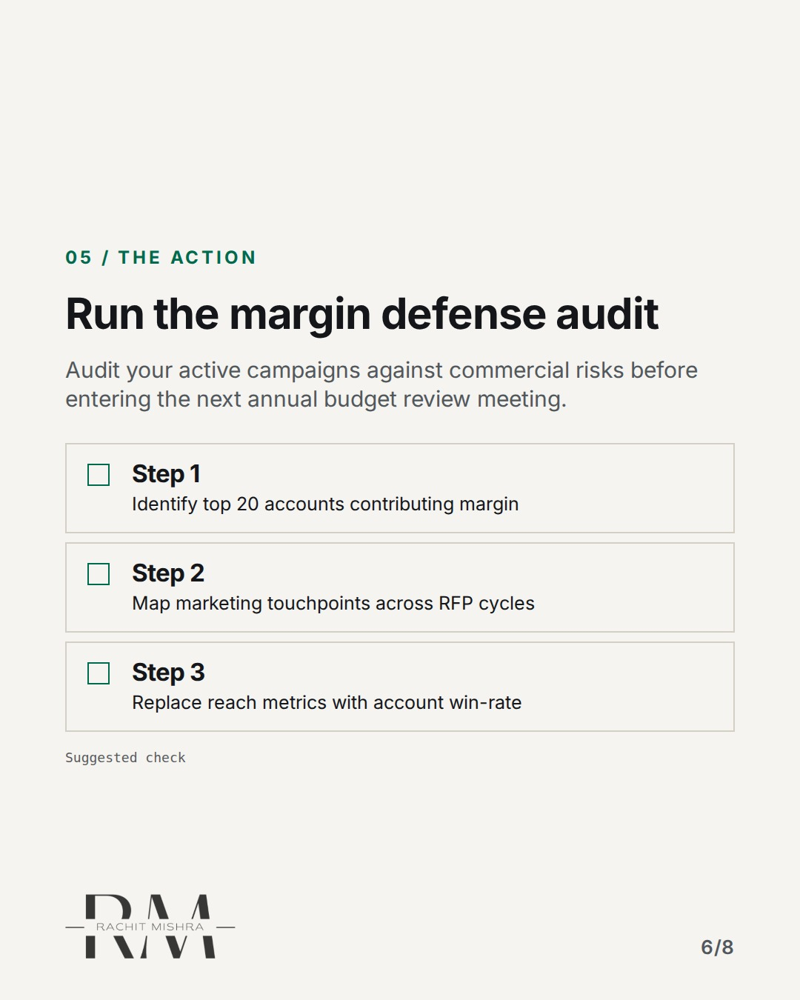
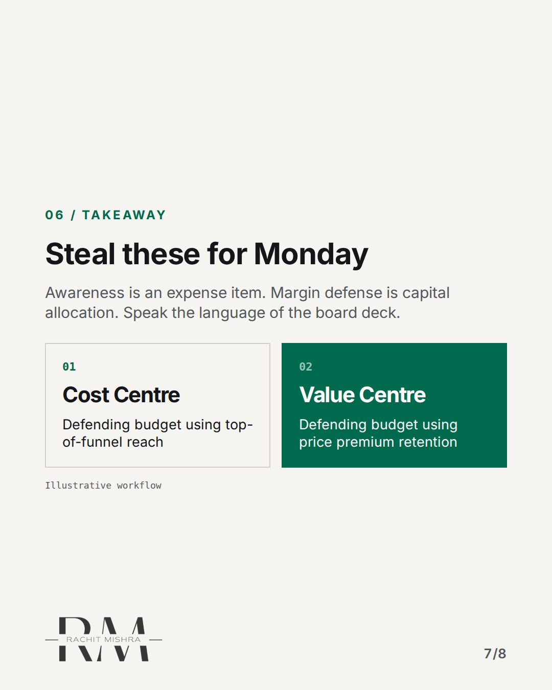
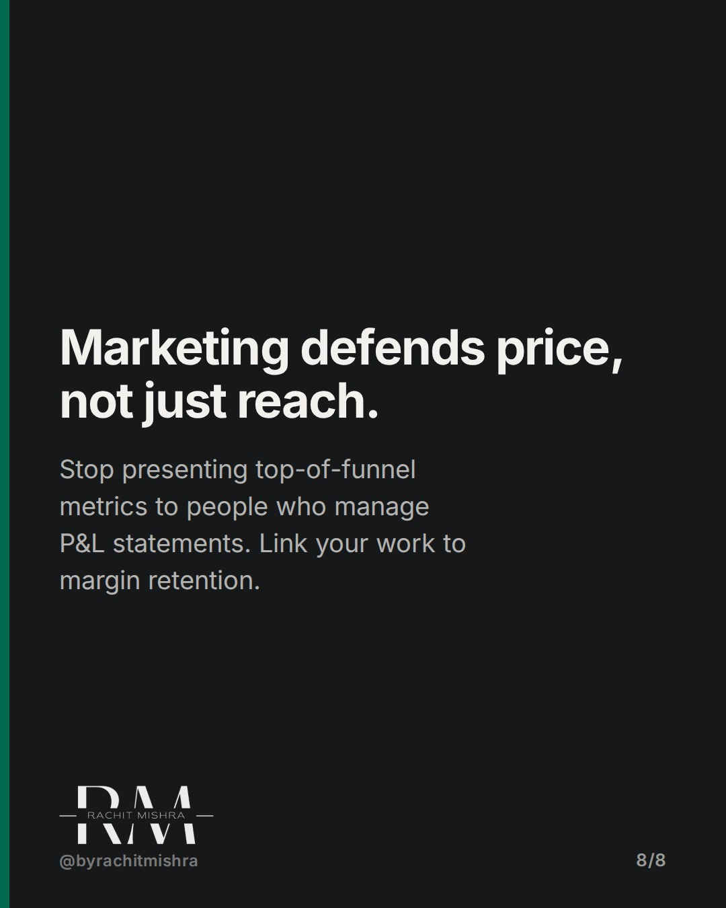

# defending_marketing_budget

**CAROUSEL** · inside_the_org · goes live **2026-11-14T10:30:00+05:30**

> Targeting: `defending a marketing budget`
>
> Claim: B2B marketing budgets get cut in downturns because teams defend awareness instead of commercial margin protection.
>
> Proof (framework): A board-level budget defense framework shifting metrics from unassigned reach to contract win-rate and margin defense.
>
> Rendered infographics: 6 — comparison, bottleneck, comparison, checklist, checklist, comparison

## Slides

8 rendered images sit in this folder — upload them in filename order.

**1.** 
### You lose budget when you defend awareness.



**2.** 01 / THE MISTAKE
### Boards do not buy general reach
When finance asks what marketing delivered, showing brand awareness scores signals that your spend is discretionary.



**3.** 02 / THE REALLOCATION
### Commodity sales run on margin
Marketing does not create buyers out of thin air. It protects pricing power so sales does not heavily discount.



**4.** 03 / THE METRIC SHIFT
### Measure pipeline velocity instead
Show how marketing assets shorten sales cycles for key accounts rather than reporting generic top-of-funnel reach.



**5.** 04 / THE GOVERNANCE
### Tie spend directly to risk
Position your budget as insurance against account churn and margin erosion during procurement negotiations.



**6.** 05 / THE ACTION
### Run the margin defense audit
Audit your active campaigns against commercial risks before entering the next annual budget review meeting.



**7.** 06 / TAKEAWAY
### Steal these for Monday
Awareness is an expense item. Margin defense is capital allocation. Speak the language of the board deck.



**8.** 
### Marketing defends price, not just reach.
Stop presenting top-of-funnel metrics to people who manage P&L statements. Link your work to margin retention.



## Caption — copy from here

```
You lose budget when you defend awareness.

Defending a marketing budget inside an industrial firm fails the moment you bring consumer metrics to a commercial board.

When finance looks to cut overhead, top-of-funnel reach looks like excess fat. If your slide deck focuses on impressions, you are inviting them to slice the line item.

In heavy industry, marketing is not there to make people feel good about the logo. It exists to protect pricing power so commercial teams do not have to give away margin during procurement negotiations.

Next time you sit in a budget review, stop talking about brand health metrics. Show how your work defends price realization in competitive tenders.

Marketing buys sales leverage. Finance understands leverage.

Send this to whoever is defending the brand budget this quarter.

[defending a marketing budget, b2b marketing, brand governance, marketing leadership]

#marketingleadership #inhousemarketing #brandgovernance
```

## Alt text

```
Slide deck explaining how to defend a B2B marketing budget using commercial margin metrics.
```

## How this post could fail

Could be misconstrued as saying brand awareness has zero value, rather than clarifying how to frame it commercially to CFOs.
