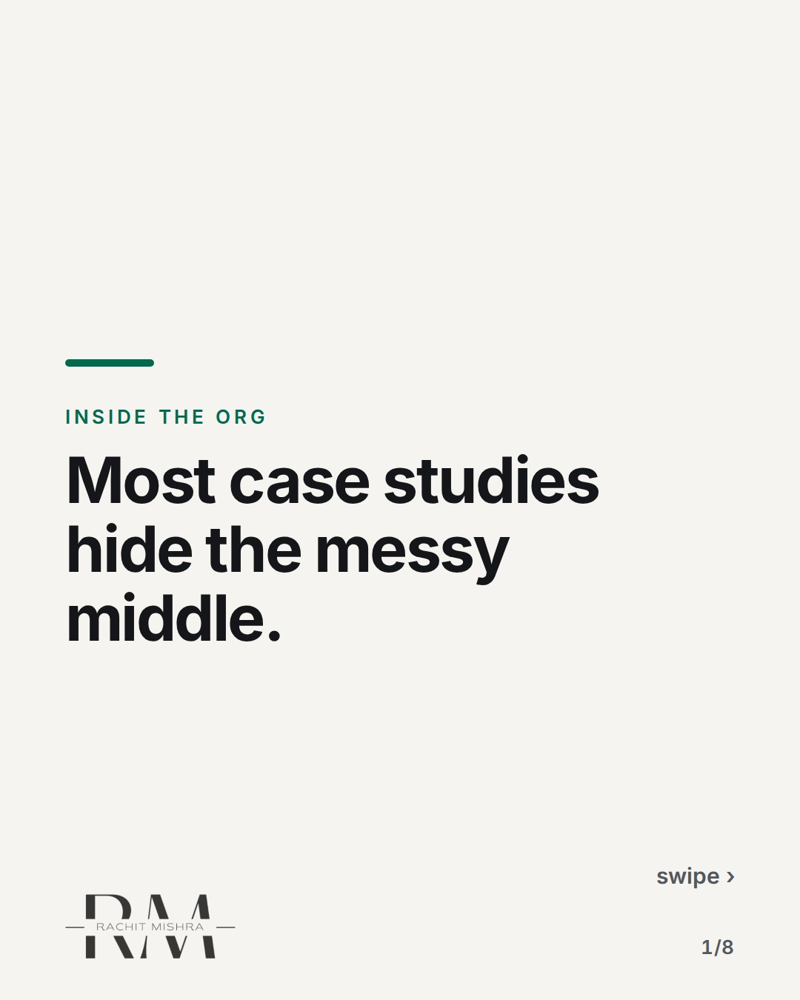
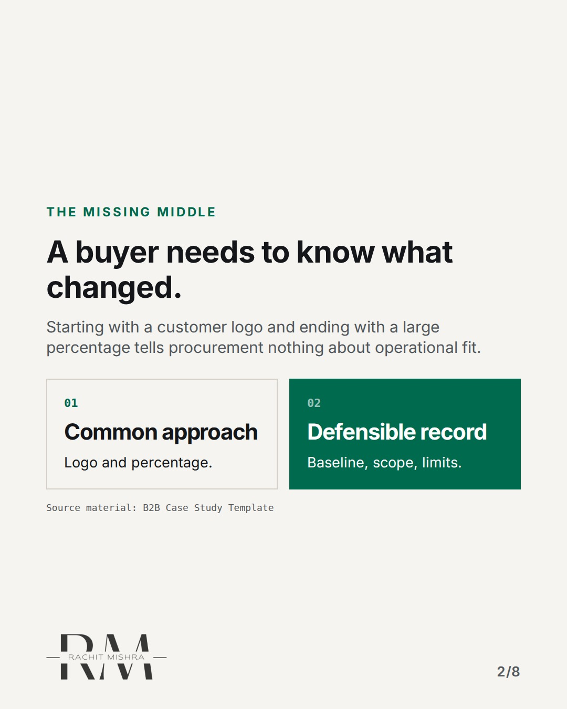
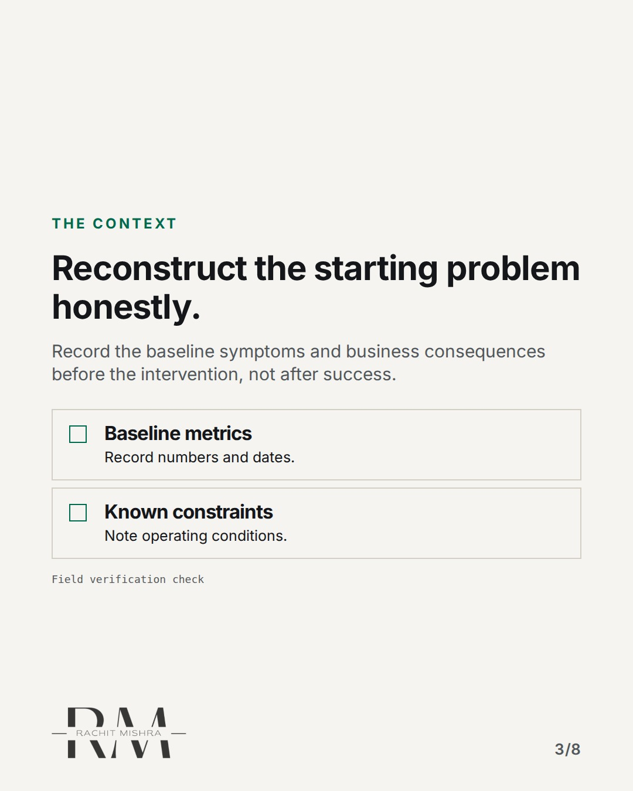
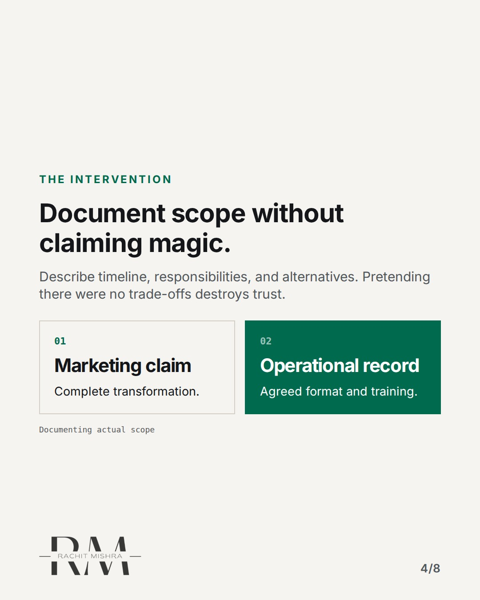
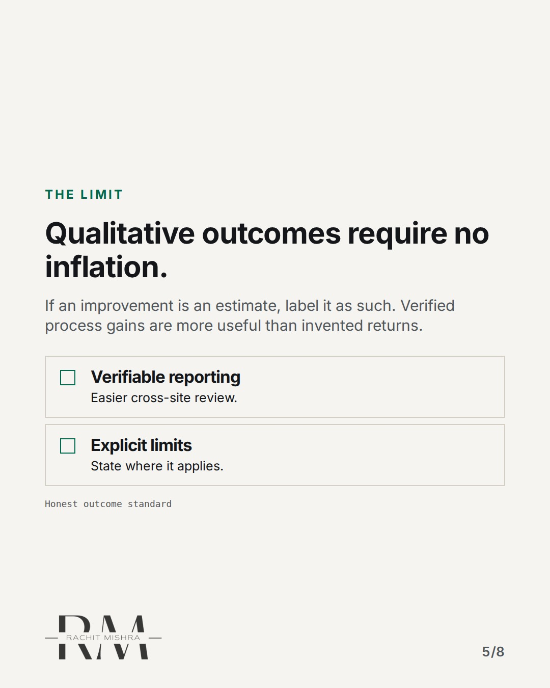
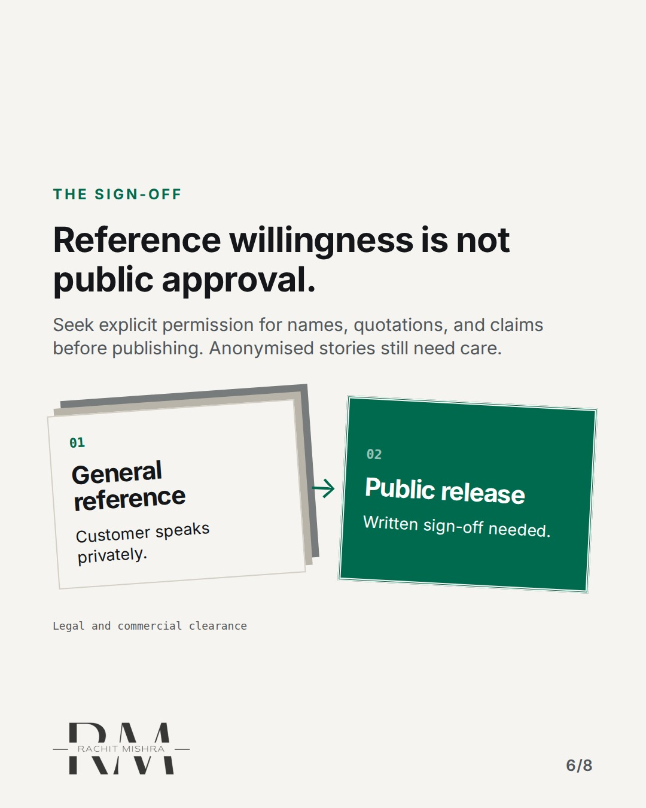
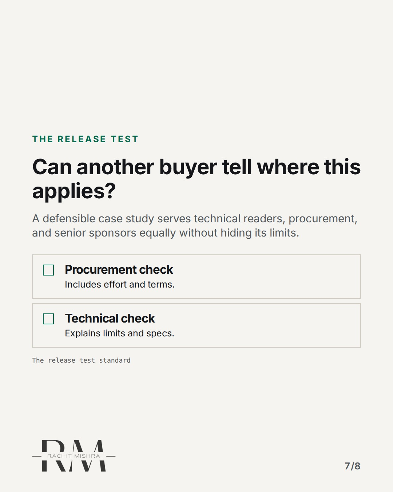
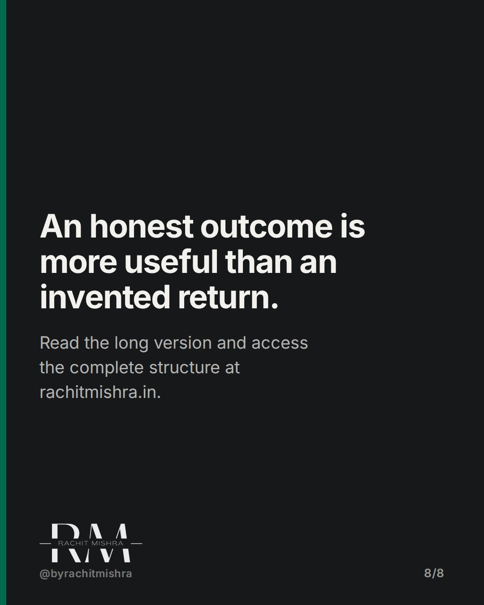

# b2b_case_study_template

**CAROUSEL** · inside_the_org · goes live **2026-11-15T10:30:00+05:30**

> Targeting: `b2b case study template`
>
> Claim: A useful case study explains the operational limit, not just the success.
>
> Proof (source): A defensible case study explains starting problems, operational interventions, measured limits, and requires explicit customer sign-off.
> Source: https://www.rachitmishra.in/2026/10/30/b2b-case-study-template/
>
> Source preflight: reachable (HTTP 200)
>
> Rendered infographics: 7 — comparison, checklist, comparison, checklist, bottleneck, checklist, comparison

## Slides

8 rendered images sit in this folder — upload them in filename order.

**1.** 
### Most case studies hide the messy middle.



**2.** The Missing Middle
### A buyer needs to know what changed.
Starting with a customer logo and ending with a large percentage tells procurement nothing about operational fit.



**3.** The Context
### Reconstruct the starting problem honestly.
Record the baseline symptoms and business consequences before the intervention, not after success.



**4.** The Intervention
### Document scope without claiming magic.
Describe timeline, responsibilities, and alternatives. Pretending there were no trade-offs destroys trust.



**5.** The Limit
### Qualitative outcomes require no inflation.
If an improvement is an estimate, label it as such. Verified process gains are more useful than invented returns.



**6.** The Sign-Off
### Reference willingness is not public approval.
Seek explicit permission for names, quotations, and claims before publishing. Anonymised stories still need care.



**7.** The Release Test
### Can another buyer tell where this applies?
A defensible case study serves technical readers, procurement, and senior sponsors equally without hiding its limits.



**8.** 
### An honest outcome is more useful than an invented return.
Read the long version and access the complete structure at rachitmishra.in.



## Caption — copy from here

```
Most case studies hide the messy middle.

Writing a useful b2b case study template means documenting operational constraints rather than chasing generic marketing praise.

When you omit the starting baseline and the intervention limits, procurement committees dismiss the claims before sales even calls.

An honest outcome is more useful than an invented return. Read the full article at https://www.rachitmishra.in/2026/10/30/b2b-case-study-template/

Send this to whoever is writing your next customer case study.

[b2b case study template, industrial marketing, procurement committee, marketing leadership, brand governance]

#b2bmarketing #inhousemarketing #brandgovernance

#b2bmarketing #inhousemarketing #brandgovernance
```

## Alt text

```
Carousel slides explaining how to build a defensible B2B case study with evidence and limits.
```

## How this post could fail

Readers might skip the operational detail if they expect high-level brand theory rather than tactical publishing standards.

## Sources

- [A defensible case study explains starting problems, operational interventions, measured limits, and requires explicit customer sign-off.](https://www.rachitmishra.in/2026/10/30/b2b-case-study-template/)
