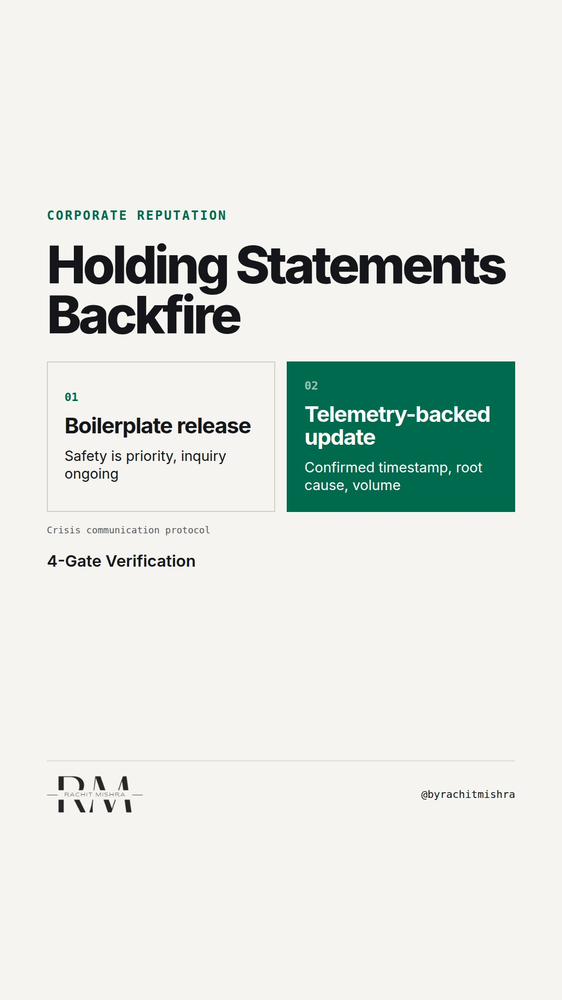

# industrial_crisis_communication_mistakes

**REEL** · reputation · goes live **2026-11-12T13:00:00+05:30**

> Targeting: `crisis communication mistakes`
>
> Claim: In B2B industrial crises, issuing boilerplate holding statements destroys customer and regulatory trust faster than operational delays.
>
> Proof (framework): A 4-gate verification checklist for B2B industrial crisis comms requiring site-level telemetry, shipment volume impact, regulatory filing status, and engineering-backed restart timelines before issuing public statements.
>
> Rendered infographics: 3 — comparison, checklist, comparison
>
> Reel assets: image `designed_gradient` · music `bed-something (11).mp3`

## Cover



## Reel script

`reel.mp4` has been generated from this script and will publish automatically. To use your own footage instead, replace that file and delete `.generated-reel` from this folder.

| Time | On screen | Voiceover | Direction |
|---|---|---|---|
| 0:00-0:05 | **A generic statement doubles crisis damage.** | A generic statement doubles crisis damage. In heavy industry, issuing holding statements before confirming engineering facts creates an immediate trust deficit. | Text graphic overlay on dark industrial background. |
| 0:05-0:12 | **Procurement checks logs, not PR.** | When an industrial asset goes down, procurement committees look at timestamped operational logs, not your press release. | Side-by-side comparison of boilerplate PR draft versus plant operational log. |
| 0:12-0:20 | **Boilerplate creates spec suspicion.** | Saying safety is your top priority while withholding technical detail makes plant managers assume the structural damage is severe. | Text card listing buyer assumptions when comms is vague. |
| 0:20-0:32 | **The 4-gate incident verification.** | Before releasing any statement during an operational crisis, run your comms draft through four hard verification gates. | Graphic overlay displaying checklist items. |
| 0:32-0:42 | **Trade off speed for accuracy.** | A three-hour delay to verify telemetry data with site engineers protects enterprise contracts far better than an instant generic quote. | Visual comparison between immediate generic release vs verified technical update. |
| 0:42-0:50 | **Fact density builds reputation.** | Fact density is the real currency of B2B corporate reputation. | Closing graphic displaying final principle text. |

## Caption — copy from here

```
A generic statement doubles crisis damage.

Most crisis communication mistakes in heavy industry start when comms issues boilerplate while plant ops checks logs.

When a boiler fails or a rail loading line halts, commercial buyers do not read press statements for emotional reassurance. They look for engineering facts, batch impact numbers, and realistic recovery windows.

Issuing generic quotes about safety being a top priority tells a procurement committee that corporate headquarters does not yet understand the operational cause.

The cost of early boilerplate is lost trust with regulators and long-term customers. Delaying a statement by three hours to verify telemetry data with site engineers protects enterprise contracts.

Fact density is what saves B2B reputation when operations fail.

Send this to the corporate communications lead reviewing your incident response playbook this quarter.

[crisis communication mistakes, corporate reputation, corporate communications, b2b crisis management, industrial reputation]

#corporatecommunications #reputation #crisiscommunication
```

## Alt text

```
Text graphic detailing a four-point B2B crisis communication checklist for industrial operations.
```

## How this post could fail

If the checklist reads as general PR advice rather than specific to heavy industrial plant operations, commercial leaders will dismiss it as communications theory.
