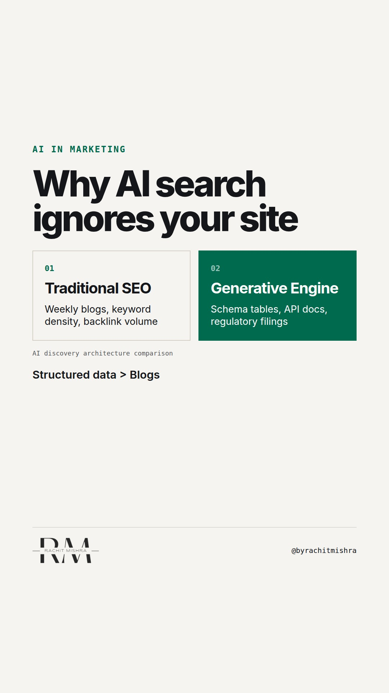

# generativeengineoptimisationb2b

**REEL** · ai_marketing · goes live **2026-11-10T19:00:00+05:30**

> Targeting: `generative engine optimisation for B2B`
>
> Claim: AI search engines index B2B brands based on structured parameter tables and third-party technical reviews, not top-of-funnel content velocity.
>
> Proof (framework): A three-point indexability test for enterprise brands assessing whether AI search engines extract structured operational specs or fall back on aggressive aggregators.
>
> Rendered infographics: 3 — comparison, checklist, bottleneck
>
> Reel assets: image `designed_gradient` · music `bed-something (10).mp3`

## Cover



## Reel script

`reel.mp4` has been generated from this script and will publish automatically. To use your own footage instead, replace that file and delete `.generated-reel` from this folder.

| Time | On screen | Voiceover | Direction |
|---|---|---|---|
| 0:00-0:03 | **ChatGPT does not care about your blog.** | ChatGPT does not care about your blog. If a procurement committee asks an AI engine to compare industrial pump suppliers, your thought leadership articles will not matter. | Dark minimalist background displaying clean typography. |
| 0:03-0:08 | **LLMs crawl structured specs, not story.** | Generative engine optimisation for B2B operates on a completely different logic than traditional search engines. | Text transition over a grey structural background. |
| 0:08-0:15 | **3 AI Search Requirements** | If you want your technical capabilities cited when buyers query generative tools, run this three-point audit on your digital assets. | Diagram layout loading on screen. |
| 0:15-0:22 | **1. Standardised schema tables** | First: convert your product datasheets into JSON-LD schema. Large language models parse raw tables far more accurately than prose. | Code highlight visually contrasting text versus JSON structure. |
| 0:22-0:29 | **2. Un-gate technical documentation** | Second: un-gate your technical manuals. Blocking technical specs behind a lead form means the model cannot read them, leaving your brand out of the answer. | Flowchart showing blocked access versus open ingestion. |
| 0:29-0:36 | **3. Audit third-party data sources** | Third: monitor industry databases. Generative models cross-reference your site with external registries to verify compliance claims. | Data nodes connecting to a central verification hub. |
| 0:36-0:42 | **AI rewards structure over volume.** | AI search rewards structured clarity over content volume. Stop writing articles for engines that read datasets. | Closing screen with clean text graphic. |

## Caption — copy from here

```
ChatGPT does not care about your blog.

When optimizing for generative engine optimisation for B2B, publishing weekly thought leadership is no longer enough. Large language models parse technical data differently than traditional web crawlers.

In heavy industry, buyers query generative systems for exact operational parameters—operating temperatures, flow rates, ISO certifications, and maintenance schedules. If that information lives inside an image-heavy PDF or behind a lead gate, the model skips your site and cites your competitor instead.

Optimising for AI engines is not a copywriting exercise. It is a data architecture problem.

If the machine cannot parse your technical specifications into clean structured key-value pairs, your brand simply does not exist in the answer.

Send this to whoever is responsible for your technical web architecture this quarter.

[generative engine optimisation for b2b, ai in enterprise marketing, b2b search strategy, martech, marketing technology stack]

#aimarketing #martech #b2bmarketing

#aimarketing #martech #b2bmarketing
```

## Alt text

```
Text graphic listing three technical checks for optimizing enterprise B2B content for AI search.
```

## How this post could fail

The post risks sounding overly technical for general brand managers if they do not manage web structure or technical documentation.
