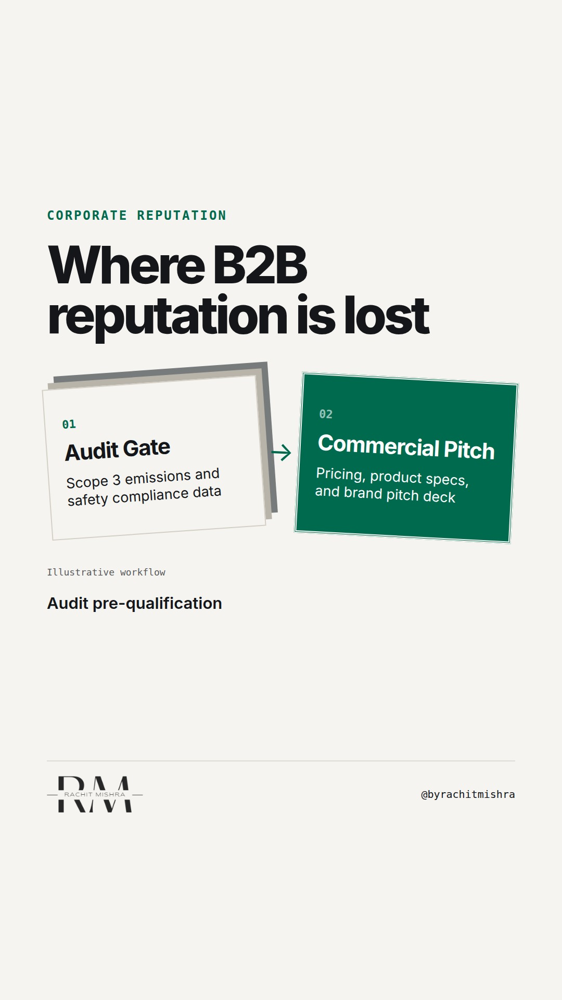

# esg_audit_gate_reputation

**REEL** · reputation · goes live **2026-11-11T08:30:00+05:30**

> Targeting: `corporate reputation management`
>
> Claim: In B2B industrial procurement, corporate reputation is tested through ESG supplier audits before marketing ever gets a pitch.
>
> Proof (practitioner_observation): Industrial buyers use standardized ESG vendor assessments (e.g., EcoVadis, ISO 14064 compliance) as mandatory qualification gates before commercial evaluations begin.
>
> Rendered infographics: 3 — bottleneck, bottleneck, checklist
>
> Reel assets: image `designed_gradient` · music `bed-something (12).mp3`

## Cover



## Reel script

`reel.mp4` has been generated from this script and will publish automatically. To use your own footage instead, replace that file and delete `.generated-reel` from this folder.

| Time | On screen | Voiceover | Direction |
|---|---|---|---|
| 0:00-0:03 | **Your reputation is decided in procurement.** | Your reputation is decided in procurement, long before your sales team presents a slide deck. | Text overlay on clean background showing an industrial procurement gate icon. |
| 0:03-0:08 | **Buyers read ads. Procurement audits risk.** | Most B2B brand advice assumes you are selling to a decision-maker who watches your campaign. | Split graphic contrasting consumer advertising with corporate procurement audit software. |
| 0:08-0:14 | **Audit scorecards drop non-compliant vendors.** | In heavy industry, corporate reputation management lives in vendor risk assessment forms. | Diagram of audit gate blocking commercial entry. |
| 0:14-0:20 | **Safety and emissions data beat brand slogans.** | If your Scope 3 emissions reporting or plant safety track record fails the preliminary check, you do not get to bid. | Checklist showing technical compliance parameters. |
| 0:20-0:26 | **Four-point vendor reputation audit** | Here is the four-point checklist to audit your corporate reputation before your buyers do. | Full checklist graphic for screenshotting. |
| 0:26-0:30 | **Reputation is operational proof, not messaging.** | Reputation is not what you say in an ad. It is the operational proof you submit to stay on the approved vendor list. | Text overlay with key takeaway phrase. |

## Caption — copy from here

```
Your reputation is decided in procurement.

Effective corporate reputation management in industrial markets rarely starts with a PR campaign. It starts in the vendor onboarding portal.

Before a procurement committee opens your proposal, they run your governance, safety, and environmental data through a risk matrix. If your metrics fall outside their threshold, the bid ends there.

Brand building in consumer markets creates desire. Brand building in heavy industry removes administrative reason to reject you.

If your comms team cannot speak to your safety record or carbon reporting, you are working on decoration while the real reputation decision happens in legal and risk.

Send this to whoever is defending the corporate communications budget this quarter.

[corporate reputation management, corporate communications, b2b reputation, industrial marketing, supplier risk]

#corporatecommunications #reputation #publicrelations
```

## Alt text

```
Text graphic listing four procurement ESG audit checks for industrial corporate reputation.
```

## How this post could fail

Could be read as reducing corporate reputation purely to compliance documentation rather than broader stakeholder trust.
