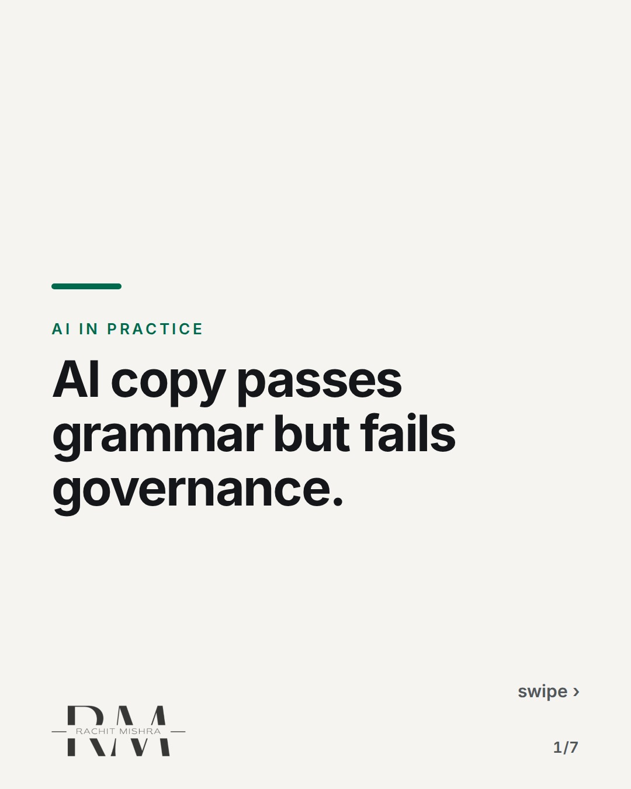
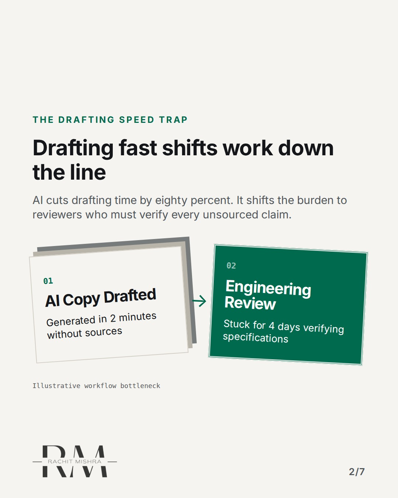
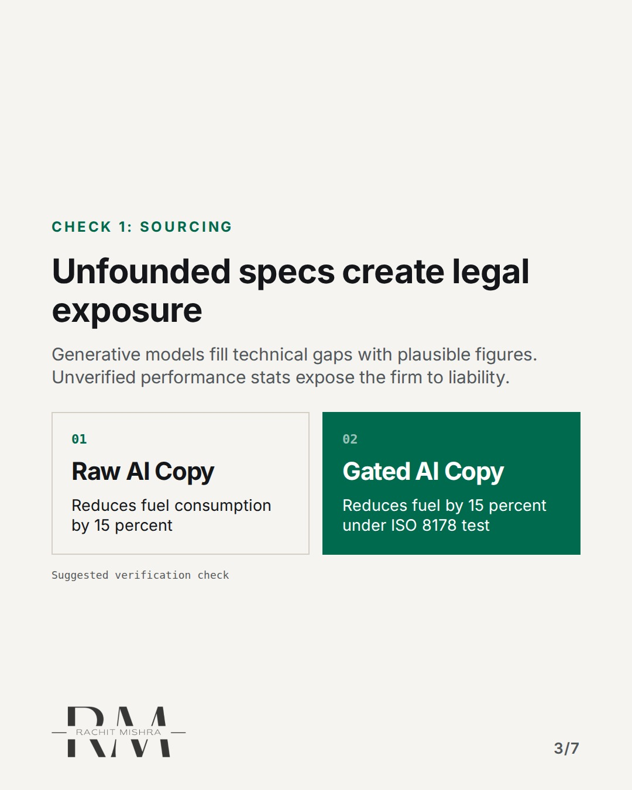
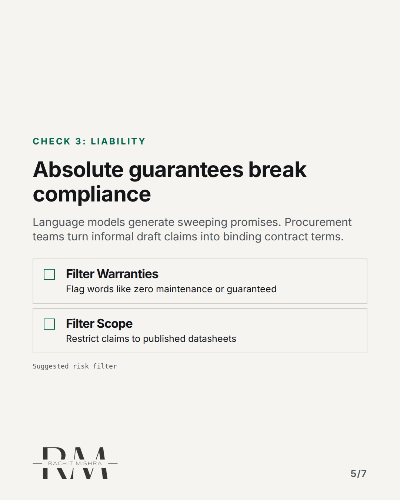
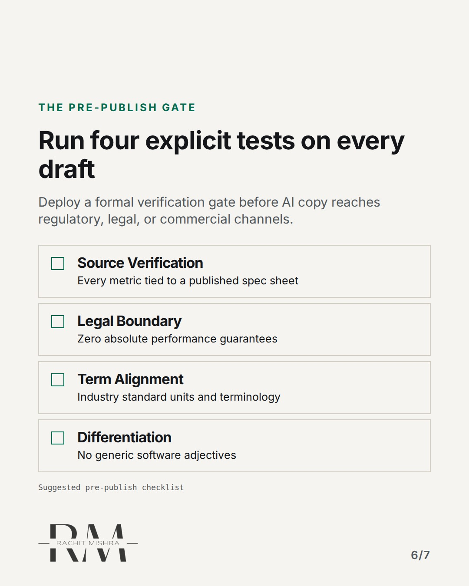
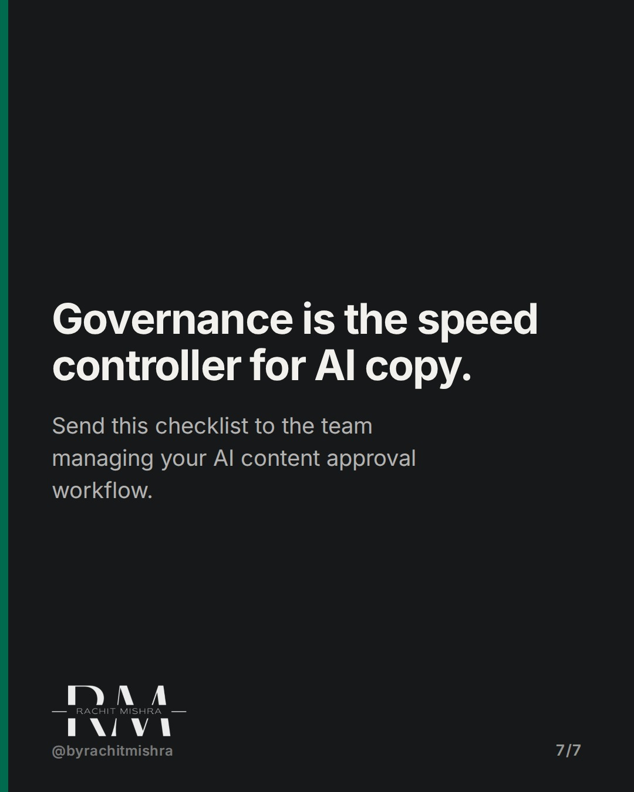

# aicopyapprovalchecks

**CAROUSEL** · ai_in_practice · goes live **2026-11-11T20:00:00+05:30**

> Targeting: `checks before AI copy goes live`
>
> Claim: Deploying generative AI copy in B2B requires explicit technical, liability, and positioning checks beyond simple grammar scanning.
>
> Proof (framework): A 4-point verification checklist for industrial marketing teams running AI drafting workflows to prevent regulatory, technical, and liability errors.
>
> Rendered infographics: 5 — bottleneck, comparison, comparison, checklist, checklist

## Slides

7 rendered images sit in this folder — upload them in filename order.

**1.** 
### AI copy passes grammar but fails governance.



**2.** The drafting speed trap
### Drafting fast shifts work down the line
AI cuts drafting time by eighty percent. It shifts the burden to reviewers who must verify every unsourced claim.



**3.** Check 1: Sourcing
### Unfounded specs create legal exposure
Generative models fill technical gaps with plausible figures. Unverified performance stats expose the firm to liability.



**4.** Check 2: Positioning
### Generic claims erode pricing power
AI defaults to consumer buzzwords. Commodity language erodes B2B differentiation in technical proposals.


**5.** Check 3: Liability
### Absolute guarantees break compliance
Language models generate sweeping promises. Procurement teams turn informal draft claims into binding contract terms.



**6.** The Pre-Publish Gate
### Run four explicit tests on every draft
Deploy a formal verification gate before AI copy reaches regulatory, legal, or commercial channels.



**7.** 
### Governance is the speed controller for AI copy.
Send this checklist to the team managing your AI content approval workflow.



## Caption — copy from here

```
AI copy passes grammar but fails governance.

Setting clear checks before AI copy goes live prevents legal rewrites. Generative tools draft fast, but in heavy industry, an unbacked metric in a bid document can derail a contract.

The bottleneck moves from drafting to compliance. The risk is rarely spelling; it is unverified claims and consumer buzzwords creeping into engineering collateral.

Build a four-point gate: source every figure, strip absolute warranties, enforce technical units, and remove consumer adjectives.

Speed without governance is just liability produced faster.

Send this to the team managing your AI content approval workflow.

[checks before AI copy goes live, ai content approval workflow, ai governance, b2b marketing, martech]

#aimarketing #martech #aigovernance
```

## Alt text

```
Carousel detailing a four-point AI copy verification checklist for B2B and industrial marketing.
```

## How this post could fail

Readers might assume basic grammar checking tools are sufficient if they do not manage high-stakes technical or regulatory B2B documentation.
