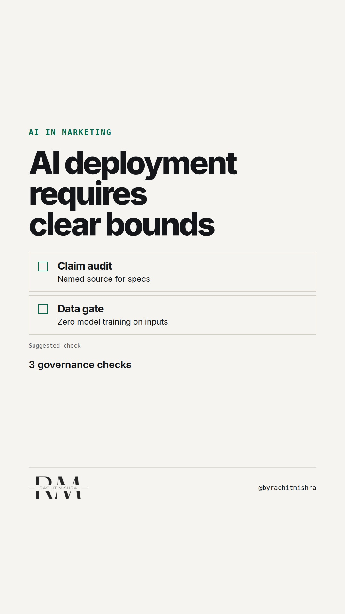

# ai_governance_redline_checklist

**REEL** · ai_marketing · goes live **2026-11-20T08:30:00+05:30**

> Targeting: `what AI cannot do in marketing`
>
> Claim: Enterprise AI adoption fails in governed industries because teams deploy tools before defining non-negotiable redlines for regulatory and brand protection.
>
> Proof (framework): A 3-part operational boundary test for evaluating LLM deployment in regulated B2B marketing workflows: regulatory claim verification, liability assignment, and technical parameter verification.
>
> Rendered infographics: 4 — checklist, checklist, checklist, checklist
>
> Reel assets: image `designed_gradient` · music `bed-something (13).mp3`

## Cover



## Reel script

`reel.mp4` has been generated from this script and will publish automatically. To use your own footage instead, replace that file and delete `.generated-reel` from this folder.

| Time | On screen | Voiceover | Direction |
|---|---|---|---|
| 0:00-0:03 | **Deploying AI without redlines is a liability.** | Deploying AI without redlines is a liability. Most B2B marketing teams focus on tool speed, but legal and compliance focus on exposed risk. |  |
| 0:03-0:07 | **Speed without boundaries creates risk.** | Understanding what AI cannot do in marketing starts with defining hard operational boundaries before software reaches your team. |  |
| 0:07-0:12 | **Pass condition: Zero auto-published text.** | First, demand explicit evidence. Every factual claim, performance metric, or compliance specification requires mandatory human review before publication. |  |
| 0:12-0:17 | **Pass condition: Clear liability ownership.** | Second, assign accountability. If output violates regulatory standards or commercial terms, an internal owner must hold explicit approval signoff. |  |
| 0:17-0:22 | **Pass condition: Data protection verified.** | Third, verify data isolation. Ensure customer data and proprietary engineering files are never used to train external foundation models. |  |
| 0:22-0:26 | **Governance is an operating framework.** | AI governance is an operating boundary, not a software feature. |  |

## Caption — copy from here

```
Deploying AI without redlines is a liability.

When evaluating what AI cannot do in marketing, large industrial organisations rarely fail due to technology limits. They fail because comms and legal teams argue over output after it reaches executive review.

Generative tools accelerate text generation, but they do not assume legal liability for unverified claims, regulatory non-compliance, or leaked operational data.

If your marketing tech stack allows unvalidated technical claims to move directly from an LLM prompt to a customer document, your governance is broken.

True integration requires hard boundaries: mandatory source verification, named human accountability for regulatory claims, and strict data isolation guarantees.

Governance is an operating boundary, not a software feature.

Send this to whoever is setting your marketing technology guardrails this quarter.

[ai in marketing, what ai cannot do in marketing, ai governance, martech stack, enterprise marketing]

#aimarketing #martech #marketingtechnology

#aimarketing #martech #marketingtechnology
```

## Alt text

```
Text listing three enterprise AI governance checks: claim audits, human signoff, and data privacy.
```

## How this post could fail

It risks reading like generic compliance advice if the checklist items are not applied directly to B2B marketing collateral review.
